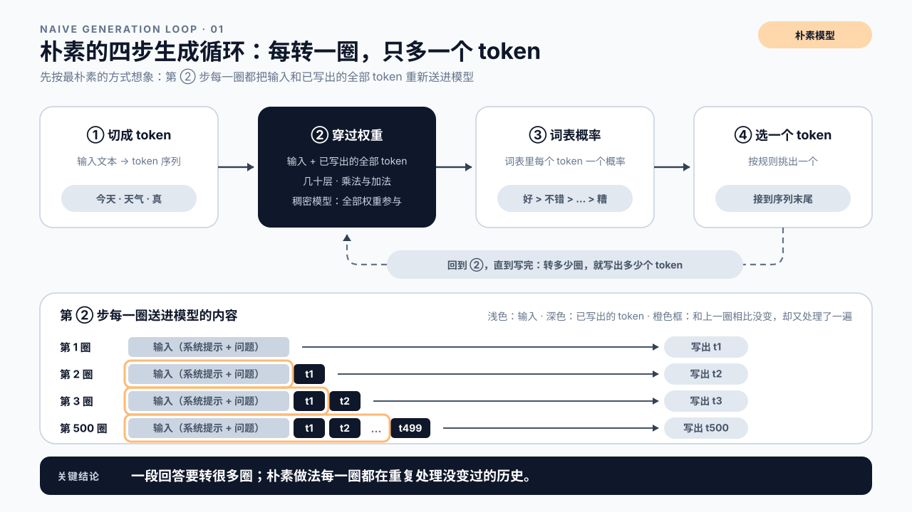
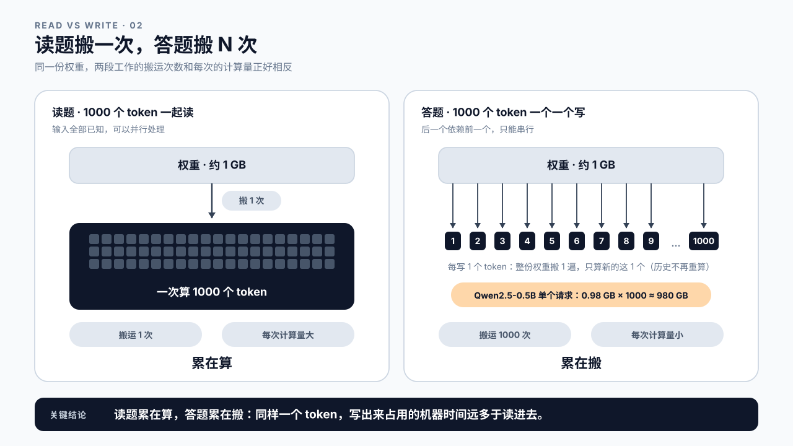
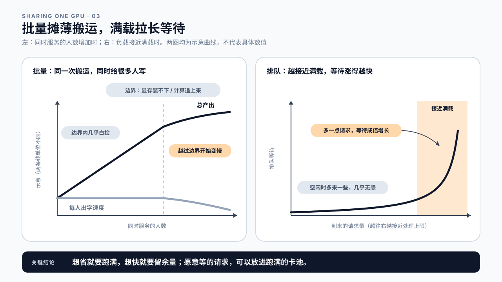

# 第 0 章 推理性能的三条规律：延迟、成本和质量为什么总在互相拉扯

一个大模型训练完成之后，真正的开销才开始。它要在线上接住一条条请求，在几百毫秒里给出回答，而且每一次都得算得起账。这本书从头到尾讲的都是这一段。

做这件事的人很快会撞上同一件事：快、省、好，三样很难同时拿到。想让回答出得更快，往往要么多花钱，要么让模型小一点、回答短一点；想把卡用得更满、把成本压下去，等待又会变长。这些拉扯看上去一事一议，底下起作用的其实只有少数几条机制。

最要紧的是三条：模型写出一个 token 和读进一个 token，代价差了一个量级；一张卡越接近满载，等待涨得越不成比例；机器忙不忙，和它交付了多少有用的东西，是两回事。三条都能用几行能手算的式子讲清楚，不必启动服务，也不必写代码。后面三十章的技术选择，大半是在这三条上做文章。

不先读也不耽误往下走，各章都能单独看。只是遇到“为什么偏偏是这样”的时候，答案多半在这几页里。

## 0.1 价目表上有三个说不通的差价

设想你的产品接入大模型刚满一周，调的是 API 还是自己部署的服务都一样，三个人先后来找你。用户说回答出得太慢；财务说这个月的账单超了预算；产品经理说回答质量不能再往下掉，已经有人投诉答非所问。三个人要的分别是快、省、好，也就是延迟、成本和质量，而你很快会发现，这三件事总是按下葫芦浮起瓢。

要弄清楚为什么，先从最容易拿到手的那张账单看起。账单上的计量单位既不是请求数，也不是字数，而是 token。

> **token**：模型读写文本的最小单位，可能是一个字、一个词的一部分或一个标点，切法由模型的词表决定，所以 token 数和字数对不上。
> API 按它计价，性能按它计量，上下文长度按它设限，本书几乎每个数字的分母里都有它。

账单背后发生的事情叫推理：模型训练完成之后，在线上接收请求、生成回答的过程。这本书要优化的就是它，让它更快、更稳、更省，同时不让回答变差。

推理的钱和训练的钱，花法不同。单次训练花完就结束，模型换代时再花一次，但不随用户的调用增长；推理的费用却跟着每一次调用累积。2023 年，Alphabet 董事长约翰·亨尼西（John Hennessy）对路透社估计，和大模型对话一次的成本，大约是一次普通关键词搜索的 10 倍（路透社 2023 年 2 月 22 日报道 For tech giants, AI like Bing and Bard poses billion-dollar search problem）。所以推理上省下的每一个百分点，都会在每一次调用上重复兑现。

硬件确实越来越快、单价也越来越低，但省下来的往往很快被新用法吃掉：推理型模型会先“思考”再作答，这部分内容你未必看得到，却按输出 token 计费；Agent 完成一个任务要调几十次模型（第 24 章）。写得越多，这笔账越要紧。

把一家主流模型 API 的价目表摊开，会看到三个不太好解释的差价。下面这三行取自 Anthropic 公布的[价目表](https://platform.claude.com/docs/en/about-claude/pricing)，2026 年 9 月 24 日查询，表内当时列出 18 个模型：

| 价目表上的差价 | 查到的幅度 |
|---|---|
| 输出 token 比输入 token 贵 | 输出单价恰好是输入的 5 倍，18 个模型无一例外 |
| 愿意等的请求更便宜（批处理接口） | 五折 |
| 命中缓存的输入比未命中的便宜 | 多数模型是未命中价格的十分之一，最深的到四十分之一 |

同一张表上还有一条方向相反的价格，它是第三个差价的代价：把内容写进缓存本身要加价，5 分钟有效期的写入是输入单价的 1.25 倍，1 小时的是 2 倍。所以缓存不是无条件便宜，这条代价在 0.3 还会再提一次。

别家的幅度不一样，有的厂商还按时段打折，本章没有逐家核对。价格是商业决定，不是成本的精确换算，数字也会变。但三个差价的方向并不随意，在机器里都有对应的成本结构。自己部署时，账单从按 token 变成按卡时，这些结构不变，只是全落在了你自己的卡上。

反过来，用 API 也不等于性能就是平台的事。平台替你管卡，账单和等待却有一大半由调用方决定：输入写多长、让模型写多长、一个任务调几次、重复的内容能不能复用，这几件都在你手里。本章后面那两个例子，把输入砍掉一半和让模型先解释再作答，改的都是调用方这一侧。

换成三个问题来问：同样是一个 token，为什么写出来比读进去贵？为什么肯多等一会儿，就能便宜一半？为什么重复发送的内容便宜得多，而第一次发送反而要加价？要回答它们，得先看清楚模型是怎样写出一段回答的。

## 0.2 模型是一摞参数，回答是一个循环

打开第 1 章要用的 Qwen2.5-0.5B-Instruct 的模型仓库，一个模型由什么组成就摆在眼前：

| 文件 | 装的是什么 | 大小 |
|---|---|---|
| `config.json` | 结构说明：24 层，每层多宽，词表多大 | 不到 1 KB |
| `tokenizer.json`、`vocab.json` 等 | 词表：把文字切成约 15 万种 token 的规则 | 几 MB |
| `model.safetensors` | 权重 | 约 988 MB |

还有一样东西不在仓库里：把这些文件读进来、真正执行计算的程序，第 1 章用的是 vLLM。一个能跑的模型，是结构、权重和执行代码三样凑在一起。权重是其中最大的一块，语法、事实和推理能力都编码在这些数字的取值里，讲性能时先盯住它。

> **参数（权重）**：模型里由训练确定下来的数字。训练调整它们，推理只读取它们，推理过程中它们保持不变。
> 本书行文里“参数”和“权重”指同一样东西。

它为什么是 988 MB，可以亲手算一次。这个模型约有 4.9 亿个参数，按 16 位浮点存储（配置里写的是 bfloat16），每个数占 2 字节：

```text
0.49 × 10⁹ × 2 字节 ≈ 0.98 GB，约 1 GB
```

和仓库里的权重文件对得上。请拿计算器算一遍，这个“约 1 GB”后面会反复用到。过去几年，这摞数字变厚得很快：

| 年份 | 模型 | 总参数 | 每写一个 token 实际用到的参数 |
|---|---|---|---|
| 2018 | GPT-1 | 1.17 亿 | 1.17 亿 |
| 2020 | GPT-3 | 1750 亿 | 1750 亿 |
| 2024 | DeepSeek-V3 | 6710 亿 | 约 370 亿 |

前两行是稠密模型，每写一个 token，所有参数都要参与。第三行是一个 MoE 模型。

> **MoE**（Mixture of Experts，混合专家）：把模型的一部分拆成许多“专家”，每个 token 只交给其中少数几个处理的结构。
> 它让“总参数”和“每一步真正要动的参数”脱钩，但所有专家通常仍要装进显存；批量一大，同一步里各个 token 选中的专家各不相同，要搬的就从激活的那部分逐渐接近全部。细节在附录 D。

对稠密模型，“越大越强”和“越大越贵”是同一件事的两面；MoE 把这两面拆开了一部分。本章后面说“每写一个 token 要把权重搬一遍”时，默认指稠密模型。

这摞数字怎样写出一段回答？先用最朴素的方式想象：

```text
① 把输入切成 token 序列
② 让整段序列（输入 + 已经写出的全部 token）穿过那摞权重：几十层，每层主要是乘法和加法
③ 在末端得到词表里每个 token 的概率
④ 选出一个 token，接到序列末尾，回到 ②
```



图0-1：朴素的四步生成循环。

这个循环每转一圈，只多出一个 token。一段 500 个 token 的回答要转 500 圈，对稠密模型，每一圈那约 1 GB 的权重都要完整参与一遍。用户感受到的“一次回答”，在机器里是几百步。

再看一眼第 ② 步，这个循环有一处明显的浪费：每写一个 token，都要把前面那些一个字没变的内容重新处理一遍。第 300 圈和第 299 圈相比，序列只多了最后一个 token，前面的部分却要从头再算。真实系统怎样绕开它，下一节先说结论，机制在第 3 章。

## 0.3 读题可以一起读，答题只能一个一个写

同样是一个 token，为什么写出来比读进去贵？答案藏在训练和推理的一个不对称里。早些年的循环神经网络只能一个词接一个词地读，2017 年的 Transformer 改变了这一点：训练时整段文本已经在手，每个位置可以同时计算，上一节那张参数表才涨得那么快。

但这份并行有一个前提：文本已经在手。推理时，模型要做两段不同的工作。先读题：用户发来的输入全部已知，可以像训练时一样一次并行读完。再答题：第 n+1 个 token 要等第 n 个写出来，才知道该写什么，只能一个一个来。

**让模型训得大的那种并行，对写新 token 帮不上忙。** 这是推理和训练最根本的不对称。这两段工作在第 2 章有正式的名字，第 3 章讲它们在模型内部为什么是这个样子；第 18 章的先猜后验证能一次多产出几个 token，但同样绕不开“后一个依赖前一个”。

读和写的代价差在哪里，要先知道一件事：权重一直放在显存里，但 GPU 里负责计算的部分和显存是分开的，每用一次，都得把数据从显存读过去，而读的速度有上限。本章把这件事叫“搬”。

另外，上一节朴素循环里的浪费，真实系统已经绕开了：处理过的历史存下来，不再重算，每一圈只为新写的那一个 token 计算。按这种做法比较读和写：

```text
读 1000 个 token 的题   权重搬 1 次，这一次里算很多
写 1000 个 token 的答   权重搬 1000 次，每次只算新的一个 token
```

以 Qwen2.5-0.5B 为例，单独服务一个请求时，写 1000 个 token，光权重就要搬约 980 GB 的数据。

“算很多”和“只算一个”也可以放进同一个单位里比。每个参数每处理一个 token，大约做一次乘法、一次加法，也就是 2 次运算。粗算一下：

```text
                 搬运             运算              每搬 1 字节算几次
读 1000 个 token  约 1 GB 权重     约 1000 GFLOP     约 1000
写 1 个 token     约 1 GB 权重     约 1 GFLOP        约 1
```

一张数据中心 GPU 每从显存搬进 1 字节，同一时间能做一两百到几百次运算。读题时每个字节有上千次运算等着做，卡在算上；答题时每个字节只有一次，计算单元大部分时间在等数据搬过来。**读题累在算，答题累在搬。** 这个“每搬 1 字节算几次”的比值叫算术强度，第 11 章会把它算准，那里还要把搬运中间结果的字节也算进去。

答题只能一个一个写，每写一个都要把权重搬一遍，所以写比读贵；算过的历史存下来，就不必重算。这是本章的第一条规律。



图0-2：读题搬一次，答题搬 N 次。

第 1 章会跑出一份真实记录，可以先看一眼。那次请求读了 30 个 token、写了 256 个 token：客户端 29.64 ms 就收到第一段正文，读题连同写出第一个 token 都在这段时间里；写完剩下的内容又用了约 2.3 秒，正文平均每 9.15 ms 到一段。读 30 个 token 连同写出第一个 token，加起来也就是写三段多一点的时间（29.64 ÷ 9.15 ≈ 3.2）。按 token 算差距更明显：每读一个 token 不到 1 ms（29.64 ÷ 30），写一个约 9.15 ms，至少贵 9 倍。那台主机上的 GPU 是 NVIDIA GB10，每秒最多从内存读出 273 GB（NVIDIA 公布的 GB10 规格，2026 年 10 月查询），搬一遍约 0.98 GB 的权重至少要 3.6 ms；实测 9.15 ms 约是这条下限的 2.5 倍，多出来的时间去了哪里，是第 15 章的问题。这次的题很短，题长了读题也会变慢（第 11 章）；这也只是客户端观测，一段正文不严格等于一个 token，首段里还含着网络（第 5 章讲这些边界）。

第一条规律回答了价目表上的第一个差价：同样是一个 token，写出来占用的机器时间远多于读进去。“每写一个 token 搬一遍权重”这句话，到第 15 章会变成一条式子，算出一张卡上写一个 token 最快要多久。

第一条规律的后半句，回答了价目表上的第三个差价。一段系统提示词如果每次请求都原样发送，服务方把第一次算出的结果留着，后面的请求直接接着用，这部分几乎不再占用计算，命中缓存的输入因此便宜得多。留着这份结果要占显存，所以第一次写入才要加价，而且缓存到期就作废。所以要命中得够多，省下的计算才补得回那笔加价。这条界线算得出来：设命中率为 h，命中的那部分按十分之一计价，没命中的那部分要按 1.25 倍重写一次缓存，平均输入单价是 `h × 0.1 + (1 − h) × 1.25`，要它低于不开缓存的 1，h 得超过约 22%。命中率由什么决定、为什么多副本会把它削掉，第 13 章讲。

这条规律有一个很实际的用处。设想一个客服助手平均每次输入 2000 个 token、回答 400 个（合成设定），用户嫌慢，团队把检索回来的资料砍掉一半，输入降到 1000。上线后第一个字确实出得快了一点，整段回答的等待却几乎没变：输入减半省下的只是读题那一段，400 个 token 的回答还是要一个一个写，写的循环一圈都没少。

开头那位用户说回答出得太慢，这句话至少可能指两件事：迟迟看不到第一个字，或者字出得慢。前一件主要看读题，以及请求在前面等了多久；后一件主要看答题。两件事的修法不同，第 1 章会把这两个数分开测出来，第 5 章给它们正式的名字。

## 0.4 一张卡同时服务很多人：批量摊薄搬运，满载拉长等待

到这里说的都是一个请求，可一张 GPU 很少只服务一个人。

顺着上一节推下去：既然每写一个 token 都要搬一遍权重，那就让同一次搬运同时给几十个人各写一个 token，搬运量几乎没变，产出却翻了几十倍。把多个请求放进同一步一起算，叫批量。在一定范围内，每个人的出字速度几乎不受影响，这在性能工程里很少见，几乎是白捡的。

白捡有边界。每个人读过、写过的内容都要占一份显存，人多了装不下；人再多，计算量也会追上来，再加人就真的变慢。边界在哪里，第 15、16 章会算。

不过，批量并没有抹平读和写的差距。读题时，一次搬运摊给题里成百上千个 token；答题时，一次搬运只摊给批里的几十个人。而且各人的历史各搬各的，这一部分搬运摊不薄（第 3 章会算出这个模型每个 token 的历史占 12 KiB）；上下文一长、同时服务的人一多，它还会反过来超过权重。所以同一张卡一秒钟能读进的 token，仍然远多于它能写出的 token。价目表上的输出溢价，对应的就是这个差距。

既然批量让卡这么划算，人人都想把卡用满。这里说的满载，是到来的请求量接近这张卡能处理的上限，不是监控面板上的 GPU 利用率。问题出在排队上：越接近满载，新来的请求越可能要等，而且等待不是均匀上涨的。

请求是随机到来的。卡还空的时候，偶尔来一阵密集请求，很快就消化掉了；接近满载时，同样一阵请求会堆出一段队伍，而用来消化它的余量又很小，队伍要很久才散得掉。所以空闲时多来一些请求几乎无感，接近满载时再多一点，等待就可能成倍增长。银行柜台、收费站都是这样。

“接近满载”可以写成一个数。负载率 ρ 等于请求到来的速度除以这张卡满载时完成请求的速度。最简单的排队模型里，平均要等的时间约是这张卡放走一个请求的间隔的 ρ/(1−ρ) 倍：

```text
ρ = 0.4    平均等 0.67 个间隔
ρ = 0.9    平均等 9 个间隔
```

负载率从四成升到九成，只多了一倍出头，等待却涨了十三四倍。有两处容易弄错。负载率不是 GPU 利用率。那个“间隔”是满载吞吐的倒数，一张卡满载时每秒完成 12 条，间隔就是 83 ms，它不是一条请求自己从头到尾的时长，后者要大几十倍，代进去会算出荒谬的等待。这条式子要求的前提、连续批处理本身怎样把这条曲线压平，第 20 章讲。

这条曲线落到账单上是这样的（合成设定）：一个团队为了降成本，把请求集中到更少的卡上，每张卡承接的请求量从它能处理上限的四成升到九成。月账单确实降了，“等太久”的投诉也明显多了起来，一部分用户等不及就放弃，这些请求占着卡却没有交付任何东西。省下的卡钱和多出来的浪费哪个大，第 26 章会把这笔账算完。

排队也不公平：同一时刻到来的请求，有的刚好赶上空档，有的排在队尾。所以接近满载时，最慢的那部分请求涨得最多，最先越过用户能忍的那条线，平均值涨得虽然也快，却掩盖了这批最先受害的人；怎样把这部分单独看，第 5 章讲。



图0-3：批量摊薄搬运，满载拉长等待。

**快和省在这里第一次撞上。** 想省，就要把卡跑满；想让每个人少等，就要留出余量。批量能摊薄搬运，但越接近满载，等待涨得越快，这是本章的第二条规律。

愿意等的请求恰好化解了这个冲突。批量处理文档、夜里生成报表，晚几个小时拿到结果都没关系，平台可以把它们攒成大批、塞进空闲时段，把卡跑满也不怕谁等得不耐烦。这就是第二个差价的来历。自己的服务也一样：实时对话要为等待留余量，离线任务应该尽量跑满，两者最好不共用一套配置。

## 0.5 什么才算优化：只有有用的产出才算数

把卡用满、让吞吐涨上去，就算优化成功了吗？不一定，这只说明机器在忙。超时的、失败重来的、质量不过关的回答，同样占着卡，却没有交付任何东西。只有成功、质量达标、而且在用户能接受的时间内送到的产出，才算有用。第 5 章会把这些条件写成可以检查的定义；GPU 利用率为什么常常显示得比实际更忙，第 15 章解释。

按这个标准算账，就得到本章唯一的成本式子：

```text
单位成本 = 资源成本 ÷ 有用的产出
```

有用的产出可以按请求算，也可以按 token 算，第 5 章讲怎么选。吞吐、成功率和质量都在分母里，所以性能工作天然就是成本工作；只盯着把卡跑满、不看分母，账会越算越好看，实际越来越亏。满载成本和实际成本为什么会差出几倍，第 26 章会算；要不要自己部署，是第 22 章的问题。

“有用”首先要求够好。快和省常常是拿“好”换来的：换更小的模型、降低数值精度、让回答更短，代价都可能落在回答质量上；反方向也有一例（合成设定）：一个接口平均每次输入 1000 个 token、输出 100 个，输出单价是输入的 5 倍；产品要求模型先解释思路再作答，平均输出涨到 400 个。把输入单价记为 1，账单从 `1000 × 1 + 100 × 5 = 1500` 涨到 `1000 × 1 + 400 × 5 = 3000`，翻了一倍，而输入一个字没变。所以质量是否决项，不是加分项。这类优化可以用，但要先有固定的质量检查和一条事先定好的底线，越过底线的提速都不算收益；底线为什么必须事先定，第 17 章讲。

“有用”也要求够快，但快本身不是目标。首字等待从 20 秒降到 1 秒，体验天差地别；从 0.1 秒降到 0.01 秒，人几乎感觉不到。越过某个点，再省下的时间不如拿去换别的：让同一张卡服务更多人，或者在同样的等待下换一个更大、回答更好的模型。性能余量是一种可以兑换的预算。

**只有有用的产出才算数，这是本章的第三条规律。** 由此可以说清本书说的性能：它是快、省、好三者之间的一个位置。快是延迟，省是每份有用的产出花掉多少资源，好是回答质量。三者咬在一起，“有用”本身就要求够快、够好，没法只推其中一个。开头那三个人，用户要的快、财务要的省、产品经理要的好，拉的是同一个位置的三个方向。优化，就是在证据支持下移动这个位置。

这个位置能挪动的空间，往往比想象的大，而且很多时候不用换卡。[vLLM 的论文](https://arxiv.org/abs/2309.06180)报告，在延迟保持同一水平时，只是改进服务软件管理显存和安排请求的方式，吞吐就比当时的主流系统高出 2 到 4 倍。同样的卡、同样的模型，差出来的这几倍，就是本书要教你找出来、再换成快、省或好的东西。

## 0.6 怎样证明：规律只给假设，结论要靠测量

三条规律都讲完了，一句话各收一下：

```text
写比读贵，算过的不必重算
批量摊薄搬运，满载拉长等待
只有有用的产出才算数
```

能不能照着它们直接下结论？不能，它们各有适用范围。拿第一条来说：上下文很长、同时服务的人又很多时，每个人读过、写过的内容也要跟着搬，加起来可能比权重还大，要搬的东西就换了主角。所以规律只能告诉你先怀疑哪里，不能直接给出结论。用户一句“慢”，要先变成能调查的问题：慢在哪一段、和什么比、改完拿什么判断；“改完感觉快了”不算结论。

把这些合起来，就是本书说的 **LLM 推理性能工程**：面向已经训练好的大模型在线服务的一套工作方法。先说清楚要服务什么样的请求、什么样的结果算合格，再用可复现的测量找到最慢或最花钱的那一段，改动之后在同样的条件下验证，最后把收益守住。它要的不是某一个数字变好看，而是在质量底线之内，让有用的产出来得更快、花得更少。怎样让测量可复现，第 7 章讲；怎样把怀疑写成能被推翻的假设，第 10 章讲。

全书的主线是这套方法的顺序：

```text
运行 → 测量 → 诊断 → 优化 → 验证 → 上线守护
```

三条规律用在其中两步：诊断时决定先怀疑哪里，验证时决定拿什么判断输赢。往后每一篇开头都会告诉你走到了主线的哪一步，以及那一篇的道理和这三条规律是什么关系：多数篇给出其中一条的定量形式，也有的篇是为它们提供机制和语言。第 1 篇从第一步开始。
