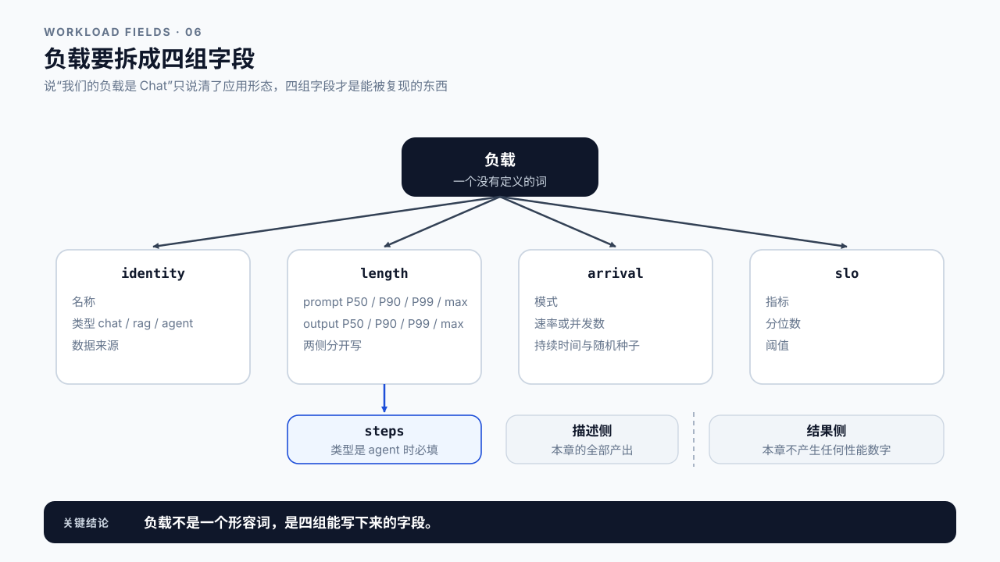
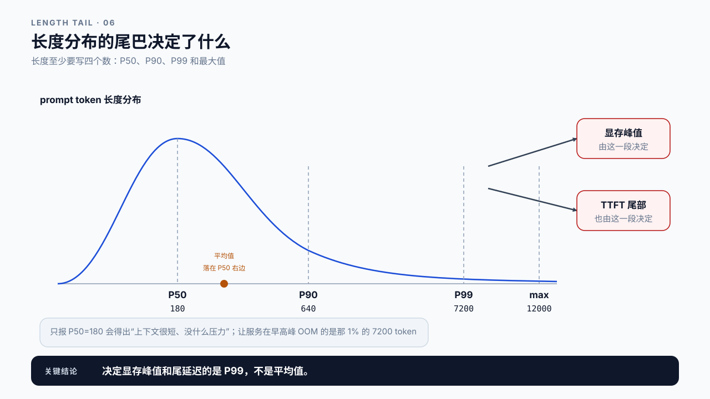
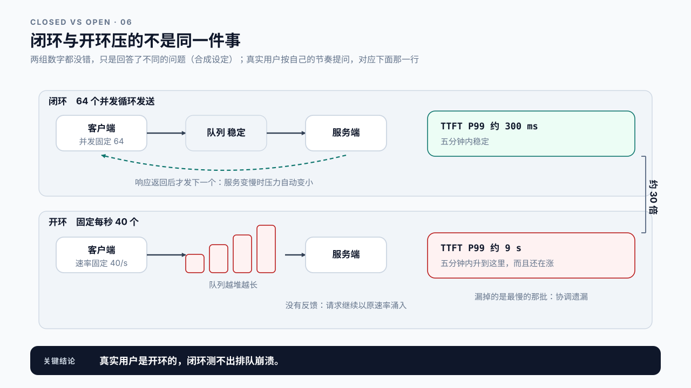

# 第 6 章 LLM 工作负载建模：先说清楚“负载”是什么

## 学习目标

读完这一章，你应该能回答三个问题：

1. 说“我们的负载是 Chat”，到底说清楚了什么？还有哪些没说？
2. 同样是一千个请求，为什么发送方式不同会得出完全不同的结论？
3. 一份 workload 描述要写全哪些字段，别人才能复现你的实验？

跟着做完，你会得到一份可复现的 workload 描述文件，它是下一章 Baseline 的输入。

第 5 章把 TTFT、TPOT、吞吐和 Goodput 的口径定了下来。但那些公式都带着一个前提：它们描述的是**某一批请求**。换掉这批请求，同一套公式会给出完全不同的数字，而且两个数字都对。本章补上这个前提。

真实压测怎么组织、Warmup 和重复次数怎么定，留到第 7 章；采什么证据、怎么归因，留到第 8 到第 10 章。

## 6.1 一次请求说明不了服务能力

第 1.8 节那份 GX10 客户端流式报告里，那次调用读了 30 个 token、写了 256 个，端到端 2.3 秒。现在有人问：这个服务能不能撑住线上流量？

回答不了。那次调用只有一个请求、一个并发、一段固定长度的 prompt，而线上同时会有几十个用户，有人问一句话，有人贴进来一整篇文档，请求到达的时间也不均匀。把单次结果乘以并发数得到的“容量”，和真实系统的表现基本没有关系。

问题不在于测得不够多，而在于**还没说清楚要测什么**。“能不能撑住线上流量”这句话里，“线上流量”是个没有定义的东西。它可能是：

- 每秒 5 个请求，每个 prompt 200 token、输出 300 token；
- 每秒 5 个请求，但其中一成是 8000 token 的长文档；
- 平时每秒 2 个，每天早上九点冲到每秒 50。

三种情况对同一套硬件的压力完全不同，得出的 P99 也不会接近。所以在测之前，先要把“负载”这个词拆成可以写下来的字段。

这一章要拆的就是这些字段：输入输出多长、请求怎么来、同时有多少、以及什么样的结果才算达标。



图6-1：负载要拆成四组字段。

## 6.2 长度：平均值会骗人

最先要写清的是长度，而且是**输入和输出分开写**。

两者对系统的压力方式不同。输入 token 决定 Prefill 要算多少、KV Cache 一次写入多少；输出 token 决定 Decode 要循环多少步、KV Cache 会长到多大。一个 8000 token 输入、50 token 输出的请求，和一个 200 token 输入、2000 token 输出的请求，总 token 数是 8050 对 2200，只看总量会以为前者重得多。可两者压的不是同一处：前者压 Prefill，后者压 Decode，优化方向完全相反。按第 0 章的第一条规律，后者那 2000 个输出 token 每个都要把权重搬一遍，占卡的时间反而可能长得多。

只写平均值不够。真实流量的长度分布通常是长尾的：大部分请求很短，少数特别长，而尾部那些请求往往决定了 P99 和显存峰值。

```text
prompt tokens
  P50   180
  P90   640
  P99  7200      ← 决定显存峰值和 TTFT 尾部的是这些
  max 12000
```

只报 P50=180，容易得出“上下文很短、没什么压力”的结论；而真正让服务在早高峰 OOM 的，是那 1% 的 7200 token 请求。

所以长度至少要写四个数：P50、P90、P99 和最大值。有条件的话直接保留原始长度列表，后面第 7 章分桶分析时用得上。



图6-2：长度分布的尾巴决定了什么。

**长度从哪里来？** 最可靠的来源是线上日志里的 `usage` 字段。没有线上数据时，用真实业务样本跑一遍 tokenizer 统计，而不是拍一个“大概 500 token”。第 3 章说过，token 数取决于 tokenizer 和 chat template，用字符数折算会失真。

## 6.3 到达模式：同样一千个请求，可以得出两个结论

长度写清楚了，还有一个更容易被忽略的维度：这些请求**是怎么到达的**。

假设要发一千个请求。至少有四种发法：

```text
A  一次性全部发出，等它们陆续返回
B  固定 20 个并发，一个结束就补一个
C  固定每秒 10 个，不管前面的有没有返回
D  平时每秒 2 个，某一刻突然涌入 200 个
```

四种方式的请求总数相同、长度分布相同，但测出来的 TTFT P99 可以差一个数量级。原因是它们压的根本不是同一件事：A 压的是瞬时排队，B 压的是稳态吞吐，C 压的是系统在给定到达率下会不会崩，D 压的是突发下的降级行为。

这里面最关键的区分是 B 和 C。

### 闭环与开环

B 属于闭环，并发数固定，新请求要等旧请求返回才发出；C 属于开环，按固定速率发送，不管系统消化得过来与否。**这两个词后面会反复出现，值得记牢。**

> **闭环（closed-loop）与开环（open-loop）**：闭环下客户端的发送速率被服务端的响应速度反向牵制，服务变慢时压力自动变小；开环下到达率由外部决定，服务变慢时请求继续堆积。
> 真实用户流量更接近开环，用户不会因为你的服务慢下来就少提问。

这一节后面还有两个词，都挂在这一对概念上。协调遗漏最典型地出现在闭环里：发送被响应牵着走，慢的时候该发的没发；开环发压器自己跟不上计划时也会犯同样的错。泊松过程是开环最常用的到达模型，比等间隔发送更像真实用户。一个说明闭环错在哪，一个说明开环该怎么发；第 7 章的发压脚本按泊松生成计划发送时刻、延迟从计划时刻起算，把这两件事合成了一步。

这个区别的后果很实际：**闭环测不出排队崩溃**。服务一旦变慢，闭环客户端自己就把压力降下来了，队列长度稳定在并发数附近，P99 看起来还行。而线上是开环的，服务变慢时请求继续以原速率涌入，队列越堆越长，延迟随时间一路上涨。

差多少？下面是一组合成设定，用来演示量级差，不是任何一台机器的实测记录（第 7 章的脚本能在你自己的服务上跑出这组对照）。设同一个服务、同一份长度分布，而且这台服务在 64 并发时吞吐已经到了平台，再加并发只排队不提速；两种发法各跑一次：

```text
合成设定
闭环  64 个并发循环发送          TTFT P99 约 300 ms，平均端到端约 1.65 秒，五分钟内稳定
开环  固定每秒 40 个             TTFT P99 五分钟内升到约 9 秒，且还在涨
```

三十倍。这两个数换成别的机器会完全不同，但符号不会变：开环那一侧一定更差，而且只要到达率超过处理能力，它就不收敛。之所以如此，不需要这两个数来证明，由定义就能推出来：闭环的在途请求数被 64 卡住，队列长度有上界；开环没有这个上界，服务变慢时到达率一点不减，队列就持续增长。

增长的速度也能算。到达率 λ 超过处理能力 μ 之后，每秒多出 λ − μ 个请求，队列按时间线性变长；新来的请求要排在它们后面，多等的时间是：

```text
等待增量 ≈ (λ ÷ μ − 1) × t        t 是过载持续的时间
```

它是线性的，不是指数的，但没有上限。这带来一个容易忽略的后果：过载下测出的 P99 不是系统的属性，而是压测时长的函数，同一组配置跑 5 分钟和跑 30 分钟，P99 能差六倍。所以过载实验的报告必须写明时长。

两组数字回答的也不是同一个问题：闭环那个 300 ms 说的是“系统在 64 条在途请求下能做到多快”，开环那个 9 秒说的是“每秒 40 个进来时会发生什么”。上线之后用户按自己的节奏提问，对应的是后一个问题。6.8 案例一沿用这组设定。

**所以“压测通过、上线就炸”不是运气问题，是问错了问题。** 压测固定的是并发，线上面对的是到达率。



图6-3：闭环与开环压的不是同一件事。

> **协调遗漏（coordinated omission）**：闭环压测在系统变慢时自动降低发压速率，那些本该在慢的时候发出的请求根本没被发出来，也就没有被记录。
> 漏掉的恰好是最该看的样本，所以这类报告的分位数会系统性偏乐观，而且越到尾部偏得越多。两种修正办法：改用开环发压；或者给每条请求一个计划发送时刻，延迟从计划时刻起算，把客户端自己欠下的那段时间补回去（第 7 章的脚本就这么做；纯闭环没有计划发送时刻，只能改开环）。

### 常见的到达模式

| 模式 | 描述 | 适合验证什么 |
|---|---|---|
| 固定并发 | N 个客户端循环发送 | 稳态吞吐上限、资源利用率 |
| 固定速率 | 每秒 R 个，等间隔 | 给定到达率下能否稳住 |
| 泊松到达 | 每秒平均 R 个，间隔随机 | 更接近真实流量的抖动 |
| 突发 | 基线速率 + 尖峰 | 限流、排队和降级行为 |
| 阶梯递增 | 速率逐级上升 | 找出系统的拐点在哪 |

> **泊松过程（Poisson process）**：一种到达时间随机、但平均速率固定的模型，相邻请求的间隔服从指数分布。
> 它比等间隔更接近真实流量：同样是每秒平均 10 个，泊松到达会自然出现短暂的密集和空档，而等间隔不会。

这份随机性有多大，可以手算。长为 t 的窗口里平均来 λt 个请求，实际个数的标准差约是 √(λt)，相对波动约 1/√(λt)。每秒 10 个、看 1 秒的窗口，相对波动约 32%，秒级的忽密忽疏是常态；看 1 分钟的窗口，相对波动只剩约 4%。所以某一分钟的请求数是均值的三倍，不可能来自泊松自己的随机性，那是到达率本身变了。第 20 章区分两种抖动时会用到这一条。

选哪种取决于你要回答什么问题，但至少要**写下来**。一份没有写明到达模式的性能报告，读者无法判断那个 P99 意味着什么。

## 6.4 并发数和到达率不是一回事

到达模式一旦分清闭环和开环，“并发”这个词也要跟着拆。

并发数是同一时刻系统里有多少条请求在处理，它是结果；到达率是每秒进来多少请求，它是输入。**一个由系统决定，一个由你决定，方向相反。**

闭环压测里你设定并发数，到达率由系统决定；开环压测里你设定到达率，并发数由系统决定。两者通过一条关系连起来：

```text
平均并发数 ≈ 到达率 × 平均请求时长
```

> **Little's Law**：稳态下，系统内平均请求数等于平均到达率乘以平均停留时间。
> 它只在系统稳定（没有无限堆积）时成立，所以队列已经在持续增长时，不能用它反推容量。

这条关系有个直接用途：它能判断你的压测配置是否自洽。设定每秒 10 个请求、每个平均耗时 2 秒，那么系统里平均应该有约 20 条在跑。拿实测值去对：

```text
实测在途 22 条    与 10 × 2 = 20 相差一成，正常
实测在途 55 条    反推平均时长 55 ÷ 10 = 5.5 秒，是设定的 2.75 倍
```

第二行要特别注意读法：**这不是 Little's Law 失效了，而是平均时长本身被排队拉长了。** 式子仍然成立，变的是右边那个 W。所以看到在途数远超预期，该问的不是“公式怎么不对”，而是“那 3.5 秒多出来的时间花在哪一段”，答案通常在队列里。

闭环压测固定的是并发 N，同一条关系换个方向写，就是闭环下的吞吐：

```text
吞吐 X = N ÷ W        N 是固定并发，W 是平均端到端时长
```

用 6.3 那组合成设定代进去：64 并发、平均端到端约 1.65 秒，这台服务的吞吐上限约 64 ÷ 1.65 ≈ 38.8 req/s（前提是 6.3 那条设定：64 并发已经把它压满）。开环按每秒 40 个发，只超了约 3%，可每秒多出的约 1.2 个请求会一直攒下去：五分钟攒下约 360 个，排在最后的那条要多等约 360 ÷ 38.8 ≈ 9.3 秒，和 6.3 那个 9 秒对得上。过载不必超出很多，超一点、时间够长就够了。

而如果在途数还在持续往上走，情况更糟：系统根本不在稳态，Little's Law 的前提不成立，此时报出来的吞吐数字不能当作容量上限，它只是“队列还没炸之前的瞬时速率”。

报告里要写清你固定的是哪个量。写“并发 32”和写“到达率 16 req/s”是两种不同的实验，混为一谈就没法比较。

## 6.5 Chat、RAG、Agent 是三种不同形状的负载

前面几节的字段适用于任何负载。但把它们填进去之后会发现，三类典型应用呈现出很不一样的形状。

**Chat** 是最简单的一类。一次用户输入对应一次 LLM 调用，输入是对话历史加新问题，输出是一段回答。随着对话轮次增加，输入会越来越长。这是 Chat 负载最需要写清的一点：同一个会话的第 10 轮，prompt 可能是第 1 轮的十几倍。

**RAG**（Retrieval-Augmented Generation，检索增强生成）在调用之前多了检索：先去知识库里找出几段相关资料，拼进 prompt 再交给模型。输入由用户问题和若干检索片段拼成，所以 prompt 长度主要由“取几段、每段多长”决定，而不是用户问了多长的问题。描述 RAG 负载时，Top-K 和每段长度是必须写的字段，它们比用户问题长度更能决定 Prefill 的压力。

Agent 的差别最大：一次用户任务会产生多次 LLM 调用。第 2 章分过 Task、Call 和 Request 三层，**Agent 负载必须在 Task 层描述**，否则完全说不清楚。

| | 一次任务的 LLM 调用数 | 输入长度主要由什么决定 | 特有字段 |
|---|---|---|---|
| Chat | 1 | 对话历史轮次 | 平均轮次、每轮增量 |
| RAG | 1 | Top-K × 每段长度 | Top-K、片段长度、是否重排 |
| Agent | 多次，且不固定 | 累积的工具结果 | 平均步数、步数分布、工具调用比例、重试率 |

Agent 还有一个容易漏掉的字段：**步数分布**。多数任务三五步结束，少数会跑到二三十步，而这些长任务贡献了大部分 token 消耗和尾部延迟。

低估的幅度可以算出来。按“每天 1 万次任务、平均 5 次调用、每次输入约 3000 token”报预算，这两个数都来自单次调用的观测：

```text
报上去的    10000 × 5 次调用 × 3000       = 1.5 亿 token
实际的步数  任务平均走了 8 步，不是 5 步
实际的长度  每步都把前面的工具结果拼进上下文，首步 3000、末步 20000，
            按梯形每任务 92000 token（合成设定，推导见第 24.3 节）
总计        10000 × 92000                ≈ 9.2 亿 token，是报上去那个数的 6.1 倍
```

漏的不是一个字段，是两个：步数估少了 1.6 倍，累积又让每步的输入远大于 3000，贡献 3.8 倍。只写“平均 5 步”只能补上第一个。6.8 案例三接着算这六倍错在预算、容量、定价上的后果，第 24.3 节给出这笔账的完整版本，并把累积那一项按平方项展开。


图6-4：Chat、RAG、Agent 是三种形状。

## 6.6 SLO 是负载描述的一部分

最后一个字段常被漏掉：**什么样的结果才算达标**。

工作负载不只是“发什么请求”，还包括“这些请求要满足什么条件”。同一批请求，SLO 定成 `TTFT ≤ 200 ms` 还是 `TTFT ≤ 2 s`，得出的容量结论会差好几倍。第 5 章的 Goodput 之所以需要 SLO 才能计算，原因就在这里。

一份 SLO 至少要写三件事：

```text
指标      TTFT
分位数    P95           ← 不是平均值
阈值      200 ms
```

三者缺一不可。只说“TTFT 要低于 200 ms”没有指明是平均值还是 P95，而这两者对系统的要求差别很大。

阈值定在哪里，直接改变容量结论。拿同一批一千个请求的 TTFT 实测分布算两次：

```text
≤ 200 ms       550 条
200 ms – 500 ms 300 条
500 ms – 2 s    135 条
> 2 s            15 条
```

```text
阈值 200 ms   达标 550 条，达标率 55.0%
阈值 2 s      达标 985 条，达标率 98.5%
```

同一批请求、同一套硬件，只因为阈值不同，SLO 内的有效产出差了 `98.5% ÷ 55% ≈ 1.8 倍`。第 5 章的 Goodput 算的就是这个，而容量规划拿 Goodput 做分母。阈值收紧之后要加多少卡，却不能按 1.8 倍等比例推：达标率和负载是非线性关系，200 ms 那档可能要加很多卡，2 s 那档可能一张都不用加，第 20 章的排队曲线和第 26 章的容量模型会把这笔账算出来。**阈值不是一句业务口号，它直接进入容量预算。**

顺带一句：阈值 200 ms 那一栏达标率只有 55%，离 P95 那条线差得很远，说明这个配置在这条 SLO 下根本不达标。要判断是否达标，光看阈值不够，必须把分位数一起代进去。

不同负载的 SLO 侧重也不同。交互式 Chat 对 TTFT 最敏感，用户盯着屏幕等第一个字；后台批处理几乎不在乎 TTFT，只关心整体吞吐和成本；Agent 关心的则是整个任务的端到端时间和成功率，单次调用的 TTFT 反而是次要的。

## 6.7 Demo：把负载写成一份可复现的描述

本章 Demo 位于 `code/ch06/workload_builder.py`，只依赖 Python 标准库，不需要 GPU。

它做两件事：把上面几节的字段组装成一份 workload 描述文件，并检查这份描述是否自洽。

从仓库根目录运行：

```bash
python3 code/ch06/workload_builder.py \
  --profile chat \
  --arrival poisson \
  --rate 10 \
  --duration 60 \
  --output workload-chat.json
```

生成的描述包含四组字段：

```text
identity     负载名称、类型（chat / rag / agent）、数据来源
length       prompt 与 output 的 P50 / P90 / P99 / max
arrival      模式、速率或并发数、持续时间、随机种子
slo          指标、分位数、阈值
```

**它只描述负载，不发送请求，也不产生任何性能数字。** 这一点必须分清：workload 描述是实验的输入，Benchmark 结果是实验的输出，两者不能出现在同一个“报告”里而不加区分。真正把请求发出去是第 7 章的事。

检查器会拒绝几类不自洽的描述：

- 长度分位数不单调（P50 大于 P90）；
- 到达模式为 `poisson` 或 `constant` 却没有给速率；
- 到达模式为 `closed` 却没有给并发数；
- SLO 只给了阈值没给分位数；
- 类型是 `agent` 却没有步数分布。

最后一条最容易踩。写 Agent 负载时如果不填步数分布，这份描述就无法推算出一次任务实际会产生多少 LLM 调用，后面所有以任务为单位的成本和延迟估算都无从谈起。

**随机种子必须记录。** 泊松到达和长度采样都带随机性，不固定种子，两次“相同配置”的实验生成的请求序列并不相同，结果差异会被误读成系统变化。归档这份描述时顺手记下它的 sha256：第 7 章的报告按它说明重放了哪一份负载，第 28 章的门禁把这个哈希记进环境指纹。

## 6.8 案例与常见误区

### 案例一：压测通过，上线就崩

合成设定，沿用 6.3 那组数：团队用 64 并发压测，P99 TTFT 稳定在 300 ms，判定容量足够。上线当天早高峰，TTFT P99 冲到 12 秒，大量请求超时。

按 6.3 那条区分复测：改成开环、固定每秒 40 个，五分钟内 TTFT P99 升到 9 秒，和线上的 12 秒同一量级。压测报告上那个 300 ms 没有错，它只是回答了一个线上不会出现的问题。

**9 秒和 12 秒之间还差 3 秒，这一段也要有交代。** 先对齐时长：6.3 说过，过载下的 P99 是压测时长的函数，复测只跑了 5 分钟；按同样的过载程度，早高峰持续六七分钟就能涨到 12 秒。时长对齐之后还差，才去找线上有而复测没复现的东西：长度分布的尾巴更重、上游有重试、或者同时段有别的流量。差一个量级要回去找原因，差三成可以先记下来当残留不确定性，第 10 章会讲怎么写。

讨论：如果只能保留一种压测方式，你会选闭环还是开环？各自会漏掉什么？

### 案例二：平均值一切正常

合成设定：一份 RAG 服务的负载描述写着“平均 prompt 长度 600 token”，据此规划的显存看起来很宽裕。上线后频繁 OOM。

翻日志发现，检索的 Top-K 是动态的：多数问题命中 3 段，但涉及政策条款的问题会命中 20 段以上，prompt 直接冲到 9000 token。P99 长度是平均值的十几倍，而显存峰值是由 P99 决定的，不是平均值。

讨论：这份负载描述里还缺哪些字段？补上之后，显存该按哪个数字规划？

### 案例三：Agent 的账算少了

合成设定：一个 Agent 服务按“每天 1 万次任务、平均 5 次调用、每次输入约 3000 token”估算 token 成本，实际账单是估算的六倍。6.5 已经把这六倍拆成了步数和累积两项，那两项是从设定里算出来的，不是量出来的。

这里要补的是它在负载描述之外的后果：**这笔账错了六倍，预算、容量和定价三件事会一起错。** 按 1.5 亿 token 报的预算，实际要为 9.2 亿付费；按 1.5 亿 token 算的卡数，上线后会不够；如果产品按这个成本定了价，每一单都在亏。而这三件事都不会立刻报警，要等到月底对账。

讨论：要把这笔账算准，负载描述里至少要补哪三个字段？如果只能先补一个，补哪个收益最大？

### 两个不会出现在字段表里的误区

误区一：负载描述可以事后补。

先跑实验、再回头写“我当时大概是这么配的”，等于没有描述。到达模式、随机种子、长度分布这些字段一旦丢失，实验就不可复现，数字也失去了比较的基础。描述要在实验之前写完并保存。

误区二：用生产流量回放就不需要建模了。

回放确实比构造更真实，但它同样需要描述：回放的是哪一天、哪个时段、多长窗口、是否按原速率、是否剔除了异常请求。不写这些，回放实验之间照样没法比较。回放替代的是“怎么造数据”，不是“怎么描述负载”。

## 本章总结

回到开头的三个问题。

**说“我们的负载是 Chat”说清楚了什么？** 只说清了应用形态，没说清任何一个能影响结论的量。要能复现，至少还要补上：输入和输出各自的长度分布（P50/P90/P99/max，不是平均值）、请求怎么到达、同时有多少在跑、以及什么结果算达标。Chat、RAG、Agent 的差别也不只是叫法。RAG 的 prompt 长度由 Top-K 和片段长度决定，Agent 必须在任务层描述，还要带上步数分布。

**为什么发送方式会改变结论？** 因为不同的发法压的不是同一件事。其中最要紧的是闭环与开环的区别：闭环下服务变慢会让客户端自动降速，队列稳定，P99 好看；开环下请求按原速率继续涌入，过载时队列按时间线性堆积，压测跑得越久 P99 越难看。真实用户是开环的，所以只做闭环压测，测不出排队崩溃。并发数和到达率也要分清，一个是结果一个是输入，报告里必须写明你固定的是哪个。

**一份 workload 描述要写全哪些字段？** 四组：identity（名称、类型、数据来源）、length（输入输出各自的分位数）、arrival（模式、速率或并发、持续时间、随机种子）、slo（指标、分位数、阈值）。种子必须记，否则两次“相同配置”的实验其实不同。这四组字段就是下一章 Baseline 的输入。没有它们，Benchmark 跑出来的数字无法复现，也无法和别人的比较。

下一章用这份描述真正把请求发出去，讨论 Warmup、重复次数和统计窗口，建立第一个可重复的 Baseline。

### 本章 Checklist

- [ ] 能从线上日志或真实样本统计出 prompt 与 output 的 P50、P90、P99 和 max，而不是拍一个平均值。
- [ ] 能说出手上这份压测配置是闭环还是开环，以及它测不出什么。
- [ ] 能用 `到达率 × 平均时长` 估出预期并发数，并判断实测值是否说明请求在堆积。
- [ ] 能为 Chat、RAG、Agent 三类负载各写出它们特有的必填字段。
- [ ] 能写出一条完整的 SLO，包含指标、分位数和阈值三项。
- [ ] 能运行 `workload_builder.py` 生成描述文件，并让检查器通过。
- [ ] 描述文件里记录了随机种子，重跑能得到同一批请求。
- [ ] 描述文件里没有任何性能数字。

## 课后练习

1. 取一段真实的 LLM 服务日志，统计 prompt 与 output 长度的四个分位数，并画出分布。
2. 用同一份长度分布，分别生成闭环（并发 32）和开环（每秒 16 个）两份描述，说明它们各自能回答什么问题。
3. 按 `到达率 × 平均时长` 估算第 2 题中开环配置的预期并发数，写出你的推算过程。
4. 为一个 RAG 服务写一份完整描述，其中 Top-K 在 3 到 20 之间波动，说明这对 prompt 长度分位数有什么影响。
5. 为一个 Agent 服务写一份描述，步数分布为“80% 在 5 步以内，15% 在 6 到 15 步，5% 超过 15 步”，估算一次任务的平均 LLM 调用数。
6. 故意写一份不自洽的描述（例如 P50 大于 P90），运行检查器，确认它被拒绝并读懂错误信息。
7. 用同一份配置、不同随机种子各生成一次，比较两批请求的差异，说明为什么种子必须记录。
8. 找一份你见过的性能报告，列出它缺了本章哪些字段，以及这些缺失让哪些结论变得不可比较。
