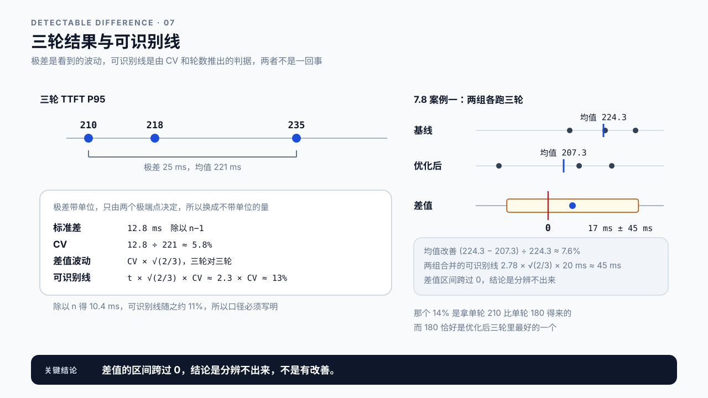
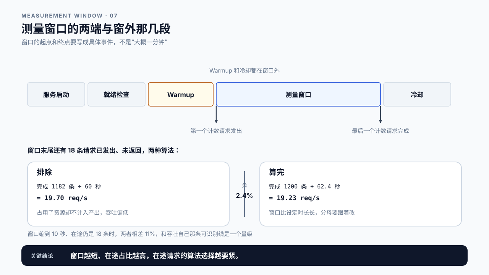
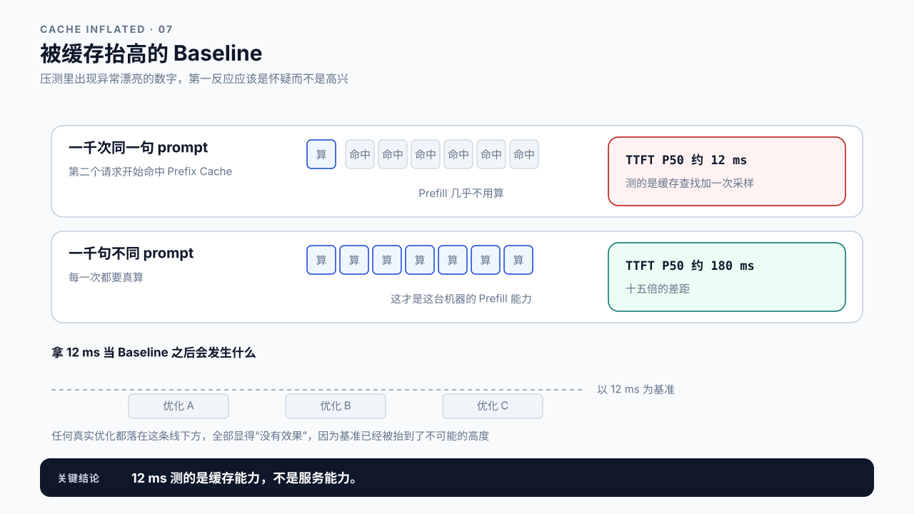
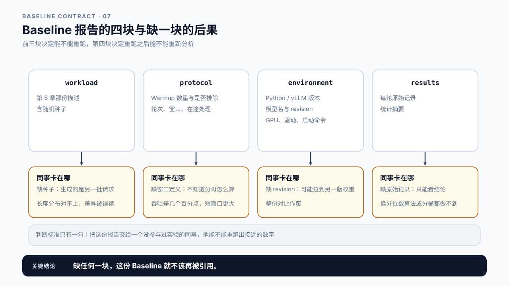

# 第 7 章 Benchmark Design：让一个数字可以被复现

## 学习目标

读完这一章，你应该能回答三个问题：

1. 跑一次得到的数字，凭什么能当作 Baseline？
2. 同样的配置跑两次，结果对不上，哪个才是对的？
3. 一份 Baseline 报告要存下哪些东西，半年后换个人还能复现？

跟着做完，你会得到第一份可复现的 Baseline：workload、protocol、environment、results 四块齐全。

第 6 章把负载写成了一份描述文件，现在要拿它去真正发请求。听起来只差一步，但从“发出去”到“得到一个可信的数字”之间，还有一整套容易被跳过的规矩。

## 7.1 不可复现的 Baseline 比没有更糟

先说清楚 Baseline 是干什么用的。

它不是为了知道“我们的服务有多快”。它是为了**将来做对比**：改了一个参数、换了一个版本、加了一项优化之后，能判断到底变好了还是变坏了。所有优化章节的“收益”都是相对 Baseline 说的。

这就带来一个后果：**如果 Baseline 不可复现，它不但没用，还会主动误导你**。

设想一份三个月前的 Baseline 写着 `TTFT P95 = 210 ms`。今天你启用了某项优化，重跑得到 180 ms，于是记下“优化带来 14% 提升”。但如果当初那次运行没有 Warmup、这次有，或者当初的 prompt 集合和这次不同，那 14% 可能全部来自这些差异，和优化本身毫无关系。你会带着一个错误的结论继续往下走，而且不会有任何报错提醒你。

没有 Baseline 时，你至少知道自己不知道。有一份坏的 Baseline，你会以为自己知道。

所以这一章的目标不是“跑出一个好看的数字”，而是**跑出一个别人能重现的数字**。

## 7.2 Warmup：前几个请求不算数

服务刚起来时发出的头几个请求，明显比后面慢。原因不止一个：

- CUDA context 初始化、显存分配器第一次向驱动申请大块显存；
- 部分 kernel 在首次执行时才被选择或编译；
- Python 解释器、tokenizer 和各类 lazy import 的首次开销；
- CPU 和 GPU 的频率还没被负载拉起来。

> **Warmup**：正式测量之前先发一批不计入统计的请求，把初始化、首次编译、lazy import 和频率爬升这类一次性开销排除掉。
> 它排除的是“第一次做某件事”的成本，不是“系统还没准备好”。服务本来就该在 Warmup 之前完成就绪检查（第 1 章的三层检查）。

把这些请求算进统计，得到的 P99 会被首批请求主导，而这个 P99 在生产环境里没有对应物：线上服务不会每分钟重启一次。

Warmup 要写清两件事：发了多少，以及**这些请求是否被排除**。

```text
warmup_requests   20        ← 发了 20 个
warmup_excluded   true      ← 且不计入统计
```

只写“做了 Warmup”是不够的。见过一种做法是发了 Warmup 但忘了排除，等于什么也没做。

**Warmup 要发多少？** 没有通用答案，取决于模型大小和框架。可操作的做法是：观察延迟何时稳定下来，稳定之后再开始计数。

要观察的不能是负载里的请求本身。负载里的 prompt 从一百多 token 到七千多 token 都有，相邻两条的延迟本来就差好几倍，永远“稳定”不下来。要用一条固定的探针请求：长度和 `max_tokens` 都固定，每次只换开头几个字，避开 Prefix Cache。Warmup 期间隔几条插一次探针，看探针自己的延迟。判据可以定成“连续两次探针相差在 5% 以内”。下面是一组合成设定：

```text
探针第 1 次  2100 ms
探针第 2 次   900 ms   与上一次差 57%
探针第 3 次   420 ms   与上一次差 53%
探针第 4 次   380 ms   与上一次差 9.5%
探针第 5 次   375 ms   与上一次差 1.3%   ← 从这里起算预热完成
```

判据里的 5% 不是定理，它应该和第 7.3 节的可识别线挂上：可识别线 13% 的实验，用 5% 当预热门槛是安全的；如果实验本身就很吵，门槛可以放到 10%。把这个观察过程和判据记在报告里，比直接写“Warmup=20”更有说服力。

这里说的“预热完成”和第 6.4 节的稳态不是一回事。稳态说的是队列不再增长、Little's Law 成立；预热完成说的是一次性开销已经付清。本书只用“稳态”指前一种。

## 7.3 一次运行给不出结论

Warmup 做完了，跑一轮，得到 `TTFT P95 = 210 ms`。这个数字能用吗？

还不能。再跑一轮可能得到 235 ms，第三轮 218 ms（合成设定，用来演示波动的量级）。三个数字都没错，问题是你打算拿哪个去和以后的实验比。

真实系统的每次运行都带着随机性：请求到达的抖动、调度顺序、其他进程的干扰、GPU 频率波动。单次运行只是这个分布里的一个采样点。

所以 Baseline 至少要**跑三轮以上，并把每轮的结果都保留下来**。报告里写的不该是一个数，而是一组：

```text
run 1   TTFT P95   210 ms
run 2   TTFT P95   235 ms
run 3   TTFT P95   218 ms

均值     221 ms
极差     25 ms（约 11%）
```

极差是你直接看到的波动，但它不方便跨实验比较：它带单位，而且只由最大和最小两个点决定，样本一多就只反映极端值。所以要把它换成一个不带单位的量。

> **变异系数（CV, coefficient of variation）**：标准差除以均值，用来衡量波动的相对大小。
> 它比标准差更适合跨实验比较，因为它不带单位。CV 超过一成通常说明实验环境还不够稳定，先去找波动源，而不是急着下结论。

还是上面那三轮：

```text
三轮        210 / 235 / 218 ms
均值        221 ms
标准差      12.8 ms        ← 样本标准差，除以 n−1
CV          12.8 ÷ 221 ≈ 5.8%
```

标准差那一行要注明口径。除以 `n−1` 得到 12.8 ms，除以 `n` 得到 10.4 ms，下面算出的可识别线随之约是 13% 或 11%。三轮时两者差别不小，所以报告里要写清用的是哪一种，否则别人复算对不上。本书统一用样本标准差。

有了 CV，“多大的变化才算真的变化”就能算成一个数。Baseline 跑 n 轮、改动后也跑 n 轮，比的是两组均值之差。每组均值自己的波动约是 CV ÷ √n，两组相减，两份波动叠在一起：

```text
两组均值之差的波动 ≈ CV × √(2/n)
```

差值要超过这份波动的 t 倍：如果改动其实没有效果，差值越过这条线的机会只有约 5%。t 取自由度 2n − 2 的双侧 95% 临界值，轮数越少它越大；这条式子还要求两组的波动相当，CV 差得多时要按两组合并的波动算（7.8 案例一就是这种情况）：

| 每组轮数 n | t | 可识别线 = t × √(2/n) × CV |
|---:|---:|---:|
| 3 | 2.78 | 约 2.3 × CV |
| 5 | 2.31 | 约 1.5 × CV |
| 12 | 2.07 | 约 0.85 × CV |

> **可识别线**（critical difference）：两组各跑 n 轮时，差值要超过多少才能当作真实变化，即上表最后一列。
> 它是两组 t 检验的手算形式，三轮对三轮时约为 CV 的 2.3 倍。注意它是误报门槛，不是检出保证：真实差值正好等于这条线时，大约只有一半的实验能把它判出来；想稳定判出某个幅度，线要压到它的一半左右。

上面那三轮代进去：5.8% × 2.3 ≈ 13%。**可识别线的意思是：改善幅度小于它，就写“在波动内不可分辨”。** 5% 的改善在这里不能报，报“提升 5%”是不诚实的。第 14 章那个“收益 6%、可识别线 13%”的案例正是这种情况。

这条线有两处容易用错。第一，它属于具体的指标：由哪个指标、哪个分位数、每轮多少条请求的 CV 算出来，就只对它成立。TTFT P95 的线不能拿去判 TPOT P50；每轮请求从 200 条减到 50 条，单轮的 P95 本身就会抖得更厉害（第 5.5 节的样本量规则），线也要重算。第二，判据看的是差值的区间，不是两组各自的区间。等价的写法是：差值加减可识别线，这个区间跨不跨过 0。两组各自的区间重叠时差值仍可能是真的，拿“重叠”当判据，会把真实的改善判成噪声。全书其余式子的前提和失效点，附录 F 汇总在一张表里。

想让这条线降下来，有两条路。一是降波动，也就是下面那几处排查，CV 降到 3%，三轮对三轮的线就到约 7%。二是多跑几轮：每组从 3 轮提到 12 轮，系数从 2.3 降到 0.85，线降到原来的三分之一多一点。

两条路里优先选第一条，而且有一种情况多跑几轮完全没用：波动来自单调漂移，比如机器越跑越热、频率一路下降。这时前后两轮本来就不是同一个条件，轮数再多也只是把漂移平均进去。先看三轮的数字是不是朝一个方向走，是的话先解决漂移。

这条可识别线是本篇那条因果与证伪的下界：它标出了证据的分辨力到哪里为止。线以下的差异不是“大概有改善”，而是这次实验回答不了，第 10 章报告里的残留不确定性就是给这类结论留的位置。

波动特别大时，先查这几处：机器上有没有别的进程在抢 GPU、请求内容是否每轮都不同、是否有后台任务在定时触发。把波动压下来，比多跑几轮更有用。



图7-1：三轮结果与可识别线。

## 7.4 测量窗口：从哪一刻开始算

第 5 章说过，吞吐必须绑定一个测量窗口。跑 Benchmark 时，这个窗口的两端要明确定义。

一次运行的完整时间线是这样的：

```text
服务启动 ──> 就绪检查 ──> Warmup ──> ┃ 测量窗口 ┃ ──> 收尾
                                    ↑           ↑
                                第一个计数请求  最后一个计数请求
```

窗口的起点是第一个计入统计的请求发出，终点是最后一个计入统计的请求完成。**Warmup 和收尾都在窗口外。**

这里有个容易出错的地方：开环压测跑固定时长时，窗口末尾会有一批请求已经发出但还没返回。这些请求怎么算？

- 把它们**排除**：吞吐会偏低，因为它们占用了资源却不计入产出；
- 把它们**算完**：实际测量窗口比设定时长长，吞吐分母要跟着改。

差多少，取决于在途请求占总量的比例。设窗口 60 秒、每秒发 20 个、末尾还有 18 个没返回：

```text
总发出        60 × 20 = 1200 条
末尾在途      18 条

排除     完成 1182 条 ÷ 60 秒 = 19.70 req/s
算完     完成 1200 条 ÷ 62.4 秒 = 19.23 req/s   （末尾 18 条又跑了 2.4 秒）
两者相差  约 2.4%
```

2.4% 是口径带来的系统差，每一轮都朝同一个方向偏，不是随机波动，所以不该拿可识别线去衡量它。基线和对照用同一种口径时它会抵消；两份报告口径不同时，它会直接混进差值里。但把参数换一下就不同了：窗口缩到 10 秒、在途仍是 18 条，排除法得 18.2 req/s、算完得 16.1 req/s，相差 11%，和吞吐自己那条可识别线已经是一个量级，足以伪造一个“提升”。**窗口越短、在途占比越高，这个选择越要紧。** 所以短窗口实验尤其必须写明用了哪种。

“排除”还有一个副作用：窗口末尾没返回的那一批不是随机抽的，同时发出的请求里越慢的越可能还在路上。把它们从延迟统计里丢掉，尾分位数会系统性偏乐观，这正是第 9 章列的那类偏差。

所以更干净的做法是把起步和收尾分开处理：停止发送后继续等在途请求返回，它们照常进延迟统计，免得慢请求被系统性丢掉；吞吐只取发压稳定段，用这段时间里的完成数除以这段时长，起步时队列还空、收尾时队列在排空，这两段都不进分母。

不管哪种，报告要写清楚：

```text
window_start_event   第一个计数请求发出
window_end_event     最后一个计数请求完成
in_flight_at_end     excluded          ← 或 drained
```



图7-2：测量窗口的两端与窗外那几段。

## 7.5 请求内容也会影响结果

同一份长度分布，用不同的文本填充，测出来的结果可以不同。最常见的坑是缓存。

很多推理服务会缓存已经计算过的 prompt 前缀，相同前缀的后续请求可以跳过一部分 Prefill。

> **Prefix Cache**：把已计算过的 prompt 前缀对应的 KV 缓存下来，下次遇到相同前缀时直接复用，跳过这段的重新计算。
> 它在生产中很有价值，因为真实流量里的 system prompt 和对话历史大量重复；但在压测中，如果所有请求用的是同一段文本，命中率会高得不真实。

用同一句 prompt 发一千次，第二个请求开始几乎全部命中缓存，测出来的 TTFT 好得离谱。“离谱”是有量的：

```text
合成设定
一千次同一句 prompt      TTFT P50  约 12 ms
一千句不同 prompt        TTFT P50  约 180 ms
```

十五倍。12 ms 这个数测的是缓存查找加一次采样，模型几乎没算 prompt；180 ms 才更接近模型真正读完这批 prompt 的耗时。这个数字不代表服务能力，只代表缓存能力。拿它当 Baseline，将来任何真实优化都会显得“没有效果”，因为 Baseline 已经被抬到了不可能的高度。

处理办法看你要测什么：

| 要测什么 | 请求内容怎么造 |
|---|---|
| 冷启动下的真实 Prefill 能力 | 每个请求用不同文本，或显式关闭 Prefix Cache |
| 生产实际表现 | 按线上真实的前缀重复率构造，把命中率也记进报告 |
| 缓存本身的收益 | 同一批请求跑两遍，对比首轮和次轮 |

无论哪种，**报告必须写明前缀重复情况和缓存是否开启**。这一条不写，两份 Baseline 之间就没有可比性。

除了缓存，还有两处内容相关的影响值得记：输出长度受 `max_tokens` 和停止条件约束，`temperature` 不为零时同一 prompt 的输出长度每次都不同。要让实验可比，采样参数必须固定并记录。



图7-3：被缓存抬高的 Baseline。

## 7.6 环境指纹：把当时的条件钉住

前面几节都在说“要写明”。最后统一收一下：一份 Baseline 报告到底要存什么。

分成四块：

```text
workload     第 6 章那份描述文件（含随机种子）
protocol     Warmup 数量、重复轮次、每轮请求数、发压方式、Prefix Cache 状态、
             测量窗口定义、在途请求处理
environment  Python / vLLM 版本、模型名与 revision、GPU 型号、驱动版本、完整启动命令
results      每轮的原始数据 + 统计摘要
```

**environment 里最常被漏掉的是模型 revision 和完整启动命令。** 只写“Qwen2.5-0.5B-Instruct”不够，同一个模型名在不同时间拉下来可能是不同的权重；只写“用 vLLM 启动”也不够，`--max-num-seqs`、`--gpu-memory-utilization` 这些参数会直接改变结果。

**results 要同时保留原始数据和摘要。** 只存 P50/P95/P99 的话，将来想换一种分位数算法、想按长度分桶重新分析，都做不到。原始的每请求记录不大，值得留着。

判断标准很简单：**把这份报告交给一个没参与过实验的同事，他能不能重跑出接近的数字。** 任何一项缺失让他答“不能”，就是报告的缺口。

这个标准可以逐项验。缺哪一项，同事会卡在哪一步：

| 缺的字段 | 同事卡在哪 | 后果 |
|---|---|---|
| workload 的随机种子 | 能跑，但生成的是另一批请求 | 长度分布对不上，差异被误读成系统变化 |
| Warmup 数量与是否排除 | 能跑，但不知道该丢前几个 | 前几个慢请求进统计，P99 偏高且不稳定 |
| 测量窗口定义与在途处理 | 能跑，但不知道分母怎么算 | 吞吐差几个百分点，短窗口下可达一成 |
| 模型 revision | 能跑，但可能拉到另一版权重 | 质量与长度分布都变，整份对比作废 |
| 完整启动命令 | 能跑，但并发上限和显存占比是默认值 | 容量相关的结论全部不可比 |
| 每请求原始记录 | 能看结论，不能重新分析 | 换分位数算法或按长度分桶都做不到 |

六项里前五项决定“能不能重跑”，最后一项决定“重跑之后能不能重新分析”。前五项缺任何一个，这份 Baseline 就不该再被引用。



图7-4：Baseline 报告的四块与缺一块的后果。

## 7.7 Demo：跑一次可复现的 Baseline

本章 Demo 位于 `code/ch07/run_baseline.py`，需要一个真实的 vLLM 服务在 GPU 上运行。

它读入第 6 章生成的 workload 描述，按描述发送请求，输出一份完整的 Baseline 报告。

```bash
python3 code/ch07/run_baseline.py \
  --workload workload-chat.json \
  --base-url http://127.0.0.1:8000/v1 \
  --warmup 20 \
  --runs 3 \
  --requests-per-run 200 \
  --prefix-cache off \
  --vllm-version <pip show vllm 里的版本> \
  --model-revision <模型仓库的 commit> \
  --gpu-name "<nvidia-smi 里的卡名>" \
  --driver-version <nvidia-smi 里的驱动版本> \
  --launch-command "vllm serve ... --max-num-seqs 64" \
  --output baseline-chat.json
```

环境指纹那五个参数和 `--prefix-cache` 不是可选的。**少给任何一个，脚本直接退出，不生成报告。** 命令行看着长，但它换来的是这份 Baseline 半年后还能被人重跑。每轮 200 条请求是按第 5.5 节的样本量规则定的：P95 以上大约有 10 条样本，单轮的 P95 才不至于太抖。

脚本按这个顺序工作：

1. 读 workload 描述，校验它自洽（复用第 6 章的检查器）；
2. 采集环境指纹，缺项直接报错退出，不允许留空；
3. 发送 Warmup 请求，不计入统计；
4. 由 workload 的随机种子生成这一轮的请求序列：每条的长度，以及开环模式下的计划发送时刻（泊松到达的间隔取指数分布）；
5. 按计划时刻并发发送，延迟从计划时刻起算；闭环模式没有计划时刻，固定在途条数，延迟从实际发送时刻起算；
6. 等待在途请求全部返回并计入，窗口终点是最后一条完成的时刻；
7. 重复 4 到 6 共 N 轮，输出报告，包含每轮原始记录、跨轮统计和可识别线。

这几步里有三处是专门为前面的道理写的。延迟从计划时刻起算，客户端自己发晚了的那段时间会记到请求头上，这是第 6.3 节协调遗漏的修正办法。每一轮都重放同一串请求，长度和发送时刻完全相同，去掉的是 7.3 列的“请求内容每轮不同”这个波动源。prompt 的开头带着轮次和序号，任何两条都不互为前缀，轮与轮之间也不会互相命中缓存，避开 7.5 的陷阱。突发和阶梯两种到达模式脚本没有实现，会直接拒绝，不拿别的模式冒充。

**报告里的每个数字都要能说出它的来源和窗口。** 脚本会拒绝生成缺少环境指纹的报告。这不是苛刻，而是因为一份没有环境的 Baseline 半年后没人能用。

### 本章预期看到什么

真机执行后，一份合格的报告至少满足：

- 三轮的 TTFT P95 都在同一量级，可识别线不超过 20%；
- 每轮的 `window_start` 和 `window_end` 都有明确事件；
- Warmup 请求单独列出，且标记为已排除；
- 环境指纹七个字段齐全，`vllm_version` 和模型 revision 不为空，`prefix_cache` 写明开或关；
- 原始每请求记录完整保留，每条都带 `send_lag_ms`。

如果可识别线超过两成，报告的 `verdict` 会标成 `too noisy`，先不要用这份 Baseline，回到 7.3 去找波动源。`send_lag_ms` 普遍偏大，说明发压端自己跟不上计划，先加大 `--max-in-flight` 或换一台发压机。

本章正文不附真机报告的示例数字。你在自己的机器上跑完之后，按上面五条验收，再把报告连同环境指纹一起归档；第 14、19、28 章都会拿它当对照。

## 7.8 案例与常见误区

### 案例一：优化带来 14% 提升

合成设定：团队在启用某项优化后重跑，TTFT P95 从 210 ms 降到 180 ms，报告写“提升 14%”。

评审时有人问：Baseline 那三轮的波动是多少？翻记录发现只跑了一轮，没有重复。

补跑三轮基线，得到 210、238、225；优化后也补跑三轮，其中一轮正是当初那个 180，另两轮是 228 和 214。

```text
基线      210 / 238 / 225    均值 224.3    标准差 14.0    CV 6.2%
优化后    180 / 228 / 214    均值 207.3    标准差 24.7    CV 11.9%

均值改善      (224.3 − 207.3) ÷ 224.3 ≈ 7.6%
两组合并波动   √((14.0² + 24.7²) ÷ 2) ≈ 20 ms
可识别线      2.78 × √(2/3) × 20 ≈ 45 ms，约为基线均值的 20%
```

这里两组的 CV 差了近一倍，所以不能只拿基线那一组的波动算线，要按 7.3 说的两组合并来算。7.6% 的改善落在约 20% 的可识别线以内。换成差值的写法：两组均值差 17 ms，加减 45 ms，区间从负 28 ms 到 63 ms，跨过了 0。真实结论应该是“改善幅度落在实验波动之内，当前精度区分不出来”，而不是一个确定的 14%。

那个 14% 是拿单轮的 210 去比单轮的 180 得来的，而 180 恰好是优化后三轮里最好的一个。**只跑一轮时，你无法知道手上这个数是分布的中间还是边缘。** 还有一个信号值得记下：优化后三轮的 CV 是 11.9%，比基线的 6.2% 大，提示这项改动可能同时放大了波动。但每组只有三个数，波动差这么多纯靠运气也有约四分之一的机会出现，这个判断本身同样要多跑几轮才能确认。

讨论：要把这个结论做实，接下来该做什么？加大样本量、还是先降低波动？

### 案例二：好得不真实的 TTFT

一份 Baseline 的 TTFT P50 只有 12 ms，比同事在类似硬件上测的低了一个数量级。

查压测脚本发现，一千个请求用的是同一句 prompt。第一个请求之后，Prefix Cache 全部命中，Prefill 几乎不用算。这个 12 ms 测的是缓存查找，不是模型推理。

讨论：如果这份 Baseline 已经被用作三个月的对比基准，期间做的优化结论要怎么重新审视？

### 案例三：半年后没人能复现

一份归档的 Baseline 报告只有一张表：TTFT、TPOT、吞吐三个数字。半年后要对比新版本，发现完全无法复现：不知道当时用的什么 prompt、并发多少、有没有 Warmup、vLLM 是哪个版本。

最后只能重新做一份 Baseline，三个月的历史对比数据全部作废。

讨论：这份报告如果只能再补三个字段，你会补哪三个？

### 两个不会写进报告模板的误区

误区一：Baseline 跑一次就够，以后一直用。

模型换了、框架升级了、机器换了、甚至驱动更新了，旧 Baseline 就失效了。它记录的是特定条件下的表现，条件变了就要重做。判断依据是环境指纹：只要指纹里有任何一项变化，就要重新建立基线。

误区二：数字越好看，说明实验做得越好。

压测里出现异常漂亮的数字，第一反应应该是怀疑而不是高兴。缓存命中、Warmup 没排除干净、请求提前失败被算成“完成”，都会让数字变好看。养成的习惯应该是：先解释这个数字为什么合理，再决定要不要相信它。

## 本章总结

回到开头的三个问题。

**跑一次得到的数字凭什么当 Baseline？** 光跑一次不够。Baseline 的用途是将来做对比，所以它的价值取决于能不能被复现，而不是数字本身多好看。一份不可复现的 Baseline 比没有更糟，因为你会拿它去做比较，得出的差异可能全部来自实验条件的不同，而不是你以为的那项改动。要让它成立，至少得排除 Warmup、跑够轮次、定义清楚测量窗口、控制请求内容、记全环境指纹。

**两次结果对不上，哪个是对的？** 都是对的。真实系统每次运行都有随机性，单次结果只是分布里的一个采样点。所以要跑三轮以上并保留每轮结果，报均值和 CV，再由它们推出可识别线：两组各跑 n 轮时，均值之差的波动约是 CV × √(2/n)，差值要超过它的 t 倍才算真的变化，三轮对三轮时约是 CV 的 2.3 倍。基线 CV 5%、三轮对三轮时，约 11% 以下的“改善”就无法与噪声区分。这条线属于具体的指标和每轮请求数；多跑几轮能把它压低，但只能压低随机波动，波动来自漂移时要先去找波动源。

**报告要存哪些东西？** 四块：workload 描述（含随机种子）、protocol（Warmup 数量、轮次、窗口定义、在途请求处理）、environment（Python 与 vLLM 版本、模型 revision、GPU、驱动、完整启动命令）、results（每轮原始记录加统计摘要）。最常漏的是模型 revision 和启动参数，最常被删的是原始记录。但没有原始记录，将来就没法换个分位数算法或按长度分桶重新分析。检验标准是一句话：把报告交给没参与实验的同事，他能不能重跑出接近的数字。

下一章从“跑出数字”转向“看清系统”：用 Request ID 把客户端时间、服务端日志、指标和 Trace 串成同一条证据链。

### 本章 Checklist

- [ ] 能用一条固定探针观察预热何时完成，并据此定 Warmup 数量。
- [ ] 报告里 Warmup 请求单独列出，且明确标注已排除。
- [ ] 至少跑了三轮，每轮结果都保留，报告里有均值、CV 和可识别线。
- [ ] 能说出当前实验的可识别线是多少、属于哪个指标和分位数，以及想把它减半该多跑几轮还是先降波动。
- [ ] 测量窗口的起止事件写成了具体事件名，不是“大概一分钟”。
- [ ] 在途请求的处理方式已写明（排除或等待返回）。
- [ ] 能说出这次压测的前缀重复情况，以及 Prefix Cache 是否开启。
- [ ] 环境指纹七个字段齐全，`vllm_version` 和模型 revision 都不为空。
- [ ] 原始每请求记录已保存，不是只留统计摘要。
- [ ] 把报告给一位没参与实验的同事看，他能照着重跑。

## 课后练习

1. 启动服务后连续发 30 次同一长度的探针请求（每次换开头几个字），记录每次的延迟，画出曲线，判断从第几次开始预热完成。
2. 用同一份配置跑五轮，计算 TTFT P95 的均值、极差和变异系数，再按五轮对五轮算出可识别线，说明这个精度下能识别多大的改善。
3. 故意不做 Warmup 跑一轮，与做了 Warmup 的结果对比，说明差异主要落在哪个分位数上。
4. 用同一句 prompt 发一百次，再用一百句不同的 prompt 发一次，比较 TTFT，解释差异来源。
5. 把 `temperature` 从 0 改成 1.0，重跑三轮，观察输出长度和 E2E 的波动变化。
6. 写一份 Baseline 报告，然后删掉环境指纹里的模型 revision，请同事尝试复现，记录他遇到的问题。
7. 设计一个冷却期方案：停止发送后如何判断所有在途请求已返回，以及这段时间该怎样从统计中排除。
8. 找一份你手头的性能报告，按 7.6 的四块字段逐项对照，列出缺口。
