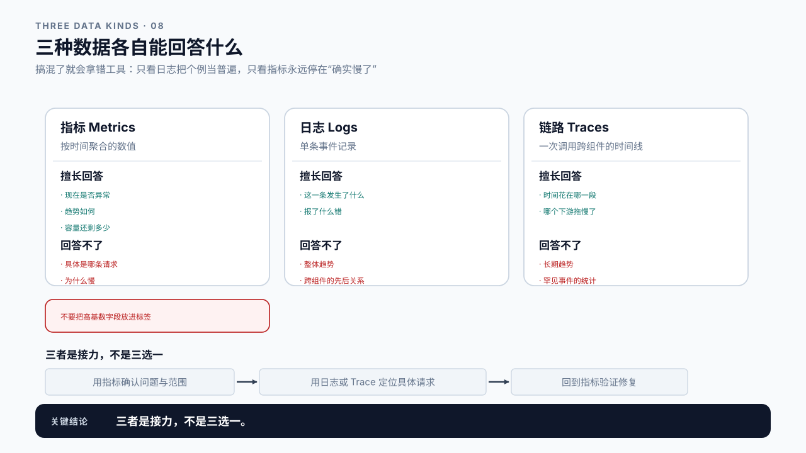
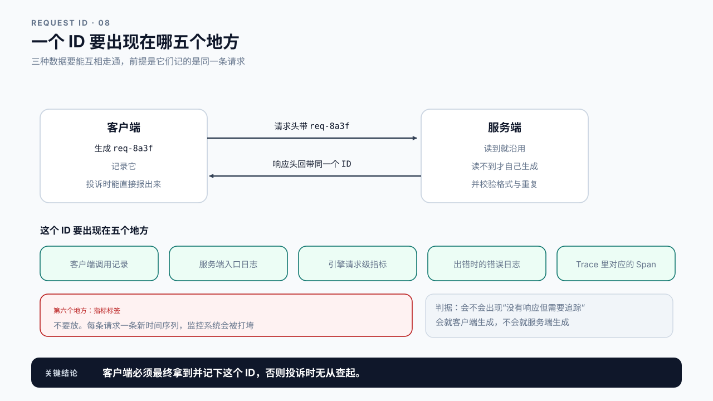
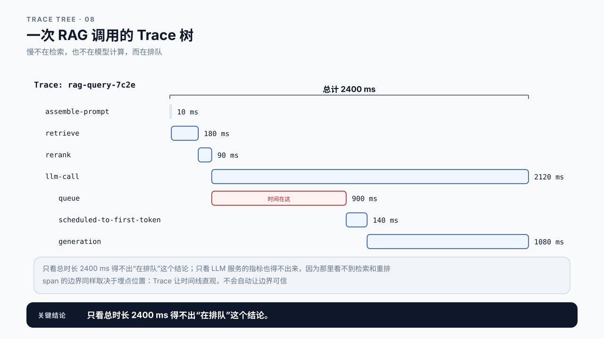
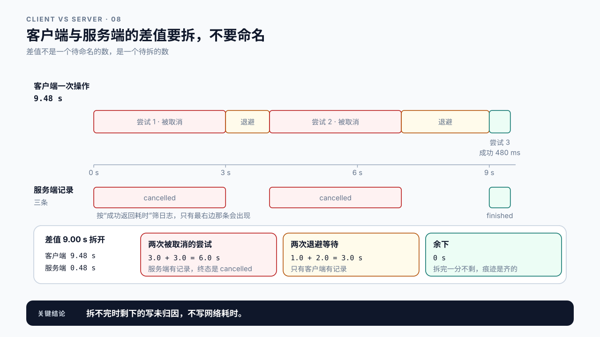

# 第 8 章 请求级可观测性：把一条请求的痕迹找齐

## 学习目标

读完这一章，你应该能回答三个问题：

1. 用户投诉某一次调用很慢，你怎样把这条请求在各个系统里的痕迹找齐？
2. 日志、指标和 Trace 各自能回答什么，又回答不了什么？
3. 要让请求可追踪，客户端和服务端分别要做什么？

跟着做完，你会得到一条用同一个 ID 贯通客户端、服务端日志和指标的请求记录。

第 7 章跑出了一份可复现的 Baseline，那是一批请求的统计。但线上出问题时，用户投诉的是某一次调用。统计告诉你“P99 是 8 秒”，用户想知道的是“我那一次为什么等了 8 秒”。**这两个问题需要的证据不一样。**

## 8.1 P99 高，但你不知道是哪些请求

假设监控告警：TTFT P99 从 400 ms 涨到 6 秒。

你打开 Dashboard，看到曲线确实在涨。然后呢？

P99 是一个聚合数字，它告诉你“有 1% 的请求很慢”，但没告诉你**是哪 1%**。你无法回答：那些慢请求的 prompt 有多长？它们来自哪个租户？是集中在某几分钟，还是均匀分布？是同一批用户反复遇到，还是随机撞上？

这些问题都需要**单条请求的记录**，而指标系统里没有。指标是把成千上万条请求压缩成几个数之后的产物，压缩过程中，“哪一条”这个信息已经丢了。

反过来，如果只有单条日志没有指标，你又会陷入另一种困境：手上有一条慢请求的完整记录，但不知道它是个别现象还是普遍问题，不知道该不该为它改系统。

所以可观测性不是“多接几个监控”，而是**让不同粒度的证据能互相走通**：从聚合指标能下钻到具体请求，从具体请求能回看它所处的整体环境。这一章讲怎样做到这一点。

## 8.2 三种数据，三种问题

日志、指标、Trace 常被合称“可观测性三大支柱”，但它们回答的不是同一类问题。搞混了就会拿错工具。

| | 是什么 | 擅长回答 | 回答不了 |
|---|---|---|---|
| 指标 Metrics | 按时间聚合的数值 | 现在是否异常、趋势如何、容量还剩多少 | 具体是哪条请求、为什么慢 |
| 日志 Logs | 单条事件记录 | 这一条请求发生了什么、报了什么错 | 整体趋势、跨组件的先后关系 |
| 链路 Traces | 一次调用跨组件的时间线 | 时间花在哪一段、哪个下游拖慢了 | 长期趋势、罕见事件的统计 |

> **高基数（high cardinality）**：一个标签可能取值的数量。`model` 只有几个取值，基数低；`request_id` 每条请求都不同，基数极高。
> 指标系统按标签组合存储时间序列，把高基数字段做成标签会让序列数量爆炸，代价极高。这是指标天生无法回答“哪一条”的根本原因。

代价是乘起来的，不是加起来的：一个指标的序列数等于各标签取值数的乘积。

```text
model (5) × status (4) × instance (20)                    = 400 条序列
再加一个取值一万的 user_id                                  = 400 万条序列
```

直方图还要再乘一项：每个标签组合会导出“桶数 + 3”条序列（各档 `_bucket`、`+Inf`、`_sum`、`_count`）。一个 20 桶的直方图，400 种标签组合就是约 9000 条，而不是 400 条。

所以加标签之前先算这个乘积，而不是等存储先撑不住。

这张表的实际用法是：**先用指标确认问题存在和范围，再用日志或 Trace 定位具体请求，最后回到指标验证修复是否生效**。跳过任何一步都会出问题：只看日志会把个例当普遍，只看指标会永远停在“确实慢了”。



图8-1：三种数据各自能回答什么。

## 8.3 Request ID 是那把钥匙

三种数据要能互相走通，前提是它们记的是同一条请求。把它们串起来的，就是一个贯穿全程的 ID。

第 2 章那份生命周期报告里已经有一个 request ID，那是引擎侧生成的。但要做到端到端可追踪，光有引擎侧的 ID 不够，因为客户端不知道它。

全书出现的 ID 有四个。**前三个按作用范围一层套一层**：引擎的 request_id 只活在引擎内部；本节要的 Request ID 从客户端一直贯通到引擎，一条推理请求一个；Trace ID 盖住一次完整的业务调用，一次 RAG 查询或一个 Agent 任务可能含好几条推理请求。Span ID 是另一种切法：Trace 里每一段可计时的操作各有一个，推理请求那一段的 Span 和它的 Request ID 指的是同一条请求，检索、重排也各有自己的 Span。排查单条请求用 Request ID，排查一次调用慢在哪一段用 Trace ID。

| ID | 标识什么 | 谁生成 | 在哪里看得到 |
|---|---|---|---|
| 引擎 request_id | 引擎里的一条请求 | 推理引擎 | 引擎的日志和请求级指标（第 2 章） |
| Request ID | 一条推理请求，从客户端到引擎 | 客户端生成，或服务端生成后回带（本节） | 客户端记录、入口日志、引擎记录、错误日志、对应的 Span（共五处，见下） |
| Trace ID | 一次完整调用，可含多条推理请求 | 调用链最外层的那个服务 | Trace 系统，经 `traceparent` 头往下传（8.4） |
| Span ID | Trace 里可计时的一段 | 每一段各自生成 | Trace 系统，挂在父 Span 下（8.4） |

两种做法：

**客户端生成，服务端沿用。** 客户端在发请求时带上一个 ID，服务端读到就用它，读不到才自己生成。好处是客户端从一开始就握着这个 ID，出问题时能直接报给运维。

```text
客户端                          服务端
  生成 req-8a3f ──请求头──>  读到 req-8a3f，沿用
  记录 req-8a3f              日志、指标、Trace 都用 req-8a3f
  收到响应，确认 ID 一致  <──响应头── 回带 req-8a3f
```

**服务端生成，响应回带。** 服务端生成 ID 并在响应里返回，客户端记录下来。好处是 ID 由服务端统一管理，不担心客户端伪造或重复。

两种都行，但**必须让客户端最终拿到这个 ID 并记录下来**。否则用户投诉时只能说“我大概三点十分点的”，运维只能在日志里按时间模糊搜索，这在高并发下基本等于找不到。

怎么选，有一条判据：**会不会出现“没有响应，但需要追踪”的情况。**

```text
会出现    用客户端生成。请求超时、连接断开、服务端来不及回响应头时，
          客户端手里仍然有 ID
不会出现  用服务端生成。客户端不可信时（公网调用、第三方接入、
          ID 可能被伪造或重复），这条更安全
```

LLM 请求的超时比一般接口常见得多，所以多数场景落在第一行：客户端生成，服务端读到就沿用，同时校验格式并对重复 ID 做处理。8.8 案例一正是这个情形的反面教材，那两条被取消的请求根本没等到响应头，如果 ID 由服务端生成，客户端永远不会知道它们的 ID。

ID 一旦确定，它要出现在这些地方：

- 客户端的调用记录；
- 服务端入口日志（收到、参数校验结果、鉴权结果）；
- 引擎侧的请求级记录（Queue、Scheduled-to-First-Token、Generation）；
- 出错时的错误日志；
- Trace 里对应的那个 Span，单独调用模型时它就是根 Span。

注意**不要把它做成指标标签**。原因就是上面说的高基数问题：给 `ttft_seconds` 加一个 `request_id` 标签，等于每条请求新建一组二十来条序列，监控系统会被打垮。请求级的时间数据应该走日志或 Trace，不走指标。



图8-2：一个 ID 要出现在哪五个地方。

## 8.4 Trace：让“慢在哪一段”有据可查

日志能告诉你一条请求发生过什么，但如果这条请求跨了好几个服务，日志是散在各处的，要靠时间戳拼。Trace 做的就是把这个拼接自动化。

> **Trace 与 Span**：一次完整调用是一个 Trace，其中每个可计时的操作是一个 Span。Span 之间有父子关系，拼起来就是一棵带时间轴的调用树。
> Trace ID 标识整次调用，Span ID 标识其中一段，父 Span ID 表示它由谁发起。

一次 RAG 调用的 Trace 大致是这样：

```text
[Trace: rag-query-7c2e]                          总计 2400 ms
  ├── assemble-prompt                              10 ms
  ├── retrieve                                    180 ms
  ├── rerank                                       90 ms
  └── llm-call                                   2120 ms
        ├── queue                                 900 ms   ← 时间在这
        ├── scheduled-to-first-token              140 ms
        └── generation                           1080 ms
```

这张图一眼就能看出：慢不在检索，也不在模型计算，而在排队。只看总时长 2400 ms 得不出这个结论；只看 LLM 服务的指标也得不出来，因为那里看不到检索和重排。

**跨服务时 Trace 上下文要能传下去。** 业务服务调用 LLM 服务时，要把 Trace 信息放进请求头，下游才能把自己的 span 挂到正确的父节点上。W3C 的 `traceparent` 头是目前通用的格式。传不下去的话，你会得到两棵互不相干的树，等于没有 Trace。

**Trace 不能替代第 2 章的证据分级。** Trace 里那些 span 的边界，同样受埋点位置影响。`queue` 这段是不是真的只有排队，取决于引擎在哪里打点。Trace 让时间线变得直观，但不会自动让边界变得可信。



图8-3：一次 RAG 调用的 Trace 树。

## 8.5 采样：不可能全都留

全量记录每一条请求的 Trace，成本很快会超过服务本身。先把这笔账算出来：

```text
每天请求        200 万条
每条请求的 span  8 个
全量 span       1600 万/天，按每个 span 约 1 KB 计，约 16 GB/天，一个月 480 GB
```

所以要采样。采样有两种时机。

**头部采样**在请求开始时决定留不留，实现简单、开销可预测，但问题在于出问题的请求往往正好没被采到。

**尾部采样**等请求结束后再决定，可以只留慢的和出错的。这正是排障需要的，代价是要先把所有 span 缓存到请求结束，内存和实现复杂度都更高。

两者的差别在同一个存储预算下最清楚。取 1% 的预算，假设慢请求占全量的 1%：

```text
头部采样 1%   期望采到慢请求 200 条/天（2 万条的 1%）
              用户投诉的那一条，被采到的概率 = 1%

尾部采样      2 万条慢请求共 16 万个 span，正好是全量 1600 万的 1%
              也就是在同样 1% 的预算内，慢请求一条不漏
```

第一行最后那句是头部采样最要紧的地方。统计上“一天采到 200 条慢请求”听着够用，**但排障要的不是随便 200 条慢请求，是用户投诉的那一条，而它被采到的概率就等于采样率本身。**

尾部采样要多付的那份内存，可以用第 6.4 节的 Little's Law 算：缓冲里同时压着的 span 数，等于 span 进来的速率乘以等待决策的时间。每天 1600 万个 span，约每秒 185 个；等 10 秒再决定，缓冲里约 1850 个，按每个 1 KB 算不到 2 MB。这是按全天均值算的，按高峰再乘一个峰均比（第 26 章会算它），也只是几 MB。内存并不贵。真正的代价在实现上：同一条 Trace 的 span 分散在网关、检索、LLM 服务等不同进程里，要先汇到同一个决策点，才能判断这条请求慢不慢、错没错，这通常需要一层专门的收集服务，按 Trace ID 把 span 送到同一台实例。

实践中常见的折中是分层：

```text
错误请求        100% 保留
超过 SLO 的请求 100% 保留
其余请求        按比例采样（如 1%）
```

日志也一样。全量记录每条请求的入口日志通常还能承受，但把 prompt 和生成内容全写进日志，量会大到离谱，而且涉及用户隐私。**记 ID、长度和时间，不记内容**是常见做法。

采样率必须记录在案。排障时如果不知道采样率，会把“没找到这条请求的 Trace”误判成“这条请求没经过这个服务”。

## 8.6 客户端也要留痕

有一类问题只靠服务端数据永远查不出来：服务端记录显示这条请求 300 ms 就返回了，用户却说等了 5 秒。

差在哪？可能是网络、客户端排队、连接池耗尽、客户端自己的重试，甚至是客户端进程被 GC 卡住。这些都发生在服务端的观测范围之外。

所以客户端至少要记这几项：

```text
request_id          与服务端一致
request_sent        发出时刻
first_chunk_received 首个内容分片到达
response_finished   响应结束（以上三个时刻取自第 1 章那四个，逐分片间隔这里不需要）
retries             重试了几次，每次的 ID
error               失败原因
```

`retries` 这一项特别容易漏。客户端自动重试时，用户感受到的是一次“很慢的调用”，服务端看到的却是两三条各自很快的请求。不记重试，这两边的数据永远对不上。

第 1 章讲过，客户端首个分片到达不等于服务端首 token 生成。现在多了一条：**客户端记录的总时长，也不等于服务端记录的总时长**。两者的差值是有意义的，但意义要靠拆出来才成立。

用 8.8 案例一那次操作拆一遍：

```text
客户端一次操作        9.48 s
服务端那条成功请求     0.48 s
差值                 9.00 s

  两次被取消的尝试     3.0 + 3.0 = 6.0 s   ← 服务端有记录，只是终态是 cancelled
  两次退避等待         1.0 + 2.0 = 3.0 s   ← 只有客户端有记录
  余下                            0 s
```

这次差值拆完一分不剩，说明这条请求的痕迹是齐的。**拆不完时，剩下的那部分才是网络往返和客户端自身处理，而在没有观测到它的边界之前，它仍然不该被命名。** 这是第 2 章那条规矩的用法：差值不是一个待命名的数，是一个待拆的数；拆到拆不动为止，剩下的写“未归因”。



图8-4：客户端与服务端的差值要拆，不要命名。

## 8.7 Demo：把一条请求的痕迹串起来

本章 Demo 位于 `code/ch08/trace_one_request.py`，需要一个真实的 vLLM 服务，而且服务端要开两个开关：

```bash
vllm serve Qwen/Qwen2.5-0.5B-Instruct \
  --enable-request-id-headers \
  --enable-per-request-metrics
```

两个都是默认关闭的。不开第一个，响应头里没有 `X-Request-Id`，卡片的 `correlation` 永远是 `unknown`；不开第二个，流里没有请求级指标，`server` 块全是 `null`，`gaps` 也就算不出来。版本相关的说法以 `content/reference/environment.md` 那一页为准。

服务起好之后，它发送一条带自定义 Request ID 的请求，把这条请求在各处留下的痕迹收集到一起：

```bash
python3 code/ch08/trace_one_request.py \
  --base-url http://127.0.0.1:8000/v1 \
  --request-id req-demo-001 \
  --output trace-req-demo-001.json
```

输出是一份单请求的证据卡片：

```text
identity      request_id、模型、时间戳
client        请求发出、响应头、首个分片、结束、重试次数
server        引擎返回的请求级记录（Queue / Scheduled-to-First-Token / Generation）
correlation   客户端 ID 与服务端 ID 是否一致
gaps          客户端总时长与服务端总时长的差值
```

`correlation` 这一项是本章的核心检查：**如果客户端带过去的 ID 和服务端回带的 ID 对不上，整条证据链就是断的**，后面所有关联分析都不成立。脚本会显式标记这种情况，而不是默默继续。要注意它只核到入口这一层：回带一致，说明 API 入口见过这个 ID；日志和引擎记录里是不是同一个，还要你按这个 ID 去日志里查到那一行才算核过。

`gaps` 那个差值不要急着命名。它包含网络往返、客户端处理和服务端观测点之外的一切，把它直接叫“网络耗时”就越界了。第 2 章的规矩在这里同样适用：没有观测到的边界，就不要给它起名字。

上面那张卡片的字段名取自仓库里的样例；真机跑出来的是你自己那条请求的数值。两个开关都开着时，`server` 块是引擎填的，`gaps` 能算；缺哪一项就留 `null`，脚本不替你补。把结果脱敏后和环境指纹一起归档，后面第 10 章的根因报告要从它取证据。

## 8.8 案例与常见误区

### 案例一：用户说很慢，日志说很快

用户投诉某次查询等了将近 10 秒。运维按时间在日志里翻，筛出那个时间窗口内**成功返回**的几十条请求，全部在 500 ms 内完成，于是回复“服务端没有慢请求”。

后来给客户端加了 Request ID 和重试记录，重现时发现这一次用户操作在服务端留下了三条请求：

```text
客户端时刻  服务端请求      终态        服务端记录
t=0.0 s     req-...a1      cancelled   Queue 2.9 s，客户端 3.0 s 超时时取消
            退避 1 s
t=4.0 s     req-...a2      cancelled   Queue 2.8 s，同样在 3.0 s 被取消
            退避 2 s
t=9.0 s     req-...a3      finished    Queue 0.2 s，E2E 480 ms
t=9.5 s     用户看到结果
```

只有第三条是成功的，也只有它进了运维那次筛选，而它确实只花了 480 ms。**前两条排队排太久、被客户端先放弃，在日志里是 cancelled，按“成功返回耗时”筛就整批漏掉了。** 用户感受到的九秒半，有六秒在那两条被丢掉的记录里，另外三秒是客户端自己的退避等待。

这里有两件事要分开记。一是不记 `retries`，客户端的一次慢调用和服务端的三条请求永远对不上。二是按终态筛日志会系统性地漏掉取消的那些，而取消恰恰是过载时最先出现的终态。第 2 章说过 `finished`、`cancelled`、`failed` 三条路都要走到资源清理，这里是那条规矩在排障侧的后果：**三类终态都要能被检索，不能只留成功的那一类。**

讨论：如果不记 `retries`，从服务端数据能不能推出这个结论？运维那次筛选要怎么改，才能第一次就看到这两条？

### 案例二：告警很响，定位很难

一个服务接了几十条告警规则，每天响几十次，但每次响了之后都要花半小时以上才能定位。

复盘发现，所有告警都建立在聚合指标上：TTFT P99 高、GPU 利用率低、队列长度增长。它们能说明“有问题”，但无法下钻到具体请求，工程师每次都要手工去日志里捞样本。

改进做法不是加更多告警，而是**让告警带上下钻入口**：告警触发时自动抓取该时间窗口内超过 SLO 的请求 ID 列表，附在告警消息里。定位时间从半小时降到几分钟。

讨论：这个改进依赖哪些前提？如果请求级记录只按 1% 采样，还能这么做吗？

### 案例三：把 request_id 做成了指标标签

团队想让指标也能按请求下钻，于是给 `ttft_seconds` 直方图加了 `request_id` 标签。

上线两小时后，监控系统内存耗尽。每条请求新建一组二十来条序列（直方图的每个桶各一条），几十万条请求就是几百万条；而且客户端库一旦创建了某个标签组合，之后每次抓取都会把它原样导出，客户端进程的内存和监控系统的活跃序列数一起只涨不落。

讨论：如果确实需要“按某个维度下钻指标”，哪些字段适合做标签，哪些不适合？判断依据是什么？

### 两个不写在架构图上的误区

误区一：接了 Trace 就等于可观测。

Trace 只解决“时间花在哪一段”。它回答不了长期趋势，也无法统计罕见事件的分布。而且如果上下文传不下去，你得到的是几棵孤立的树，比没有更容易误导，因为它看起来很完整。

误区二：日志记得越全越好。

把 prompt 和生成内容全量写进日志，量大、贵，还涉及隐私。真正排障需要的是 ID、长度、时间点和错误原因，内容本身很少用得上。需要复现某条请求时，按 ID 去原始存储取，而不是让每条日志都背着全文。

## 本章总结

回到开头的三个问题。

**怎样把一条请求的痕迹找齐？** 靠一个贯穿全程的 Request ID，而且客户端必须最终拿到并记录它。这个 ID 要出现在客户端调用记录、服务端入口日志、引擎的请求级记录、错误日志和 Trace 里对应的 Span 上。唯独不能把它做成聚合指标的标签，那会因为高基数把监控系统打垮。ID 对不上，整条证据链就是断的，后面的关联分析都不成立。

**三种数据各自能回答什么？** 指标是聚合的，告诉你现在是否异常、趋势如何，但压缩过程中丢掉了“哪一条”；日志是单条事件，能说清这一次发生了什么，但难以看出整体；Trace 是跨组件的时间线，能指出时间花在哪一段，却统计不了长期趋势。正确用法是三者接力：指标确认问题和范围，日志或 Trace 定位具体请求，再回到指标验证修复。

**客户端和服务端分别要做什么？** 服务端要把 ID 贯穿日志、请求级记录和 Trace，聚合指标里不放它，跨服务时传递 Trace 上下文，并按错误和超 SLO 分层采样，把采样率记录在案。客户端要记请求发出、首个分片、结束三个时刻，以及重试次数和失败原因。重试最容易漏：客户端的一次“慢调用”在服务端可能是三条各自很快的请求，不记重试，两边数据永远对不上。客户端总时长与服务端总时长的差值有意义，但在没有观测到边界之前，不要给它起名字。

下一章换一个方向：当请求级证据仍然不足以解释现象时，用分层 Profiling 工具去看系统内部。

### 本章 Checklist

- [ ] 能说出手上这条请求的 ID 在哪几个系统里出现过。
- [ ] 客户端的调用记录里有 Request ID，且与服务端记录的一致。
- [ ] 客户端记录了请求发出、首个分片、结束三个时刻和重试次数。
- [ ] 能从一条告警下钻到具体的慢请求 ID 列表。
- [ ] 指标标签里没有 `request_id` 这类高基数字段。
- [ ] 跨服务调用时 Trace 上下文能传下去，得到的是一棵树而不是几棵。
- [ ] 采样策略已写明，包括错误和超 SLO 请求的处理方式与采样率。
- [ ] 客户端总时长与服务端总时长的差值有记录，但没有被命名为“网络耗时”。

## 课后练习

1. 给第 1 章的客户端脚本加上 Request ID，确认服务端日志里能找到同一个 ID。
2. 在客户端设一个很短的超时，触发重试，比较客户端记录与服务端记录的条数差异。
3. 找出你的服务里所有指标标签，逐个判断基数量级，列出有风险的那些。
4. 为一次 RAG 调用画出预期的 Trace 结构，标出每个 span 的父子关系。
5. 设计一套分层采样策略，说明错误请求、超 SLO 请求和普通请求各自的采样率与理由。
6. 取一条真实请求，把它在客户端、服务端日志和引擎请求级记录里的数据拼到一张表上，标出哪些字段来自哪里。
7. 计算该请求客户端总时长与服务端总时长的差值，列出这段时间里可能发生的所有事情。
8. 设计一条告警规则，要求它触发时能直接给出可下钻的请求 ID 列表，写明它依赖哪些前提。
