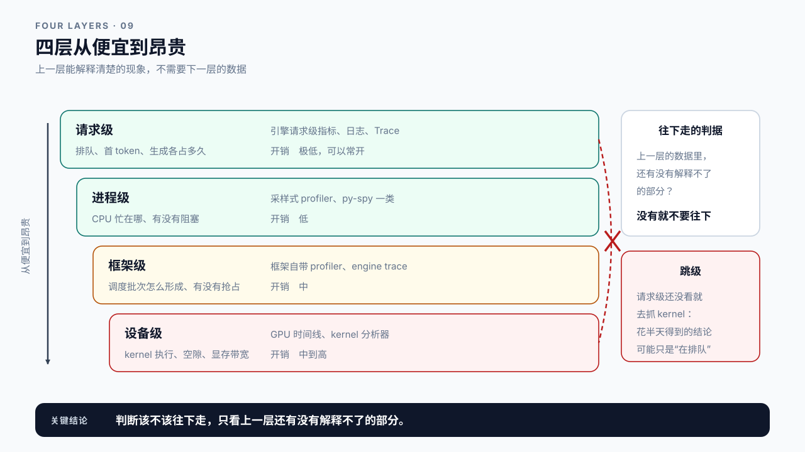
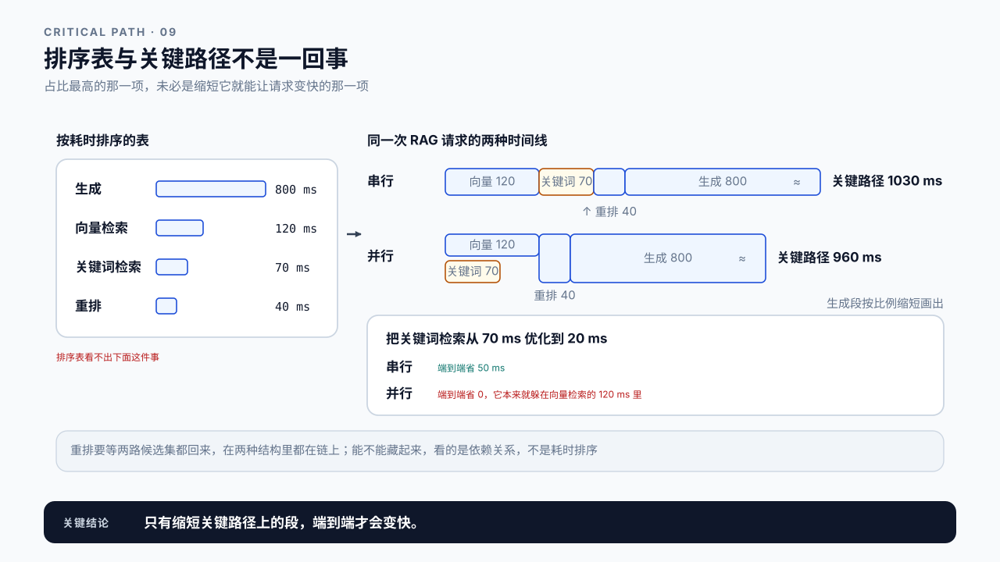
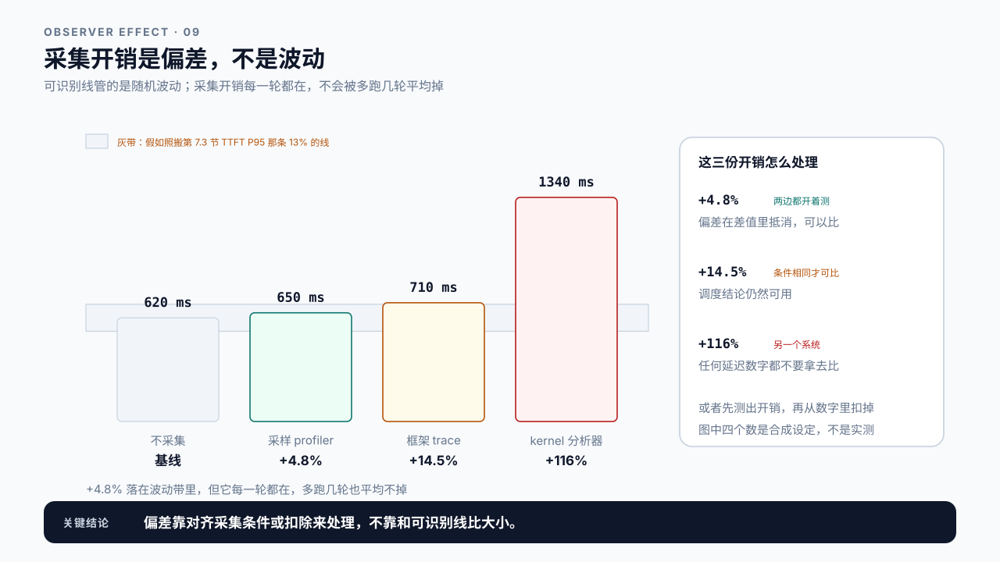
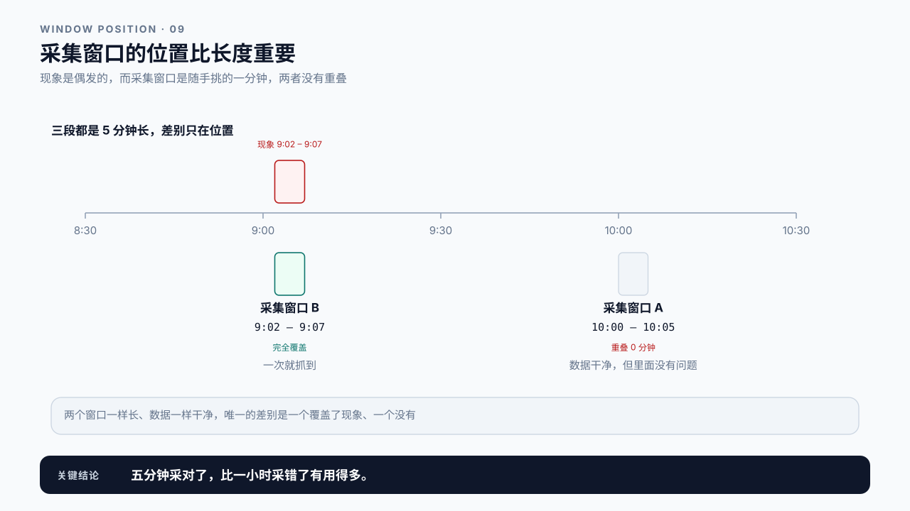

# 第 9 章 Profiling Toolchain：先问问题，再挑工具

## 学习目标

读完这一章，你应该能回答三个问题：

1. 手上这么多 profiling 工具，什么时候该用哪个？
2. 一份 profile 能证明什么，又证明不了什么？
3. 采集这个动作本身，会不会把被测系统改了？

跟着做完，你会得到一张“问题到工具”的对照表，以及一份标注了采集条件的 profile 记录。

第 8 章把一条请求的痕迹串了起来。但有些现象靠请求级记录解释不了：Queue 时间正常、TTFT 却很高，服务端指标看不出异常，GPU 利用率忽高忽低。这时候要打开的是系统内部，而不是再加一条日志。

## 9.1 装了一堆工具，还是定位不了

常见的场景是这样：团队装了 Nsight、接了 PyTorch Profiler、开了框架自带的 trace，出问题时把能跑的都跑一遍，导出几个 GB 的数据，然后对着一堆火焰图和时间线不知道看什么。

问题不在工具不够，而在**没有先把问题问清楚**。

“服务慢”不是一个能用工具回答的问题。能用工具回答的是这一类：

- 首 token 之前的时间，主要花在排队还是模型计算？（请求级就能答）
- GPU 在这段时间里有没有空闲，空闲是因为没活干还是在等 CPU？（要到设备级）
- 这个 kernel 慢，是因为算得多，还是因为在等显存？（设备级，还要配硬件计数器）

括号里那一项就是本章要建立的东西：每个问题对应的证据在不同的层上，**用错层的工具，采出来的数据再详细也答不了**。第一个问题用请求级十分钟能答，如果一上来就抓 kernel，花半天得到的结论还是它。

所以这一章的顺序是：**先分层，再选工具，最后才谈怎么采**。

## 9.2 分层：从便宜的开始

推理系统的可观测层次大致是四层，从外到内、从便宜到昂贵：

| 层 | 看什么 | 典型手段 | 开销 |
|---|---|---|---|
| 请求级 | 排队、首 token、生成各占多久 | 引擎的请求级指标、日志、Trace | 极低 |
| 进程级 | CPU 忙在哪、有没有阻塞、Python 层耗时 | 采样式 profiler、py-spy 一类 | 低 |
| 框架级 | 算子调用序列、调度批次、内存分配 | 框架自带 profiler、engine trace | 中 |
| 设备级 | kernel 执行、显存带宽、SM 占用、通信 | GPU 时间线工具（开销低到中）、kernel 分析器（开销高） | 中到高 |

**从上往下走，不要跳级。** 上一层能解释清楚的现象，不需要下一层的数据。如果请求级指标已经显示 Queue 占了 TTFT 的 86.5%（第 8.4 节那条 Trace），先要问的是负载率为什么高：到达变多了、每条请求的服务变慢了，还是可用容量变小了。这三个问题请求级数据和一张并发曲线就能回答，不必先抓 kernel profile。

但也不能说 kernel 快慢和排队无关。按第 0 章 0.4 那条式子，排队本身是服务时间的函数：设这张卡放走一个请求的间隔 S = 100 ms（第 20.6 节那个服务时间，不是单条请求的时长）、负载率 0.9，平均排队约 900 ms；服务时间缩短 10%，同样的到达速度下负载率降到 0.81，排队只剩约 90 × 0.81 ÷ 0.19 ≈ 384 ms。关键路径是单条请求的视角，GPU 是很多请求共用的，缩短别人的服务时间也会让你少排队。所以顺序是先查到达和容量，查完仍解释不了，再看服务时间这一侧。

反过来，跳级采集的代价很实际：设备级 profiling 的数据量和分析成本都高一个量级，而且很多要停服务或改启动参数。花半天抓回来的 kernel timeline，结论可能只是“确实在排队”。

判断该不该往下走，标准是：**上一层的数据里，还有没有解释不了的部分**。



图9-1：四层从便宜到昂贵。

## 9.3 每一层分别回答什么

### 请求级：时间的大致去向

第 2 章和第 8 章已经建立了这层。它回答的是“一条请求的时间分布在哪几段”，代价极低，应该常开。

它回答不了的是“为什么这一段长”。Queue 时间长，可能是并发太高、可能是 KV Cache 不够导致调度不上、也可能是某个大请求把资源占满了。请求级数据只到“哪一段”为止。

### 进程级：CPU 侧有没有卡住

推理服务不是只有 GPU 在工作。tokenize、请求校验、协议解析、响应组装、日志写入都在 CPU 上，Python 的 GIL 还会让它们互相阻塞。

> **采样式 profiler（sampling profiler）**：定期中断程序、记录当前调用栈，据此估算各函数的耗时占比。
> 它不需要修改代码，开销通常在个位数百分比，适合在真实负载下持续运行。代价是只能给出统计分布，无法还原某一次具体调用的完整路径。

这一层适合回答：CPU 使用率是否已经打满、某个函数是不是异常地占时间、有没有线程长期阻塞在锁上。

典型现象是 GPU 利用率不高但吞吐上不去。这时先看 CPU，往往能发现瓶颈在请求预处理或响应序列化，而不是模型。

### 框架级：调度和批次形成

再往下是推理框架自己的视角：这一轮迭代放进了几条请求、token 预算怎么分的、有没有请求被抢占、KV Cache 的分配和释放。

这层数据通常由框架自身提供，开销中等。它回答的是“调度是否高效”。比如 batch 一直只有一两条请求，说明要么流量不够，要么调度策略或容量限制让请求进不来。

第 2 章说过请求时间线和引擎时间线是两条正交的线。框架级 profiling 看的就是引擎那条线。

### 设备级：GPU 上到底在干什么

最后一层看 GPU 执行：每个 kernel 什么时候开始结束、kernel 之间有没有空隙、显存带宽用到了多少、通信占了多久。

要读懂这一层，先要知道 CPU 和 GPU 是怎么配合的。

> **异步执行**（asynchronous execution）：CPU 把 kernel 放进 GPU 的执行队列就立即返回，接着准备下一个；GPU 按队列顺序执行。两边各干各的，只在需要结果时才同步。
> 所以 GPU 时间线上的空隙往往不是 GPU 慢，而是 CPU 没来得及把下一个 kernel 放进队列；也正因为如此，强制同步的工具会把原本重叠的两边变成串行。

上面那张表里的 SM（Streaming Multiprocessor，流式多处理器）是 GPU 上执行 kernel 的计算单元，一块数据中心 GPU 有一百个上下，细节在附录 A。

这里会遇到一个叫 Kernel Launch Gap 的现象：相邻两个 kernel 之间 GPU 空着，通常是在等 CPU 提交下一个任务，也就是上面那条注释说的情形。本章只要求你能在时间线上看出这些空隙；它在 Decode 高频循环里为什么会累积成可观的时间，以及怎么算这笔账，放在第 15.6 节。

这层能回答的问题最具体，但也最容易被误读。一个 kernel 耗时长，可能是计算量本来就大，也可能是在等显存读写，两者的优化方向完全相反，需要配合硬件计数器才能区分。

**这一层的深入分析放在附录。** 正文只要求你能看懂时间线上有没有空洞、kernel 是否密集，以及判断该不该把问题升级给更专门的工具。

## 9.4 读任何一层之前，先问它在不在关键路径上

四层数据都会给你一张按耗时排序的表，而排序表最容易让人得出错误结论：占比最高的那一项，未必是缩短它就能让请求变快的那一项。

> **关键路径（critical path）**：一次请求里决定总时长的那条最长的依赖链，链上每一段都要等前一段结束才能开始。
> 只有缩短关键路径上的段，端到端才会变快。不在链上的段再慢，也只是躲在别人的等待时间里。

拿一次 RAG 请求举例：向量检索 120 ms、关键词检索 70 ms、重排 40 ms、生成 800 ms。两路检索互不依赖，可以同时发出；重排要等两路的候选集都回来，生成又要等重排的结果。

```text
串行  向量 120 → 关键词 70 → 重排 40 → 生成 800             关键路径 1030 ms
并行  两路检索同时发出，取较长的 120 → 重排 40 → 生成 800   关键路径 960 ms
```

把关键词检索从 70 ms 优化到 20 ms：串行时端到端省 50 ms，并行时省 0，因为它本来就藏在向量检索的 120 ms 里。重排没有这种待遇，它要等候选集，在两种结构里都在关键路径上。同一项优化，收益差别完全来自它在不在关键路径上，而这要看时间线和依赖关系，不是看排序表。第 23.4 节会用它拆 RAG 链路，第 24 章用它看 Agent 的串行步骤。



图9-2：排序表与关键路径不是一回事。

## 9.5 观测者效应：采集会改变被测对象

有一条容易被忽略的前提：**profiling 本身是有代价的，代价大到一定程度就会改变你要测的东西**。

不同层的影响差别很大：

```text
请求级指标      基本无影响，可以常开
采样 profiler   通常个位数百分比
框架 trace      中等，可能影响调度时序
GPU 时间线      低到中等，不改执行顺序
kernel 分析器   显著，要串行化并反复重放 kernel，延迟涨一个数量级
```

这五行可以配一组合成设定来感受量级。同一份负载、同一台机器，只改采集方式：

```text
不采集              P99   620 ms
采样 profiler       P99   650 ms    +4.8%
框架 trace          P99   710 ms    +14.5%
kernel 分析器       P99  1340 ms    +116%
```

这三个百分比容易被拿去和第 7.3 节的可识别线比：+4.8% 小于 13%，于是宣布“开销在线以下，可以和 Baseline 比”。这一步是错的，两者不是同一类误差。可识别线衡量的是随机波动，多跑几轮能把它压低；采集开销是每一轮都有、方向固定的偏差，跑多少轮都平均不掉，它会原封不动地进入改前改后的差值。

处理偏差有两种正确的做法。一是让两边的采集条件相同：改前改后都开着采样 profiler，偏差在差值里抵消。二是先单独测出开销再扣掉：同一份负载开和不开各跑几轮，得到开销本身的估计，再从开着采集测到的数字里减去。可识别线在这里只用来判断开销本身测准了没有。

```text
+4.8%    采样 profiler     改前改后都开着测，可以比；只开一边就不行
+14.5%   框架 trace        延迟数字只在两边条件相同时可比，调度结论仍然可用
+116%    kernel 分析器     已经是另一个系统，任何延迟数字都不要拿去比
```

**偏差靠对齐采集条件或扣除来处理，不靠和可识别线比大小。** 9.8 案例二的讨论题问的就是这件事。

设备级 profiling 尤其要小心，而且它下面还分两种。GPU 时间线工具默认不强制同步，开销通常不大，看的是各段在时间轴上怎么排。kernel 分析器为了计时会串行化执行、把时钟锁在基础频率、每次重放前清缓存，这既破坏了原本的异步流水线（9.3 那条异步执行的注释），也让测到的数字成了“这个 kernel 在受控条件下的耗时”：它适合拿来比较两个 kernel 的快慢，不能当作它在生产里的耗时，总延迟更是另一个系统的延迟。上面那组合成设定里 +116% 的那一行，就是这种工具。

代价之外还有另一件事：采到的样本本身可能是偏的。

> **偏差与方差**（bias and variance）：统计结果偏离真值有两种来源。方差来自随机抽到了哪些样本，样本越多越小；偏差来自采集方式本身让结果系统性地偏向一边，有两种：每个样本都被同一个方向推了一把（采集开销），或者一个样本会不会被记下和它的取值有关（协调遗漏、只留成功请求）。样本再多，偏差都不变小。
> 多采样能消掉方差，消不掉偏差。低采样率下慢请求偶尔整批漏掉，是样本太少带来的方差，提高采样率就能缓解，第 8.5 节的尾部采样是另一种解法。偏差则要改采集方式本身。

本书已经遇到过四个偏差的例子：闭环压测的协调遗漏（第 6.3 节），慢的时候本该发出的请求根本没发；只按成功终态筛日志（第 8 章），取消和失败的请求从样本里消失；从统计里剔除失败请求（第 5 章），最慢的那批被当成没发生；下一节还会遇到一个：采集窗口挑在非高峰（9.6 节），压根没采到现象。再加上这一节的采集开销，它们有一个共同点：多跑多少轮都纠正不了，只能把采集方式改对，或者在报告里写清偏的方向。

所以要分清两类结论：

- 相对结论可以信：这个 kernel 比那个 kernel 慢、这段有空洞那段没有；
- 绝对结论要谨慎：开着 profiler 测出来的 P99 不能直接当作生产表现。

报告里要写清 profile 是在什么条件下采的，以及采集本身带来了多大开销。**没有标注采集条件的 profile，不能和未采集时的 Baseline 直接比较。**



图9-3：采集开销是偏差，不是波动。

## 9.6 采集窗口要对准现象

profiling 数据通常很大，采集窗口不能一直开着。什么时候开、开多久，直接决定了你有没有抓到要找的东西。

常见的失败是：现象是偶发的，而采集窗口是随手挑的一分钟，两者没有重叠。数据是干净的，但里面没有问题。

9.8 案例三就是这个形状，把它的时间摆出来看得更清楚：

```text
现象实际发生   每天 9:02 – 9:07，约 5 分钟
采集窗口       10:00 – 10:05，约 5 分钟
重叠            0 分钟
```

两个窗口一样长、数据一样干净，唯一的差别是一个覆盖了现象、一个没有。**采集窗口的第一属性不是长度，是位置。** 五分钟采对了比一小时采错了有用得多，而且便宜得多。



图9-4：采集窗口的位置比长度重要。

几条可操作的做法：

**先用便宜的层定位时间窗。** 请求级记录可以常开，从中找出慢请求集中的时间段，再在那个时间段重开昂贵的采集。

**用可复现的负载触发。** 第 6、7 章的 workload 描述和 Baseline 脚本在这里派上用场：与其等偶发现象自己出现，不如构造一个能稳定复现它的负载，然后从容采集。

**对齐时钟。** profile 的时间轴和请求日志的时间轴要能对上，否则无法把“这个 kernel 空洞”和“那条慢请求”关联起来。第 2 章讲的时钟域问题在这里同样存在。

**记下窗口边界。** 采集的起止时刻、覆盖了多少请求、期间有没有其他流量，都要记录。一份不知道覆盖范围的 profile，分析出的占比没有意义。

## 9.7 Demo：建立问题到工具的对照

本章 Demo 位于 `code/ch09/profiling_planner.py`，只依赖 Python 标准库。

它不采集数据，而是帮你在采集之前想清楚：手上这个现象，该用哪一层的工具，需要什么前置证据，预期开销多大。

```bash
python3 code/ch09/profiling_planner.py \
  --symptom "TTFT 高但 Queue 正常" \
  --evidence-have request_metrics \
  --output plan-ttft.json
```

输出是一份采集计划：

```text
symptom          现象描述
already_known    已有哪些证据，它们排除了什么
next_layer       建议采集的下一层
rationale        为什么是这一层，上一层为什么不够
expected_cost    预期开销与对系统的影响
window           建议的采集窗口与触发方式
must_record      这次采集必须记录的元数据
```

它会在两种情况下提出警告：跳级（请求级证据还没看就要抓 kernel），和目标不清（现象描述里没有可证伪的表述，比如只写了“服务慢”）。

这个 Demo 的用处不在于它的输出多聪明，而在于**它强迫你在花几小时采集之前，先把“我要回答什么问题”写下来**。第 10 章的根因报告会直接用到这份计划。

## 9.8 案例与常见误区

### 案例一：抓了半天 kernel，结论是在排队

线上 TTFT P99 升高，团队直接上了设备级 profiling，停服务、改启动参数、抓了 4 GB 的 timeline，分析两天。

结论是：kernel 执行都正常，GPU 大部分时间在空转。回头看请求级指标才发现，Queue 时间占了 TTFT 的 88%，早就写在那里了。

真正的原因是上游某个批处理任务在同一时段开始跑，抢走了大量并发额度。这个结论用请求级数据加一张并发曲线，十分钟就能得出。

讨论：什么情况下“直接抓最详细的数据”是对的？这个案例里有没有这样的条件？

### 案例二：开着 profiler 测出来的 P99

一份优化报告显示某项改动让 P99 从 900 ms 降到 600 ms。评审时发现，Baseline 那次是开着 kernel profiler 测的，优化后那次没开。

kernel profiler 为了精确计时强制了 GPU 同步，本身就把延迟推高了不少。两次测量的系统状态不同，300 ms 的“收益”里有多少来自优化，无法判断。

讨论：如果必须在开着 profiler 的情况下做对比，要保证什么？

### 案例三：采到的窗口里没有问题

某服务每天早高峰偶发超时，团队在上午十点抓了五分钟 trace，数据完全正常。

后来在客户端加了请求级记录，发现超时集中在 9:02 到 9:07，那是定时任务批量发起请求的窗口。改成在这个窗口触发采集，一次就抓到了现象。

讨论：如果这个现象无法预测发生时间，还有什么办法能抓到它？

### 两个不会写在工具文档里的误区

误区一：数据越详细，结论越可靠。

详细度和有效性是两回事。一份 4 GB 的 kernel timeline，如果采集窗口没覆盖到问题发生的时刻，它的价值是零。而一条请求级记录，只要覆盖了正确的时间段，就能把范围缩小一个数量级。先保证采对时间和层次，再谈详细度。

误区二：profile 里占比最高的那一项就是瓶颈。

占比高只说明它耗时长。它在不在关键路径上，才决定缩短它有没有用，判断方法在 9.4 节。

## 本章总结

回到开头的三个问题。

**什么时候该用哪个工具？** 按四层从外到内、从便宜到昂贵地走：请求级看时间的大致去向，进程级看 CPU 有没有卡住，框架级看调度和批次形成，设备级看 GPU 上的 kernel 和空隙。不要跳级。上一层能解释清楚的现象，不需要下一层的数据。判断该不该往下走的标准只有一条：上一层的数据里，还有没有解释不了的部分。

**一份 profile 能证明什么？** 相对结论可以信，绝对结论要谨慎。哪个 kernel 更慢、哪段有空洞，这些比较是可靠的；但开着 profiler 测出来的 P99 不是生产表现。采集开销是偏差，不是波动，多跑几轮平均不掉，所以要么让对比的两边采集条件相同，要么先测出开销再扣掉，不能拿它和可识别线比大小。另外，占比最高的那一项未必是瓶颈，它得在关键路径上才算。

**采集会不会改变被测系统？** 会，而且分层差别很大。请求级基本无影响，可以常开；采样 profiler 通常在个位数百分比；kernel profile 常需要强制 GPU 同步，延迟可能翻倍。所以报告里必须写清 profile 是在什么条件下采的，以及带来了多大开销。没有标注采集条件的 profile，不能和未采集时的 Baseline 直接比较。采集窗口同样要记：起止时刻、覆盖请求数、期间有无其他流量，不知道覆盖范围的 profile，算出的占比没有意义。

下一章把前四章的东西合起来用：从一个现象出发，走完提出假设、采集证据、排除竞争解释、形成结论的完整流程，产出一份可复核的根因报告。

### 本章 Checklist

- [ ] 能把手上的现象改写成一个指明了证据层次的问题，而不是“服务慢”。
- [ ] 能说出这个问题对应哪一层的证据，以及上一层为什么不够。
- [ ] 采集之前先看过请求级数据，确认它解释不了这个现象。
- [ ] 知道这次采集的预期开销，以及它会不会影响被测结果。
- [ ] profile 记录里写明了采集条件，包括是否开启同步、采样率。
- [ ] 采集窗口的起止时刻、覆盖请求数和期间流量都有记录。
- [ ] profile 的时间轴与请求日志能对齐，可以把某段空洞关联到具体请求。
- [ ] 不把 profile 里占比最高的项直接当作瓶颈，而是先确认它在关键路径上。

## 课后练习

1. 为下面四个现象各写出它属于哪一层，以及为什么不是相邻的那一层：TTFT 高但 Queue 正常、GPU 利用率低但吞吐上不去、batch 一直只有两条请求、某个 kernel 耗时是同类的三倍。
2. 在真实负载下运行一次采样 profiler，测量它带来的额外开销，记录测量方法。
3. 同一配置下分别在开启和关闭设备级 profiling 时跑 Baseline，比较 P99，说明差值的来源。
4. 用第 6 章的 workload 描述构造一个能稳定复现某现象的负载，说明你如何验证它确实复现了。
5. 取一份 profile 和一段请求日志，把两者的时间轴对齐，找出某条慢请求对应的那段 GPU 活动。
6. 找出你的 profile 里占比最高的三项，逐项判断它们是否在关键路径上，说明判断依据。
7. 写一份采集计划，覆盖现象描述、已有证据、目标层次、预期开销、窗口与必须记录的元数据。
8. 设计一个偶发问题的捕获方案：无法预测发生时间，但需要在它发生时自动开始采集。
