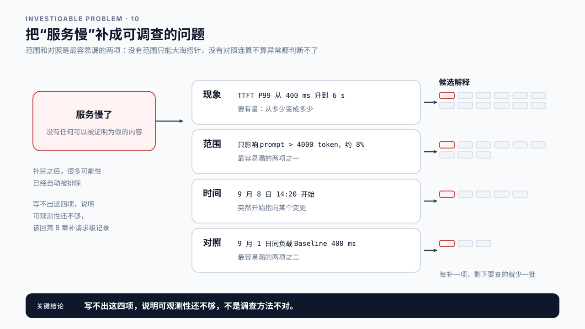
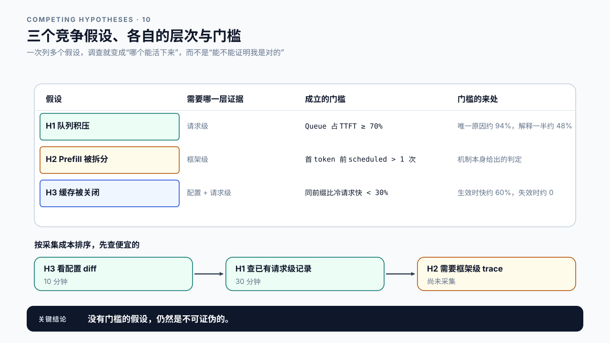
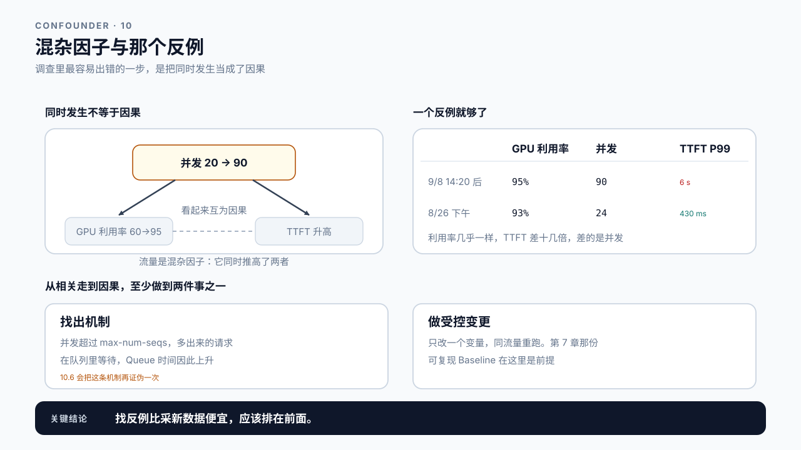
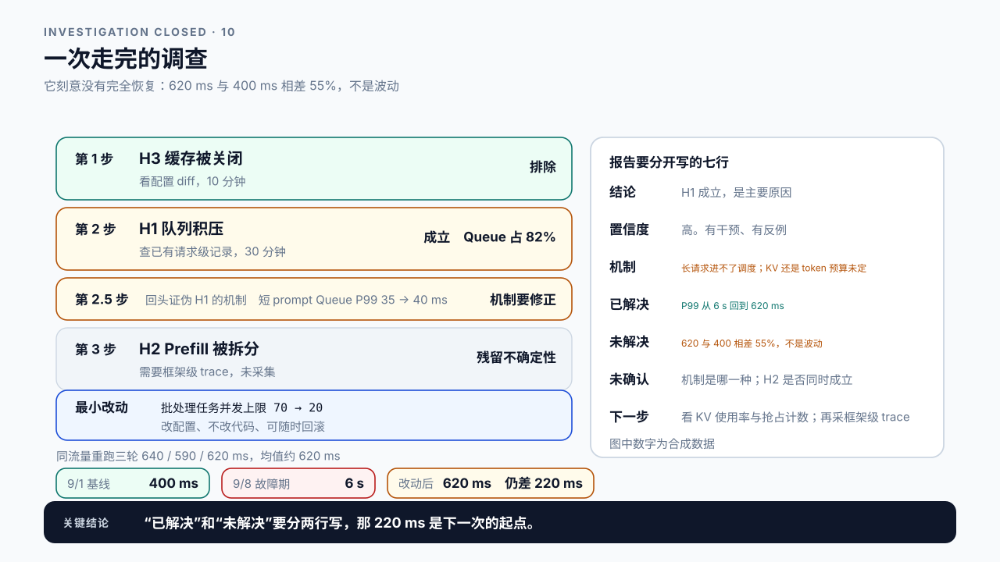

# 第 10 章 Root Cause Analysis Lab：把现象收敛成可证伪的结论

## 学习目标

读完这一章，你应该能回答三个问题：

1. 怎样把“服务慢”变成一个可以被证伪的假设？
2. 哪些证据足以支撑根因，哪些只是碰巧同时发生？
3. 一份根因报告要写成什么样，别人才能复核甚至推翻它？

跟着做完，你会产出本篇的最终交付物：一份完整的根因报告，包含现象、假设、证据、排除项、残留不确定性和下一步。

前四章各自解决了一件事：第 6 章说清楚负载是什么，第 7 章让数字可复现，第 8 章让单条请求可追踪，第 9 章决定该采哪一层的数据。这一章把它们连起来跑一遍完整流程。

这是一章实践课。方法不新，难的是在真实证据不全的情况下仍然做出诚实的判断。

## 10.1 “服务慢”不是一个可以调查的问题

排障最常见的起点是一句话：服务慢了。

这句话没法调查，因为它不包含任何可以被证明为假的内容。慢多少？哪些请求慢？和什么时候比？在这些都没说清之前，任何“调查”都是在猜。

把它变成可调查的问题，要补四件事：

```text
现象    TTFT P99 从 400 ms 升到 6 s
范围    只影响 prompt 超过 4000 token 的请求，约占 8%
时间    9 月 8 日 14:20 开始，持续至今
对照    9 月 1 日同负载下的 Baseline 为 400 ms
```

补完之后，很多可能性已经被排除了。“只影响长 prompt”就把纯 Decode 侧的解释排掉大半；“14:20 突然开始”指向某个变更，而不是渐进的容量不足。

**范围和对照是最容易漏的两项。** 没有范围，你会在全量请求里大海捞针；没有对照，你甚至无法确定“6 秒”算不算异常，也许这个服务一直是这样。

写不出这四项，说明当前的可观测性还不够，应该先回第 8 章把请求级记录补上，而不是硬着头皮往下查。



图10-1：把“服务慢”补成可调查的问题。

## 10.2 假设要能被证伪

有了可调查的问题，下一步是提假设。

一个有用的假设必须**能被证据推翻**。对比下面两种写法：

| 不可证伪 | 可证伪 |
|---|---|
| GPU 性能不够 | 长 prompt 请求的 Prefill 计算量超过单批预算，被拆成多轮调度，导致首 token 延后 |
| 系统负载太高 | 14:20 起并发从 20 升到 90，队列长度持续增长，Queue 时间占 TTFT 的 70% 以上 |
| 可能是缓存问题 | 新版本关闭了 Prefix Cache，长 prompt 的重复前缀不再复用，Prefill 计算量增加数倍 |

左边那些无法被任何证据推翻，因此也无法被证实，它们只是换个说法重复了现象。右边每一条都明确指出了应该在哪里看到什么，如果看不到，假设就不成立。

**一次列多个竞争假设，而不是盯着一个查。** 只有一个假设时，人会不自觉地去找支持它的证据，忽略反面的。同时摆出三四个，调查就变成了“哪个能活下来”，这比“能不能证明我是对的”可靠得多。

按第 9 章的分层，给每个假设标出它需要哪一层的证据：

```text
H1 队列积压        请求级：Queue 时间占比、并发曲线
H2 Prefill 被拆分  框架级：调度批次、token 预算
H3 缓存被关闭      配置差异 + 请求级：相同前缀请求的 TTFT 对比
```

标完会发现，H1 和 H3 用的都是已有的请求级数据，成本极低，应该先查。H2 需要框架级采集，放后面。

**还差最后一步：每个假设要给一条可判定的门槛。** 没有门槛，“Queue 时间占比高”是多高仍然由人说了算，假设就又变回不可证伪的了。

```text
H1 成立的门槛   长 prompt 请求的 Queue 占 TTFT 达到 70% 以上
                （逐条算 Queue ÷ TTFT，取中位数；9 月 1 日 Baseline 上是 15%）
H2 成立的门槛   同长度的长 prompt 请求，首 token 前的调度轮数比 9 月 1 日多
                （或每轮分到的 Prefill token 数比 9 月 1 日少）
H3 成立的门槛   相同前缀请求比冷请求快不到 30%
                （9 月 1 日 Baseline 上快约 60%；缓存失效时应接近 0）
```

门槛里的数字都有来处，而且可以推出来。

先看 H1 的 70%。用 P99 那一档的长请求粗算（把中位数那个比例借来当它的比例，口径不严格，只为定一个量级）：9 月 1 日这一档的 TTFT 约 400 ms，Queue 占 15%，也就是 Queue 约 60 ms、其余约 340 ms；故障期 TTFT 约 6 s，多出约 5.6 s。如果排队是唯一原因，其余那 340 ms 不变，Queue 的占比应该是 5660 ÷ 6000 ≈ 94%；如果排队只解释了一半增量，占比约 48%。70% 落在两者之间，意思是“排队至少解释了增量的大头”。门槛定在这里还有一个好处：实测占比如果明显低于 94%，就说明 Queue 以外的那段也涨了，这本身是一条线索。

再看 H3 的 30%。缓存生效时相同前缀请求快约 60%，缓存失效时两者应该一样快，两种情形相差 60 个百分点，远大于这个比例自身的轮间波动，所以中间画一条 30% 的线就能分开。注意 H3 的门槛没有写成“差异小于可识别线”：线以下只能说“没观察到差异”，不能拿来断言“缓存没起作用”，10.4 会讲这条区分。**门槛不能拍脑袋，否则它只是把主观判断往后挪了一步。**



图10-2：三个竞争假设、各自的层次与门槛。

## 10.3 相关不等于因果

调查过程中最容易出错的一步，是把同时发生当成了因果。

回到上面那次调查。翻监控时会发现一件很诱人的事：14:20 之后 TTFT 升高的同时，GPU 利用率也从 60% 涨到 95%，两条曲线几乎同时起跳。很容易写下“GPU 打满导致 TTFT 升高”。

但这个结论有几种同样成立的替代解释：

- 并发本身从 20 升到 90，既推高了 GPU 利用率，也拉长了队列，两者都是结果，共同原因是流量；
- 某个低效 kernel 让每个请求占用 GPU 更久，利用率高是因为在做无用功；
- 两条曲线的采样窗口不同，一个 15 秒一个 1 分钟，根本不在同一个时间尺度上比较。

第一种解释有个名字，值得记住：

> **混杂因子（confounder）**：同时影响两个观测量的第三个因素。这里的流量就是混杂因子，它既推高 GPU 利用率，又拉长队列，于是两个结果看起来像是互为因果。

要从相关走到因果，至少要做到两件事之一：

**找出机制。** 能说清“A 通过什么路径导致了 B”。比如“并发从 20 升到 90，超过了引擎的 `max-num-seqs`，多出来的请求在队列里等待，Queue 时间因此上升”，这是一条可以逐段检查的链路。

**做受控变更。** 只改一个变量，看现象是否随之变化。第 7 章的可复现 Baseline 在这里是前提：没有它，你无法判断变化是来自你的改动还是本来的波动。

> **干预（intervention）**：主动改变其中一个量，再看另一个变不变。观察到的相关只能提出假设，干预才能把混杂因子排除掉。

还要主动去找**反例**：有没有 GPU 利用率同样高但 TTFT 正常的时段？这次调查里正好有一个。翻回 8 月的监控，8 月 26 日下午有一段利用率同样到过 93%，而那天 TTFT P99 一直在 430 ms。

```text
9 月 8 日 14:20 后   GPU 利用率 95%   并发 90   TTFT P99 6 s
8 月 26 日下午       GPU 利用率 93%   并发 24   TTFT P99 430 ms
```

两天的利用率几乎一样，TTFT 差十几倍，差的是并发。**这一个反例就把“利用率高导致慢”排掉了**，而且它比任何正面证据都便宜：不用新采集，翻历史监控就有。找反例应该排在采集新数据之前。



图10-3：混杂因子与那个反例。

## 10.4 排除项和残留不确定性要写下来

一份诚实的根因报告，不只写你相信什么，还要写你排除了什么、以及还有什么没搞清楚。

**排除项**记录你考虑过但否定的假设，以及否定的依据：

```text
已排除  模型权重被换   依据：model revision 在变更前后一致（同为 a1b2c3d）
已排除  网络劣化       依据：要解释的是 TTFT 多出的约 5.6 s；客户端与服务端时长差值
                      9/1 是 35 ms、9/8 是 38 ms，只动了 3 ms，差了三个数量级
已排除  GPU 打满致慢   依据：8/26 利用率 93% 时 TTFT P99 仍为 430 ms（10.3 那个反例）
已排除  H3 缓存被关闭  依据：9/8 那次发布的配置 diff 里未改动 Prefix Cache 相关项，
                      且相同前缀请求的 TTFT 比冷请求低 61%，超过 30% 的门槛，缓存仍在生效
```

注意第二条的写法。“无明显变化”这种话不算依据，要给数、给判据。“没观察到变化”什么时候能当排除依据，要分两步判断。

先问：这个假设如果成立，应该造成多大的变化？网络劣化要解释 5.6 s 的增量，差值至少该涨几秒，实际只动了 3 ms，这样的“没观察到”可以直接排除。再问：这个预期变化比第 7.3 节的可识别线大多少？预期变化至少是线的两倍、实测却落在线以内，可以排除；预期变化本身就在线附近，没观察到只能写“未观察到变化”，不能写“没有变化”，它该进残留不确定性，而不是排除项。后者宣称了一件这次实验证明不了的事。

这里要分清两类错误。把波动当成真实变化，叫第一类错误，也就是误报；把真实存在的变化当成没有，叫第二类错误，也就是漏报。可识别线主要防的是第一类；“没观察到就排除”最容易犯的是第二类，所以排除之前要先算预期效应。预期效应是线的两倍时，真实存在的变化落进线以内的概率约 2.5%：线本身按双侧 5% 定，两倍线时的漏报正好是其中一侧。这就是“两倍”这条经验的来历；想把漏报压到 1% 上下，预期效应要到线的 2.2 倍。第 28 章的门禁会给这两类错误各算一个概率。

写排除项有两个用处：它让复核的人知道你想到过这些，也防止几个月后有人重新提出同一个假设再查一遍。

**残留不确定性**记录证据不足的部分：

```text
未确认  H2 是否成立    原因：框架级 trace 未采集，当前无法判断批次是否被拆
影响    若 H2 也成立，仅解决 H1 可能只恢复一部分
```

第 2 章那条规矩在这里同样适用：**没有证据就写没有证据，不要用推测填满报告**。一份写着“还有一段没查清”的报告，比一份把所有空白都圆上的报告可信得多。

到这里，本篇开头那三件套就凑齐了：对照在 10.1 的第四项和 10.6 的同流量重跑里，排除在 10.3 的反例和 10.4 的排除项里，残留不确定性在 10.4 的第二张表里。10.2 那种可证伪的写法，是让这三样都能落地的前提。三样都在，这份报告才算能交出去。

## 10.5 先做最小侵入的改动

根因确定之后，下一步不是直接上最优方案，而是**先做能验证结论的最小改动**。

原因是根因判断本身可能是错的。如果一上来就同时改三处、再加一次架构调整，改完之后即使指标恢复了，你也不知道是哪一处起了作用，更不知道当初的判断对不对。

### 动手之前先算这次改动的上限

还有一件事要在动手前做完：算出这次改动能带来多少收益。最粗的一句是：某一段占端到端的比例，就是把它优化到零的收益上限。

用第 9.4 节那次串行 RAG 请求代入：向量检索 120 ms、关键词检索 70 ms、重排 40 ms、生成 800 ms，端到端 1030 ms。

```text
重排        40 ÷ 1030  ≈ 3.9%    优化到零，端到端最多快 3.9%
两路检索   190 ÷ 1030  ≈ 18.4%   优化到零，端到端最多快 18.4%
生成       800 ÷ 1030  ≈ 77.7%   只有这一段能带来大幅改善
```

一段代码很少能优化到零，更常见的是快几倍。把“优化到零”换成“加速 s 倍”，就是 Amdahl 定律：

```text
端到端节省 ≈ f × (1 − 1/s)        f 是这一段在关键路径上的占比，s 是这一段的加速倍数
```

s 趋于无穷时，它退回上面那个上限 f。生成快一倍，端到端省 77.7% × 0.5 ≈ 39%；重排快十倍，端到端只省 3.9% × 0.9 ≈ 3.5%。所以算出来的上限本身只有百分之几的事，不值得排在第一个做，哪怕它在排序表上看着很刺眼。后面第 17、23、25、30 章算优化收益时用的都是这条式子。

> **Amdahl 定律**（Amdahl's law）：只加速整体中的一部分时，整体的提速受这部分所占比例的限制，节省等于占比乘以 (1 − 1/加速倍数)。
> 它的前提是被加速的那段与其他段互不影响，加速它不会改变别的段花多少时间。

这条式子在两种情况下失效。

一是这一段不在关键路径上。此时 f 是零而不是它在排序表上的占比，要回到第 9.4 节看时间线。

二是这一段会改变别的段，最典型的是排队。Amdahl 默认各段互不影响，排队段恰恰不满足：服务变快，同样的到达速度下负载率降低，排队按第 0 章的 ρ/(1−ρ) 塌下去。沿用第 9.2 节那组数：服务时间 100 ms、负载率 0.9，排队约 900 ms，端到端约 1000 ms。服务时间缩短 10%，照 Amdahl 算，服务只占端到端的一成，只该省约 1%；实际上负载率降到 0.81，排队降到约 384 ms，端到端降到约 474 ms，省了一半多。所以当排队占大头时，提升服务速度的收益可能远超它的占比，要按第 20 章的排队模型重算，不能套 Amdahl。

最小侵入的顺序大致是：

```text
1. 改配置（不改代码、可随时回滚）
2. 改参数（需要重启，但影响可控）
3. 改代码（需要发布流程）
4. 改架构（涉及多方，周期长）
```

从第 1 类开始试。如果调一个并发上限就能把 TTFT 从 6 秒压回几百毫秒，那既验证了根因，也争取到了时间去做更彻底的修复。

**验证必须用同流量重跑。** 第 7 章的 workload 描述和 Baseline 协议在这里要原样复用：同一份负载描述、同样的 Warmup、同样的轮次和窗口。改了负载再对比，得出的收益没有意义。报告里要写明“同流量”指的是哪一份描述，以及线上有没有别的流量同时在跑。

如果最小改动没有让现象改善，那是个重要信号：**根因判断可能不对**，回到 10.2 重新审视那几个假设，而不是继续加大改动力度。

## 10.6 把这次调查写完

前面五节各讲一件事，用的都是 10.1 那个现象。这一节把它收口，看看一份走完的调查长什么样。

**查了什么，按成本从低到高。**

```text
第 1 步  H3 缓存被关闭   看配置 diff，10 分钟
         结果：9/8 那次发布没有动 Prefix Cache 相关项；
               相同前缀请求的 TTFT 比冷请求低 61%，缓存仍在生效   → 排除

第 2 步  H1 队列积压     查已有的请求级记录，30 分钟
         结果：14:20 起并发从 20 升到 90，多出来的 70 来自上游一个
               新上线的批处理任务；长 prompt 请求的 Queue 占 TTFT 的 82%，
               超过 70% 的门槛                                  → 成立

第 2.5 步 H1 的机制      同一批请求级记录，再看短 prompt，10 分钟
         结果：短 prompt 请求的 Queue P99 只从 35 ms 涨到 40 ms → 机制要修正

第 3 步  H2 Prefill 被拆分  需要框架级 trace，未采集
         结果：无法判断                                          → 残留不确定性
```

第 2.5 步是对 H1 自己的一次证伪。如果机制真是 10.3 写的“并发超过上限、多出来的请求在队列里等”，短 prompt 请求也该一起排队，可它们几乎没等。排队集中在长请求身上，说明卡住它们的不是并发上限本身，而是并发涨到 90 之后 KV Cache 的空闲空间常常凑不够一条长 prompt 一次要的量，放得下的短请求先进去了，长请求只能等（调度器允不允许短请求先进，取决于所用引擎的版本和策略，要以实际行为为准）。H1 的结论不变，批处理任务挤占资源是原因；变的是机制，这也解释了 10.1 那条范围为什么只落在长 prompt 上。显存准入的细节在第 16 章。

82% 这个数还透露了一件事。按 10.2 的粗算，排队若是唯一原因，占比应在 94% 左右；实测 82%，说明 Queue 以外的那段也涨了：6 s 的 18% 约 1.1 s，是 9 月 1 日 340 ms 的 3.2 倍。这正是 H2 要回答的问题。

**最小改动。** 按 10.5 的顺序，第一类就够：给那个批处理任务单独设一个并发上限，从 70 压到 20。改配置、不改代码、可随时回滚。

**验证。** 用 9 月 1 日那份 workload 描述和同一套 Baseline 协议发压，批处理任务照常运行（已限到 20 并发），重跑三轮：

```text
9/1  Baseline        TTFT P99   400 ms
9/8  故障期          TTFT P99     6 s
改动后三轮           TTFT P99   640 / 590 / 620 ms，均值约 620 ms
```

**这里最值得学的是它没有完全恢复。** 620 ms 比 400 ms 高 55%；改动后那三轮自己的 CV 约 4%，三轮对三轮的线不到一成（9 月 1 日那一侧同样是三轮，见 10.1 的合成设定）。这个差距不是波动。

有两种解释，而且这次实验分不开：一是批处理任务仍然占着 20 个并发，9 月 1 日那天它还不存在；二是 H2 也成立，长 prompt 的 Prefill 确实被拆了轮次。要分开就得采框架级 trace，那是下一步的事。

所以这份报告的结论应该这样写：

```text
结论      H1 成立，是本次劣化的主要原因。并发从 20 升到 90，
          长 prompt 请求的 Queue 占 TTFT 达 82%
置信度    高。有干预、有反例
机制      初步指向长请求进不了调度。是 KV 空间凑不够，还是单步 token
          预算被大批 Decode 占满，本次没采 KV 使用率和调度记录，分不开
已解决    TTFT P99 从 6 s 回到 620 ms
未解决    620 ms 与 9/1 的 400 ms 相差 55%，超过可识别线
未确认    机制是 KV 还是 token 预算；H2 是否同时成立；
          批处理任务保留的 20 并发贡献了多少
下一步    看 14:20 前后的 KV 使用率与抢占计数，把机制那一项定下来；
          采一次框架级 trace 判定 H2；或把批处理并发临时压到 0 跑一轮，
          先把两种解释分开
```

**“已解决”和“未解决”要分开写。** 只写“已恢复”，那 220 ms 的缺口就消失了，而它恰恰是下一次同类故障的起点。第 28 章那套门禁如果按 400 ms 设阈值，这个服务从此每天都会报警，也是因为这 220 ms 没有被记下来。



图10-4：一次走完的调查。

## 10.7 Demo：产出一份根因报告

本章 Demo 位于 `code/ch10/rca_report.py`，只依赖 Python 标准库。

它不采集数据，而是把你的调查过程组织成结构化报告，并检查这份报告是否自洽。

```bash
python3 code/ch10/rca_report.py \
  --input rca-draft.json \
  --output rca-report.json
```

报告结构对应前面几节，10.6 那次调查就是一份填满了的实例：

```text
problem       现象、范围、时间、对照 Baseline
hypotheses    候选假设列表，每条含预期证据和所需层次
evidence      实际采到的证据，标明来源、层次、采集条件
ruled_out     已排除项及其依据
conclusion    结论、置信度、支撑证据引用
unknowns      残留不确定性及其影响
next_step     最小侵入改动与验证方式
```

检查器会拒绝几类不合格的报告：

- `problem` 缺少范围或对照；
- 某条假设没有写出预期证据，即无法被证伪；
- 某条假设没有写出判定门槛，“高”是多高仍然由人说了算；
- `conclusion` 引用的证据编号在 `evidence` 里不存在；
- `evidence` 里有条目没写采集条件（第 9 章的要求）；
- 某条假设标了未确认，却没出现在 `unknowns` 里；
- `next_step` 的验证方式没写明同流量重跑；
- 只有一条假设，且 `ruled_out` 为空。

最后一条是刻意设的。**只提出一个假设、什么都没排除的调查，通常是先有结论再找证据。** 检查器不判断你的结论对不对，它只检查这个调查过程是否具备被推翻的可能。

仓库里附了一份 10.6 那次调查的完整报告 `content/ch10/evidence/rca-report-sample.json`，可以直接用检查器跑一遍看它为什么通过。**它是合成数据，不是真机诊断。** 它证明的是流程能走通、结构长什么样，不能当作任何真实系统的结论。

Part 2 真正的交付，是在你自己的服务上走完一次完整流程，产出一份能通过这个检查器的报告。样例告诉你报告该长什么样，真实的那份才能告诉你服务慢在哪里。

## 10.8 案例与常见误区

### 案例一：改了三处，指标恢复了

TTFT P99 异常，团队同时做了三件事：调大并发上限、重启服务、回滚了一个前一天的配置变更。指标恢复正常。

一周后同样的问题再次出现。这次没人知道该先试哪一个，因为上次不知道是哪一项起的作用。

如果按最小侵入顺序来：先只回滚配置变更，观察；没好转再调并发；最后才考虑重启。每一步之间留出观察窗口，第一次就能定位。

讨论：线上故障时确实有恢复压力，怎样在“尽快恢复”和“搞清原因”之间取舍？有没有两者兼顾的做法？

### 案例二：GPU 利用率高就是 GPU 的锅

某服务吞吐下降，监控显示 GPU 利用率长期在 95% 以上，团队据此申请扩容。

扩容后吞吐只提升了不到一成。进一步排查发现，利用率高是因为某个算子在新版本里走了低效路径，GPU 大量时间在做本可以避免的计算。换回原来的实现后，利用率降到 60%，吞吐反而翻倍。

利用率是资源指标，它说明 GPU 在忙，不说明它在做有用的事。第 5 章讲过资源指标不能替代结果指标，这个案例是它的实际后果。

讨论：在申请扩容之前，还应该先看哪些证据？

### 案例三：报告里没有排除项

一份根因报告结论明确、证据充分，评审通过。三个月后类似现象重现，新接手的工程师从头查了一遍，最后得出同样的结论，但花了两天。

翻旧报告发现，当初其实排除过四个其他假设，只是没写进报告。那四条线索新工程师又走了一遍。

讨论：排除项应该写到多细？全部记录会不会让报告臃肿到没人看？

### 两个不在流程图上的误区

误区一：根因只有一个。

真实故障常常是多个因素叠加：并发上升、缓存命中率下降、某个慢请求占住资源，任何一个单独出现都不会触发问题。执着于找“那个唯一的根因”，会让你在找到第一个解释后就停下。更实用的问法是：**这些因素各自贡献了多少，去掉哪一个能让现象消失。**

误区二：现象消失就等于根因找对了。

重启能让很多问题暂时消失，但它什么也没证明。判断根因是否正确，标准是“按这个解释做的改动，带来了这个解释所预测的变化”，而不是“改完之后问题不见了”。两者的区别在于：前者可以预测下一次，后者不能。

## 本章总结

回到开头的三个问题。

**怎样把“服务慢”变成可调查的问题？** 补四件事：现象要有量（从多少变成多少）、范围要划定（影响哪一类请求、占比多少）、时间要标明（什么时候开始）、对照要给出（和哪份 Baseline 比）。补完之后很多可能性已经自动排除。范围和对照最容易漏：没有范围只能大海捞针，没有对照连“这算不算异常”都判断不了。写不出这四项，说明可观测性还不够，该回第 8 章补请求级记录。

**哪些证据足以支撑根因？** 能被推翻的才算数。假设要写成“应该在哪里看到什么”，看不到就不成立；一次列三四个竞争假设，让调查变成“哪个能活下来”，而不是“能不能证明我是对的”。同时发生不等于因果，要么说清机制（A 通过什么路径导致 B，逐段可查），要么做受控变更（只改一个变量，同流量重跑），并主动去找反例，连自己认定成立的假设也要再证伪一次。“没观察到变化”能不能当排除依据，要先算这个假设成立时应造成多大的变化：远大于可识别线却没观察到，才能排除。证据不足的部分就写不足，不要用推测填满报告。

**报告要写成什么样？** 七块：现象与对照、候选假设及其预期证据、实际证据及采集条件、排除项及依据、结论与支撑引用、残留不确定性及其影响、最小侵入的下一步。写下一步之前先算收益上限：一段的占比就是把它优化到零的上限，加速 s 倍时节省 `f × (1 − 1/s)`；这段不在关键路径上时 f 为零，这段是排队时要按排队模型重算，两种情况 Amdahl 都给不出答案。排除项和残留不确定性最常被删，但它们恰恰决定了这份报告几个月后还有没有用。验证时要用同一份负载和同样的 Baseline 协议重跑；如果最小改动没有带来预期变化，那是根因判断有问题的信号，回去重审假设，而不是加大改动力度。

Part 2 到此结束。下一篇进入 Prefill 与上下文优化：把这套方法用到第一个具体的瓶颈域上。

### 本章 Checklist

- [ ] 能把手上的现象写成含量值、范围、时间和对照四项的问题描述。
- [ ] 至少提出了三个竞争假设，每个都写明了预期在哪里看到什么证据。
- [ ] 每个假设标注了所需的证据层次，并按成本从低到高排了序。
- [ ] 对每条“同时发生”的观察，要么说清了机制，要么做了受控变更。
- [ ] 主动找过反例，并记录了结果。
- [ ] 报告里有排除项，每条都写了否定依据；靠“没观察到变化”排除的，先算过预期效应比可识别线大多少。
- [ ] 报告里有残留不确定性，写明了它对结论的影响。
- [ ] 动手之前算过这次改动的收益上限，并说明 Amdahl 在这里适不适用。
- [ ] 下一步是最小侵入的改动，且验证方式是同流量重跑。
- [ ] 报告能通过 `rca_report.py` 的自洽检查。

## 课后练习

1. 取一条真实或模拟的告警，按 10.1 的四项把它改写成可调查的问题，标出你缺哪些信息。
2. 为该问题列出至少四个竞争假设，逐个标注所需证据层次和预期开销。
3. 选出成本最低的两个假设先查，记录你实际采到的证据和它们排除了什么。
4. 找一组“同时发生”的指标变化，写出至少三种能解释它的不同机制。
5. 设计一次受控变更来区分其中两种机制，说明你固定了什么、只改了什么。
6. 为一次调查写出完整的排除项，每条附上否定依据。
7. 写出残留不确定性一节，说明如果那部分假设也成立，你的结论要怎么修正。
8. 按最小侵入顺序为你的结论排出四级改动方案，并说明每一级的验证方式和回滚代价。
