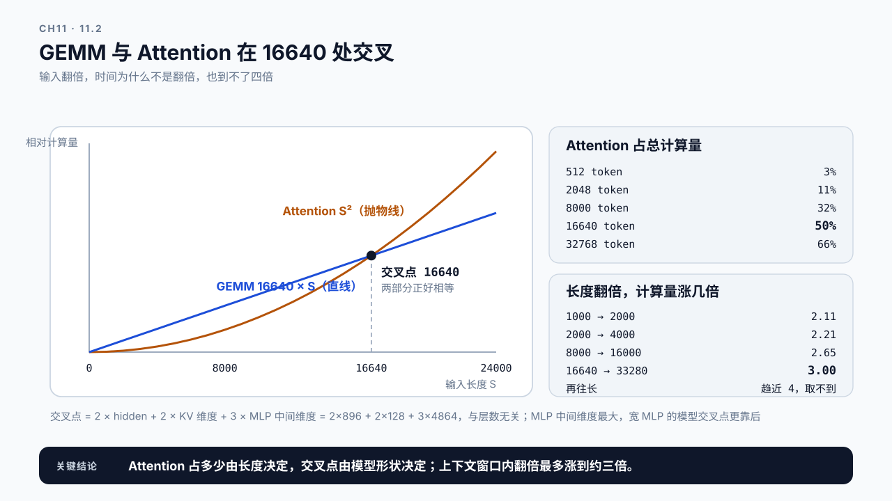
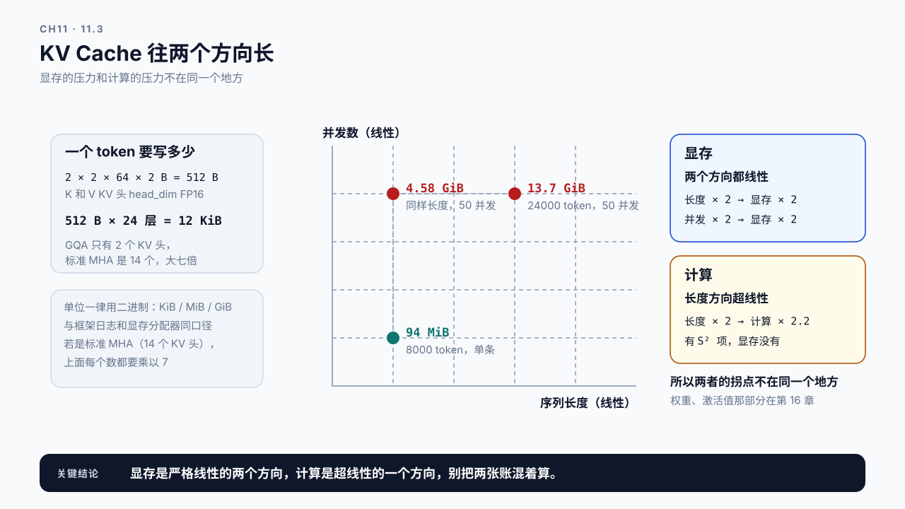
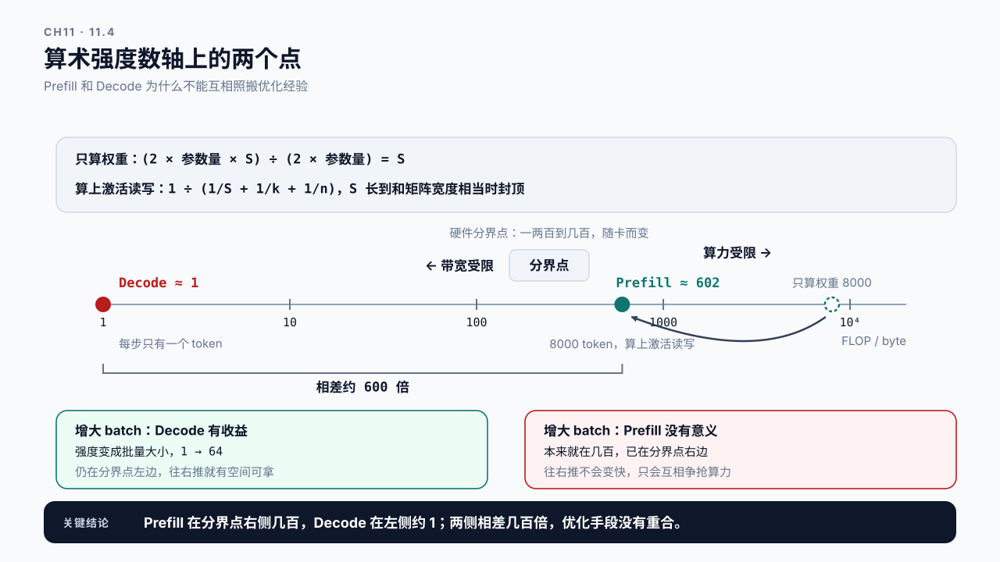
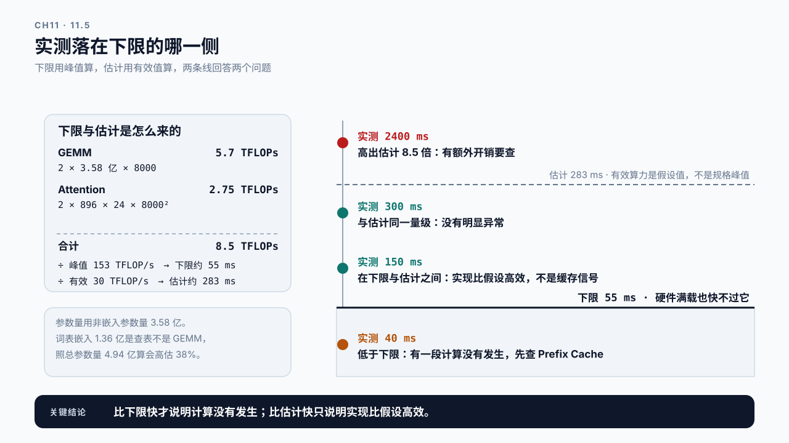

# 第 11 章 Prefill 工作机制与性能模型：首 token 之前发生了什么

## 学习目标

读完这一章，你应该能回答三个问题：

1. Prompt 从进入模型到产出第一个 token，这段时间里 GPU 具体在算什么？
2. 输入长度翻倍，Prefill 时间会翻倍吗？
3. 手上这台机器跑这个模型，Prefill 大概该花多久？怎么判断实测值是不是合理？

跟着做完，你会得到一个能估算 Prefill 计算量和显存写入量的模型，以及一份把估算与实测对照的记录。

第 10 章那份报告留了一条没查完的线：Queue 以外那一段从 340 ms 涨到约 1.1 s，H2“Prefill 被拆分”还等着框架级 trace（10.6）。TTFT 高而 Queue 不高时，时间就花在首 token 之前的模型计算上。这一章拆开这段计算。

Part 2 建立的是通用方法，从这一篇开始把它用到具体瓶颈上。Prefill 是第一个，因为它最容易被观察到，也最容易被错误归因。

## 11.1 一个 8000 token 的 prompt，慢在哪

先从一个具体现象开始。

合成设定：同一个服务，400 token 的短 prompt 的 TTFT 是 80 ms，8000 token 的长 prompt 是 2.4 秒。长度是 20 倍，时间是 30 倍。队列是空的，GPU 只跑这一条请求。时间去哪了？

第 3 章讲过 Prefill 做两件事：把所有 prompt 位置过一遍模型，为每层每个位置写入 KV Cache；取最后一个位置的 Logits 交给 Sampling。第 2 章又补充过，这段时间在报告里叫 `Scheduled-to-First-Token`，它除了 prompt 计算还包含采样和输出组装。

但这些都是定性的。要判断 2.4 秒是否合理、优化空间有多大，需要能算出**这段时间大致应该花多久**。

这一章要建的就是这个估算模型。它不追求精确，精确值必须实测；它的用处是给你一个量级参照：**实测值和估算值差一个数量级时，说明有你还没理解的事情正在发生。**

## 11.2 计算量：两部分，增长方式不同

Prefill 的计算可以粗分成两类，它们随输入长度的增长方式不一样。这是整章最关键的一点。

**线性的那部分**是矩阵乘法：Q/K/V 投影、Attention 输出投影、MLP 的三个投影。每个 token 各自过一遍这些权重，互不相干。所以 token 数翻倍，这部分计算量也翻倍。

**超线性的那部分**是 Attention 本身。第 3 章的公式里，`Q Kᵀ` 要让每个位置和它之前的所有位置做点积。位置 `i` 要算 `i` 次，全部加起来大约是 `S²/2` 次点积；算完注意力权重之后，还要拿它去加权求和 V（`AV` 那一步），又是约 `S²/2` 次同样长度的乘加。所以 token 数翻倍，这部分是四倍。

```text
输入长度 S 翻倍时：

  GEMM 部分（投影、MLP）     计算量 × 2
  Attention 部分（QKᵀ、AV）  计算量 × 4
```

两部分的相对占比随长度变化。短 prompt 时 GEMM 占绝对主导，Attention 那点计算可以忽略；长到一定程度后，`S²` 项开始追上来，最终反超。

这个交叉点在哪，可以直接算出来，不用估。先把两部分写成每层的运算量，`S` 是输入长度：

```text
GEMM       2 × 每层参数量 × S        每个 token 过一遍每个参数，一乘一加
Attention  2 × hidden × S²          QKᵀ 与 AV 各约 S²/2 次长为 hidden 的点积，每次一乘一加
```

两条式子里的 hidden 指 Q 头数 × head_dim；本书两个参考模型都恰好等于 hidden，Q 维度与 hidden 不等的模型要按前者代入。

每层参数量是七个投影矩阵加起来：Q 和输出投影各 `hidden × hidden`，K 和 V 各 `hidden × KV 维度`，MLP 的三个矩阵各 `hidden × MLP 中间维度`。两部分相等时 `S = 每层参数量 ÷ hidden`，展开就是 `2 × hidden + 2 × KV 维度 + 3 × MLP 中间维度`，和层数无关。代入第 3 章那张 Qwen2.5-0.5B 配置表（hidden 896、KV 维度 128、MLP 中间维度 4864）：

```text
S = 2 × 896 + 2 × 128 + 3 × 4864 = 16640
```

也就是说，这个模型上 Attention 要到一万六千多个 token 才和 GEMM 打平。前后各取几个长度看形状：

| 输入长度 | Attention 占 GEMM 的比例 | Attention 占总计算量 |
|---:|---:|---:|
| 512 | 3% | 3% |
| 2048 | 12% | 11% |
| 8000 | 48% | 32% |
| 16640 | 100% | 50% |
| 32768 | 197% | 66% |

**结论是：不要笼统地说“Attention 是 Prefill 的瓶颈”，它在不同长度下的地位完全不同。** 8000 token 时它占将近三分之一，值得看；512 token 时它占 3%，为它做优化基本白费。



图11-1：GEMM 与 Attention 在 16640 处交叉。横轴是输入长度，GEMM 是一条直线，Attention 是一条抛物线，两者在 16640 token 处相交。右侧两张表分别是上面那五行占比，以及长度翻倍时计算量的实际倍数。

这个算法有两处要注意。它只数浮点运算，不数显存读写，而 Attention 的实际耗时占比通常高于这里算出来的计算占比，因为它的算术强度更低，这正是 FlashAttention 的用武之地（第 13.4 节）。另外交叉点随模型变：MLP 中间维度是最大的那一项，宽 MLP 的模型交叉点更靠后，换模型要重算。

回到 11.1 那个现象，现在可以算了。把上面两个式子相加，再除掉与长度无关的公共系数（`2 × hidden × 层数`），一次 Prefill 的相对计算量就只剩一个关于 `S` 的函数：

```text
相对计算量 = S × (16640 + S)
```

代入两个长度：

```text
8000 token    8000 × (16640 + 8000)  = 1.971 亿
 400 token     400 × (16640 +  400)  = 0.068 亿
比值                                    28.9 倍
```

长度只差 20 倍，纯线性会是 20 倍，纯平方会是 400 倍，这个模型算出来是 28.9 倍，实测 30 倍。**估算和实测在增长形状上对上了：长度带来的增长，计算量的形状就能解释。**

但这只是一种检验，叫比值检验。它把所有常数因子都约掉了，所以只能回答“随长度怎么涨”，回答不了“该花多久”。11.5 会用同一个模型算绝对值，在那里会得到另一个结论。

## 11.3 一次 Prefill 要写多少 KV Cache

除了算，Prefill 还要写。每一层、每个位置的 K 和 V 都要存进 KV Cache，供后面 Decode 复用。

写入量可以直接估：

```text
KV 字节数 = 2 × 层数 × KV头数 × head_dim × 序列长度 × 每元素字节数
            ↑
            K 和 V 各一份
```

以第 3 章那个 Qwen2.5-0.5B 为例，它有 24 层、2 个 KV head（第 3 章讲过 GQA）、head_dim 64，按 FP16 每元素 2 字节：

```text
单 token 单层   2 × 2 × 64 × 2 B  =  512 B
单 token 全部   512 B × 24 层      =  12 KiB
8000 tokens     12 KiB × 8000      ≈  94 MiB
```

显存的数字全书统一用二进制单位（KiB、MiB、GiB），因为显存分配器和框架的日志也是这个口径；换成十进制会在第 16 章算容量时差出百分之几，够让两份报告对不上。

94 MiB 听起来不多，但要注意三件事：

**它随并发数线性增长。** 50 条这样的请求同时在跑，就是 4.58 GiB，而且这些内存在整个生成期间都不能释放。

**它随长度线性增长，不是平方。** 计算量里有平方项，显存没有。所以长上下文对显存的压力是线性的，对计算的压力是超线性的，两者的拐点不在同一个地方。

**GQA 让它小了七倍。** 如果是标准 MHA（14 个 KV head），上面的数字要乘以 7，8000 token 就是 656 MiB。这是第 3 章那节说的“GQA 存在的理由”的具体数值。



图11-2：KV Cache 往两个方向长。序列长度和并发数各自都是线性方向，沿任一方向放大都是成比例增长；而计算量在长度方向是超线性的，所以两者的拐点不在同一个地方。

显存那一半的完整讨论在第 16 章。这里只需要知道：**Prefill 不只是算得多，它还在为后面的每一步生成预付显存。**

## 11.4 算力还是带宽：Prefill 通常是算力受限

同样是模型计算，Prefill 和 Decode 的瓶颈类型不同。这个区别决定了优化方向，值得单独说清楚。

> **算力受限与带宽受限（compute-bound / memory-bound）**：一次计算要读一定量的数据、做一定量的运算。运算量相对读取量足够大时，瓶颈在算力；反之瓶颈在把数据搬进计算单元的带宽。
> 判断依据是两者的比值，通常叫算术强度。它是硬件特性和计算形状共同决定的，不是某个算子固有的属性。

Prefill 一次处理 S 个 token。权重只需要从显存读一遍，就能被这 S 个 token 共用，每读一个字节的权重能摊到很多次运算上。**所以 Prefill 通常是算力受限的。**

Decode 则相反：每步只处理 1 个 token，同样要把全部权重读一遍。读得多、算得少，**Decode 通常是带宽受限的**。

这个比值不用估，直接能算出来。FP16 下权重的读取量是 `2 × 参数量` 字节，Prefill 的 GEMM 运算量是 `2 × 参数量 × S`，两者相除，参数量约掉了：

```text
只算权重的读取
Prefill 的算术强度 ≈ S        输入 token 数
Decode 的算术强度  ≈ 1        每步只有一个 token
```

这个式子漏了一样东西：每个投影除了读权重，还要读入 S 个 token 的输入、写出 S 个 token 的输出。一个 k × n 的权重矩阵处理 S 个 token，运算 `2Skn` 次，搬运 `2(Sk + kn + Sn)` 字节，相除得到：

```text
Prefill 的算术强度 ≈ 1 ÷ (1/S + 1/k + 1/n)
```

S 远小于矩阵的两个维度时，它约等于 S；S 长到和矩阵宽度相当，激活的读写追上了权重，强度就封顶了。把这个 0.5B 模型每层的七个投影代进去：

| 输入长度 | 只算权重 | 算上激活读写 |
|---:|---:|---:|
| 512 | 512 | 约 287 |
| 2048 | 2048 | 约 494 |
| 8000 | 8000 | 约 602 |

封顶的位置由矩阵宽度决定，模型越宽封得越高，参考模型二（Qwen2.5-7B）8000 token 时约 1950。

硬件那一侧的分界点，就是峰值算力除以峰值带宽：

```text
分界点 = 峰值算力 ÷ 峰值带宽
A100   312 TFLOP/s ÷ 2.039 TB/s ≈ 153 FLOP/byte
H100 SXM   989 TFLOP/s ÷ 3.35 TB/s  ≈ 295 FLOP/byte
```

**这是本篇那条理论锚的定量形式：长 Prompt 的 Prefill 强度在几百，Decode 每步约 1，分界点在一两百到几百之间。** Prefill 落在分界点右侧，Decode 在左侧两个数量级，两者相差几百到上千倍。但 Prefill 并不在右侧很远的地方：这个小模型 512 token 的 287 就贴着 H100 SXM 的 295，换卡、换精度都可能让判断翻转（低精度会把分界点翻倍，第 17 章），第 14.6 节会遇到这种情况。Decode 这一侧还要把 KV Cache 的读取量加进分母，第 15.7 节会算。分界点在哪些情况下会移动，见附录 F.1。

这个数字顺手解释了下面那张表里最容易记反的一行。增大 batch 会把权重读取摊给更多 token：Decode 的强度从 1 涨到批量大小，批量 64 仍然在分界点左边，往右推就有收益；Prefill 本来就在几百，已经在右边了，再往右推没有意义。



图11-3：算术强度数轴上的两个点。分界点画成一段区间而不是一条线，因为它随卡而变；Decode 约 1，8000 token 的 Prefill 只算权重是 8000，算上激活读写封顶在约 602，两点分别落在区间两侧。

这个差别的实际后果：

| | Prefill | Decode |
|---|---|---|
| 典型瓶颈 | 算力 | 显存带宽 |
| 增大 batch 的效果 | 收益有限，算力本来就被占满 | 收益明显，权重读取被更多请求摊薄 |
| 优化方向 | 减少计算量、提高计算效率 | 减少数据搬运、提高并行度 |

所以把 Decode 的优化经验直接搬到 Prefill 上，往往没有效果。这是后面几章反复要回到的判断。

这条判断背后的 Roofline 模型，以及“单步时间取计算和搬运两个下界里大的那个”这条式子，在附录 A《GPU 性能心智模型》的“算力”一节。第 15 章会用它推 Decode 的批量边界。

## 11.5 估一个数，再去和实测对

把前面几节合起来，可以对一次 Prefill 做量级估算。

计算量的粗略式子是：

```text
Prefill FLOPs ≈ 2 × 参数量 × 输入 token 数        （GEMM 主导部分）
              + Attention 的 S² 项                （长输入时才显著）
```

第一项里的 2 是因为每个参数在乘加中各用一次。这个式子在输入不算特别长时够用。

**这里的参数量要用非嵌入参数量。** 词表嵌入是查表，不是矩阵乘法，不该算进来。Qwen2.5-0.5B 总参数 4.94 亿，其中词表嵌入占 1.36 亿（151936 × 896），真正参与 Prefill GEMM 的是 3.58 亿。照总参数量算会把这一项高估 38%，词表越大的模型高估越多。这是 Prefill 里所有 `2 × 参数量 × token 数` 估算的通用陷阱。Decode 不一样：每一步都要把新 token 过一遍词表投影（lm_head），151936 × 896 这一份矩阵乘法每步都在，算 Decode 的运算量时要加回去。

拿它除以 GPU 的算力，能得到两个不同的数，要分开叫：

```text
下限   Prefill FLOPs ÷ 峰值算力                    硬件满载也快不过它
估计   Prefill FLOPs ÷ (峰值算力 × 经验效率)        正常的实现大概要多久
```

这两个数都只算了计算，没算搬运：Prefill 的算术强度在分界点右侧，附录 A 那条 Roofline 时间形式 `max(FLOPs ÷ 算力, 字节 ÷ 带宽)` 取的是左项。第 15.3 节算 Decode 时取的是右项。

**“有效算力”不是规格书上那个峰值。** 实际能达到的通常只是峰值的一部分，取决于数据类型、kernel 实现和计算形状。做估计时用峰值的一个保守比例即可，重点不是算准，而是得到一个可以对照的数量级。下限则必须用峰值算，它的用处是标出“不可能”的边界。全书统一这个口径：下限由规格值算，估计由有效值算。

走一遍完整的算例，还是这个 0.5B 模型、8000 token。卡用本书的参考卡（Part 3 开篇那张表），FP16 稠密峰值 153 TFLOP/s：

```text
GEMM       2 × 3.58 亿 × 8000        =  5.7 TFLOPs
Attention  2 × 896 × 24 × 8000²      =  2.75 TFLOPs
合计                                    8.5 TFLOPs
下限       8.5 ÷ 153                 ≈  55 ms
估计       8.5 ÷ 30（峰值的两成）      ≈  283 ms
```

Attention 在这里占 32.5%，和 11.2 那张表 8000 token 那一行是同一个数，两处可以互相对账。

拿实测的 `Scheduled-to-First-Token` 和这两个数比：

| 实测落在哪 | 说明什么 |
|---|---|
| 低于下限 | 不可能是算出来的：先查是不是命中了 Prefix Cache，或者这段时间的边界定义不对 |
| 下限与估计之间 | 实现效率比估计时假设的高，正常 |
| 与估计同一量级 | Prefill 本身没有明显异常，要优化就得减少计算量或换更高效的实现 |
| 高出估计数倍 | 有额外开销：可能是 kernel 效率低、被拆成了多轮调度、或这段时间里还混着别的东西 |

第一行很实际。第 7 章讲过 prompt 重复会命中缓存，如果实测比下限还快，不是模型算得快，而是它压根没算。注意它比的是下限，不是估计：实测 150 ms 比 283 ms 的估计快，却仍在 55 ms 的下限之上，这只说明实现比假设的高效，不能据此断定缓存命中。



图11-4：实测落在下限的哪一侧。估计线和下限线分开画，只有下限以下画成阴影区，因为下限已经假设硬件满载；落进阴影区的实测值不是好消息，是某段计算没有发生的信号。

现在回到 11.1 那个 2.4 秒，用两种检验各看一次（下面的“实测”沿用 11.1 的合成设定）：

```text
比值检验    400 → 8000 token   估算 28.9 倍，实测 30 倍          通过
绝对值检验  8000 token         估计 283 ms，实测 2400 ms，8.5 倍   不通过
```

两个检验回答的是不同的问题。比值检验把所有常数因子约掉了，它只问“随长度怎么涨”，答案是计算量的形状解释得了；绝对值检验问“该花多久”，答案是比估计慢了 8.5 倍。换算过来，这次 Prefill 实际只跑出 8.5 ÷ 2.4 ≈ 3.5 TFLOP/s，不到峰值的 3%。一个常数倍的开销对每个长度都一样，所以在比值里看不见它。

所以 11.2 那句“对上了”只对了一半，另一半是一条线索。这个模型只有 896 宽，矩阵窄，可能喂不饱这张卡；Prefill 被拆成多轮调度、kernel 没走上高效路径也都可能。哪一种，要用第 9 章的工具去查。

**这套估算只给量级，不给结论。** 第 10 章的规矩在这里同样适用：估算值和实测值的差异是一条线索，不是根因。

## 11.6 Demo：Prefill 计算量与显存估算器

本章 Demo 位于 `code/ch11/prefill_model.py`，只依赖 Python 标准库，不需要 GPU。

它读入模型配置和输入长度，输出这次 Prefill 的估算：

```bash
python3 code/ch11/prefill_model.py \
  --config code/ch11/model-qwen25-05b.json \
  --input-tokens 8000 \
  --peak-tflops 153 \
  --effective-tflops 30 \
  --measured-ms 2400 \
  --reference-tokens 400 \
  --reference-ms 80 \
  --output prefill-estimate-8k.json
```

`model-qwen25-05b.json` 是一份**放在仓库里的共享配置**，第 12 章和第 13 章的 Demo 都读它。本章正文里的每个数字都出自这份文件，换模型只改这一处，不必在四章正文里各改一遍。

输出包含六组：

```text
config                层数、hidden size、KV 头数、head_dim、参数量、数据类型
compute               GEMM 部分、Attention 部分、两者占比、总 FLOPs
memory                KV Cache 写入字节数、按并发数放大的结果
arithmetic_intensity  只算权重与算上激活读写的两种强度，Decode 的强度
comparison            下限、估计、实测、实测折合的有效算力，以及绝对值检验的解读
ratio_check           两个长度的估算倍数与实测倍数，以及比值检验的解读
```

照上面的命令跑，`comparison` 会报“高出估计数倍”，`ratio_check` 会报“增长形状一致”，正是 11.5 那两个检验。

`compute` 里把两部分**分开列出**是刻意的：它让你直接看到当前长度下 Attention 占多少。改变 `--input-tokens` 再跑一次，能看到这个占比怎么随长度移动，比记住“长了之后 Attention 变重要”更直观。

`comparison` 在缺少 `--measured-ms` 时只输出下限和估计，不编造实测；`ratio_check` 缺少较短那次测量时直接说做不了。这与全书的证据纪律一致：**没有测就是没有测。**

脚本不会给出“该优化什么”的建议。它只负责把量级摆出来，判断留给你。

## 11.7 案例与常见误区

### 案例一：输入翻倍，时间涨了 2.3 倍

合成设定：一个文档摘要服务，把输入从 2000 token 提到 4000，团队预期 TTFT 翻倍，实测涨了 2.3 倍。有人认为多出来的 0.3 倍说明系统有问题。

用估算器跑一遍两个长度：

```text
2000 token   2000 × (16640 + 2000)  =  0.373 亿
4000 token   4000 × (16640 + 4000)  =  0.826 亿
比值                                    2.215 倍
```

估算 2.215 倍，实测 2.3 倍，两者落在同一个位置。多出来的那部分不是异常，它就是 Attention 平方项的贡献：2000 token 时 Attention 占总计算量 10.7%，4000 token 时占 19.4%。

**顺便可以把“翻倍就是四倍”这个说法彻底排除掉。** 四倍要求 Attention 完全主导，而它只在长度远超交叉点时才逼近。用同一个函数算一遍，上限在哪就很清楚：

```text
1000 → 2000       2.11 倍
2000 → 4000       2.21 倍
8000 → 16000      2.65 倍
16640 → 33280     3.00 倍     ← 交叉点上正好三倍
再往长                        趋近 4 倍，取不到
```

所以在这个模型 32768 的上下文窗口内，翻倍最多涨到约三倍（式子本身随长度趋近 4 倍，但那要长到窗口之外）。真正该做的不是排查系统，而是回到第 6 章重新描述负载：如果生产上确实有大量 4000 token 请求，容量规划要按这个成本重算。

讨论：如果实测真的是四倍，你会先怀疑什么？计算量已经解释不了它了。

### 案例二：比下限还快

合成设定：某次 Baseline 显示 8000 token 的 Prefill 只用了 40 ms，而 11.5 那个算例给出的下限是 55 ms。

第 7 章的老问题：压测脚本用的是同一份长 prompt，Prefix Cache 全部命中。真实计算几乎没发生。

**比下限快是一个强信号**，因为下限已经假设了硬件满载。出现这种情况，多半是某段计算被跳过了，而不是硬件超常发挥。如果实测是 150 ms，它比 283 ms 的估计快，却在下限之上，就不能用这条规则下结论，那只说明实现效率比假设的高。

讨论：如果确实需要测缓存命中场景下的表现，报告该怎么写才不会被误读？

### 案例三：照搬 Decode 的优化经验

合成设定：团队在 Decode 侧通过增大 batch 拿到了明显的吞吐提升，于是把同样思路用在 Prefill：允许更多长 prompt 请求同时进入 Prefill 阶段。

结果 TTFT 不降反升。原因是 Prefill 本来就是算力受限的，多条请求并不能摊薄什么，反而互相争抢算力，每条都变慢。

讨论：那么什么情况下把多条 Prefill 合并处理是有意义的？

### 两个不写在公式里的误区

误区一：Attention 是 Prefill 的瓶颈。

这句话在足够长的输入下成立，短输入下不成立。GEMM 和 Attention 的占比随长度移动，交叉点和模型形状有关：这个 0.5B 模型的交叉点是 16640，512 token 时 Attention 只占 3%。不带长度谈占比，结论会在不同场景下自相矛盾。

误区二：估算值和实测值差得多，说明估算没用。

估算的价值恰恰在于偏差本身。差一个数量级时，它告诉你“有你还没理解的事情正在发生”，这是一条很强的线索。把估算当作预测来用才会失望，把它当作对照基准来用才对。

## 本章总结

回到开头的三个问题。

**首 token 之前 GPU 在算什么？** 把全部 prompt 位置过一遍模型：每个位置做 Q/K/V 投影、Attention、MLP，同时把每层每个位置的 K 和 V 写进 KV Cache，最后取末位置的 Logits 交给采样。所以这段时间既在算，也在为后续每一步生成预付显存。报告里它叫 `Scheduled-to-First-Token`，除 prompt 计算外还含采样和输出组装。

**输入翻倍，时间会翻倍吗？** 不会，会更多，但也远没到四倍。计算分两部分：投影和 MLP 这些 GEMM 随长度线性增长，Attention 的 `QKᵀ` 因为每个位置要和之前所有位置做点积，随长度平方增长。两部分在这个 0.5B 模型上于 16640 token 打平，短输入下 GEMM 主导（512 token 时 Attention 占 3%），长输入下 Attention 追上来（32768 token 时占 66%）。所以翻倍的实际倍数落在 2.1 到 3.0 之间：几千 token 上约 2.2 倍，交叉点上正好 3 倍，四倍是取不到的渐近上限。显存那边不同，KV Cache 写入量是严格线性的。

**大概该花多久？** 用 `2 × 非嵌入参数量 × token 数` 估 GEMM 部分（词表嵌入是查表，算进去会高估三成以上），加上 Attention 的平方项，得到总运算量。除以峰值算力得到下限，除以有效算力得到估计，两个数要分开。这个 0.5B 模型 8000 token 合计 8.5 TFLOPs，在峰值 153 TFLOP/s 的参考卡上下限约 55 ms，按 30 TFLOP/s 估计约 283 ms。实测低于下限要先怀疑缓存命中；与估计同量级说明没有明显异常；高出估计数倍说明有额外开销。比值检验和绝对值检验要都做：11.1 那个 2.4 秒增长形状对得上，绝对值却比估计慢 8.5 倍，后者才是要查的线索。还要记住算术强度：只算权重时 Prefill 约等于输入 token 数，算上激活读写在几百处封顶，Decode 每步约 1，分界点在一两百到几百之间，优化经验不能互相照搬。

下一章把长度这个变量单独拿出来：当上下文长到几千甚至几万 token 时，TTFT 和 token 成本会被放大到什么程度，以及 RAG 场景下这个长度是由谁决定的。

### 本章 Checklist

- [ ] 能说出 Prefill 期间 GPU 做的两类计算，以及它们各自随长度怎么增长。
- [ ] 能用模型配置算出单 token 的 KV Cache 字节数，并推到指定长度和并发。
- [ ] 能说明为什么 Prefill 通常算力受限而 Decode 通常带宽受限。
- [ ] 能用估算器分别给出一次 Prefill 的下限和估计，并说清两者各用什么算力。
- [ ] 拿到实测值后，能同时做比值检验和绝对值检验，并判断它相对下限和估计是正常、偏高还是不可能地偏低。
- [ ] 实测低于下限时，会先去查缓存命中而不是庆祝；只低于估计时，不急着下这个结论。
- [ ] 不在没有指明输入长度的情况下断言 Attention 是不是瓶颈。

## 课后练习

1. 用估算器分别跑 512、2000、8000、32000 token，记录 Attention 占比的变化，找出它开始显著的位置。
2. 把 KV 头数从 2 改成 14（模拟 MHA），比较 8000 token 下的 KV Cache 写入量。
3. 估算 50 并发、每条 4000 token 时的 KV Cache 总占用，判断单卡是否放得下。
4. 取一次真实的 `Scheduled-to-First-Token` 实测值，和估算对比，写出你的解读。
5. 构造一次会命中 Prefix Cache 的测量，观察实测值相对下限和估计的位置。
6. 说明为什么增大 batch 对 Decode 吞吐帮助明显、对 Prefill 帮助有限。
7. 为你手上的模型和 GPU 写一份 Prefill 估算卡片，列出各长度档位的理论时间。
8. 找一份声称“Prefill 慢是因为 Attention”的分析，判断它有没有指明输入长度，以及这个结论在什么长度下成立。
