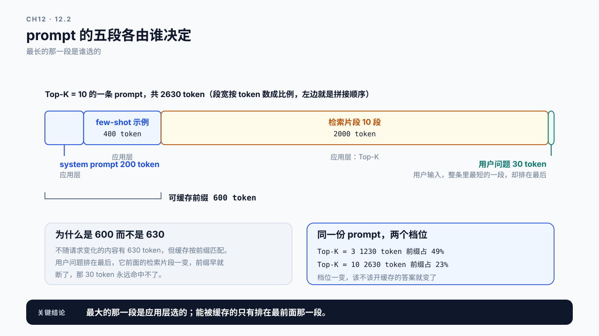
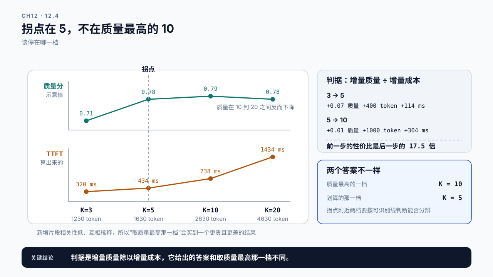
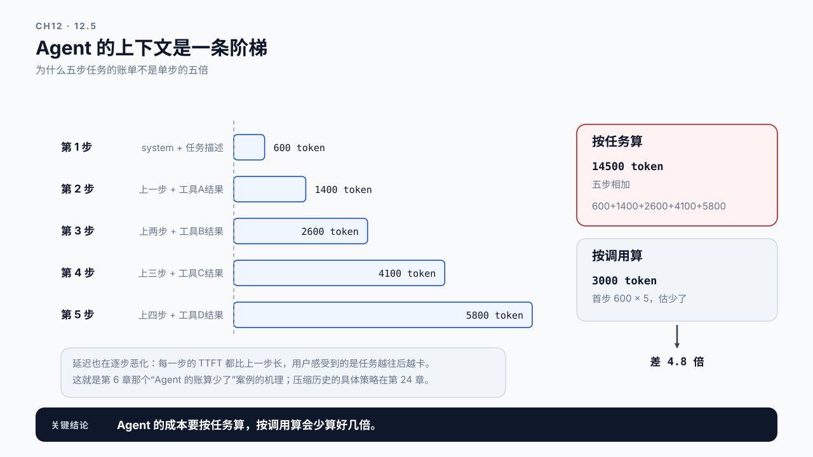

# 第 12 章 长上下文与 RAG 上下文成本：塞进去的每一段都要付钱

## 学习目标

读完这一章，你应该能回答三个问题：

1. 上下文从 500 token 涨到 8000，用户等待和账单各自变成多少倍？
2. RAG 里的 Top-K 调大一档，代价具体落在哪几个地方？
3. 塞进上下文的内容，哪些真的在起作用，哪些只是在付钱？

跟着做完，你会得到一份上下文成本清单：每一段内容占多少 token、贡献多少延迟、值不值这个价。

第 11 章建立了 Prefill 的估算模型，其中输入长度是最重要的自变量。这一章把这个变量单独拿出来，因为在真实系统里，**上下文长度往往不是模型决定的，而是应用层决定的**，而做决定的人经常不知道自己在花多少钱。

**这一章只算两样账：TTFT 和 token 成本。** 长上下文还会推高 KV Cache 占用，进而压低并发上限、增加抢占，那部分在第 16 章算。所以读完这一章你手上的账是不完整的，缺的正是显存那一半。

## 12.1 多塞一段文档，慢了多少

合成设定：一个 RAG 问答服务，原本检索 3 段文档，效果不够好，于是调到 10 段。Top-K=3 那一档实测 TTFT 320 ms，这是全章唯一的锚点，其余的 TTFT 都由它按第 11 章的模型推出来。

上线后用户投诉变慢。

为什么？因为检索回来的每一段都要拼进 prompt。每段约 200 token，Top-K 从 3 调到 10 就多拼了 7 段，prompt 从 1230 token 涨到 2630。按第 11 章那个 `S × (16640 + S)` 的相对计算量算一遍：

```text
1230 token   1230 × 17870  =  0.220 亿
2630 token   2630 × 19270  =  0.507 亿
比值                          2.31 倍
```

长度只涨了 2.14 倍，计算量涨了 2.31 倍，多出来的那点是 Attention 的平方项。把 320 ms 乘上这个比值，Top-K=10 那一档应该在 738 ms 上下，用户投诉的就是这四百多毫秒。

**做这个决定的人通常看不到这笔账。**调 Top-K 的是算法工程师，衡量的是召回率；承担 TTFT 的是用户，处理投诉的是运维。三方看的是不同的指标，中间没有一个地方把“多取 7 段”翻译成“TTFT 涨四百多毫秒、每次调用多花 1400 个输入 token”。

这一章要建的就是这个翻译。

## 12.2 上下文是由谁决定的

先分清 prompt 里各段内容的来源，因为它们的可控性完全不同。

一个典型的 RAG 请求，prompt 大致由这几段拼成：

```text
system prompt        固定，每次都一样            ~200 token
few-shot 示例        固定或按场景切换            ~400 token
检索片段 × K         由 Top-K 和片段长度决定     ~200 × K token
对话历史             随轮次累积                  0 ~ 数千 token
用户问题             用户输入，最短的一段        ~30 token
```

几个反直觉的地方：

**用户问的那句话通常是最短的。** 大家直觉上以为“用户问得长所以慢”，实际上用户输入在整个 prompt 里往往占不到一成。

**最大的那块通常是检索片段或对话历史，而它们都是应用层的选择。** 取几段、每段多长、保留几轮历史，这些都是代码里的常数，不是用户行为。

**固定部分每次都在重复付费。** system prompt 和 few-shot 每次调用都要重新过一遍 Prefill。第 13 章的 Prefix Cache 正是针对这一点：它们不变，所以可以复用。

把上面那张表代进具体档位，这三句话就变成了数：

```text
不随请求变化   system 200 + few-shot 400 + 用户问题 30  =  630 token
Top-K = 3      630 + 3 × 200  =  1230 token
Top-K = 10     630 + 10 × 200 =  2630 token
```

这里有一个容易记错的地方，值得现在就分清：**“每次都一样”和“能被缓存”不是同一件事，能被缓存的只有排在最前面那一段。** 缓存按前缀匹配，用户问题虽然很短，却排在整个 prompt 的最后，它前面的内容变了它就跟着失效。所以真正可缓存的是 system prompt 加 few-shot 那 600 token：

```text
Top-K = 3    可缓存前缀 600 / 1230  =  49%
Top-K = 10   可缓存前缀 600 / 2630  =  23%
```

Top-K=3 那一档，将近一半的 token 每次调用都在重复发送。这个比例就是 12.6 那个 `cacheable` 字段要算的东西，也是第 13 章 Prefix Cache 的天花板。它随 Top-K 变大而迅速摊薄，所以“该不该开缓存”的答案在不同档位上并不相同。



图12-1：prompt 的五段各由谁决定。段宽按 token 数成比例，从左到右就是拼接顺序。用户问的那句话窄到要用引线才标得下，而它恰恰是唯一由用户决定的一段。

所以谈上下文成本时，要按来源分段记账，而不是只看一个总长度。总长度告诉你现在多贵，分段记账才能告诉你贵在哪、哪一段可以动。

## 12.3 两笔账：等待和账单

上下文变长，代价落在两个地方，它们的增长方式不一样。

**用户等待（TTFT）** 按第 11 章的模型增长：线性和平方之间。这笔账由 Prefill 承担，长度翻倍时涨得比两倍多。

多多少，值得说清楚，因为很多人以为“有平方项”就等于“翻倍变四倍”。按第 11 章的模型算，长度翻倍的实际倍数是这样的：1000 到 8000 token 之间约 2.1 到 2.4 倍（1000 → 2000 是 2.11，4000 → 8000 已经到 2.39），到交叉点 16640 才正好三倍，四倍是取不到的渐近上限。**所以在 RAG 常见的几千 token 区间，平方项只贡献一成左右，TTFT 基本是跟着长度线性走的。** 它要变得显著，得等上下文长到接近交叉点。

**token 账单**是严格线性的。输入 token 数直接就是计费的分母之一，翻倍就是两倍。

```text
上下文 1230 → 2630 token（Top-K 从 3 到 10）

  TTFT        320 ms → 738 ms       2.31 倍（按模型推）
  输入 token  1230 → 2630           2.14 倍
  输出 token  基本不变              回答长度不因为输入变长而变化
```

本章开头那一问要的是 500 到 8000 这一段，同一把尺子量一遍：

```text
上下文 500 → 8000 token

  输入 token   500 → 8000                      16 倍，严格线性
  相对计算量   8000 × 24640 ÷ (500 × 17140)    23.0 倍
```

多出来的 7 倍就是 Attention 的平方项。

第三行容易被忽略：**输入变长通常不会让输出也变长**。所以如果你的成本结构里输出 token 单价更高，那么拉长上下文对总成本的影响，可能没有对 TTFT 的影响那么显眼。反过来，如果输入输出单价接近，上下文就是成本的主要来源。

这就带来一个实际的判断：**上下文优化的收益，在延迟和成本两个维度上不一样大**。一个能把 prompt 砍掉 40% 的改动，对 TTFT 的改善可能超过 40%（因为有平方项），对总成本的改善可能低于 40%（因为输出部分没动）。报告里要把两笔账分开写。

## 12.4 有效信息密度：付了钱的内容在起作用吗

把上下文拉长的理由通常是“信息更全，回答更好”。但这个假设值得检验。

三个常见的现象：

**检索回来的片段不一定相关。** Top-K 调大时，新增的那几段排在相关性靠后的位置，它们贡献的信息可能接近于零，但 token 成本一分不少。

**模型不一定用得上中间那部分。** 上下文很长时，模型对开头和结尾附近内容的利用通常好于中间部分，这个现象在长上下文研究里被反复观察到。所以把关键信息埋在很长的上下文中间，是在付钱买一个未必生效的东西。

**冗余内容会互相稀释。** 十段内容里有六段在说同一件事，它们占了六份 token，提供的却是一份信息。

所以要引入一个判断：**每一段内容的边际贡献**。

```text
Top-K    输入 token   TTFT       回答质量
  3        1230        320 ms     0.71
  5        1630        434 ms     0.78
 10        2630        738 ms     0.79      ← 多花 1000 token、304 ms，质量只涨 0.01
 20        4630       1434 ms     0.78      ← 反而下降
```

token 数由 12.2 那张分段表算出来（630 固定加每段 200），TTFT 由第 11 章的模型按 Top-K=3 那一档标定后推出，质量分是示意，真实曲线要自己测。但形状通常是这样：**收益先快后慢，某一点之后停滞甚至反向**。找出那个拐点，就是上下文优化最大的一块空间，不需要任何技术手段，只需要把参数调回去。

> **边际收益递减（diminishing marginal returns）**：每多投入一个单位，带来的增量收益比前一个单位更小。
> 检索片段数是典型例子，因为片段是按相关性排序进来的：第 1 段最相关，第 10 段已经在长尾上。质量的增量沿着排序衰减，而 token 成本对每一段都一样，所以每千 token 换到的质量分只会越来越少。

有了这个名字，停在哪里就有判据了：看的不是绝对质量，而是最后一段的增量质量除以它的增量成本。用上面那张表算一次：

```text
3 → 5     质量 +0.07   成本 +400 token、+114 ms   每千 token 换到 0.175 分
5 → 10    质量 +0.01   成本 +1000 token、+304 ms  每千 token 换到 0.010 分
```

前一步的性价比是后一步的 17.5 倍，所以**拐点在 5 附近，而不是在质量最高的 10**。这个判据和“取质量最高的那一档”会给出不同的答案，而它给的那个答案才是划算的。



图12-2：拐点在 5，不在质量最高的 10。两条曲线分上下两栏画，因为它们量纲不同、不能放在同一根纵轴上比。质量那条在 10 到 20 之间是往下走的。

这条判据在两种情况下要改。片段顺序如果不是按相关性排的，衰减假设就不成立，此时调 Top-K 之前先去修排序；另外增量质量的测量误差往往和 0.01 同量级，所以拐点附近的两档要按第 7 章那条可识别线判断能不能分辨，分辨不了就取更小的那档。

**质量必须实测，不能靠感觉。** 没有一个可量化的质量指标，“加长上下文让回答更好”就是一句无法证伪的话，按第 10 章的标准，它不能作为决策依据。

## 12.5 Agent 的上下文是累积的

RAG 的上下文长度是一次性决定的：检索完拼好，发出去。Agent 不一样。

第 2 章分过 Task、Call、Request 三层。一次 Agent 任务里，每一步的 prompt 都会把之前的工具结果拼进去：

```text
第 1 步   system + 任务描述                         ~600 token
第 2 步   上一步 + 工具A结果                       ~1400 token
第 3 步   上两步 + 工具B结果                       ~2600 token
第 4 步   上三步 + 工具C结果                       ~4100 token
第 5 步   上四步 + 工具D结果                       ~5800 token
合计                                               14500 token
```

于是出现两个 RAG 没有的问题：

**成本是累加的，而且每一步比上一步贵。** 把上面五步加起来是 14500 token，而按第 1 步那 600 token 乘五估算只有 3000，差 4.8 倍。第 6 章那个“Agent 的账算少了”案例里，累积贡献的就是这一项（那里的步数和长度另有一组设定，六倍是步数和累积两项叠出来的）：估算用的是单次调用的长度，而真实账单是一条逐步变长的阶梯的和。

**延迟也在逐步恶化。** 每一步的 TTFT 都比上一步长，用户感受到的是任务越往后越卡。



图12-3：Agent 的上下文是一条阶梯。左边每一级的宽度按 token 数成比例，右边是两种算法的总量对比。

所以 Agent 场景下，上下文管理不是可选优化，而是必需品。常见做法是把历史工具结果压缩或摘要后再拼入，用一点质量换回线性增长。具体策略在第 24 章展开，这里只需要建立一个认识：**Agent 的上下文成本要按任务算，不能按调用算。**

## 12.6 Demo：上下文成本清单

本章 Demo 位于 `code/ch12/context_cost.py`，只依赖 Python 标准库，不需要 GPU。

它把一个 prompt 按来源拆开，逐段算出 token 数、占比和对应的延迟贡献：

```bash
python3 code/ch12/context_cost.py \
  --prompt-spec code/ch12/rag-prompt.json \
  --model-config code/ch11/model-qwen25-05b.json \
  --output context-cost-rag.json
```

输出是一份分段账单：

```text
segments      每段的名称、来源、token 数、占比、是否每次重复
totals        输入 token 总数、估算 TTFT、按单价折算的输入成本
cacheable     固定不变的那部分占多少，理论上可缓存的比例
sensitivity   Top-K 或历史轮次变化一档，总成本变化多少
```

`--model-config` 读的是第 11 章那份共享配置，计算量的形状和第 11 章同源。TTFT 的绝对值则按 12.1 那个锚点标定：Top-K = 3 时 1230 token 实测 320 ms，其余档位按 `S × (16640 + S)` 的相对计算量换算。这次 Prefill 约 0.95 TFLOPs，320 ms 折合约 3 TFLOP/s，和 11.1 那个 2.4 秒（约 3.5 TFLOP/s）是同一个尺度，而不是 11.5 用 30 TFLOP/s 算的那个估计。两章能对账的是这个实测尺度，不是 11.5 的估计值；拿 11.5 的 30 TFLOP/s 去算 1230 token，会得到约 32 ms，比实测快十倍。

`cacheable` 这一项直接指向第 13 章：**它算的是可缓存前缀，不是所有固定内容的总和**。12.2 那两档分别是 49% 和 23%；换算成能省下的 Prefill 计算是 47% 和 20%，比 token 占比再低一点，原因在第 13.3 节。脚本还会检查固定段有没有被排到变化内容后面，排错了就直接给警告，因为那种顺序下缓存永远命中不了。

`sensitivity` 是给做决定的人看的：调 Top-K 之前先看一眼这一档要多花多少，比上线后查投诉便宜。

脚本**不评估回答质量**。它只算成本那一边，质量那一边要靠你自己的评测集。两边都有，才能画出 12.4 那条曲线。

## 12.7 案例与常见误区

### 案例一：Top-K 调大，质量没变

合成设定：一个客服问答服务把 Top-K 从 5 调到 15，希望提升准确率。每段 300 token，prompt 从 2130 token 涨到 5130，按第 11 章的模型 TTFT 涨了约 2.8 倍，准确率在评测集上只提升了不到一个百分点。

回看检索结果发现，第 6 段之后的片段相关性已经很低，大部分是和问题沾边但没有答案的内容。它们占了检索那部分三分之二的 token，几乎没贡献信息。

调回 Top-K=6、再把片段长度从 300 压到 200，prompt 只剩 1830 token，比原来的 2130 还短，TTFT 也比原来低一成多，准确率反而比 15 段时略高，因为去掉了干扰内容。

讨论：如果没有评测集，这个决定要怎么做？

### 案例二：谁该为上下文买单

合成设定：合成设定：一个平台团队发现某个业务方的 token 消耗是同类业务的四倍，于是限了它的配额。业务方抗议说自己的请求量并不高。

查下来发现，该业务的 system prompt 写了 1800 token，包含大量示例和规则说明，而且每次调用都完整发送。请求量确实不高，但每一次都贵。

这不是谁对谁错的问题，而是**没有人看得到这笔账**。平台只统计总 token，业务方只关心效果，中间缺一个把 prompt 结构翻译成成本的环节。

讨论：这个环节应该放在哪里？是平台提供工具，还是业务方自查？

### 案例三：Agent 跑到第八步就很慢了

合成设定：合成设定：一个 Agent 服务在任务前几步响应正常，跑到七八步之后明显变慢，用户经常直接放弃。

原因是每步都把完整的工具输出拼进上下文，到第八步 prompt 已经超过 12000 token，单次 TTFT 接近 4 秒。而这些历史工具结果里，大部分内容对当前这一步的决策已经没有作用。

讨论：压缩历史会不会影响 Agent 的判断质量？怎样验证这个取舍是划算的？

### 两个不写在 prompt 模板里的误区

误区一：上下文越长，回答越好。

这个假设在某个范围内成立，超过之后收益停滞甚至反向。而且模型对长上下文中间部分的利用通常不如两端，所以塞得多不等于用得上。要判断该不该加长，必须有可量化的质量指标。

误区二：上下文优化是个技术问题。

大部分上下文成本来自应用层的选择：取几段、留几轮、system prompt 写多长。这些都是改配置就能动的，往往比任何 Prefill 优化技术的收益都大，而且没有技术风险。先看能不能少塞点，再看塞进去的怎么算得快。

## 本章总结

回到开头的三个问题。

**上下文涨到 8000，两笔账各变成多少倍？** 从 500 token 到 8000 token，长度是 16 倍，输入 token 账单也是 16 倍，因为它严格线性；用户等待按第 11 章的模型是 23 倍，多出来的 7 倍是 Attention 的平方项。这个差距随长度放大：1000 到 8000 token 之间长度翻倍 TTFT 涨 2.1 到 2.4 倍，要到交叉点 16640 才涨三倍，四倍取不到。输出 token 基本不变，因为回答长度不会因为输入变长而变化。所以上下文优化在延迟和成本两个维度上的收益不一样大，报告里要分开写。这一章算的是这两笔，KV Cache 占用、并发上限和抢占那一半在第 16 章，账还没算完。

**Top-K 调大一档，代价落在哪？** 检索片段通常是 prompt 里最大的一块，Top-K 直接决定它的长度。代价同时落在 TTFT 和输入 token 上，而做这个决定的人往往只看召回率，看不到另外两个数字。所以要按来源分段记账：system prompt、few-shot、检索片段、对话历史、用户问题各占多少。用户问的那句话通常是最短的一段，而固定部分每次调用都在重复付费。

**哪些内容在起作用？** 要靠实测，不能靠感觉。把 Top-K 或历史轮次作为自变量，同时记录 token 数、TTFT 和质量分，画出曲线，找收益停滞的那个拐点。真实曲线通常是先快后慢、某点之后反向：新增片段相关性低，模型对长上下文中间部分的利用有限，冗余内容互相稀释。找到拐点往往是最大的一块优化空间，因为它只需要把参数调回去，不需要任何技术手段。Agent 场景要特别注意：它的上下文是逐步累积的，成本必须按任务算而不是按调用算。

下一章把四条路放在一起：上下文裁剪、Prefix Cache、FlashAttention、Chunked Prefill 各自改变什么、前提是什么，以及各自在什么条件下才有效。

### 本章 Checklist

- [ ] 能把一个真实 prompt 按来源拆成五段，说出每段的 token 数和占比。
- [ ] 能算出其中固定不变、每次重复发送的部分占多大比例。
- [ ] 能同时给出一次上下文调整对 TTFT 和输入 token 的影响，两者分开。
- [ ] 知道输出 token 不会因为输入变长而增加，并据此判断成本影响。
- [ ] 有一个可量化的质量指标，能画出质量随上下文长度变化的曲线。
- [ ] 能找出曲线上收益停滞的拐点，并据此给出 Top-K 建议。
- [ ] Agent 场景下按任务而不是按调用统计上下文成本。
- [ ] 清楚这一章的账不含显存，那部分在第 16 章。

## 课后练习

1. 取一个真实的 RAG prompt，按来源拆成五段，统计各段 token 数与占比。
2. 计算其中可缓存部分（system prompt 加 few-shot）的比例，判断 Prefix Cache 的潜在收益。
3. 固定其他条件，把 Top-K 设为 3、5、10、20，记录输入 token 数与 TTFT，画出曲线。
4. 用一个评测集测出上述四档的质量分，找出收益停滞的拐点。
5. 把片段长度从 300 压到 200，重复第 3 题，比较两种减长度方式的效果。
6. 为一次五步 Agent 任务统计每步的 prompt 长度，画出累积曲线，算出总输入 token。
7. 估算若把历史工具结果压缩一半，该任务的总成本和末步 TTFT 分别变化多少。
8. 为你的服务写一份上下文成本卡片，让调 Top-K 的人在改之前能看到这一档要多花多少。
