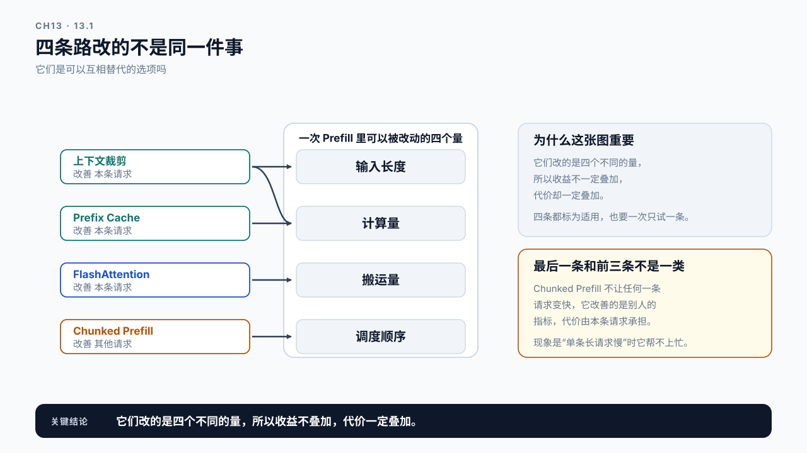
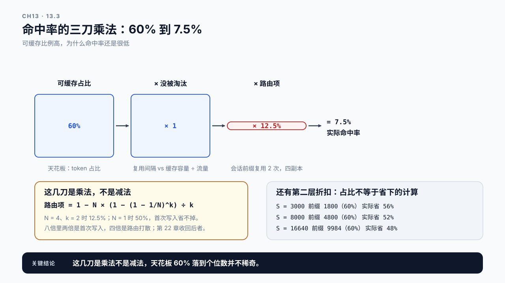
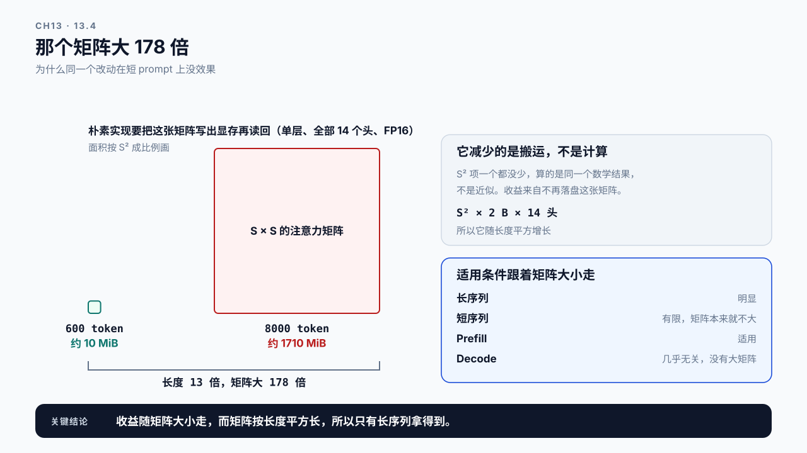
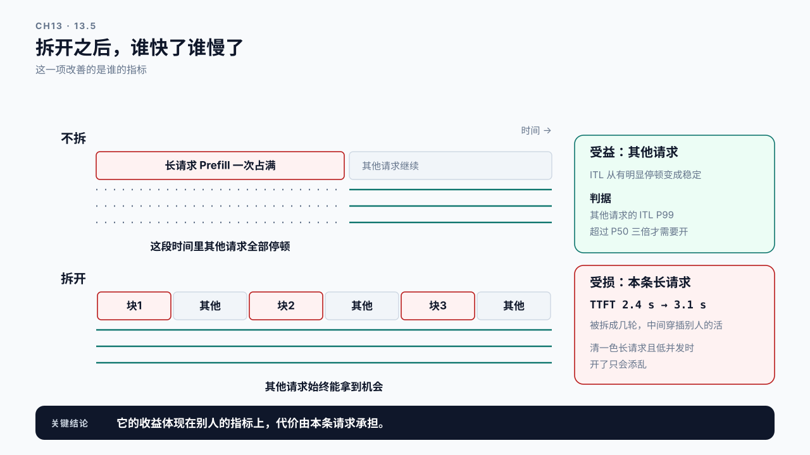

# 第 13 章 Prefill 优化方法：四条路各自通向哪里

## 学习目标

读完这一章，你应该能回答三个问题：

1. FlashAttention、上下文裁剪、Prefix Cache、Chunked Prefill 各自改变了什么？
2. 拿到一个 Prefill 慢的现象，该先试哪一条？
3. 某项技术“没有效果”，是它不管用，还是这个场景本来就不适合它？

跟着做完，你会得到一张适用条件对照表：什么样的负载该用哪条路，以及每条路的代价。

第 12 章的结论是：先看能不能少塞点。当内容已经砍无可砍，才轮到这一章的技术手段。

顺序不能反。上下文裁剪能省掉的往往比任何 kernel 优化都多，而且没有技术风险。**先做应用层的减法，再做系统层的加速。**

## 13.1 四条路改的不是同一件事

把四项技术放在一起容易误以为它们是互相替代的选项。其实它们改的是完全不同的东西：

| 技术 | 改变了什么 | 输入长度 | 计算量 | 本条请求更快吗 |
|---|---|---|---|---|
| 上下文裁剪 | 输入本身变短 | 减少 | 减少 | 是 |
| Prefix Cache | 重复的部分不再重算 | 不变 | 减少 | 命中时是 |
| FlashAttention | 减少注意力矩阵的搬运 | 不变 | 不变 | 长序列下是 |
| Chunked Prefill | 长输入不再一次占满预算 | 不变 | 不变 | 否，反而更慢 |

最后一行值得停一下：**Chunked Prefill 不让任何一条请求变快**。它解决的是别的问题，下面会展开。



图13-1：四条路改的不是同一件事。右边是一次 Prefill 里可以被改动的四个量，左边四条路各自连向其中一个；只有上下文裁剪连了两条，因为长度变短会连带把计算量也减下来。

理解这张表的用处是：当有人说“我们上了 FlashAttention 但 TTFT 没降”，你能立刻问出对的问题：降不下来是因为瓶颈根本不在 Attention 那部分计算，还是因为别的。

## 13.2 上下文裁剪：最有效，也最容易被跳过

第 12 章已经讲了方法：按来源分段记账，测出质量随长度变化的曲线，找收益停滞的拐点。这里只补三点执行层面的。

**它的收益有平方项加成。** 第 11 章说过 Attention 部分随长度平方增长，所以把 prompt 砍掉 40%，TTFT 的改善会超过 40%。这是其他三项技术都没有的特性，它们都不减少输入长度。

超出多少可以算，而且值得先算一遍，因为这个加成比多数人想的小。用第 11 章那个 `S × (16640 + S)`，砍掉 40% 在三个长度上的效果是：

```text
3000  → 1800    计算量降 43.7%     加成 3.7 个百分点
8000  → 4800    计算量降 47.8%     加成 7.8 个百分点
16640 → 9984    计算量降 52.0%     加成 12.0 个百分点
```

**加成是几个百分点，不是翻倍，而且只在长上下文上才拿得到。** 几千 token 的 RAG 场景里，砍 40% 基本就是省 44%。这一条要写清楚，否则读者会拿“有平方项”去解释一个对不上的收益。

**它不需要动系统。** 改一个 Top-K 常数、压缩一下 system prompt，不涉及框架、不需要重启、随时可回滚。按第 10 章的最小侵入原则，这是应该最先试的一类改动。

**它的代价是质量，必须实测。** 砍短了可能丢信息。没有评测集就没法判断这个取舍是否划算，那样的“优化”是在赌。

裁剪的常见做法：

```text
减 Top-K              少取几段
压片段长度            每段只留最相关的部分
去重                  内容重复的片段合并
压缩历史              旧对话或旧工具结果转成摘要
精简 system prompt    示例挪到少数几条、规则说明去冗余
```

最后一条常被低估。见过 1800 token 的 system prompt，其中大半是写给人看的说明文字，对模型行为没有影响，却每次调用都在付费。

## 13.3 Prefix Cache：让重复的那段不再重算

第 7 章从压测的角度讲过它，那时它是个麻烦（污染 Baseline）。在生产里它是正经的优化手段。

**它解决的问题**：第 12 章分段记账时会发现，system prompt、few-shot 这些内容每次调用都一样，却每次都完整走一遍 Prefill。Prefix Cache 把这段的 KV 缓存下来，下次命中就直接复用。

名字里带“缓存”的东西，全书有四个，复用的范围一层比一层大。**前三个存的是同一种东西，都是算好的 K、V**：KV Cache 只在一条请求内部跨步复用；Prefix Cache 把相同前缀的 KV 留给后面的请求，所以它住在同一个 KV 池里，空闲时留着、显存紧张时先被淘汰，也受路由影响；价目表上的缓存命中价，是 API 供应商那一侧的 Prefix Cache。第四个在应用层，存的是检索结果或整段回答，不碰 KV。

| 名字 | 复用什么 | 跨越的范围 | 住在哪 |
|---|---|---|---|
| KV Cache | 这条请求已算过的 K、V | 同一条请求的前后各步（第 3 章） | 实例的 KV 池 |
| Prefix Cache | 相同前缀的 K、V | 同一实例上的不同请求（本节） | 同一个 KV 池，空闲时留着，显存紧张时先被淘汰 |
| 缓存命中价 | 相同前缀的 K、V | 供应商那一侧的不同请求（第 0 章） | 供应商的 KV 池，你看到的只是价格 |
| 检索结果缓存、回答缓存 | 检索结果或整段回答 | 应用层的相似请求（第 23 章） | 应用自己的存储 |

**收益直接取决于前缀重复率。** 这就是第 12 章那个 `cacheable` 比例的用处：

```text
可缓存部分占 60%   →   命中时能省掉约半数 Prefill 计算
可缓存部分占 10%   →   这条路基本走不通，别在这上面花时间
```

第一行为什么是“约半数”而不是“六成”，值得说一句：**60% 是 token 占比，省下的计算比它低，因为被缓存的恰好是最便宜的那一段。** 靠前的位置要注意的位置更少，后面的位置要注意前面所有位置，所以前 60% 的 token 承担的计算不到全部的 60%。算出来是：

```text
S = 3000    前缀 1800（60%）   实际省 56%
S = 8000    前缀 4800（60%）   实际省 52%
S = 16640   前缀 9984（60%）   实际省 48%
```

上下文越长，这个折扣越明显。几千 token 上按 token 占比估收益还算得过去，长上下文上就偏乐观了。

**几个决定它有没有用的条件：**

前缀必须完全一致且从头开始。缓存是按前缀匹配的，system prompt 后面紧跟着变化的内容，那么只有 system prompt 那段能命中。如果 prompt 拼接顺序是“用户问题在前、system 在后”，命中率会接近于零。**把固定内容放在最前面，是启用缓存前必须做的事。**

缓存**有容量上限**，会被淘汰。低频场景下，上一次的缓存可能等不到下一次命中就被挤掉了。

多副本部署时，**请求要落到有缓存的那个实例上**才能命中。这一条要看前缀属于哪一类，下面单独算；需要路由层配合的那部分，属于第 22 章的缓存感知路由。

**代价**：它不另占显存。空闲的缓存块留在空闲队列里，新请求要块时按最近最少使用先淘汰它们，所以要担心的不是它挤掉并发，而是并发挤掉它，也就是下面那条式子里“没被淘汰的比例”。真正的代价是前缀哈希与查找的开销。（这里按 vLLM 的自动前缀缓存描述，换框架要核实。）

**把上面几条串起来，命中率有一个能算的上限。** 可缓存前缀占比是天花板，后面每个条件各扣一刀，扣的是乘法不是减法：

```text
命中率 ≈ 可缓存占比 × 复用间隔内没被淘汰的比例 × 路由命中的比例
```

最后一项最容易算错。前缀分两类，路由对它们的影响完全不同。

全体共享的前缀，例如每个请求都带的同一段 system prompt，每个实例第一次遇到它时各写一份，之后在每个实例上都能命中。多副本只是让显存里多存几份，路由项接近 1。

会话级的前缀，例如一段对话的历史、某一份文档拼出来的前缀，只被同一会话或同一文档的几次请求复用。设它被复用 k 次，副本有 N 个，请求随机落到各副本，每个副本缓存都装得下，那么能命中的比例是：

```text
路由项 ≈ 1 − N × (1 − (1 − 1/N)^k) ÷ k
```

意思是：k 次请求里，每个被碰到的副本都要付一次首次写入，其余的才算命中。N = 4 时：

| 复用次数 k | 1 个副本 | 4 个副本 |
|---:|---:|---:|
| 2 | 50% | 12.5% |
| 10 | 90% | 62% |
| 100 | 99% | 96% |

单实例那一列不是 100%：每个前缀第一次出现时总要写一次，这一刀和路由无关，路由再好也省不掉（第 22 章的表也是这么列的）。

复用次数越少、副本越多，这一刀越狠；只有复用很少、缓存又容不下每个副本各存一份时，它才逼近常听到的那个 1/N。

代入上面那个 60% 的场景，其他条件都理想。可缓存的若是全体共享的 system prompt，命中率仍接近 60%；若是只复用两次的会话前缀，`60% × 1 × 1 × 12.5% = 7.5%`。同一个天花板，前缀种类不同，结果差八倍。这八倍要拆开看：两倍是每个会话第一次必须写的那次，路由再好也省不掉；另外四倍是随机路由把同一前缀打散到各副本造成的。缓存感知路由值得单独做一章，它收回的是后面这四倍。

这里还要分清两个比例。上面算的是 token 命中率：输入 token 里有多少走了缓存。省下多少计算要另算：

```text
计算节省率 ≈ 请求命中的概率 × 每次命中省下的计算份额
```

还是那个场景，每条请求命中的概率是 12.5%，命中一次省 56%，计算节省约 12.5% × 56% ≈ 7%。不能拿 7.5% 的 token 命中率再去乘 56%，那会把 60% 的可缓存占比算两遍。

如果用的是按第 0 章那种价目计费的 API，还有一条盈亏线：命中价是原价的十分之一、写入价是原价的 1.25 倍时，可缓存那段里命中的比例要超过约 22%，开缓存才不亏（第 0.3 节算过这条界线）。12.5% 在线下，那个会话前缀的场景开了反而多花钱。

再加上淘汰那一刀会更低：同一前缀下次出现之前有没有被挤掉，取决于复用间隔和“缓存容量 ÷ 流量”这个淘汰窗口的比值，低频场景下它可以很小。两刀都挨上，60% 的天花板落到个位数并不稀奇。



图13-2：命中率的三刀乘法。图里只让路由那一刀生效，淘汰那一刀按理想值 1 算：可缓存的是只复用两次的会话前缀、四副本随机路由时，天花板就已经从 60% 掉到 7.5%。

这个式子给的是量级，不是预测值。它的用处是在开启之前判断值不值得做：算出来低于一成，就该先去改 prompt 拼接顺序或者路由，而不是先去调缓存参数。

## 13.4 FlashAttention：同样的计算，更省的做法

> **FlashAttention**：一种重新组织 Attention 计算顺序的实现方式，通过分块计算避免把完整的注意力矩阵写进显存再读回来。
> 它算的是同一个数学结果，不是近似。收益来自减少显存读写，不是减少浮点运算。

用本篇开头那条算术强度来说，这一项和前两条路的方向正好相反：裁剪和 Prefix Cache 减的是分子的运算量，FlashAttention 减的是分母的搬运量。所以它的收益出现在 Attention 那一段：那一段在朴素实现下不论长短都是带宽受限的，而长序列上它占的时间多，省下的才看得见，而不是 GEMM 那一段。

理解这一点很关键：**它不减少计算量**。第 11 章那个 `S²` 项一个都没少。它减少的是数据搬运：朴素实现要把 `S × S` 的注意力矩阵存下来再读回，长序列下这个矩阵本身就很大，读写它的开销可能超过计算。

“很大”是多大，算一下就明白这一项的收益为什么只在长序列上出现。参考模型一每层 14 个注意力头，FP16 每元素 2 字节：

```text
 600 token    600²  × 2 B × 14  ≈    10 MiB
8000 token   8000²  × 2 B × 14  ≈  1710 MiB
```

长度 13 倍，要落盘再读回的矩阵大了 **178 倍**，因为它是平方项。10 MiB 那一档基本不构成压力，1710 MiB 那一档每层都要写一遍读一遍，搬运时间就会盖过计算时间。这一个数把下面那张表的四行和 13.8 案例一都解释完了。

换成算术强度看更清楚。朴素实现里 Attention 这一段每层的运算量是 `2 × hidden × S²`，搬运量是那个矩阵写一遍读一遍，即 `S² × 2 字节 × 头数 × 2`：

```text
强度 = 2 × hidden × S² ÷ (S² × 2 B × 头数 × 2) = head_dim ÷ 2
参考模型一：head_dim 64，强度 32
```

S 被约掉了，所以**不论 prompt 多长，朴素 Attention 这一段都在分界点左侧，是带宽受限的**。分块实现把这个矩阵留在片上，读写量降到朴素实现的几分之一到几十分之一，具体差多少取决于块大小和片上存储（FlashAttention 论文给的 IO 复杂度是 Θ(S²d²/M)，M 是片上存储）。它把这一段推到算力受限一侧，所以省下的是搬运时间。



图13-3：那个矩阵大 178 倍。两个正方形的面积按 `S²` 成比例画，左边那个小方块就是 600 token 那一档，它小到几乎看不见，这正是同一个改动在短 prompt 上没效果的原因。

于是它的适用条件就清楚了：

| 场景 | 收益 |
|---|---|
| 长序列 | 明显。`S²` 的矩阵越大，省下的读写越多 |
| 短序列 | 有限。Attention 只占 Prefill 的几个百分点（600 token 时约 3.5%），省下它的搬运对 TTFT 影响很小 |
| Prefill | 适用。一次处理很多位置，注意力矩阵大 |
| Decode | 几乎无关。每步只有一个查询位置，没有大矩阵 |

**多数现代推理框架已经默认启用它**，所以“上 FlashAttention”往往不是一个待做项，而是一个待确认项：先查当前用的是哪种实现，再谈要不要换。

框架侧还有一类相关能力，按具体的 kernel 或 runtime 特性来看即可，不要把某个库名当成一种优化算法，同一个库里不同版本、不同配置启用的路径可能完全不同。判断有没有生效，看的是实际走了哪条 kernel，不是装了哪个包。

## 13.5 Chunked Prefill：它不让你快，它让别人不卡

这一项最容易被误解，因为它的目标不是本条请求的 TTFT。

**它解决的问题是这样的**：一条 16000 token 的长请求进来，Prefill 要占用相当长一段计算。在这期间，已经在生成中的其他请求拿不到执行机会，它们的 token 就卡住了。一条长请求进来，几十条正在流式输出的请求同时出现停顿。这类问题叫队头阻塞。

> **队头阻塞**（head-of-line blocking）：排在前面的一个大任务占住共享资源，后面的小任务只能等它做完，哪怕它们自己只需要一点点资源。
> 长 Prompt 的 Prefill 卡住正在 Decode 的请求就是一例。网关的先进先出队列、Agent 的工具调用队列里会遇到同一件事，第 16 章的抢占和第 20 章的调度也会回到它。

解法有两种，区别在于让不让两类工作共用一张卡。Chunked Prefill 让它们轮流用，长 Prefill 每轮只占一小段；PD 分离让它们各用各的卡，Prefill 算完把 KV 交过去。前者只改调度，代价落在那条长请求自己身上；后者要多一组卡，还要传 KV。本节讲前一种，后一种在节末。

> **Chunked Prefill**：把一条长请求的 Prefill 拆成若干小块，分散到多轮调度中执行，每轮只处理一块，中间让出机会给其他请求。

效果是：

```text
不拆：  [====== 长请求 Prefill ======][其他请求继续]
                 ↑ 这段时间里其他请求全部停顿

拆开：  [块1][其他][块2][其他][块3][其他]...
             ↑ 其他请求始终能拿到机会
```

**代价是那条长请求自己会更慢。** 原因有两层。一是它被拆成几轮，中间穿插着别人的工作，从开始到首 token 的总时间变长了。二是每一块只有几百个 token，按 11.4 的算术强度也跟着降下来：参考模型一 512 token 一块时约 287，已经贴着 H100 约 295 的分界点，矩阵乘不再像整段处理时那样吃得饱算力。块越小，这一层代价越大。

所以判断标准很明确：

| 你在意什么 | 该不该开 |
|---|---|
| 混合负载下其他请求的 ITL 稳定性 | 开 |
| 单条长请求的 TTFT 最快 | 不开 |
| 只有长请求、没有并发 | 开了没意义，反而更慢 |

第 6 章的 workload 描述在这里派上用场：**如果你的负载里长短请求混跑，这项大概率有用；如果清一色长请求且串行处理，它只会添乱。**



图13-4：拆开之后，谁快了谁慢了。上下两条时间线里，其他请求的 token 流从断断续续变成连续，而本条长请求的 TTFT 从 2.4 秒变成 3.1 秒。

它和调度的关系很近，Token Budget 怎么分、拆多大一块，属于第 20 章 Scheduler 的范畴。这里只需要知道它改变的是什么，以及它的收益体现在别人的指标上。

另一种解法是分池，两类工作不再共用一张卡：

> **PD 分离**（Prefill/Decode disaggregation）：用一组卡专做 Prefill、另一组卡专做 Decode，Prefill 算完把 KV Cache 传给 Decode 那组，两边互不打断。
> 它的代价是 KV Cache 的传输和两组卡各自的容量规划，细节留在附录 E；第 26.3 节算出 Prefill 占时接近一半时，正是该考虑它的时候。

Chunked Prefill 和 FlashAttention 一样，先是一个待确认项而不是一个开关：vLLM V1 起它默认就是开的。要做对照，得先在 Baseline 里显式关掉它，再在实验轮打开（以你所用版本的文档为准，本书的版本记在 `content/reference/environment.md`）。

## 13.6 先试哪一条

把前面几节合成一个判断顺序：

```text
1. 内容能不能少
   看第 12 章的分段账单 → 有停滞拐点就先调参数
   代价：质量，需评测集   风险：低，可随时回滚

2. 重复的能不能不算
   看 cacheable 比例 → 算期望收益：全命中能省的份额 × 请求命中的概率，
   高过 Baseline 的可识别线才值得走这条
   代价：前缀哈希与查找  风险：中，要确认前缀顺序和路由

3. 实现是不是已经最优
   查实际走的 Attention kernel 名，不是装了哪个包
   判据：prompt 在千 token 以下时收益有限，几千以上才值得查
   代价：无           风险：低，通常只是确认而非改动

4. 别人是不是被你卡住了
   看混合负载下其他请求的 ITL
   判据：其他请求的 ITL P99 超过 P50 三倍（经验阈值），而且尖峰出现的时刻和长请求 Prefill 所在的那一步对得上，才说明是被它卡住
   代价：本请求 TTFT   风险：中，要配合调度参数
```

**注意第 4 条和前三条不是一类。** 前三条改善的是本条请求，第 4 条改善的是其他请求。如果你的现象是“单条长请求 TTFT 高”，第 4 条帮不上忙，开了还会更糟。

每一步做完都要按第 7 章的协议同流量重跑，并和 Baseline 的波动范围对比。一次只动一项，否则分不清是谁起的作用。

## 13.7 Demo：适用条件自检

本章 Demo 位于 `code/ch13/prefill_optimization_check.py`，只依赖 Python 标准库。

它读入第 6 章的 workload 描述和第 12 章的上下文账单，输出这四条路各自在当前场景下的适用判断：

```bash
python3 code/ch13/prefill_optimization_check.py \
  --workload workload-rag.json \
  --context-cost context-cost-rag.json \
  --model-config code/ch11/model-qwen25-05b.json \
  --output prefill-options.json
```

输出对每条路给出：

```text
applicable     适用 / 有限 / 不适用
reason         判断依据，引用输入里的哪个字段
expected       预期改善的指标，以及改善的是本请求还是其他请求
cost           代价落在哪里
prerequisite   启用前必须先确认的事
risk           风险等级与回滚方式
```

几条判断规则是硬写进去的：

- 期望收益（全命中省下的份额 × 请求命中的概率）低于 Baseline 的可识别线时，Prefix Cache 标为“有限”，并说明原因；
- workload 的长度分布里如果长短差异不大，Chunked Prefill 标为“不适用”；
- 没有提供质量评测配置时，上下文裁剪会附带警告：**这条路的代价是质量，没有评测集就无法判断是否划算**。
- workload 里写了多副本部署时，Prefix Cache 的期望收益按 13.3 的路由项折算：前缀标为全体共享时不打折，会话级前缀按复用次数和副本数算，没写复用次数就按复用两次这种最保守的情形取 1/(2N) 并给出警告（路由项随 k 单调上升，k = 2 是确有复用时的最小值，比常听到的 1/N 还低一半）。

脚本不替你做决定，它只把判断依据摆出来。**四条路同时标为“适用”时，仍然要一次只试一条。**

## 13.8 案例与常见误区

### 案例一：上了 FlashAttention，没有效果

合成设定：团队把框架升级后确认启用了 FlashAttention，重跑 Baseline，TTFT 基本没变。

查下来两个原因：一是旧版本其实已经在用同类实现，这次升级没有改变实际走的 kernel；二是该服务的 prompt 普遍在 600 token 左右，按 13.4 那个算法，这时每层要落盘的注意力矩阵只有 10 MiB，显存读写本来就不是瓶颈。

**这不是 FlashAttention 没用，是这个场景用不上它。** 同一个改动放到 8000 token 的负载上，那个矩阵变成 1710 MiB，收益会明显得多。

讨论：升级之前应该先确认什么，才能避免这次无效的工作？

### 案例二：开了 Prefix Cache，命中率接近零

合成设定：一个 RAG 服务的固定内容占了 55% 的 token，团队据此启用 Prefix Cache，命中率却只有 3%。其实第 12 章那份上下文账单早就算出它的可缓存前缀是 0，并给了顺序警告，只是没人看。

查 prompt 拼接代码发现，检索片段被拼在了 system prompt 前面。前缀匹配从第一个 token 开始，而每次请求的检索结果都不同，所以从第一个 token 就对不上，后面那段固定的 system prompt 再也没机会命中。

把顺序调换后，命中率升到 50% 以上。

讨论：除了拼接顺序，还有哪些常见写法会让前缀匹配失效？

### 案例三：开了 Chunked Prefill，长请求变慢了

合成设定：团队看到文档推荐 Chunked Prefill，就把它打开了（vLLM V1 起它默认就是开的，这种情况下要做对照得先显式关掉）。之后长文档请求的 TTFT 从 2.4 秒涨到 3.1 秒，用户投诉。

这个服务几乎全是长请求，并发很低，基本是一条一条串着处理。没有“其他请求被卡住”这个问题，拆分只带来了额外的调度开销。

关掉后恢复。

讨论：这个团队犯的错误在哪一步？是选错了技术，还是没有先描述清楚负载？

### 两个不写在文档里的误区

误区一：这几项可以一起上，收益叠加。

它们改的东西不同，收益不一定叠加，代价却一定叠加。Prefix Cache 多一道前缀哈希与查找、Chunked Prefill 拖慢本请求，同时开启时很难分清哪一项带来了什么。按第 10 章的规矩，一次只动一项，每次都同流量重跑。

误区二：技术手段比调参数高级。

改一个 Top-K 常数听起来没有技术含量，但它减少的是输入长度本身，收益还带平方项加成，而且没有技术风险。两条路的上限都能算出来放在一起看：裁剪 40% 在几千 token 上省 44%，而 Prefix Cache 在 60% 可缓存、会话前缀只复用两次、四副本随机路由时，每条请求命中的概率约 12.5%，乘上每次命中省的 56%，期望只省约 7%。**判断一项优化好不好，看的是收益和代价，不是它听起来复不复杂。**

## 本章总结

回到开头的三个问题。

**四条路各自改了什么？** 上下文裁剪让输入变短，是唯一减少长度的一条，因此收益带平方项加成，砍 40% 能省 44% 到 52%，加成是几个百分点而不是翻倍；Prefix Cache 让重复的前缀不再重算，上限是可缓存的 token 占比，而实际省下的比它低一截（60% 占比只省 48% 到 56%），因为被缓存的是最便宜的前缀；多副本时还要看前缀是全体共享的还是会话级的，后者的命中比例由复用次数和副本数决定；FlashAttention 不减少计算量，它减少的是注意力矩阵的显存读写，而这个矩阵按平方长（600 token 是 10 MiB，8000 token 是 1710 MiB），所以对长序列有效、对短序列有限、对 Decode 几乎无关；Chunked Prefill 既不减少计算也不加快计算，它把长请求的 Prefill 拆散，让其他请求不被卡住，改善的是别人的指标，代价是本请求更慢。

**该先试哪一条？** 按代价和风险排序：先看内容能不能少（改参数、可回滚、收益最大），再看重复的能不能不算（按期望收益判断：全命中省下的份额乘上请求命中的概率，高过可识别线才值得），然后确认实现是不是已经最优（多数框架已默认启用，通常只需确认），最后才考虑是不是别人被你卡住了。注意最后一条和前三条不是一类：现象是“单条长请求慢”时，它帮不上忙，开了还更糟。

**“没有效果”说明什么？** 多数时候说明场景不匹配，而不是技术无效。FlashAttention 在 600 token 的负载上收益有限，因为注意力矩阵本来就不大；Prefix Cache 在检索片段被拼到 system prompt 前面时命中率接近零，因为前缀从第一个 token 就对不上；Chunked Prefill 在清一色长请求、低并发的场景下只会添乱。所以每一项在启用前都要先确认它的前提条件，而确认前提条件靠的是第 6 章那份 workload 描述。

下一章把这些判断拿到真实负载上验证：用同一份长 Prompt 工作负载，逐项开启并同流量重跑，看实际收益和这一章的预期是否一致。

### 本章 Checklist

- [ ] 能说出四条路各自改变的是什么，以及哪一条减少了输入长度。
- [ ] 在考虑技术手段之前，先看过第 12 章的分段账单和质量曲线。
- [ ] 能从上下文账单里读出可缓存比例，并据此判断 Prefix Cache 值不值得走。
- [ ] 确认过 prompt 的拼接顺序：固定内容在最前面。
- [ ] 知道当前服务实际走的是哪种 Attention 实现，而不是装了哪个包。
- [ ] 能说明 Chunked Prefill 改善的是谁的指标，代价由谁承担。
- [ ] 能从 workload 描述判断当前负载是否属于长短混跑。
- [ ] 一次只启用一项，每次都按第 7 章的协议同流量重跑。

## 课后练习

1. 为你的服务算出可缓存比例，判断 Prefix Cache 这条路值不值得走。
2. 检查 prompt 拼接代码，确认固定内容是否在最前面；如果不是，估算调整后的命中率上限。
3. 查出当前服务实际使用的 Attention 实现，记录查证方法。
4. 用 600 token 和 8000 token 两种负载分别测 FlashAttention 的收益，解释差异。
5. 在长短混跑的负载下开启 Chunked Prefill，同时记录长请求的 TTFT 和其他请求的 ITL，说明谁受益谁受损。
6. 在清一色长请求的负载下重复第 5 题，比较结论。
7. 把上下文裁剪 30% 与启用 Prefix Cache 两种方案各做一次，比较收益、代价和风险。
8. 为这四条路写一份适用条件卡片，让团队成员在动手前能自查前提是否满足。
