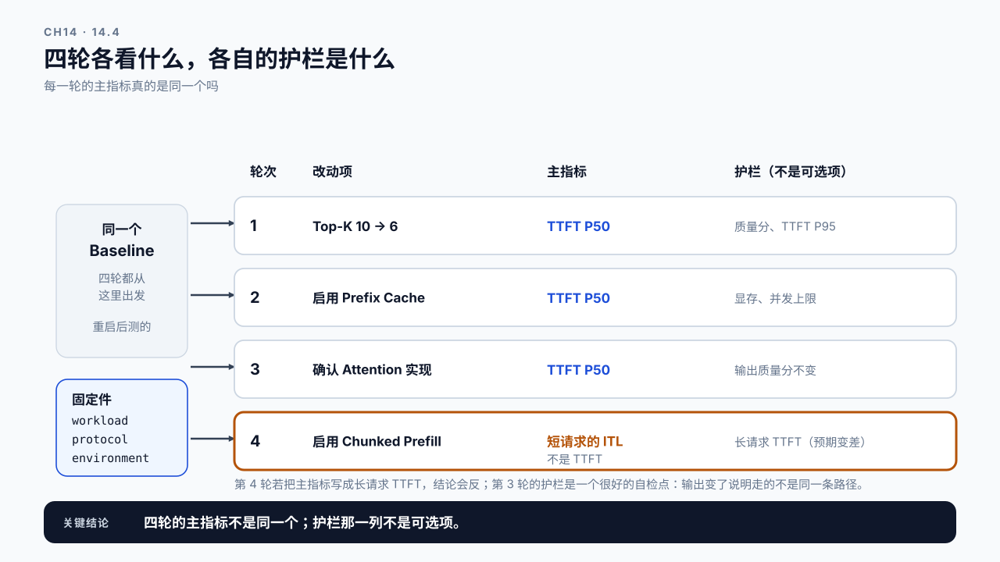
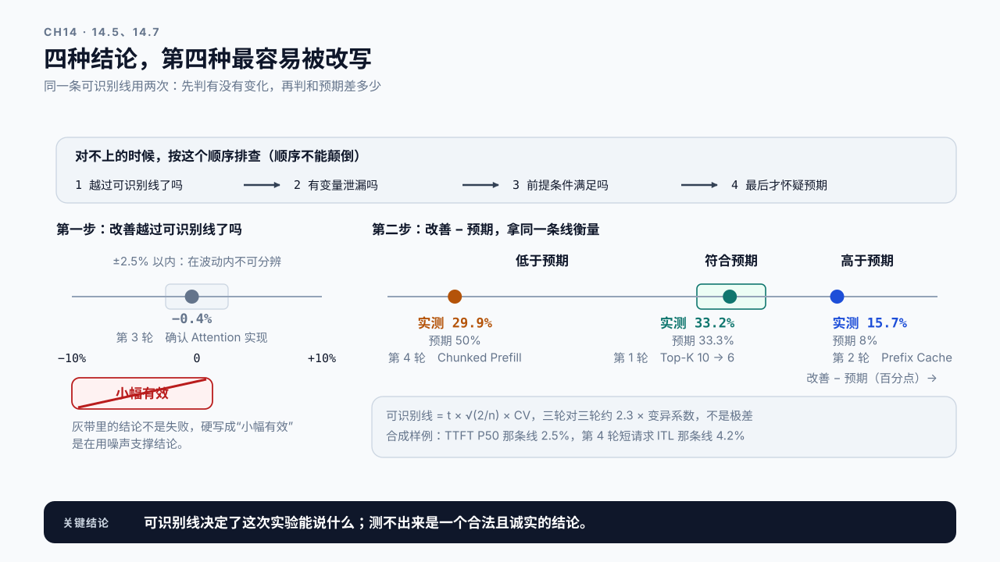
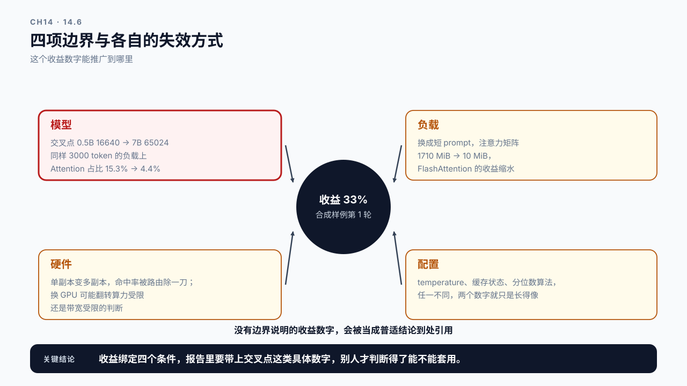

# 第 14 章 Prefill 优化实验：把预期拿去撞真实数据

## 学习目标

读完这一章，你应该能回答三个问题：

1. 一次优化实验要怎么组织，结论才站得住？
2. 实测收益和第 13 章的预期不一致时，先怀疑什么？
3. 这次拿到的收益，能不能推广到别的模型、别的负载、别的硬件？

跟着做完，你会产出本篇的交付物：一份长 Prompt 场景的优化报告，包含 Baseline、逐项验证和边界说明。

前三章分别建立了估算模型、成本账单和技术选项。这一章把它们拿到真实服务上验证。

这是一章实践课。方法在第 7 章和第 10 章已经讲过，这里的新内容是：**当预期和实测对不上时，怎么判断是预期错了还是实验错了。**

## 14.1 实验之前先写下预期

大多数优化实验做完之后说不清结论，问题出在开始之前。

先跑再看结果，人会不自觉地去解释已经看到的数字。无论收益是 5% 还是 40%，总能编出一套说法。这样的实验无法证伪，按第 10 章的标准不能作为决策依据。

所以动手前先把预期写下来：

```text
改动        Top-K 从 10 降到 6
主指标      TTFT P50，负载率约 0.3（14.3）
预期方向    TTFT 下降，输入 token 下降
预期幅度    输入 token 降 30%；TTFT P50 降 33%
预期不变    输出 token 数、回答质量分下降不超过 0.02、TTFT P95 不越过 SLO
判据        先看改善有没有越过 Baseline 的可识别线，再看它和预期差多少（14.5）
```

**预期幅度里的每个数都要有出处，不能是感觉。** 这两个数是这么来的：14.3 那份负载的 prompt P50 是 2630 token，每段 200，Top-K 从 10 降到 6 少拼 4 段共 800 token，降到 1830。token 账是线性的，所以输入 token 降 30.4%。TTFT 那一项按第 11 章的模型算：

```text
2630 token   2630 × 19270  =  0.507 亿
1830 token   1830 × 18470  =  0.338 亿
降幅                           33.3%
```

比 token 降幅多出来的那 2.9 个百分点就是 Attention 平方项的贡献，和第 13.2 节那三行是同一件事。

**预期要按主指标对应的那条请求来算。** 上面这笔账算的是 P50 那条请求的 Prefill，所以主指标选 TTFT P50，而且把负载率压在 0.3 左右，让排队只占 TTFT 的小头。如果主指标是 SLO 用的 TTFT P95，这笔账就不对了：P95 那条请求约 7950 token，少 800 token 只让它自己的 Prefill 降约 13%；与此同时平均服务时间降了约 22%，负载率跟着降，排队按第 0 章那条 ρ/(1−ρ) 非线性地缩短。P95 的降幅会落在 13% 和排队降幅之间的某处，要用第 20 章的排队模型才算得出来。所以这次让 P95 当护栏，不当主指标。

第 7 章那条纪律在这里落地：**判据用的是可识别线，不是极差。** 极差是三轮数据的观察量，可识别线是由 CV 推出的判据（第 7.3 节：两组各跑 n 轮时为 t × √(2/n) × CV，三轮对三轮约 2.3 × CV）。如果 Baseline 三轮算出来的可识别线是 13%，那么预期里写“改善 5%”就没有意义，实验精度区分不出来。要么先降低波动，要么把预期定在可分辨的范围内。这次预期的 33% 远高于线，所以这个实验是能得出结论的。

## 14.2 实验的固定件和变动件

一次可比较的实验，要分清哪些必须原样不动，哪些是这次要改的。

> **可比较（comparability）**：两轮实验的结果能相减，前提是除了这次要改的那一项，其余条件全部相同。
> 这里的“其余条件”包括三样容易漏掉的东西：同一份负载（含随机种子）、同一个测量窗口口径、同一套分位数算法。三样里任意一样不同，两个数字就只是长得像，不构成对照。第 5.5 节说过分位数算法不止一种，第 5.8 节那份指标合同就是用来固定这几项的。

**必须原样不动的：**

```text
workload      第 6 章那份描述文件，含随机种子
protocol      Warmup 数量、重复轮次、测量窗口、在途请求处理
environment   模型 revision、vLLM 版本、GPU、驱动、其他启动参数
```

**这次要改的：只有一项。**

第 13 章说过四条路同时标为适用时也要一次只试一条，原因就在这里：同时改两项，结果好了也不知道是谁的功劳，结果坏了更不知道该退哪一个。

**容易在不知不觉中变掉的三处：**

`temperature` 不为零时输出长度每次不同，会污染 E2E 和吞吐。实验期间固定为 0。

Prefix Cache 的状态。测裁剪效果时如果缓存开着，两次实验的命中率不同，收益里会混进缓存的贡献。**要么全程关掉，要么全程开着并记录命中率**，不能一次开一次关。

服务重启。改配置常常要重启，而重启会清空缓存、重置显存分配器。所以每次实验都要重新 Warmup，且 Baseline 也应该是在重启后测的，否则比较的是“冷启动后”和“跑了一天后”两个不同状态。

## 14.3 长 Prompt 工作负载

本篇的实验统一用同一份负载，这样四项技术的收益可以横向比较。

按第 6 章的字段写：

```text
identity   name: prefill-long-context
           type: rag
           source: 合成，长度按 12.2 的分段表设定；换成你的检索日志采样

length     prompt  P50 2630 / P90 6400 / P99 9200 / max 12000
           output  P50 180 / P90 320 / P99 480
           short   prompt < 1000 token 记为短请求，约占两成（第 4 轮单独统计）

arrival    mode: poisson
           rate: 0.25 req/s
           duration: 800 s
           seed: 固定

slo        metric: TTFT
           quantile: P95
           threshold: 4000 ms
```

P50 那个 2630 不是随手写的：它是 12.2 那张分段表在基线配置（Top-K=10、每段 200 token、固定部分 630）下算出来的长度。**14.1 那份预期的分母就是它**，所以负载描述和预期用的是同一个数，两边不会各说各的。

到达率和 SLO 也是算出来的。按第 12 章的实测尺度（1230 token 320 ms），这份长度分布下平均每条请求的 Prefill 约 1.2 秒，每秒 0.25 个请求时，Prefill 占卡的比例约 0.3，也就是负载率约 0.3。每轮 800 秒约 200 条请求，P95 以上才有约 10 个样本（第 5.5 节）。SLO 定在 4 秒，是因为 P95 那条约 7950 token 的请求单是 Prefill 就要 2.8 秒左右：第 11 章已经指出，这台机器的 Prefill 比估计慢了 8.5 倍，那笔开销查清之前，SLO 只能按实测尺度定，不能按估计定。

几个设计上的考虑：

**四项开关在 Baseline 里的状态要显式写出来，不能依赖默认值。** Prefix Cache、Chunked Prefill、Attention 实现这三项在不同框架、不同版本下的默认值不一样（vLLM V1 起 Chunked Prefill 默认就是开的）。Baseline 里哪一项开着、哪一项关着，要和负载描述一起记进报告；否则第 2、3、4 轮可能根本没改变任何东西。

**长度分布要有长尾。** 如果所有请求都是 3000 token，测不出 Attention 平方项的影响，也测不出 Chunked Prefill 的作用。P99 和 max 要拉开。

**用泊松而不是等间隔。** 第 6 章讲过，等间隔不会出现真实流量里的短暂密集，而排队现象恰恰在密集时才显现。

**保留短请求。** 只有长请求的负载测不出 Chunked Prefill，因为它的收益体现在“其他请求不被卡住”，没有其他请求就没有收益。所以负载里要混入一定比例的短请求，并单独统计它们的 ITL。

**SLO 定在 P95 而不是平均。** 长尾场景下平均值会掩盖问题。

## 14.4 四项逐个上，每次只动一项

按第 13 章的顺序做四轮实验，每轮都从同一个 Baseline 出发。

| 轮次 | 改动 | 主要看 | 同时要看（护栏） |
|---|---|---|---|
| 1 | 上下文裁剪：Top-K 10 → 6 | TTFT P50、输入 token | 质量分、召回率、TTFT P95 |
| 2 | 启用 Prefix Cache | TTFT P50、请求命中概率 | token 命中率、缓存块被淘汰的比例 |
| 3 | 确认 Attention 实现 | TTFT P50 | 输出质量分（应在可识别线以内） |
| 4 | 启用 Chunked Prefill | **短请求的 ITL** | 长请求 TTFT（预期变差） |

**护栏那一列不是可选项。** 第 5 章讲过，报告必须同时覆盖目标和护栏，只挑好看的数字是不诚实的。第 4 轮如果短请求的 ITL 稳住了，长请求的 TTFT 却越过了 SLO，那这不是一次成功的优化，而是一次交换，要写进结论。

**第 3 轮的护栏是输出质量不变。** FlashAttention 算的是同一个数学结果，不是近似，但“不是近似”说的是没有做数学上的简化，不是逐位相同：换实现会改变浮点累加顺序，FP16/BF16 下 logits 有末位差异，贪心解码遇到两个接近的候选就会分叉。更直接的一层是，14.3 用的是泊松到达的在线负载，每一轮的批次组成都不同，vLLM 默认不保证这种情况下输出可复现，同一配置跑两遍都可能不逐 token 一致。所以这一轮的护栏是质量分在可识别线以内，再逐 token 抽检：分叉只出现在少数样本、而且出现得晚，才算正常。想把逐 token 一致当判据，得先开启批次无关（batch invariance）或离线固定调度，并在 Baseline 对 Baseline 上确认它本身一致（以所用版本的文档为准）。

**第 4 轮主指标不是 TTFT。** 这一点在第 13 章强调过：Chunked Prefill 改善的是其他请求的指标。如果报告里只看长请求 TTFT，会得出“这项技术有害”的错误结论。



图14-1：四轮各看什么，各自的护栏是什么。第 4 行单独加了框，因为它的主指标和前三行不是同一个。

## 14.5 对不上的时候先怀疑实验

跑完四轮，总会有几项和预期不一致。按这个顺序排查：

**第一步：这个差异越过可识别线了吗？**

Baseline 三轮算出来的可识别线是 13%，实测改善 8%，那么“没有效果”和“有小幅改善”都无法排除。不要在噪声上编解释。这时的正确做法是先降低波动，或者接受“当前精度区分不出来”这个结论。

越过了线，才轮到和预期比。比的方法是同一条线再用一次：看实测改善减去预期的那个差值。差值的绝对值在线以内，记为“符合预期”；超出线，按符号记为“低于预期”或“高于预期”。四种结论就这样分出来，判据只有一条线，没有另拍一个“正负一成”的容差。高于预期同样要排查，它往往说明预期的依据本身错了，14.7 那份样例的第 2 轮就是这样。

**第二步：实验本身有没有变量泄漏？**

按 14.2 那三处逐个查：`temperature` 是不是 0、缓存状态两次是否一致、有没有重启但漏了 Warmup。变量泄漏比技术无效常见得多。

**第三步：前提条件满足吗？**

第 13 章每项技术都有前提。Prefix Cache 命中率低，先查 prompt 拼接顺序；FlashAttention 没效果，先查 prompt 长度和当前实际走的 kernel；Chunked Prefill 没收益，先查负载里有没有短请求。

**最后才怀疑预期本身。**

前三步都排除了，才轮到“我对这项技术的理解可能不对”。这时候要做的是回到第 11 章的估算模型，看是不是某个假设在这个场景下不成立。

这个顺序不能颠倒。人的本能是先怀疑理论、再怀疑自己，而实际情况通常相反：**实验出错的概率远高于原理出错的概率。**



图14-2：四种结论，第四种最容易被改写。左边是第一步，灰带是可识别线以内的区域，落在里面的结论就是“测不出来”，它不是失败；右边是第二步，横轴是改善减预期，同一条线把它分成低于、符合、高于三段。图中的点是 14.7 那份合成样例四轮的结果。

## 14.6 边界：这次的结论能推广到哪里

拿到收益之后，最后一步是划定它的适用范围。

一次实验的结论天然绑定在四个条件上：

```text
模型     参数量、层数、KV 头数、上下文窗口
负载     长度分布、到达模式、并发、前缀重复率
硬件     GPU 型号、显存、驱动、框架版本、副本数与路由方式
配置     本次实验固定的所有启动参数（含四项开关各自的状态）
```

任何一项变化，结论都要重新验证。几个具体的例子：

**换更大的模型**：Attention 和 GEMM 的占比会变，第 11 章那个交叉点会移动，上下文裁剪的相对收益随之改变。这个移动幅度比直觉大，值得记住两个数：

```text
Qwen2.5-0.5B   交叉点 16640     3000 token 时 Attention 占总计算量 15.3%
Qwen2.5-7B     交叉点 65024     3000 token 时 Attention 占总计算量  4.4%
```

交叉点是 `2 × hidden + 2 × KV 维度 + 3 × MLP 中间维度`，MLP 中间维度是最大的一项，所以模型越宽交叉点越靠后。**同样 3000 token 的负载，在 0.5B 上算是“中等长度”，在 7B 上还处在 GEMM 完全主导的区间。** 针对 Attention 的优化在后者身上自然没什么可拿。

**换成短 prompt 负载**：FlashAttention 的收益会明显缩水，Chunked Prefill 可能完全用不上。

**从单副本变成多副本**：Prefix Cache 的命中率取决于路由是否把相同前缀的请求送到同一实例，单机测出来的命中率不能直接套用。

**换 GPU**：算力和带宽的比例变了，算力受限还是带宽受限的判断可能翻转。



图14-3：四项边界与各自的失效方式。模型那一条画得更粗，因为它最容易被忽略、后果最大：交叉点一移动，针对 Attention 的优化就失去了作用面。

报告里要把这四条写清楚。**没有边界说明的收益数字，会被当成普适结论到处引用**，这是性能报告最常见的误用方式。

## 14.7 Demo：优化实验报告

本章 Demo 位于 `code/ch14/prefill_experiment.py`，需要真实 vLLM 服务。

它按第 7 章的协议跑一组对照实验，并生成结构化报告：

```bash
python3 code/ch14/prefill_experiment.py \
  --workload workload-prefill-long.json \
  --baseline baseline-prefill.json \
  --variant topk-6 \
  --expectation expect-topk6.json \
  --model-config code/ch11/model-qwen25-05b.json \
  --output experiment-topk6.json
```

报告结构：

```text
expectation   实验前写下的预期方向、幅度、不变项、无效判据
fixed         本次固定的 workload、protocol、environment
changed       本次唯一改动项及其取值
results       Baseline 与 variant 各轮的原始数据和统计
guardrails    护栏指标的变化
verdict       与预期对照的结论：符合 / 低于 / 高于 / 在波动内不可分辨
boundary      模型、负载、硬件、配置四项边界
```

两条硬性检查：

`expectation` 必须在实验开始前提供，脚本会记录它的写入时间，事后补写的预期不被接受。`changed` 字段只允许出现一项，多于一项直接拒绝执行。

`verdict` 按 14.5 那两步来判：先比改善和可识别线，再比改善减预期和同一条线，中心值一律用均值，和第 7 章算 CV 的口径一致。那个“在波动内不可分辨”是刻意保留的结论类型。第 7 章说过 Baseline 的可识别线决定了能识别多大的改善，所以**“测不出来”是一个合法且诚实的结论**，不该被硬掰成“有小幅提升”。

`boundary` 里的模型一项会自动从 `--model-config` 读出交叉点填进去，这样 14.6 那条“报告要带上交叉点”的要求不靠人记。

`content/ch14/evidence/prefill-experiment-sample.json` 是一份用合成数据填满的四轮报告，作用和第 2 章那份离线生命周期报告、第 10 章那份根因报告一样：证明结构能走通、成品长什么样，不冒充真机结论。它的每个数字都能用本篇的模型复算，`_note` 字段里写明了是合成的。四轮正好落在四种结论上：第 1 轮符合预期；第 2 轮高于预期，因为预期按四成算，而单副本加全体共享的 system prompt 下，每条请求命中的概率实际有八成多；注意这是请求命中概率，不是 token 命中率，后者的上限就是 23% 的可缓存占比（13.3 专门分开了这两个比例）；第 3 轮在波动内不可分辨；第 4 轮低于预期，因为负载率只有 0.3，长请求 Prefill 和短请求 Decode 本来就很少撞在一起。第 2 轮还顺带回答了第 12、13 章留下的一个问题：这份负载的可缓存前缀只占 23%，按“低于三成基本走不通”那条粗线应该直接放弃，实际却拿到了 15.7% 的改善，是四轮里第二大的收益。原因在于三成那条线只看了可缓存占比，没乘请求命中的概率：全命中能省 20.4%，乘上 0.82 的命中概率是 16.7%，远高于 2.45% 的可识别线。所以 13.6 的判据按期望收益写，不按占比一刀切。

你在自己的服务上跑完四轮后，用真实报告替换它，再对照这四种结论看看自己的每一轮落在哪里。

## 14.8 案例与常见误区

### 案例一：四项一起上，收益 45%

合成设定：团队一次性启用了裁剪、Prefix Cache、FlashAttention 和 Chunked Prefill，TTFT P95 从 2.1 秒降到 1.15 秒，报告写“Prefill 优化收益 45%”。

三个月后换了模型，重新上这四项，收益只有 12%。没人知道该查哪一项，因为当初就不知道各自贡献多少。最后只能四项逐个拆开重测一遍，花了原本可以省掉的两周。

讨论：如果当时时间紧迫必须一次全上，有没有办法事后还能拆出各自的贡献？

### 案例二：收益 6%，可识别线 13%

一次裁剪实验测出 TTFT 改善 6%，团队准备上线。

评审时被问：Baseline 的可识别线是多少？拿三轮数据算出来约 13%（变异系数 5.5%，三轮对三轮乘 2.3）。改善幅度小于这条线，这个 6% 无法与噪声区分。

后续做法是先花时间降低波动：把测试机上的其他进程停掉、固定 GPU 频率、增加重复轮次。可识别线降到 3% 后重测，实际改善是 9%，这次结论才站得住。

**注意这里改变的不是优化本身，是实验的分辨率。** 同一个改动，第一次“测不出来”，第二次“改善 9%”，两次的真实收益没有变过。

讨论：如果波动始终降不下来，还有什么办法能得出可信结论？

### 案例三：换了模型，结论反了

某项针对 Attention 的优化在 0.5B 模型上测出明显收益，换到 7B 模型后不但没有收益，TTFT 还略有上升。

原因就是 14.6 那两个交叉点：同样 3000 token 的负载，Attention 在 0.5B 上占总计算量 15.3%，在 7B 上只占 4.4%。**优化的作用面缩到了原来的三分之一以下，而它引入的额外开销不随模型缩小，于是净效果变成了负的。**

这个案例的教训不是“别信小模型上的结论”，而是**报告里要把交叉点写进边界一节**。有了这个数，别人拿到报告时自己就能判断能不能套用，不需要重跑一遍才发现。

讨论：这个结论要怎么写进报告，才能防止别人把 0.5B 的数字套到 7B 上？

### 两个不写在实验记录里的误区

误区一：结论应该是“有效”或“无效”两种。

还有第三种：**当前实验精度区分不出来**。这不是失败，而是一个准确的描述。把它硬写成“小幅有效”，是在用噪声支撑结论，后面所有基于它的决策都建立在沙上。

误区二：收益数字可以直接引用。

任何收益都绑定在特定的模型、负载、硬件和配置上。报告里如果没写边界，这个数字会被当成普适结论到处传播，直到某天在另一个场景下复现不出来，然后开始怀疑方法本身。写边界不是谨慎，是让这个数字将来还能被正确使用。

## 本章总结

回到开头的三个问题。

**实验要怎么组织，结论才站得住？** 先写预期，再动手。预期里要有方向、幅度、什么不该变，以及多大算无效；幅度的每个数字都要有出处（Top-K 从 10 降到 6 是 2630 到 1830 token，token 降 30%、TTFT 降 33%），而且要按主指标对应的那条请求算：33% 是 P50 那条请求的数，所以主指标选低负载下的 TTFT P50，P95 那条请求只降约 13%、还要叠上非线性的排队，只当护栏。无效判据由 Baseline 的可识别线决定而不是极差。实验时分清固定件和变动件：workload、protocol、environment 原样不动，一次只改一项。最容易在不知不觉中变掉的是 `temperature`、Prefix Cache 状态和重启后是否重新 Warmup。护栏指标不是可选项，TTFT 降了但并发从 40 掉到 25，那是交换不是优化。

**对不上时先怀疑什么？** 先用同一条可识别线判两次：改善越过线没有，改善减预期越过线没有，由此得出符合、低于、高于和不可分辨四种结论。对不上时按这个顺序排查：实验有没有变量泄漏、技术的前提条件是否满足，最后才怀疑预期本身。顺序不能颠倒，因为实验出错的概率远高于原理出错的概率。另外要记住“不可分辨”这种结论是合法的：当前精度区分不出来，这比把噪声写成“小幅有效”诚实得多。

**收益能推广到哪里？** 绑定四个条件：模型、负载、硬件、配置。换大模型会移动 Attention 与 GEMM 的交叉点（0.5B 是 16640，7B 是 65024，同样 3000 token 的负载上 Attention 占比从 15.3% 掉到 4.4%），换短 prompt 负载会让 FlashAttention 收益缩水（注意力矩阵从 1710 MiB 掉到 10 MiB），从单副本变多副本会改变 Prefix Cache 的命中率，换 GPU 可能翻转算力受限还是带宽受限的判断。报告里必须写清这四条，而且要带上交叉点这类具体数字，否则这个收益会被当成普适结论到处引用。

Part 3 到此结束。下一篇转向 Decode：为什么逐 token 生成的瓶颈类型和 Prefill 完全不同，以及 KV Cache 那笔还没算完的显存账。

### 本章 Checklist

- [ ] 实验开始前写下了预期，包含方向、幅度、不变项和无效判据。
- [ ] 无效判据是根据 Baseline 的可识别线定的，不是拍脑袋。
- [ ] 预期幅度里的每个数字都能说出出处，不是感觉。
- [ ] workload、protocol、environment 三组固定件在各轮之间完全一致。
- [ ] 每轮只改一项，且改动项明确记录。
- [ ] `temperature` 固定为 0，Prefix Cache 状态各轮一致并记录。
- [ ] 每次重启后都重新做了 Warmup，Baseline 也是重启后测的。
- [ ] 每项改动都记录了护栏指标，不只报主指标。
- [ ] Chunked Prefill 那轮的主指标是短请求的 ITL，不是长请求 TTFT。
- [ ] 结论里出现过“在波动内不可分辨”时，没有被改写成“小幅有效”。
- [ ] 报告写明了模型、负载、硬件、配置四项边界。

## 课后练习

1. 为一次 Top-K 裁剪实验写出完整预期，包含幅度与无效判据，说明判据是怎么定的。
2. 用第 6 章的字段写一份长 Prompt 负载描述，确保长度有长尾且混入短请求。
3. 跑三轮 Baseline，算出变异系数与可识别线，据此确定这次实验能识别的最小改善。
4. 按 14.4 的四轮逐项实验，每轮同时记录主指标与护栏。
5. 在第 3 轮验证 FlashAttention 时，先比质量分，再逐 token 抽检一批输出。写出你看到的分叉比例和分叉出现的位置，并解释为什么“逐 token 不完全一致”在这个设置下不等于变量泄漏；要让逐 token 一致成为判据，还得先做什么。
6. 在第 4 轮单独统计短请求的 ITL 与长请求的 TTFT，说明谁受益谁受损。
7. 故意同时改两项，观察你还能不能拆出各自的贡献，记录这个尝试的结果。
8. 为你的实验报告写边界一节，逐条说明换模型、换负载、换硬件、换配置后哪些结论需要重验。
