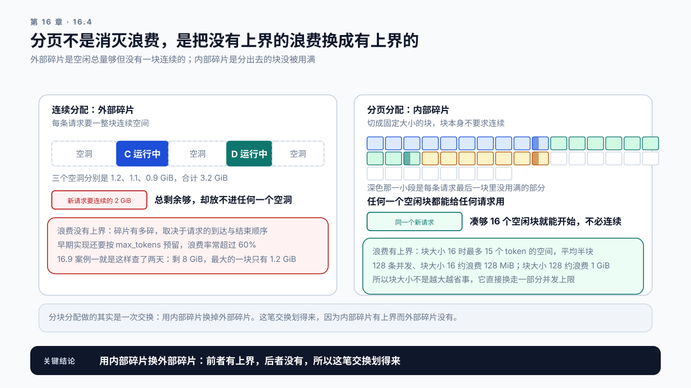
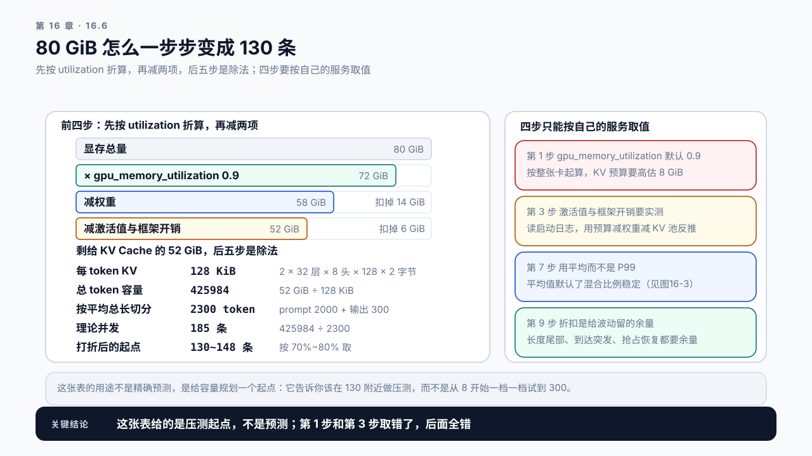
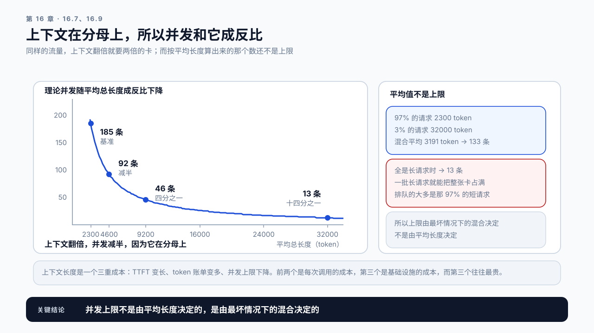

# 第 16 章 KV Cache 管理与容量：显存决定你能同时服务多少人

## 学习目标

读完这一章，你应该能回答三个问题：

1. 这张卡上最多能同时跑多少条请求，怎么算出来？
2. 显存明明还剩不少，为什么新请求还是排队？
3. 请求被抢占重算是怎么回事，什么时候会发生？

跟着做完，你会得到一份容量表：给定模型、卡和上下文长度，能算出理论并发上限，并解释实际上限为什么比它低。

第 12 章留了一笔账没算：上下文变长除了放大 TTFT，还占显存。这一章把它结清。

## 16.1 为什么并发上不去

先看一个常见的现象。

一台 80 GiB 的卡，跑参考模型三（Part 3 开篇参考表里的通用 7B），权重按 14 GiB 计，还剩 66 GiB。压测时把并发从 8 加到 16，吞吐涨了；加到 32，吞吐还在涨；加到 64，请求开始排队，部分请求的 TTFT 突然从 800 ms 跳到 6 秒。

`nvidia-smi` 显示显存用了 72 GiB，还剩 8 GiB。看起来没满，但就是加不上去了。这里假设的是一个按需申请显存、没有预先留出 KV 池子的实现，显示的就是真实用量；vLLM 一类引擎启动时会先把池子整块留出来，空载时也显示 72 GiB，那种情况怎么读，16.6 会讲。

要解释这件事，得先知道那 58 GiB 是怎么用掉的，以及为什么剩下的 8 GiB 不能用。

答案分三层。16.2 先算 KV Cache 本身要占多少；16.3 至 16.5 是让这笔账变复杂的三个原因：输出长度事先不知道，连续分配会产生碎片，显存真不够时引擎会抢占；16.6 再把它们折进一张容量表。长度的不确定靠分页的按需分配化解，所以第 7 步可以用平均长度，剩下的波动由第 9 步的折扣吸收；碎片同样由 PagedAttention 消掉；抢占是显存真不够时的后果，它要的余量也在第 9 步。框架开销是另一件事，它在第 3 步，16.6 讲怎么实测。

## 16.2 KV Cache 要占多少

第 11 章给过单条请求的公式，这里把它用到并发场景。

一个 token 的 KV Cache 字节数：

```text
每 token 字节数 = 2 × 层数 × KV头数 × head_dim × 字节数
                  ↑
                  K 和 V 各一份
```

以参考模型三为例（32 层、8 个 KV head、head_dim 128、FP16）：

```text
每 token = 2 × 32 × 8 × 128 × 2 = 131072 字节 = 128 KiB
```

一条 4096 token 的请求：

```text
4096 × 128 KiB = 512 MiB
```

66 GiB 的可用显存，除以 512 MiB，理论上能装 132 条。

显存的数字全书用二进制单位，第 11.3 节定的口径：分配器和框架日志都按这个口径报，容量表要和它们对得上。这一章的每一步除法都靠它对齐，换成十进制会在第 6 步差出百分之七，够让一张表和实测对不上。

这里有一处两套口径的交界，值得说破。第 15.3 节那个 14 GB 的权重是十进制的，因为它要除以同样十进制的带宽规格；换算成二进制是 13.0 GiB。本章的容量表按 14 GiB 扣权重，比实际多扣了 1 GiB。**这个方向是刻意的**：容量估算宁可保守，多扣的那 1 GiB 落进第 9 步那个折扣里，不会让你在压测时撞上意外的抢占。

**但这个数字基本不可能达到。** 三个原因，下面三节各讲一个。

KV Cache 的定义在第 2.4 节：它把已处理 token 的 K/V 存下来复用，用显存换计算。本章关心的不是它是什么，而是它占多少、为什么装不下预期的条数。

上面这笔每 token 占用的账，附录 A《GPU 性能心智模型》的“KV Cache 估算”一节给了按层数、头数、位宽逐项展开的算式，换模型时可以照着重算一遍。同一节的“为什么必须留余量”列了 16.6 那张表第 3 步那 6 GiB 里装的是哪几类东西，也说明了这里那个 66 GiB 为什么只是上界；具体扣多少只能实测，16.6 讲怎么测。

## 16.3 原因一：长度是不确定的

上一节按 4096 token 算，但真实请求的长度是分布，不是定值。

**输入长度事先知道，输出长度事先不知道。** 请求进来时，服务只知道 prompt 有多长，不知道模型会生成 50 个还是 2000 个 token。而 KV Cache 是随着生成过程一点点长出来的。

这就带来一个两难：

```text
按最坏情况预留   每条请求都按 max_tokens 占位 → 严重浪费，并发被压得很低
按当前长度分配   边生成边要 → 可能生成到一半发现没显存了
```

早期的实现选了前者，为每条请求预分配一整块连续显存，按最大可能长度算。结果是一条实际只生成 80 个 token 的请求，占着 2048 个 token 的空间。**浪费率常常超过 60%。**

PagedAttention 解决的正是这个，下一节讲。

## 16.4 原因二：碎片，以及 PagedAttention 怎么消除它

即使不按最坏情况预留，连续分配也会碎。

请求的到达和结束是交错的：A 结束了释放 2 GiB，B 结束了释放 1.5 GiB，但这两块中间夹着还在跑的 C。现在来了一条需要 3 GiB 的请求，总剩余够，却没有一块连续的 3 GiB。

这就是开头那个现象的答案之一：**显存还剩 8 GiB，但没有一块连续的够用。**

PagedAttention 的做法借自操作系统的虚拟内存：

```text
把 KV Cache 切成固定大小的块（block），比如每块 16 个 token
每条请求持有一张块表，记录自己的 KV 分散在哪些块里
块本身不要求连续
```

三个直接后果：

**外部碎片基本消失。** 任何一个空闲块都能被任何请求使用，不再需要连续。

**按需分配。** 生成到哪里就分配到哪里，不再按最大长度预留。浪费降到最后一个块内的不满部分，最多 15 个 token 的空间。

**前缀共享成为可能。** 两条请求如果有相同的前缀，可以指向同一批物理块。第 13 章那个 Prefix Cache 的底层就是它，同一个 system prompt 在显存里只存一份。它用的是同一个块池，不另占一份显存：被在跑的请求引用的前缀块按一份计入容量表第 6 步，没人引用的缓存块在显存紧张时先被淘汰。所以它不压低第 8 步那个并发上限，代价是被淘汰之后命中率下降（第 13.3 节那条式子里的“没被淘汰的比例”）。

> **PagedAttention**：把 KV Cache 按固定大小的块分散存储、用块表索引的管理方式，由 vLLM 提出。它让 KV Cache 的分配从“一整块连续空间”变成“若干不连续的块”，代价是 Attention kernel 要能处理这种非连续布局。

> **外部碎片与内部碎片（external / internal fragmentation）**：外部碎片是空闲空间总量够但没有一块连续的够用；内部碎片是分出去的空间没被用满，浪费在已分配的块里面。
> 分块分配做的其实是一次交换：用内部碎片换掉外部碎片。这笔交换划得来，因为内部碎片有上界而外部碎片没有。

块大小就是这笔交换的价格，两头都不能取极端：

```text
块大小 16 个 token   内部碎片上界 15 个 token 的空间，块表更长，索引开销更大
块大小 128 个 token  块表短、kernel 更好写，但内部碎片上界涨到 127 个 token
```

平均浪费大约是半个块，乘上并发条数才是总账。128 条并发、块大小 16 时，平均浪费约 8 × 128 ≈ 1000 个 token 的空间；块大小 128 时约 64 × 128 ≈ 8000 个。对照 16.2 那个每 token 128 KiB 的量级，前者约 128 MiB，后者约 1 GiB。**所以块大小不是越大越省事，它直接换走一部分并发上限。**



图16-1：外部碎片与内部碎片，分页做的是一次交换。左边是连续分配：三个空洞合计 3.2 GiB，却放不下一条要 2 GiB 连续空间的新请求。右边是分页分配：块不要求连续，浪费缩到每条请求最后一块里，深色那一小段就是它。

需要说明的是，**它管的是分配方式，不是总量**。显存总共就那么多，Paged 只是让它被用得更满。总量不够时，仍然要靠下一节的手段。

## 16.5 原因三：抢占，以及它的代价

显存真的不够时，引擎不会直接报错，它会做一件更微妙的事：把某条正在跑的请求踢出去。

```text
新请求需要显存，当前没有空闲块
  → 选一条正在 Running 的请求
  → 释放它的 KV Cache
  → 它退回 Waiting 队列
  → 稍后重新调度时，KV 要重新算一遍
```

这叫抢占（Preemption）。它的代价很具体：**被抢占的那条请求，已经完成的 Prefill 白做了。** 一条 8000 token 的请求被抢占，重新调度时要重新跑一遍 Prefill，那可能是几百毫秒到几秒。

用户端看到的现象是：回答吐到一半停住，卡一两秒，然后继续。ITL 序列里会出现一个巨大的尖峰。

抢占是显存不足的**症状**，不是解决方案。看到抢占计数上升，要做的是查显存账，而不是调高最大并发。

**两种抢占策略：**

```text
重算（recompute）  丢掉 KV，重新调度时重跑 Prefill。省显存，费算力
换出（swap）       把 KV 挪到主机内存，回来时挪回。省算力，费 PCIe 带宽
```

直觉上这该是一道时间题：算一下哪个快，选快的那个。这笔账能算，但算完的结论和直觉不一样。还是那条 8000 token 的请求，它占的 KV 是 `8000 × 128 KiB = 1000 MiB`：

```text
重算   重跑 8000 token 的 Prefill，按第 11 章的模型、有效算力 100 TFLOPS，约 1.3 秒
换出   1000 MiB 走 PCIe，按 16 GB/s 算单程约 65 ms，一来一回约 131 ms
```

**换出快了一个数量级，而且这个差距在短序列上同样成立。** 把两边都摊到每个 token 上就看清了：重算是 `2 × 参数量 ÷ 有效算力`，7B 上约 0.14 ms；换出往返是 `2 × 128 KiB ÷ PCIe 带宽`，约 0.016 ms。两者都与序列长度成正比，比值约九倍，跟长度无关。序列再长，Prefill 那个平方项还会让重算更贵，差距只会拉大。

所以“哪个划算”不能只比单条请求的时间，还要看代价落在谁身上：

```text
重算   代价是一段占满整卡算力的 Prefill。它不只拖慢被抢占的那一条：重跑那 1.3 秒里，
       同一张卡上正在 Decode 的请求都要跟着停（第 13.5 节的队头阻塞，也是本章案例二的机制）
换出   代价是主机内存和引擎的复杂度。换出的 KV 要在主机内存里留出同样大小，批量 32 条就是 31 GiB；
       传输走 PCIe，每秒十几 GB，相对每秒上千 GB 的显存带宽很小，其他请求几乎感觉不到
```

两种代价都不是零。以 vLLM V1 为例，抢占只有重算一种，没有换出可选；被踢出的是最后加入 Running 的那条（FCFS 下）。官方给的理由不是“实现简单”，而是重算在这套架构下开销更低：V1 默认开着前缀缓存，被释放的块带着哈希回到空闲队列，重新调度时只要没被淘汰就能直接命中，实际要重算的往往远少于整段 Prefill。换出是 V0 和另一些引擎的选项。长请求多、抢占频繁时，重算的那段 Prefill 会一次次打断所有人；主机内存紧、引擎对换出支持不好时，换出又不现实。**引擎两种都支持时，这个选择最终靠实测：打开抢占计数，比较两种策略下 ITL 尖峰出现得多频繁、有多高。** 这几条都是版本相关的说法，以 `content/reference/environment.md` 那一页的版本为准。

把代价放在一起看，抢占的真实账就清楚了：**用一段打断所有人的 Prefill，或者 1000 MiB 的主机内存，换回 1000 MiB 显存。** 如果这 1000 MiB 只够再接一条同样长的请求，那这次抢占什么也没解决，只是把卡顿从一个用户转移到了另一个。

## 16.6 算一张容量表

把前面的东西合起来，就能算出一个可用的容量估计。

```text
1. 引擎能用的显存预算                 80 GiB × 0.9 = 72 GiB
2. 减去权重                          -14 GiB
3. 减去激活值、框架开销、通信缓冲区     -6 GiB（经验值，需实测）
4. 剩余给 KV Cache                    52 GiB
5. 每 token KV 字节数                 128 KiB
6. 总 token 容量                      52 GiB ÷ 128 KiB ≈ 426000 token
7. 按负载的平均总长度切分              平均 prompt 2000 + 输出 300 = 2300
8. 理论并发                           426000 ÷ 2300 ≈ 185 条
9. 打折                               实际按 70%~80% 取，约 130~148 条
```

几点说明：

**第 1 步不是整张卡。** vLLM 一类引擎按 `gpu_memory_utilization` 一次性划走一块显存，默认 0.9，权重和 KV 池都在这块里面，剩下的一成留给驱动上下文和临时分配。按 80 GiB 整张卡起算会把 KV 预算高估 8 GiB，到第 8 步就是多出近三十条并发。自己的服务按启动参数的实际取值代入；16.1 那台按需申请显存的服务没有这一步，所以那里是从 80 GiB 直接扣的。

**第 3 步必须实测，但不能看空载时的 nvidia-smi。** 框架开销和激活值占用因版本、配置而异，猜出来的数字会让后面全错。可 vLLM 一类引擎启动时会按 `gpu_memory_utilization`（默认 0.9）把 KV Cache 的池子一次性留出来，空载时 nvidia-smi 就显示约 72 GiB；拿它减权重，会得出 58 GiB 的“固定开销”，这正是 16.1 那个现象的另一种误读。要读启动日志：日志里会分别报模型权重占了多少显存、分给 KV Cache 的容量或块数，以及按 `max_model_len` 算出的最大并发（那是每条都是最长请求时的最坏值，见 16.9 案例三），措辞以所用版本为准。用 `gpu_memory_utilization × 显存总量 − 权重 − KV 池` 反推出来的，才是第 3 步那一项。

**第 7 步用平均而不是 P99。** 按 P99 算会严重低估容量，因为不是所有请求同时都是 P99 长度。但也不能只看平均，还要看第 9 步的折扣是否够覆盖长度波动。

**第 9 步那个折扣是给波动留的余量。** 长度分布的尾部、到达的突发、抢占的恢复，都需要余量。折扣打太满，系统会在流量波动时频繁抢占。



图16-2：容量表的九步，80 GiB 怎么变成 130 条。上半是一乘两减：80 乘 0.9 得到 72 GiB，再减 14 减 6 得到 52 GiB。下半是五步除法，从每 token 128 KiB 一直算到打折后的 130 到 148 条。右侧标出第 1、3、7、9 四步为什么只能按自己的服务取值。

**这张表的用途不是精确预测，是给容量规划一个起点。** 它告诉你该在 130 附近做压测，而不是从 8 开始一档一档试到 300。

## 16.7 长上下文把这张表压缩得多快

现在回答第 12 章欠下的那个问题。

上下文长度直接出现在第 7 步的分母上，所以并发上限和它成反比：

| 平均总长度 | KV 每条 | 理论并发 | 相对变化 |
|---|---|---|---|
| 2300 token | 288 MiB | 185 | 基准 |
| 4600 token | 575 MiB | 92 | 减半 |
| 9200 token | 1.12 GiB | 46 | 减到四分之一 |
| 32000 token | 3.91 GiB | 15 | 减到十四分之一 |

第 12 章那个把 Top-K 从 3 调到 10 的例子，在那一章的账里是输入 token 从 1230 涨到 2630、TTFT 从 320 ms 涨到 740 ms。现在可以把这笔账补全：

```text
总长度   1230 + 300 输出 = 1530   →   2630 + 300 = 2930
并发上限 × 1530 ÷ 2930 = 0.52
```

**并发上限同时减半。**

也就是说，同样的流量，需要的卡数翻倍。这笔成本在那一章的账单里是看不到的，它体现在容量规划上。



图16-3：并发上限与上下文长度成反比，而平均值不是上限。曲线上四个点分别是 2300 token 的 185 条、4600 的 92 条、9200 的 46 条、32000 的 13 条。右侧那个混合分布按平均算是 133 条，而全是长请求时只有 13 条。

**所以上下文长度是一个三重成本：** TTFT 变长（第 12 章）、token 账单变多（第 12 章）、并发上限下降（这一章）。前两个是每次调用的成本，第三个是基础设施的成本，而第三个往往是最贵的那个。

## 16.8 Demo：KV Cache 容量计算器

本章 Demo 位于 `code/ch16/kv_capacity.py`，不需要 GPU。

```bash
python3 code/ch16/kv_capacity.py \
  --layers 32 --kv-heads 8 --head-dim 128 --dtype fp16 \
  --gpu-memory 80 --weight-memory 14 --overhead 6 \
  --avg-context 2300 --p99-context 9200 \
  --block-size 16
```

输出：

```text
bytes_per_token     每 token 的 KV 字节数
kv_budget_gb        扣除权重和开销后能给 KV 的显存
total_tokens        总 token 容量
concurrency_avg     按平均长度的理论并发
concurrency_p99     按 P99 长度的理论并发（保守下界）
recommended         打折后的建议起点
blocks_total        按 block_size 切分后的总块数
waste_per_request   每条请求最后一块的平均浪费
```

两个用法：

**做容量规划。** 改 `--avg-context`，看并发上限怎么掉，把它和业务的目标并发对照，决定要几张卡。

**判断显存账对不对。** 实测的最大并发远低于 `recommended`，说明 `--overhead` 估小了，或者存在别的显存占用。实测显著高于它，说明真实的平均长度比你以为的短。

`concurrency_avg` 和 `concurrency_p99` 一起给出是刻意的：**真实的安全并发在这两个数之间**，具体位置取决于长度分布的形状和你能接受多少抢占。

这张表算出来的并发是一个待校准的估计。用在自己的服务上时，按它算出的并发去压测，记录实际的抢占计数和显存占用，反过来校准 `--overhead`；校准之前，不要拿它直接定卡数。

## 16.9 案例与常见误区

### 案例一：显存剩 8 GiB，请求还在排队

开头那个现象。团队认为是调度器有问题，查了两天。

最后发现是碎片：剩余的 8 GiB 分散在十几个不连续的区域，最大的一块只有 1.2 GiB，而新请求需要连续的 2 GiB。升级到支持 PagedAttention 的版本后，同样的显存下并发从 41 提到了 96。

这个案例的教训是：**判断显存够不够，不能只看剩余总量，还要看分配方式。** 在没有分页的实现上，“剩余 10%”和“能再接一条请求”是两件事。

讨论：如果暂时不能升级框架，有什么办法缓解碎片？

### 案例二：最大并发调高之后更糟了

监控显示抢占频繁，有人把允许的最大并发调高，希望减少排队。

结果抢占次数翻了三倍，P99 延迟从 4 秒涨到 17 秒。原因是并发调高之后显存更紧张，抢占更频繁，而每次抢占都要重算 Prefill，重算又占用算力，进一步拖慢其他请求，形成正反馈。

正确的做法是反过来：**看到抢占频繁，先把并发降下来**，让系统回到稳定区，再去查显存账。

讨论：抢占计数该配什么样的告警阈值？超过之后第一步做什么？

### 案例三：把 32K 上下文当成免费的功能

产品侧要求支持 32K 上下文，理由是“模型本来就支持”。

上线后启动日志里报的最大并发从 150 变成 13，团队据此按 24 张卡做了预算，而原来只要 2 张。实际统计显示，只有 3% 的请求真的用到了超过 8K 的上下文。

**这里要小心一个误读。** 按 16.4 那套分页按需分配，把上限从 8K 调到 32K 本身不占显存，短请求该占多少还是多少。按混合分布算平均：

```text
97% 的请求 2300 token，3% 的请求 32000 token
平均总长 3191 token   →   理论并发 133 条
```

掉到 133，不是 13。那 13 是另一个数：

```text
单条 32000 token 的 KV = 3.91 GiB
52 GiB ÷ 3.91 GiB = 13 条
```

13 正是启动日志按 `max_model_len` 报的那个数，它说的是“全是最长请求”时的上限（16.6 第 3 步讲过怎么读这一行）。平时 133 条跑得好好的，一旦来一批长请求，13 条就能把整张卡占满，其余全部排队，而排队的大多是那 97% 的短请求。**并发上限不是由平均长度决定的，是由最坏情况下的混合决定的**，容量表那一步用平均值算，就是默认了混合比例稳定。

后来的做法是按长度分流：绝大多数请求走一个 8K 上限的实例组，少量长请求走单独的实例组。总卡数回到 4 张。分流真正隔离的不是显存，是**那 3% 的请求把整张卡占满的可能性**。

讨论：按长度分流引入了哪些新问题？路由该按什么判断？

### 两个不写在容量表里的误区

误区一：KV Cache 是缓存，满了淘汰就行。

它叫 Cache，但行为不像缓存。缓存丢了可以重新去源头取，KV Cache 丢了只能重算，而重算的代价是整段 Prefill。所以它更接近“正在运行的进程占用的内存”，而不是“可以随时丢弃的副本”。

误区二：显存不够就加卡。

加卡确实能增加总显存，但如果问题的根源是上下文太长或者按最大长度预留，加卡只是把浪费按比例放大。先算清 16.6 那张表，看当前的显存到底用在了哪里，再决定是加卡还是改配置。

## 本章总结

回到开头的三个问题。

**最多能跑多少条，怎么算？** 显存总量减去权重、再减去实测的框架开销，剩下的除以每 token 的 KV 字节数，得到总 token 容量；再除以负载的平均总长度，得到理论并发；最后打七到八折留余量。每 token 的 KV 字节数按 `2 × 层数 × KV头数 × head_dim × 字节数` 算：参考模型三（8 个 KV 头）是 128 KiB，同为 7B 的 Qwen2.5-7B（4 个 KV 头）只有 56 KiB，MHA 的 7B（32 个 KV 头）是 512 KiB，差别全在 KV 头数。这张表算的不是精确值，而是给压测一个起点。

**显存还剩不少为什么还排队？** 三种可能。一是碎片：剩余空间不连续，凑不出一块够大的，这正是 PagedAttention 要解决的问题，它把 KV 切成固定块、用块表索引，外部碎片基本消失，还顺带让前缀共享成为可能。二是按最大长度预留：一条只生成 80 个 token 的请求占着 2048 个 token 的位置。三是显存被框架开销吃掉了，而你的估算里没算它。

**抢占是怎么回事？** 显存不够时引擎把某条正在跑的请求踢回等待队列，释放它的 KV。代价是已完成的 Prefill 白做，重新调度时要重算，用户端看到回答卡住几秒。它是显存不足的症状，不是解决方案，看到抢占上升要先降并发再查显存账，调高并发只会形成正反馈。第 12 章那笔账到这里结清：上下文长度是三重成本，TTFT、token 账单，以及并发上限，而第三个通常最贵。

下一章讲怎么把这笔显存账压下来：量化让权重和 KV 都变小，但它换走了什么。

### 本章 Checklist

- [ ] 能算出这个模型每 token 的 KV Cache 字节数。
- [ ] 能实测出框架的固定显存开销，而不是猜一个值。
- [ ] 能算出一张完整的容量表，并说明每一步的折扣是给什么留的。
- [ ] 能解释为什么剩余显存和可接纳的请求数不是一回事。
- [ ] 能说出 PagedAttention 消除了什么浪费，以及它没有解决什么。
- [ ] 能从 ITL 序列的尖峰判断是否发生了抢占。
- [ ] 能说明重算和换出两种抢占策略各自的代价。
- [ ] 能算出把上下文上限翻倍之后，需要的卡数怎么变。

## 课后练习

1. 用你的模型参数算出每 token 的 KV 字节数，并和 MHA 版本对比，说明 GQA 省了几倍。
2. 启动服务但不发请求，记录显存占用，算出权重之外的固定开销。
3. 按 16.6 的步骤算出理论并发，然后压测找出实际上限，解释两者的差距。
4. 把平均上下文长度翻倍，重算容量表，记录并发上限的变化。
5. 找出服务的抢占计数指标，压测到抢占发生，记录此时的并发和显存。
6. 采集一条被抢占请求的 ITL 序列，量出那个尖峰有多大。
7. 对比开启和未开启前缀共享时，相同 system prompt 下的显存占用差异。
8. 为你的服务写一份容量说明，包含单卡并发上限、对应的上下文假设，以及假设不成立时的后果。
