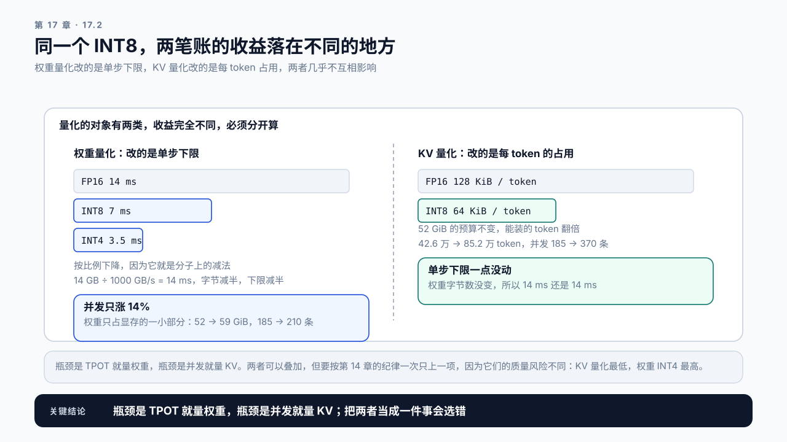
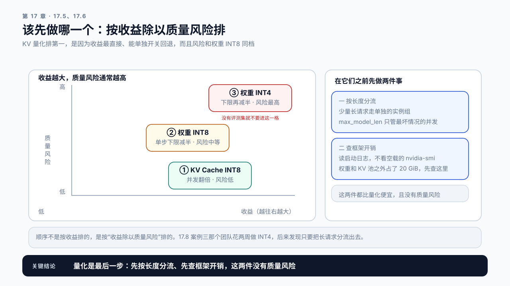

# 第 17 章 量化与内存优化：用精度换容量和速度

## 学习目标

读完这一章，你应该能回答三个问题：

1. 量化到底省下了什么，省多少？
2. 权重量化和 KV 量化，哪个更该先做？
3. 质量损失怎么衡量，多大算不能接受？

跟着做完，你会得到一份量化决策记录：这个场景该量化什么、预期收益多少、用什么评测集守住质量底线。

## 17.1 上两章都指向同一个数字

第 15 章的结论是，Decode 的单步耗时下限等于权重字节数除以显存带宽。第 16 章的结论是，并发上限取决于扣掉权重之后还剩多少显存给 KV Cache。

两个结论里都有“字节数”。

所以有一个手段能同时改善两者：**让这些字节变少**。

```text
权重从 FP16 变成 INT8
  → 单步耗时下限减半         （第 15 章那个公式的分子减半）
  → 腾出一半权重显存给 KV     （第 16 章那张表的第 2 步）
  → 并发上限跟着上去
```

这就是量化。它是本书到目前为止第一个同时压低 Decode 单步下限和 KV 之外显存占用的手段，代价也很明确：精度。

> **量化**（Quantization）：用更少的比特表示模型的权重或激活值。FP16 每个数占 2 字节，INT8 和 FP8 占 1 字节，INT4 占半字节。表示范围和精度随之下降，需要用缩放因子把原始数值映射到目标范围。
> FP8 是一种 8 位浮点格式，比 INT8 多了指数位，对离群值更宽容；较新的卡（例如 H100）有对应的矩阵运算单元，vLLM 的 KV Cache 量化也常用它。

## 17.2 省下多少，分两笔算

量化的对象有两类，收益完全不同，必须分开算。

### 权重量化

直接的账：

```text
参考模型三  FP16  14 GB
            INT8   7 GB
            INT4 3.5 GB
```

这三个数是十进制的，和第 15.3 节同口径：参数量乘位宽再除以带宽规格，两边都是十进制才约得掉。下面算显存预算时换回二进制，按第 16.2 节说破的那处交界，扣权重时取偏大的整数。

收益出现在两处：

**Decode 单步下限按比例下降。** 在参考卡（1000 GB/s）上，FP16 是 14 ms，INT8 约 7 ms。这是第 15 章那个公式的直接结果。

这条比例关系为什么成立，值得单独说一句。它就是本篇那条搬运下限在分子上做减法，也是第 15.2 节那个恒等式的另一面。每个参数每生成一个 token 大约要做 2 次运算，这一项不随位宽变化；变的只是每个参数占多少字节：

```text
bfloat16  2 FLOP ÷ 2 byte   = 1 FLOP/byte
INT8      2 FLOP ÷ 1 byte   = 2 FLOP/byte
INT4      2 FLOP ÷ 0.5 byte = 4 FLOP/byte
```

位宽减半，搬运量减半，算术强度翻倍。换个说法，量化是把 Decode 往分界点的方向推，但单条请求推不了多远：参考卡和 A100 的分界点都在 153，INT4 之后也才 4，单条请求的 Decode 仍然牢牢地是带宽受限。**这就是小批量时延迟收益接近线性、而且一路量下去都还有收益的原因**，真正先撑不住的是质量，不是硬件。

批量大了就不一样。批量为 B 时，FP16 的强度约是 B，INT8 约是 2B，INT4 约是 4B，于是越过分界点所需的批量也跟着减半。只量化权重、计算仍按 FP16 跑时，分界点不变，还是 153：

```text
FP16   批量约 153 起算力受限
INT8   批量约 77 起
INT4   批量约 38 起
```

这三个数都没算 KV 的读取，相当于上下文趋近于零；上下文越长，交叉批量越往后推（第 15.4 节算过同一件事）。

按第 15.3 节那条 max 式子，越过之后量化版的单步由计算决定，搬运省下来的那部分不再全额变成时间。**但收益不是在这里消失，是在这里开始缩水。** 因为同一个批量上 FP16 版还在带宽受限、还是 14 ms，两者要到批量 153 才一起变成算力受限、收益归零。线上批量 48 时，INT4 已经越过它自己那条 38 的线：单步从 3.5 ms 被算力托到 4.4 ms，仍比 INT8 的 7 ms、FP16 的 14 ms 快，只是四倍的收益只兑现了约三点二倍。INT8 在 77 以内收益完整，77 到 153 之间逐渐缩水，到 153 与 FP16 持平。所以“量化让 Decode 变快”这句话要带着批量说，这是本篇第二条纪律在量化上的样子。

它还在两种情况下不成立。一是搬运本来就不是瓶颈：大批量 Prefill 已经是算力受限，只量化权重不会让它变快，权重和激活一起量化、走低精度矩阵单元的情形不同，见 17.3 那张表。二是实现上要先反量化回高精度再算，那么搬运确实省了，但多出一步开销，收益要实测，这就是 17.3 的第二个判断。

这里用的 1000 GB/s 是规格带宽。实际能跑到多少、怎么从 Profiling 数据里读出有效带宽，在附录 A《GPU 性能心智模型》的“显存带宽”一节。用规格值算出来的单步下限是下限，不是预期值。

**腾出的显存全部转给 KV Cache。** 80 GiB 的卡上，按 16.6 那张表的口径（引擎能用 72 GiB）扣权重，从 14 GiB 降到 7 GiB，KV 预算从 52 GiB 变成 59 GiB，并发上限涨约 14%。

注意这两笔的量级不同：**延迟的改善接近线性，而并发的改善是有限的**，因为权重只占显存的一小部分。所以权重量化的主要价值在延迟，不在容量。

### KV Cache 量化

```text
每 token KV  FP16  128 KiB
             INT8   64 KiB
```

收益出现在一处，但很大：

**KV 预算不变，但每 token 占一半，总 token 容量翻倍，并发上限跟着翻倍。**

对照第 16 章那张表：52 GiB 的 KV 预算，FP16 下能装 42.6 万个 token，INT8 下能装 85.2 万个。平均长度 2300 的负载，并发从 185 涨到 370。



图17-1：权重量化推延迟，KV 量化推容量。左栏三条按比例缩短的条是 FP16、INT8、INT4 的单步下限，而并发只涨 14%；右栏每 token 从 128 KiB 降到 64 KiB，并发从 185 涨到 370，而单步下限一点没动。

**所以两者的分工很清楚：权重量化主要改善延迟，KV 量化主要改善容量。** 瓶颈是 TPOT 就量权重，瓶颈是并发就量 KV。

对 Decode 单步耗时，KV 量化也有帮助：第 15 章说过长上下文大批量时 KV 读取量会超过权重，量化它同样减少搬运。但这个收益只在长上下文场景下明显。

## 17.3 精度换的到底是什么

量化不是无损压缩，它真的丢了信息。丢多少、丢在哪，决定了质量损失有多大。

最朴素的做法是按张量取最大最小值线性映射。问题是 LLM 的权重和激活值里存在**离群值**：绝大多数数值集中在一个小范围里，但有少量数值大得多。

“大得多”是多少，决定了损失有多重，所以值得摆一个量级。典型情况下绝大多数权重落在一个窄区间里，而少数离群值要大出一两个数量级。按最大值定缩放因子会是这样：

```text
INT8 一共 256 个格子，均匀铺在 [−max, +max] 上
离群值比主体大 100 倍  →  主体只占用中间约 3 个格子
等效位宽              →  log₂3 ≈ 1.6 位，从 8 位掉了六位多
```

**这就是精度损失的来源：不是 8 位不够用，是 8 位里有六位多被少数几个数占掉了。** 看懂这一点，下面三类方案在补什么就清楚了：更细的粒度是让离群值只污染它所在的那一小组，保留离群是把那几个数单独拿出去，校准是用真实分布找一个比最大值更合适的边界。

实际的量化方案都在处理这个问题，思路大致三类：

```text
更细的粒度   不按整个张量，按通道或按小组各用一个缩放因子
保留离群     把少量离群值用高精度单独存，其余量化
校准         用一批真实数据统计分布，据此选缩放因子
```

对性能工程来说，不需要掌握每种方案的细节，需要掌握的是三个判断：

**一、量化是否需要校准数据。** 需要的方案质量通常更好，但校准数据要和线上分布接近，否则会在真实流量上表现更差。用通用语料校准的模型跑医疗问答，质量可能掉得比预期多。

**二、量化后的 kernel 是否真的更快。** INT8 权重如果在计算时要先反量化回 FP16 再算，那搬运量确实减半了，但多了一步反量化。收益是否兑现取决于实现，必须实测。

这两个判断合起来，就是下面这张表。表里的名字按一个规矩读：W 后面是权重的位宽，A 后面是激活的位宽，W8A16 就是权重 8 位、激活仍是 16 位。KV 量化不在这套命名里，它是第三个独立的开关，17.2 已经单独算过。行是量化了什么，列是工作落在分界点哪一侧：

| | 带宽受限区（小批量 Decode） | 算力受限区（Prefill、大批量 Decode） |
|---|---|---|
| 只量化权重（W8A16、W4A16） | 搬运减半或更多，单步下限按比例降；反量化的开销会吃掉一部分 | 计算仍按 FP16 跑，峰值算力没变，几乎没有收益；批量越过 153 ÷ 强度倍数之后收益开始缩水，到 153 归零 |
| 权重和激活都量化（W8A8、FP8） | 收益同左，激活的搬运也省了；激活同样有离群值，质量风险更高 | 走 INT8 或 FP8 的矩阵单元，峰值算力翻倍（A100 的 INT8 是 624 TFLOP/s，H100 的 FP8 是 1979 TFLOP/s），分界点也跟着翻倍（A100 从 153 到约 306，H100 从 295 到约 591），Prefill 能变快 |

右下那一格有一个前提：**硬件得有对应精度的矩阵单元。** A100 没有 FP8 矩阵单元，H100 有；没有对应单元时，低精度只能先转回高精度再算，右下那一格就退回右上。

**三、模型规模影响损失大小。** 一般来说模型越大，量化的相对损失越小。小模型上 INT4 可能明显掉质量，大模型上可能几乎看不出来。不能把大模型的结论套到小模型上。

## 17.4 质量怎么量

这是量化决策里最容易被跳过的一步，也是最危险的。

第 12 章说过一次：没有可量化的质量指标，“质量没什么损失”就是一句无法证伪的话。量化这里更严重，因为**损失是隐蔽的**：大部分回答看起来完全正常，问题出在少数场景下。

最低限度需要三样东西：

```text
1. 一个固定的评测集     覆盖线上的主要场景和已知的难例
2. 一个可复现的跑法     temperature 固定为 0，同一批输入
3. 一条底线            事先写死，比如准确率下降不超过 1 个百分点
```

**底线必须在量化之前定。** 事后看着结果定标准，和第 14 章说的事后补写预期是同一个毛病，这样的评估无法证伪。

几个容易漏掉的检查维度：

**长回答比短回答更敏感。** 误差在逐 token 生成中会累积，前面的小偏差会影响后面的选择。只测单轮问答可能测不出长文生成的退化。

**格式遵循能力容易先坏。** 要求输出 JSON 的场景，量化后可能出现格式错误率上升，而这在通用评测集上完全看不出来。17.8 案例二那组数字值得记住：

```text
公开评测集准确率   掉 0.3 个百分点     看起来没问题
JSON 格式错误率    0.2% → 4.1%         涨了二十倍
```

**同一次量化，两个评测集给出的结论完全相反。** 如果你的服务依赖结构化输出，必须单独测。

这里还有一层更隐蔽的。就算评测集里已经放了结构化样本，总分也可能照样通过。本章 Demo 那份合成样例算给你看：20 条样本里 10 条短问答、4 条长回答、3 条结构化、3 条专业难例，结构化那一维掉了 3.9 个百分点，可总分只掉 0.68 个百分点，1 个百分点的底线轻松通过。短问答样本多，把那一维的退化在平均值里稀释掉了。所以**底线要逐维度各设一条，不能只对总分设一条**，否则评测集里放了什么样本都救不了你。

**低频语言和专业领域损失更大。** 校准数据覆盖不到的分布，量化误差会更明显。

**拒答和安全行为可能改变。** 这一项在生产服务里的后果可能比准确率更严重。

## 17.5 该先做哪一个

按收益和风险排序：

| 顺序 | 做法 | 主要收益 | 质量风险 | 什么时候做 |
|---|---|---|---|---|
| 1 | KV Cache INT8 或 FP8 | 并发翻倍 | 低 | 瓶颈是并发或显存 |
| 2 | 权重 INT8 | 单步下限减半 | 中 | 瓶颈是 TPOT |
| 3 | 权重 INT4 | 单步下限再减半 | 高 | 前两项不够，且有评测集 |

“单步下限减半”不等于 TPOT 减半。按第 10 章的 Amdahl 定律，实测 TPOT 是下限的 r 倍时，下限减半大约省 1/r × 50%：r = 1.2 时省四成，r = 6.25 时只省 8%（17.8 案例一）。这是按规格带宽估的，有效带宽跑不满时搬权重占的比例还要大一些，实际省的会比这个数多（第 19 章第 2 轮就是这样）。决定排不排这一项之前，先把 r 测出来。

**KV 量化排第一，因为经验上它的质量风险最低。** 这是经验结论，不是机制上的保证：KV 每一层都被量化，后面每个位置都要反复读它，误差同样会传下去。常见的 INT8、FP8 KV 量化在多数任务上看不出损失，但长上下文、需要逐字回忆前文的任务要单独测。而收益又是三者里最直接的：并发接近翻倍。

**权重 INT8 是当前比较成熟的选择。** 多数模型上质量损失可控，收益明确。

**INT4 要谨慎。** 收益诱人，但质量损失明显，且在小模型上可能不可接受。没有评测集就不要做这一步。

**这三项可以叠加**，但要遵守第 14 章的纪律：一次只上一项，各自测清楚。

## 17.6 量化之外的两件事

显存紧张时，除了量化还有两个常被忽略的手段。

**一是按长度分流，而不是只调低上下文上限。** 第 16 章案例三说过一个容易误读的地方：在分页按需分配的引擎上，`max_model_len` 本身不占显存，平均并发由实际的长度分布决定，把它从 32K 降到 8K，平均并发不会涨四倍。它真正管的是三件事：挡住超长的请求；决定启动时能不能装下一条最长的请求；以及启动日志里那个按它算出来的“最大并发”，那是每条都是最长请求时的最坏值。最坏情况下的并发确实和它成反比：上限 32K 时，一批长请求能把整张卡占满，其余请求全部排队。所以首选的手段是第 16 章那种按长度分流：短请求走一个上限 8K 的实例组，少量长请求走单独的实例组。最坏情况被隔离开，短请求那一组不再被长请求挤占，也不损失任何质量。

**二是查框架开销。** 第 16 章那个 `--overhead` 参数，实测常常比预期大。有些配置项会预留大块显存，比如 CUDA Graph 的捕获缓冲区（第 18 章）。`swap_space` 不在其中，它占的是主机内存。读启动日志（16.6 第 3 步），不要看空载的 nvidia-smi：如果权重和 KV 池之外的那一块就有 20 GiB，那要先查这里，而不是急着量化。



图17-2：三项量化手段的收益与质量风险。横轴是收益，纵轴是质量风险。KV Cache INT8 在右下角，收益大而风险低；权重 INT4 在右上角，收益最大而风险最高。右侧是两件该先做的、没有质量风险的事。

**这两件事都比量化便宜，且没有质量风险，应该先做。** 量化是在这两件事做完之后仍然不够时才用的手段。

## 17.7 Demo：量化收益估算

本章 Demo 位于 `code/ch17/quant_tradeoff.py`，分成两个子命令：`estimate` 只做算术，不需要 GPU；`evaluate` 比对两个服务的质量，需要实测数据。

```bash
python3 code/ch17/quant_tradeoff.py estimate \
  --config code/ch15/model-7b-generic.json \
  --avg-context 2300 \
  --weight-dtype fp16,int8,int4 \
  --kv-dtype fp16,int8 \
  --measured-tpot-ms 17
```

模型参数默认读 Part 4 共享的那份配置，`--params`、`--layers` 这些可以逐项覆盖。输出一张对照表：

```text
combo              权重与 KV 的精度组合
weight_gb          权重显存（十进制，与 15.3 同口径）
step_floor_ms      Decode 单步下限
kv_kib_per_token   每 token 的 KV 字节数
concurrency        按 16.6 的方法算出的理论并发
delta_tpot_floor   相对 FP16 基线的单步下限变化
delta_concurrency  相对 FP16 基线的并发变化
realised_tpot_saving  按实测与下限的比值折算后的实际收益
```

最后一项是这个 Demo 的重点。**前面那些是下限的变化，不是你会拿到的变化。** 给了 `--measured-tpot-ms`，它按 17.8 案例一那条除法折算一遍；没给，它只报上界，并写明为什么不能当预期值用。实测是下限的六倍多时，这一列会直接告诉你权重减半只值 8%。

质量那一半：

```bash
python3 code/ch17/quant_tradeoff.py evaluate \
  --evalset content/ch17/evidence/quant-eval-sample.jsonl \
  --results content/ch17/evidence/quant-eval-results.json \
  --threshold 0.01
```

`--evalset` 给样本清单，每条带一个 `kind`；`--results` 给两个服务在同一批输入上的打分。**`quant-eval-results.json` 是合成样例，不是真机结果**，文件里的 `synthetic` 字段和 `_note` 都写明了。它演示的是 17.4 那个稀释陷阱：总分下降 0.68 个百分点、能通过 1 个百分点的底线，而结构化输出那一维已经掉了 3.9 个百分点，脚本因此判不通过。

三条硬性要求：

**评测集必须包含长回答样本和格式化输出样本**，缺任一类直接拒绝出报告，因为只有短问答的评测集测不出 17.4 说的那两类退化。

**阈值的写入时间必须提供**，脚本会把它记进报告。事后改阈值的评估不被接受。

**逐维度都要过线，不是只看总分。** 任一维度越界就判不通过，哪怕总分漂亮。总分通过而某一维度越界，是这一章最危险的那种情形。

在自己的服务上做这一步时，在同一份负载上跑 FP16 与 INT8 的对照，看 `delta_tpot_floor` 和 `delta_concurrency` 的估算与实测差多少，用实测 TPOT 填进 `--measured-tpot-ms` 校准 `realised_tpot_saving`，再用你自己的评测结果替换那份合成的质量结果。

## 17.8 案例与常见误区

### 案例一：量化之后并没有变快

团队把 7B 模型从 FP16 量化到 INT8，期望 TPOT 减半，实测只降了 8%。

查 Timeline 发现，kernel 之间有大量空隙，这个服务的瓶颈本来就不在带宽，而在调度开销。第 15 章那个对照没做：实测 TPOT 是理论下限的**六倍多**，说明大部分时间根本不花在读权重上。

这个 8% 不用猜，一步除法就出来了：

```text
实测 = 6.25 × 下限
权重减半 → 下限减半 → 省下 0.5 ÷ 6.25 = 8% 的总时间
```

**把权重减半，只压缩了那六分之一里的一半。** 反过来也能用：知道实测是下限的几倍，就能在动手之前算出量化最多能拿多少。实测是下限的 1.2 倍时，权重减半能省四成；到了六倍，只剩 8%。

讨论：在做量化之前，用什么最快的检查能避免这次白做？

### 案例二：通用评测过了，线上炸了

量化后在公开评测集上跑，准确率只掉了 0.3 个百分点，上线。

三天后客诉激增。排查发现服务的主要场景是结构化输出，量化后 JSON 格式错误率从 0.2% 涨到 4.1%。公开评测集里没有这类任务，所以完全没测出来。

后续补了一个从线上真实请求采样的评测集，才发现这个问题在量化方案切换后能降到 0.6%。

讨论：评测集该怎么构造，才能覆盖线上的真实分布？

### 案例三：先量化，后来发现只要改一行配置

服务显存告急，团队花了两周做 INT4 量化，质量掉了不少，反复调方案。

后来有人看了一眼启动参数和告急时的请求，发现 `max_model_len` 设的是 32768，而实际请求的 P99 长度是 3800，告急的时刻恰好是一批长文档请求集中涌入。平时的平均并发其实够用，是最坏情况下的并发只有 15 条。改成 8192、把少量长请求分流到单独的实例组之后，最坏情况下的并发回到 60，平均并发没变，显存告急的现象就没了（机理见 17.6），量化根本没必要。

**这个案例真正的教训不是“先查配置”，是那两周本来可以省掉。** 17.6 那两件事没有质量风险、改一行配置就能生效，而 INT4 花了两周还要反复调方案。顺序搞反的代价就是这两周。

讨论：还有哪些启动参数会在不知不觉中吃掉显存？

### 两个不写在决策记录里的误区

误区一：量化是压缩，解压回来就没损失了。

它不是无损压缩。INT8 表示不了 FP16 能表示的所有数值，信息是真的丢了。反量化回 FP16 得到的是近似值，不是原值。

误区二：别人量化没问题，我们也没问题。

量化的质量损失高度依赖模型规模、任务类型和数据分布。别人在 70B 模型上做通用问答没问题，不代表你在 7B 模型上做结构化输出也没问题。这个结论不可迁移，必须自己测。

## 本章总结

回到开头的三个问题。

**量化省下了什么？** 省字节，而字节同时决定了第 15 章的单步耗时下限和第 16 章的并发上限。权重量化让 7B 模型从 14 GB 降到 7 GB，Decode 单步下限按比例减半；KV 量化让每 token 从 128 KiB 降到 64 KiB，总 token 容量翻倍，并发跟着翻倍。代价是精度，而精度损失的根源是离群值：少量数值远大于其余，按最大值定缩放因子会把大多数数值压到很窄的区间。

**先做哪个？** 看瓶颈。瓶颈是并发或显存，先做 KV 的 INT8 或 FP8：它和权重 INT8 同属低风险档，而且能单独开关、随时回退，收益也最直接；但它对长上下文的逐字回忆更敏感，那类任务要单独测；瓶颈是 TPOT，做权重 INT8，并先用实测与下限的比值算清它最多能省多少；INT4 只在前两项不够且有可靠评测集时才考虑。量化的收益要带着批量说：只量化权重时，越过分界点的批量从 FP16 的约 153 降到 INT8 的约 77、INT4 的约 38（都没算 KV 读取，上下文越长越往后推），越过之后收益开始缩水、到批量 153 才归零；权重和激活一起量化、硬件又有对应的矩阵单元时，Prefill 也能变快。在这三项之前，先做两件更便宜的事：按长度把少量长请求分流出去（`max_model_len` 管的是最坏情况，不是平均并发），以及从启动日志里查清框架吃掉了多少显存。它们没有质量风险。

**质量损失怎么衡量？** 需要固定的评测集、可复现的跑法、事先写死的底线，三样缺一不可，且底线必须在量化之前定。评测集要覆盖四个容易漏的维度：长回答（误差会在生成中累积）、格式遵循（结构化输出容易先坏且通用评测看不出来）、专业领域和低频语言（校准数据覆盖不到）、拒答与安全行为。公开评测集过了不等于线上没问题。

下一章讲不改精度的另一类办法：Speculative Decoding 和 CUDA Graph 分别绕开了哪个瓶颈。

### 本章 Checklist

- [ ] 能算出权重从 FP16 到 INT8，单步下限和并发各变多少。
- [ ] 能算出 KV 从 FP16 到 INT8，并发上限变多少。
- [ ] 能说明为什么权重量化主要改善延迟，KV 量化主要改善容量。
- [ ] 在量化之前做过第 15 章那个对照，确认瓶颈确实在带宽。
- [ ] 手上有一份覆盖长回答和格式化输出的评测集。
- [ ] 质量底线在量化之前就写下来了，且没有事后修改。
- [ ] 能说清 `max_model_len` 管的是最坏情况下的并发，并检查过显存告急是不是长请求集中涌入造成的。
- [ ] 读过启动日志里的权重显存、KV 池容量和最大并发，确认了框架开销。
- [ ] 说量化收益时带上了批量，知道只量化权重时越过分界点的批量是多少。

## 课后练习

1. 用你的模型参数算出 FP16、INT8、INT4 三档的权重显存和单步下限。
2. 算出 KV 从 FP16 到 INT8 之后，按 16.6 的方法并发上限变成多少。
3. 做第 15 章那个对照，判断当前瓶颈是不是真的在带宽，记录比值。
4. 查出服务的 `max_model_len` 和实际请求的长度分布，分别算出把上限调低之后最坏情况下的并发和平均并发各变多少，说明两者为什么不同。
5. 读服务的启动日志，记录权重显存、KV 池容量和按 `max_model_len` 算出的最大并发，再逐项查清剩下的显存被什么占用。
6. 构造一份评测集，明确包含长回答样本和结构化输出样本，说明每类各占多少。
7. 在量化之前写下质量底线，跑完评测后对照，记录是否通过以及哪个维度最接近底线。
8. 找一份声称“量化几乎无损”的报告，判断它测了哪些维度、漏了哪些。
