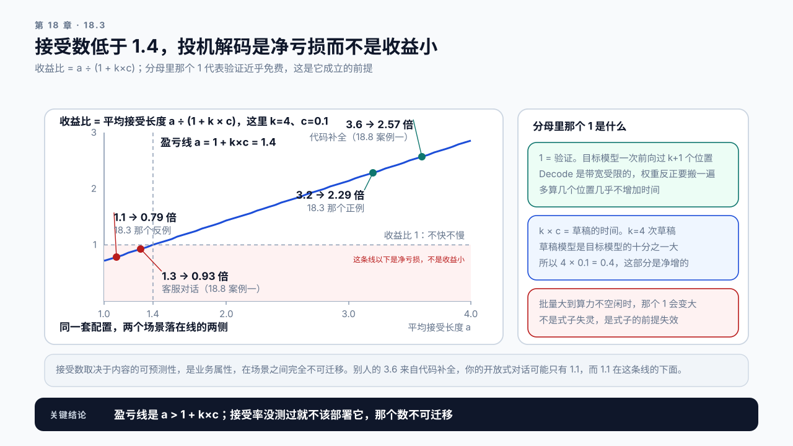
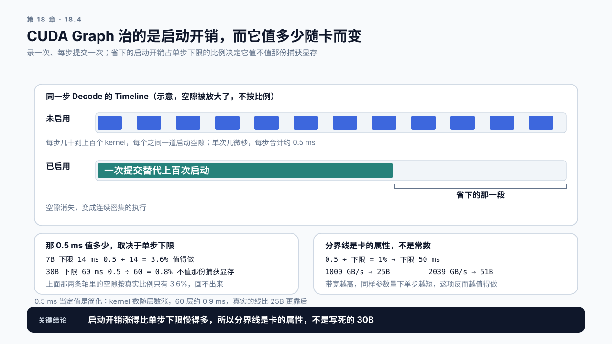

# 第 18 章 生成与 Runtime 优化：不动精度的另外两条路

## 学习目标

读完这一章，你应该能回答三个问题：

1. 不降低精度，还有什么办法让 Decode 变快？
2. Speculative Decoding 为什么能在带宽受限的情况下加速？
3. 一个优化的收益依赖负载特征时，该怎么判断它适不适合你？

跟着做完，你会得到一份 Decode 侧的技术选择记录：每一项对应哪种瓶颈形态、前提是什么、在什么情况下会失效。

## 18.1 量化不够，或者不能用

上一章的手段都要动精度。但有两类情况下这条路走不通。

一是**质量底线守不住**。结构化输出、专业领域、需要严格遵循指令的场景，量化的损失可能超出可接受范围。

二是**瓶颈根本不在带宽**。第 15 章那个对照如果显示实测 TPOT 是理论下限的三倍，那么把权重减半只能压缩其中一小部分，第 17 章那个案例就是这么白做的。

这两种情况需要不动精度的办法。而它们分别针对两种不同的瓶颈形态：

```text
瓶颈在带宽（实测接近理论下限）    → Speculative Decoding
瓶颈在调度（实测远高于理论下限）  → CUDA Graph 与 kernel 层优化
```

**所以这一章的第一件事仍然是判断瓶颈形态。** 判断方法在第 15 章：实测 TPOT 与带宽下限的比值，加上 Timeline 上 kernel 之间有没有空隙。

## 18.2 Speculative Decoding：用空闲算力换步数

第 15 章说过一件事：Decode 是带宽受限的，计算单元大量时间在等数据。

换个角度看，这意味着**算力是空闲的**。每一步读了 14 GB 的权重，只算了一个 token 的量。如果这一步能顺便多算几个 token，几乎不增加时间。

问题是 token 必须一个一个生成，第 n+1 个依赖第 n 个的结果。

Speculative Decoding 绕开这个依赖：

```text
1. 用一个小模型快速猜出接下来的 k 个 token（比如 4 个）
2. 把这 k 个 token 一起送进大模型，一次前向
3. 大模型验证：逐位置比对它自己会生成什么
4. 从头连续匹配的部分被接受，第一个不匹配的位置往后全部丢弃
5. 至少接受 1 个（不匹配位置上用大模型自己的结果）
```

关键在第 2 步：**验证 4 个 token 和生成 1 个 token，大模型的权重都只读一遍**。带宽消耗几乎相同，但可能一次产出 4 个 token。

> **Speculative Decoding**（投机解码）：用一个低成本的草稿来源先猜若干个 token，再由目标模型一次性验证的加速方法。
> 它不改变输出分布：贪心解码时，最终输出和目标模型逐个生成的结果逐字相同；按概率采样时，它保证的是每个位置的输出分布相同，而不是逐字相同。

**它不损失质量**，这是它相对量化的最大优势。接受的判据就是“大模型自己会不会这么生成”。按概率采样时判据换一种形式：按 `min(1, 目标概率 ÷ 草稿概率)` 接受草稿那个 token，拒绝时从两者之差归一化出来的分布里重采一个。分布不变靠的正是这一步；18.3 那个 α 指的也是这个接受概率的平均值，不是“猜中的概率”，所以贪心解码时最终输出和不加速时一字不差；按概率采样时两次运行本来就不逐字相同，它保证的是分布不变。

草稿的来源有几种：

```text
小模型草稿    用一个同系列的小模型，质量好但要额外显存和时间
n-gram / 前缀  从 prompt 或已生成内容里找重复片段，零成本但只在特定场景有效
模型内置头    在目标模型上额外训练几个预测头，需要训练
```

## 18.3 接受率决定一切

Speculative Decoding 的收益几乎完全取决于草稿猜得准不准。这件事有两种说法，先分清楚：

```text
接受率 α          每个猜测位置被接受的概率，0 到 1 之间，引擎日志和指标里报的多是它
平均接受长度 a     一轮投机平均真正产出几个 token，1 到 k + 1 之间，收益算式用的是它
```

各位置独立时，两者可以换算：

```text
a = (1 − α^(k+1)) ÷ (1 − α)
```

每轮猜 4 个时，α = 0.23 对应 a ≈ 1.3，α = 0.78 对应 a ≈ 3.2。把引擎报的 0.72 直接当成 a 代进下面的式子，会误判成净亏损，实际上它对应 a ≈ 2.9。本章后面说的“接受数”，指的都是 a。

```text
每轮猜 4 个
  平均接受长度 3.2  → 步数减少到原来的 1/3.2，收益明显
  平均接受长度 1.1  → 几乎没有收益，还多付了草稿的开销
```

注意这里说的是**步数**。时间上的收益还要扣掉草稿本身的开销，比步数那个倍数小一截，本节后面那个式子会把两者的差算出来。

为什么接受率会低？因为草稿模型猜不准。而猜得准不准高度依赖内容：

**接受率高的场景：** 代码生成（语法结构可预测）、格式化输出（JSON 的键名、标点）、摘要和改写（大量内容来自原文）、重复性强的文本。

**接受率低的场景：** 开放式创作、高 temperature 采样、专业领域的生僻内容、草稿模型没见过的语言。

**所以这项技术的适用性是按业务场景定的，不是按模型或硬件定的。** 同一套部署，服务代码补全时收益很大，服务开放对话时可能得不偿失。

还有两笔成本要算进去：

**草稿本身的时间。** 小模型虽然快，但也要跑 4 次。如果草稿模型是目标模型的十分之一大，那 4 次草稿约等于 0.4 次目标模型的时间，这部分是净增的。

**草稿模型的显存。** 它要常驻，占的显存从 KV 预算里扣；十分之一大的草稿模型按 FP16 存是 1.3 GiB，按 16.2 那个每 token 128 KiB 算，等于吃掉约 1.1 万个 token 的容量。第 16 章那张表会因此缩水，并发上限下降。

**把三项写成一个式子，就能在开之前判断划不划算。** 三项分别是平均接受数、草稿成本和验证成本：

```text
收益比 ≈ a ÷ (1 + k × c)

a  平均接受长度（一轮投机真正产出的 token 数）
k  每轮猜的个数
c  草稿模型一次前向占目标模型一次前向的比例
```

分母里没有单独的验证项，这不是漏了。验证是目标模型的一次前向，k + 1 个位置一起过；Decode 阶段是带宽受限的，权重反正要搬一遍，多算几个位置几乎不增加时间。**验证近乎免费，正是投机解码能成立的前提**，分母里的那个 1 就是它。

代入本节开头那两个接受数，草稿模型是目标模型的十分之一大（`k = 4`、`c = 0.1`，分母 1.4）：

```text
a = 3.2   3.2 ÷ 1.4 ≈ 2.3 倍    值得开
a = 1.1   1.1 ÷ 1.4 ≈ 0.79 倍   比不开还慢约两成
```

由此得到一条能直接用的判据：收益比大于 1 要求 `a > 1 + k × c`，这个配置下就是接受数必须超过 1.4。低于这条线，投机解码是净亏损，而不是收益小。

猜的个数 `k` 加大会同时抬高分子和分母，所以它有最优值，不是越大越好。把 a 的换算式代进收益比，对每个 k 算一遍取最大即可：α = 0.8、c = 0.1 时最优 k 约是 6；草稿越贵（c 越大）、猜得越不准（α 越小），最优 k 越小。

c 也不能只按参数量的比例算。0.7B 的草稿模型按参数量是目标模型的十分之一，可它的每一步同样要付第 15.6 节那笔固定开销。如果草稿的每一步也走全套调度（约 3 ms），它一步约 1.4 + 3 ms，相对目标模型的 17 ms，c 约 0.26，盈亏线升到 2.0；如果草稿的几步在引擎内部连续跑完、只付 kernel 启动那 0.5 ms 上下，一步约 1.9 ms，相对同一个 17 ms，c 约 0.11，盈亏线约 1.45。上面按 0.1 算的那条 1.4 是最乐观的情形。



图18-1：投机解码的收益比与盈亏线。k=4、c=0.1 时盈亏线在接受数 1.4，线以下的红色区域是净亏损。四个点里 1.1 与 1.3 在线的左侧，3.2 与 3.6 在右侧。右侧解释分母里那个 1 是什么，以及它什么时候会变大。

还有一个容易忽略的副作用：批量大时收益会缩水。验证一次要让 批量 × (k + 1) 个位置过一遍目标模型，按第 15.3 节那条 max 式子，算术强度也跟着乘了 (k + 1)，所以算力不再空闲的批量是：

```text
批量阈值 ≈ 分界点 ÷ (k + 1)        参考卡、k = 4 时约 153 ÷ 5 ≈ 31
```

这就是本章和 Demo 里“批量 32 以下”那条线的来历。它和第 15.4 节“批量要到一百多才算力受限”并不矛盾：那里每条请求每步一个位置，这里每条请求每步要验证 k + 1 个位置。越过这条线，验证不再近乎免费，投机解码抢的就是真实算力了。**它最适合低并发、低批量的场景**，比如单用户的代码补全，而不是高并发的在线服务。

## 18.4 CUDA Graph：消除每步的启动开销

如果第 15 章的对照显示实测远高于带宽下限，且 Timeline 上 kernel 之间有明显空隙，那问题在调度和启动。

Decode 每一步要启动几十到上百个 kernel。每次启动都要 CPU 做准备、提交到 GPU 队列。单次几微秒，但每步上百次、生成 500 步，总量可观。

CUDA Graph 的做法是把这一串启动**预先录制下来**：

```text
录制一次：完整跑一遍 Decode 步，记录所有 kernel 及其依赖关系
之后每步：提交这个图，一次调用替代上百次启动
```

**效果在 Timeline 上很直观**：kernel 之间的空隙消失，变成连续密集的执行。

它有几个必须知道的限制：

**图是按形状固定的。** 批量大小、序列长度这些会改变张量形状的东西变了，图就不能复用。实现上通常预先捕获若干个常见批量大小的图，运行时选最接近的那个，不够的部分用填充补齐。填充意味着浪费算力。

**捕获要占显存，但不是按档位数相加。** 常见的实现让所有图共用一个显存池，并且从最大的批量往小捕获，小批量的图复用大批量留下的那块内存。所以这笔显存主要由最大的那个捕获批量决定，不是“档位数乘每档固定值”。到底多少，要读引擎启动日志里图捕获那一行，措辞和数值随引擎版本变化，以你所用的版本为准；18.8 案例二就是按档位数乘错的样子。它同样落进第 16 章那个 `--overhead`。



图18-2：CUDA Graph 让 Timeline 上的 kernel 空隙消失。两条时间轴是示意，空隙被刻意放大了，按真实比例那 0.5 ms 在 7B 上只占单步的 3.6%。下方给出这条分界线怎么随带宽从 25B 移到 51B。

**不是所有操作都能录。** 带数据依赖的控制流、动态形状的算子通常不行。框架会自动回退到普通执行路径，而回退发生时你可能不知道。

**收益和模型大小成反比。** 小模型的每步计算本来就短，启动开销占比大，CUDA Graph 收益明显；大模型的每步计算很长，那点启动开销淹没在里面，所以小模型上这项的收益往往比量化还大。

这条可以写成一个能直接用的分界。按第 15.6 节那个拆分，kernel 启动那一项在 7B（32 层）上是每步 0.5 ms 上下；权重搬运随参数量线性涨。先把 0.5 ms 当定值：7B 的下限 14 ms，0.5 ms 占 3.6%；到 30B 时下限 60 ms，占比掉到 0.8%，为它付那份捕获显存就不值得了。

把“占比低于百分之一”当成那条线，先按 0.5 ms 当定值粗解一次，它对应的参数量就出来了：

```text
0.5 ms ÷ 单步下限 = 1%   →   单步下限 = 50 ms
50 ms × 1000 GB/s ÷ 2 字节 = 25B
```

**0.5 ms 当定值是个简化。** kernel 数大致按层数涨，30B 级模型六十来层，这一项其实约翻倍到 0.9 ms，占比是 1.5% 而不是 0.8%，所以真实的线比 25B 更靠后。但方向不变：权重搬运按层数 × hidden² 涨，比 kernel 数快得多，所以模型越大，这一项的占比一定越低。心算时用定值，上线前用自己的 Profiling 把这一项量出来。

**所以这条线不是 30B 这个常数，是这张卡的属性。** 1000 GB/s 的卡上落在 25B，2039 GB/s 的卡上落在 51B：带宽越高，同样的参数量下单步越短，启动开销的占比越大，CUDA Graph 反而越值得做。18.7 那个脚本是把这条线算出来的，不是写死的。

## 18.5 kernel 层面的那些手段

再往下一层还有一批优化：算子融合、更好的 GEMM 实现、针对特定形状的专用 kernel。

对性能工程来说，这一层的正确态度是：**知道它存在，知道怎么判断它有没有生效，但不要自己去写。**

第 13 章讲 FlashAttention 时说过同一件事：不要把某个库名当成一种优化算法，判断有没有生效要看实际走了哪条 kernel，不是看装了哪个包。

这一层的实际工作通常是三件事：

```text
升级框架版本      新版本往往带来更好的默认 kernel
确认走的是哪条路   通过 Profiling 看实际执行的 kernel 名称
排除回退          某些配置组合会让框架退回朴素实现
```

第三件事最容易出问题。一个不起眼的参数可能让整条快速路径失效，而框架不一定会告诉你。**发现性能莫名其妙地差，先查是不是退回了朴素实现。**

Kernel 级的深入分析放在附录 B（目前只列了要回答的问题），正文不展开。

## 18.6 三项技术的对照

| | Speculative Decoding | CUDA Graph | kernel 层优化 |
|---|---|---|---|
| 针对的瓶颈 | 带宽受限、算力空闲 | 启动与调度开销 | 单个算子的效率 |
| 何时收益大 | 批量低于分界点 ÷ (k + 1)（参考卡上约 31）、内容可预测 | 参考卡上 25B 以下、高频步，线随带宽移动 | 视具体算子 |
| 何时失效 | 接受数低于 `1 + k×c`、高批量 | 形状频繁变化 | 已经是最优实现 |
| 质量影响 | 无 | 无 | 无 |
| 显存代价 | 草稿模型常驻 | 捕获缓冲区 | 通常无 |
| 主要风险 | 接受率低时倒亏 | 填充浪费、显存吃紧 | 静默回退 |

三项都不损失质量，这是它们相对量化的共同优势。代价换成了显存和适用范围。

**尝试顺序的建议：**

先做第 15 章那个对照，确定瓶颈形态。

瓶颈在调度，先确认 CUDA Graph 是否已启用。多数框架默认开启，所以这往往是一个确认项而非待做项，同时要检查它占的显存是否过大。

瓶颈在带宽，先评估业务场景的可预测性，再决定要不要试 Speculative Decoding。评估方法很简单：拿一批真实请求，用候选草稿模型跑一遍，统计接受率。**接受率测出来之前不要部署它。**

kernel 层放最后，且主要是确认而非改动。

## 18.7 Demo：Decode 优化适用性检查

本章 Demo 位于 `code/ch18/decode_optimization_check.py`，不需要 GPU。

```bash
python3 code/ch18/decode_optimization_check.py \
  --config code/ch15/model-7b-generic.json \
  --tpot-measured 25 \
  --batch-p50 8 --batch-p95 32 \
  --draft-params 0.7e9 \
  --captured-buckets 20 \
  --draft-acceptance content/ch18/evidence/draft-acceptance-sample.json
```

`--tpot-floor` 不给就按配置里的参数量和带宽自己算，省得两处各写一遍。图捕获显存要从启动日志读出来，用 `--graph-memory-gib` 传进去；只给 `--captured-buckets` 时，脚本只记录档位数，不拿它去乘一个每档固定值。接受率报告里给平均接受长度 `mean_accepted` 或逐位置接受率 `acceptance_rate` 都可以，给了后者，脚本会换算出 a，并报出这个 α 下的最优 k。

输出：

```text
bottleneck_form    带宽受限 / 混合 / 调度受限，附实测与下限的比值
spec_decoding      适用性判断 + 理由 + 收益比 + 盈亏线 + 草稿模型挤掉多少容量
cuda_graph         适用性判断 + 理由 + 启动开销占比 + 算出来的分界参数量 + 显存代价
kernel_level       待确认项清单
try_order          按代价与风险排序的尝试顺序，瓶颈形态不同顺序也不同
warnings           前提失效的提示
```

几条判据：

- 实测 TPOT 与下限的比值小于 1.3 时判为带宽受限，大于 2 时判为调度受限，中间判为混合；比值小于 1 直接判口径有问题；
- 模型参数量越过 18.4 那条算出来的线时，CUDA Graph 标为“收益有限”，这条线随带宽移动，不是写死的 30B；
- `--batch-p50` 大于 分界点 ÷ (k + 1) 时（参考卡、k = 4 时约 31），Speculative Decoding 标为“收益有限”并说明原因；`--batch-p95` 超过这条线而 P50 没超时，提示按 19.4 第 3 轮的要求在两个批量档位各测一次；
- 没有提供 `--draft-acceptance` 时，Speculative Decoding 一律标为“待测”，不给收益预估。

最后一条是刻意的，而且它压过其他判据：**接受率是这项技术唯一的决定因素，没测过就不该给出预估。** 脚本不会替你猜一个行业平均值填进去，因为那个数在业务场景之间完全不可迁移。

`draft-acceptance-sample.json` 是**合成样例，不是真机结果**，文件里的 `synthetic` 字段和 `_note` 都写明了。它演示的是 18.8 案例一那两个场景：同一套配置，客服对话的 1.3 落在盈亏线 1.4 之下，代码补全的 3.6 在线之上。

还有一处值得单独说：**给了实测接受率、而批量又超过那条线时，脚本会把收益比算出来，同时说明这个数在这个批量下不成立。** 它不改数字，改的是对数字的解读。18.8 案例一那 8 个百分点的缺口就藏在这里，脚本把它标出来，而不是替你把它抹平。

在自己的服务上用它时，先在真实请求样本上测出接受率，用测到的结果替换那份合成样例，再拿实测的收益去对 18.3 那个收益比公式，差得多的地方多半是 c 估小了或批量越过了那条线。

## 18.8 案例与常见误区

### 案例一：投机解码上线后更慢了

团队在一个在线客服服务上启用了 Speculative Decoding，期望 TPOT 减半。上线后 TPOT 反而涨了 15%。

合成设定，c 按 0.1 取（这个草稿的几步在引擎内部连续跑完，实测就是这个值；c 不同，下面的拆账会完全不一样）。两个原因叠加：一是平均接受长度只有 1.3（逐位置接受率约 0.23），因为客服对话是开放式的，草稿模型猜不准；二是这个服务的平均批量是 40，算力本来就不空闲，投机解码的额外计算变成了真实开销。

**这两个原因在 18.3 那个式子里是分开的两项，值得对着算一遍：**

```text
只看第一个原因   1.3 ÷ 1.4 = 0.93   本该只慢 7%
实测                             慢 15%
```

多出来的那 8 个百分点正是第二个原因。这一步对 c 很敏感：同样的接受数，c 要是 0.13，只看第一个原因就该慢 17%，已经盖过实测的 15%，第二个原因反而没有位置了。所以拆账之前先把 c 测出来，别用按参数量估的那个。式子分母里那个 1 代表“验证近乎免费”，而批量 40 时算力已经不空闲，**那个 1 变大了**。所以这个案例不是式子失灵，而是式子的前提失效。18.3 特意把这个前提写在分母里，就是为了让它失效时能被看见。

回滚后，团队在另一个代码补全服务上试同样的配置，平均接受长度 3.6（逐位置接受率约 0.84），TPOT 降了 61%（式子给的是 `3.6 ÷ 1.4 = 2.57` 倍，正好对上）。同样的技术，两个场景的结果完全相反。

讨论：上线前做什么检查能预判这个结果？

### 案例二：以为罪魁是 CUDA Graph

合成设定：显存告急，一位工程师查配置，看到 CUDA Graph 捕获了从 1 到 256 共 20 个批量档位。他按“每档 0.8 GiB”估了一笔：20 档占 16 GiB，裁到实际用得上的 6 档能省回 11 GiB。

改完一测，几乎没省下显存。读启动日志才发现，图捕获那一行报的总量本来就只有一两个 GiB。常见的实现让所有图共用一个显存池、从最大的批量往小捕获，小图复用大图留下的内存，这笔显存主要由最大的捕获批量决定，不随档位数线性相加。裁掉 14 个档位，省下的只是捕获时间，代价是落在档位之间的批量要多付填充。

**这个数只能从启动日志读，不能按档位数乘出来。** 真要压这一项，该动的是最大捕获批量，而且要确认它没有低于线上实际会出现的批量。这次显存真正的去处，要回第 16.6 节那张表逐项去查。

讨论：最大捕获批量设得比线上实际批量还小，会发生什么？

### 案例三：升级框架，性能掉了一半

例行升级框架版本后，TPOT 从 18 ms 涨到 35 ms。

排查发现新版本对某个配置项的默认值做了调整，导致 Attention 退回了朴素实现。Profiling 里看到的 kernel 名称和升级前完全不同。加回一个参数就恢复了。

这个案例的价值在于：**框架不会告诉你它回退了。** 性能变差时，看实际执行的 kernel 名称，比看配置文件有用。

讨论：怎么在升级流程里加一道能自动发现这类回退的检查？

### 两个不写在选择记录里的误区

误区一：不损失质量就可以放心上。

这三项确实不改变输出，但它们改变显存占用和适用范围。Speculative Decoding 的草稿模型常驻，CUDA Graph 的缓冲区占显存，两者都会挤压第 16 章那张表里的 KV 预算，间接降低并发。不损失质量不等于没有代价。

误区二：别人测出来收益 50%，我们也能有。

Speculative Decoding 的收益取决于接受率，接受率取决于内容的可预测性，而这是业务属性。别人的 50% 来自代码补全场景，你的开放式对话可能只有 5%。这个数字在业务场景之间完全不可迁移，必须自己测。

## 本章总结

回到开头的三个问题。

**不动精度还有什么办法？** 分两类，对应两种瓶颈形态。实测 TPOT 接近带宽下限，说明算力空闲，用 Speculative Decoding 把空闲算力换成更少的步数；实测远高于下限且 Timeline 上 kernel 之间有空隙，说明卡在启动和调度，用 CUDA Graph 把上百次 kernel 启动压成一次图提交。再往下是 kernel 层，那一层的正确工作是确认而非改动：升级版本、看实际走了哪条 kernel、排除静默回退。

**投机解码为什么能加速？** 因为大模型验证 4 个 token 和生成 1 个 token，权重都只读一遍，带宽消耗几乎相同。它不改变输出分布，被接受的 token 就是目标模型自己会生成的。收益完全由接受率决定，而接受率取决于内容可预测性：代码和格式化输出高，开放式创作低。还要扣掉草稿本身的时间和它常驻占用的显存，高批量时算力不再空闲，收益进一步缩水。

**收益依赖负载时怎么判断？** 测，而不是引用别人的数字。Speculative Decoding 的收益在业务场景之间完全不可迁移，同一套部署在代码补全上降 61%、在开放对话上涨 15% 是真实发生过的。判断方法是拿一批真实请求，用候选草稿模型跑一遍统计接受率，代入收益比公式 `a ÷ (1 + k × c)`，低于 1 就是净亏损。接受率测出来之前不要部署。CUDA Graph 同理，它在小模型上收益可能超过量化，在参考卡上 25B 以上的模型就几乎看不出来，带宽越高，这条线越往大模型那一侧移。

下一章把第 15 到 18 章的手段拿到同一份负载上验证，产出 Decode 侧的优化报告。

### 本章 Checklist

- [ ] 能用实测 TPOT 与带宽下限的比值判断瓶颈形态。
- [ ] 能从 Timeline 上区分带宽受限和启动开销受限。
- [ ] 能解释为什么验证多个 token 和生成一个 token 的带宽消耗几乎相同。
- [ ] 能在真实请求样本上测出接受率，而不是引用别人的数字。
- [ ] 能把引擎报的逐位置接受率 α 换算成平均接受长度 a，再用草稿开销算出收益比，判断是否划算。
- [ ] 能说明为什么高批量会侵蚀 Speculative Decoding 的收益。
- [ ] 能从启动日志读出 CUDA Graph 捕获占的显存，并说明它为什么不按档位数相加。
- [ ] 能从 Profiling 的 kernel 名称判断是否发生了静默回退。

## 课后练习

1. 算出你的服务实测 TPOT 与带宽下限的比值，判断瓶颈形态。
2. 采集一段 Decode Timeline，量出 kernel 之间空隙占总时间的比例。
3. 从线上采样 200 条真实请求，用候选草稿模型跑一遍，统计接受率分布。
4. 按业务场景把请求分成两类，分别统计接受率，看差异有多大。
5. 用收益比公式算出 Speculative Decoding 是否划算，并说明草稿开销怎么估的。
6. 把批量从 4 加到 64，观察 Speculative Decoding 的收益怎么变化。
7. 从启动日志读出 CUDA Graph 捕获的批量档位和显存占用，分别试一下减少档位数和降低最大捕获批量，记录哪一种真正省下了显存。
8. 故意改一个配置让 Attention 退回朴素实现，记录 Profiling 里 kernel 名称的变化，把它写成一条可自动检查的判据。
