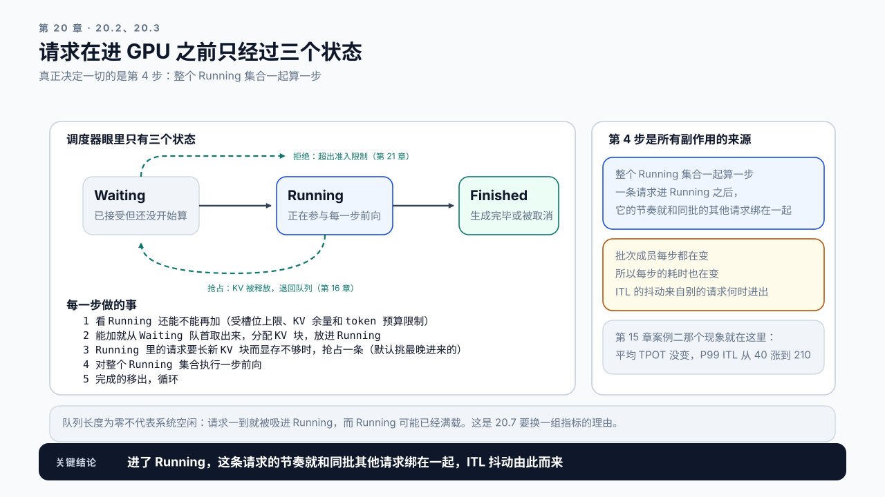
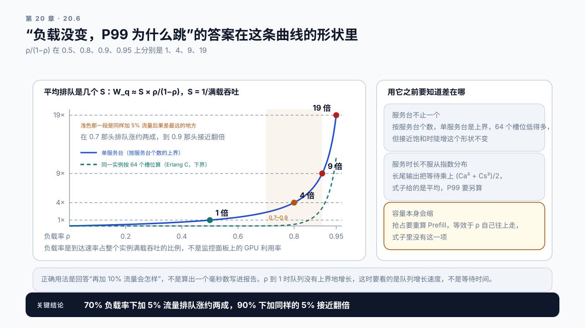
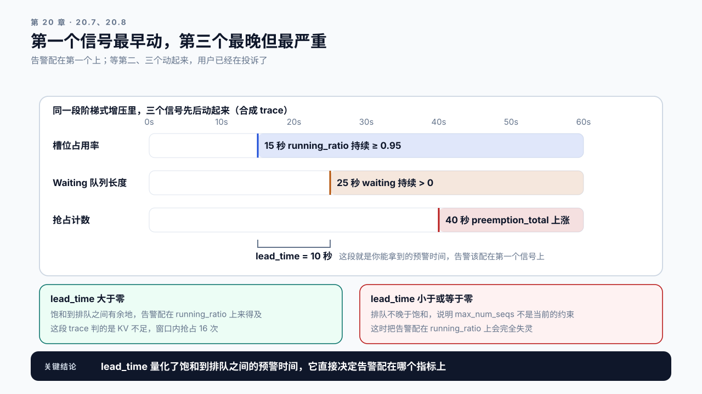

# 第 20 章 Scheduler 与 Continuous Batching：请求在进 GPU 之前发生了什么

## 学习目标

读完这一章，你应该能回答三个问题：

1. 一条请求从到达到开始生成，中间经过了哪些状态？
2. 负载明明没变，为什么 P99 延迟会突然跳几倍？
3. 调度参数该怎么调，调错了会出现什么现象？

跟着做完，你会得到一张调度状态图和一份参数说明：每个旋钮影响什么、往哪个方向调、调过头的症状是什么。

## 20.1 GPU 没满，请求却在等

前四篇都在问同一个问题：这条请求在 GPU 上花了多少时间。但线上排查常常遇到一个对不上的现象：单条请求实测 TTFT 是 400 ms，用户报的却是 3 秒；GPU 利用率看着不高，请求偏偏在积压。差额不在 GPU 上，在队列里。

第 8 章那套请求级追踪能把这段时间标出来：请求到达的时间戳、被调度器接受的时间戳，两者之间就是排队。第 2 章那条时间线里的 `t2 - t1` 正是这一段。

**排队时间由调度器决定，而调度器的行为由几个参数控制。** 这一章讲清楚这些参数各自在管什么。

## 20.2 三个队列，一条路径

现代推理引擎的调度可以简化成三个状态：

```text
Waiting    已接受但还没开始算，排队中
Running    正在参与每一步前向计算
Finished   生成完毕或被取消
```

加上两条非常规的边：

```text
Waiting → 拒绝      超出准入限制，直接返回错误（第 21 章）
Running → Waiting   被抢占，KV 被释放，退回队列（第 16 章）
```

调度器每一步做的事很简单：

```text
1. 看当前 Running 集合还能不能再加请求
   （受槽位上限、KV Cache 余量和 token 预算限制）
2. 能加就从 Waiting 队首取出来，分配 KV 块，放进 Running
3. Running 里的请求要长出新的 KV 块而显存不够时，
   抢占一条 Running 的（vLLM 的 FCFS 策略挑最晚进 Running 的），释放它的 KV
4. 对整个 Running 集合执行一步前向
5. 完成的移出，循环
```

默认情况下抢占只由第 3 步触发，也就是显存不够，所以 20.7 把抢占计数当作显存信号。开了优先级调度时，显存不够要抢占的那一条改按优先级挑；有的引擎（如 vLLM V0）还会为等在队列里的高优先级请求主动抢占，那时抢占计数要按原因分开看。本章讲 vLLM 行为的几处都以 V1 为准（它的抢占只有重算一种方式，见第 16.5 节），具体挑谁、会不会为等待者抢占，各版本不同，以手里那一版的代码或文档为准。

**关键在于第 4 步：整个 Running 集合一起算一步。** 这意味着一条请求进入 Running 之后，它的节奏就和同批的其他请求绑在一起了。



图20-1：三个状态，一条路径，两条非常规边。实线是常规路径，两条虚线是准入拒绝和抢占；右侧三块是第 4 步带来的后果，ITL 的抖动就从那里来。

## 20.3 Continuous Batching：不必等同伴结束

传统批处理的做法是凑齐一批、一起算完、再凑下一批。

用在 LLM 上的问题很明显：同一批里有的请求生成 50 个 token，有的生成 2000 个。按静态批处理，前者算完后要干等着后者，那个位置就一直空着。

**浪费有多大？** 一批 32 条请求，输出长度在 50 到 2000 之间均匀分布时，整批要跑到最长那条的约 1940 步，平均每条只生成约 1025 步，槽位有效率（真正在生成的槽位步数占全部槽位步数的比例）约 53%。真实负载的长度是长尾的，少数几条特别长，这个比例常常不到四成。

Continuous Batching 把粒度从“一批请求”降到“一步”：

```text
每一步之后重新组批
  已完成的立刻移出，位置立刻释放
  Waiting 队首的立刻补进来
```

> **Continuous Batching**（连续批处理）：以单步为粒度动态调整批次成员的调度方式。请求完成即离开，新请求随时补入，不必等待整批结束。它是 LLM 服务吞吐提升最大的单项改进之一。

粒度降到一步以后，“这一批有几条”和“Running 里有几条”成了同一个数。全书还有几个数也常被叫作“并发”，**它们之间是包含和上限的关系**：在途包含引擎里的 Waiting 和 Running；Running 就是这一步的批量；Running 受三个上限约束：槽位上限、KV 能容纳的条数，以及每步的 token 预算（它主要卡新请求的 Prefill 能不能进来）。读压测报告、配告警、做容量规划之前，先弄清手里的是哪一个。

| 数 | 数的是什么 | 由什么决定 |
|---|---|---|
| 在途 | 已到达、还没结束的全部请求 | 到达速率乘停留时间，L = λW（第 6 章） |
| 压测并发 | 客户端同时在途的条数 | 闭环压测里是设定，开环压测里是结果（第 6 章） |
| Waiting | 已接受、还没进 Running 的 | 引擎里放不进 Running 的那部分 |
| Running（批量） | 这一步一起前向的请求 | 调度器每步重排，不超过下面两个上限中较小的；长 Prompt 多时还受 20.4 那个 token 预算限制 |
| 槽位上限 | Running 最多几条 | 启动参数 `max_num_seqs` |
| KV 能容纳的条数 | 按平均上下文，KV 池放得下几条 | 显存与上下文长度，第 16 章称它并发上限 |

这是第 15 章那个“批量近乎免费”的结论真正兑现的地方。批量之所以免费是因为权重共用，而只有让批次始终保持满载，这个免费才吃得到。

**副作用也来自同一处。** 批次成员每步都在变，意味着每步的耗时也在变。一条请求的 ITL 序列因此天然带抖动，而抖动的来源是别的请求何时进出。第 15 章案例二那个“平均 TPOT 没变，P99 ITL 从 40 ms 涨到 210 ms”的现象，根源就在这里。批量上限从 8 调到 64 以后，进出 Running 的请求多了，每进来一条，它的 Prefill 就要插进某一步一起算，一段长 Prompt 一插就是几百毫秒，这一步里所有在 Decode 的请求都停一拍；同时 64 条请求的 KV 都要读，单步本身也变长了。前者造成孤立的尖峰，后者把整体抬高。前一件就是第 13.5 节说的队头阻塞：一个大任务占住共享的那一步，后面的小任务只能等它；网关上的先来先服务队列、Agent 编排层里排队等同一个工具的调用，也是同一类问题。下一节的 token 预算管的就是这一件。

## 20.4 Token 预算：调度器真正在数的东西

调度器限制批次大小时，数的往往不是请求数，而是 token 数。

原因是请求之间的差异太大。32 条短请求和 32 条 8000 token 的请求，对 GPU 的压力差着两个数量级。按请求数限制，要么短请求时浪费，要么长请求时打爆。

所以引擎通常用两个预算：

```text
max_num_batched_tokens   一步里最多处理多少个 token（Prefill 和 Decode 合计）
max_num_seqs             一步里最多有多少条请求
```

两者取更紧的那个。

**理解 token 预算，是理解第 13 章 Chunked Prefill 的钥匙。**

一条 8000 token 的请求要做 Prefill，一步吃不下 2048 的预算。没有分块时引擎不许出现这个组合：vLLM 关掉分块时要求 `max_num_batched_tokens` 不小于 `max_model_len`，否则启动就报错。也就是说预算必须开到装得下最长的那条 Prompt，于是这一步被这一整段 Prefill 占满，同一步里其他正在 Decode 的请求都跟着等它。这就是第 13 章说的“长请求卡住其他请求”。

开启分块后，这 8000 token 被拆成若干段，每步处理一段，剩下的预算留给其他请求的 Decode。**代价是这条长请求自己的 TTFT 变长**，因为它的 Prefill 被拆成了多步。

```text
不分块   长请求 TTFT 短，其他请求 ITL 出现大尖峰
分块     长请求 TTFT 变长，其他请求 ITL 平稳
```

这是一个明确的取舍，取决于你的 SLO 更在乎哪一边。

## 20.5 参数怎么调，调过头什么样

四个主要旋钮，以及它们的失控症状：

| 参数 | 管什么 | 调大的后果 | 调过头的症状 |
|---|---|---|---|
| `max_num_seqs` | 批次里最多几条请求 | 吞吐涨，ITL 抖动涨 | P95 ITL 超 SLO；抢占计数上升 |
| `max_num_batched_tokens` | 一步最多几个 token | 长请求 Prefill 更容易整块通过 | 单步耗时长，所有请求的 ITL 变差 |
| `gpu_memory_utilization` | 给 KV Cache 留多少显存 | 并发上限涨 | OOM；或挤压 CUDA Graph 缓冲区 |
| `max_model_len` | 单条请求的上下文上限 | 支持更长输入 | 最坏情况下的并发成比例下降（第 16、17 章） |

**调参的顺序建议：**

先定 `max_model_len`。第 17 章说过，它常常被设得远大于实际需要。在分页按需分配的引擎上它不决定平均并发，管的是最坏情况：一批长请求能不能把整张卡占满、启动时能不能装下一条最长的请求。把它调到贴近实际 P99，再把少量更长的请求分流出去，是最便宜的一步。

再定 `gpu_memory_utilization`。它决定 KV 预算，直接对应第 16 章那张容量表。调之前要先从启动日志里读出权重和 KV 池各占多少（16.6 第 3 步），反推框架的固定开销，否则会 OOM。

最后调 `max_num_seqs`，用第 19 章那条 Goodput 曲线找峰值。这一步要在前两项定下来之后做，因为它们变了曲线就变了。`max_num_batched_tokens` 通常不需要动，除非负载里长请求的比例很高。

**一个反复出现的错误是从最后一个开始调。** 先把 `max_num_seqs` 调到吞吐峰值，再回头调显存，结果是前面测的曲线全部作废。

## 20.6 排队为什么会突然爆

回到开头那个问题：负载没变，P99 为什么会跳？

排队系统有一个性质：**接近饱和时，延迟对负载的敏感度急剧上升。** 第 0 章只给了这个形状，这一节把它写成能代数的式子。先定义两个量。

> **负载率**（utilization，ρ）：到达速率除以整个实例的满载吞吐。满载吞吐是实例压满时每秒最多完成几条请求，第 19 章的批量扫描给出 token/s，除以平均输出长度就是它。负载率不是监控面板上的 GPU 利用率，也不是 20.7 的槽位占用率，几个“率”的分子分母在 20.7 有一张对照表。

服务时间 `S` 取满载吞吐的倒数。一个实例满载时每秒完成 12 条请求，`S` 约 83 ms。这等于把整个实例看成一个服务台，每 83 ms 放走一条请求；按第 6 章的 Little's Law，它也等于单条请求的停留时间除以同时在跑的条数。`S` 不是单条请求从进 Running 到结束的时长，那个数要大几十倍，代进下面的式子会算出荒谬的排队时间。

把平均排队时间记为 `W_q`，它只算排队，不含服务；第 6 章 Little's Law 里的 `W` 是含服务的停留时间，两者别混：

```text
W_q ≈ S × ρ / (1 − ρ)

负载率 0.5    平均排队约 1 个 S
负载率 0.8    约 4 个
负载率 0.9    约 9 个
负载率 0.95   约 19 个
```

这条式子不是 LLM 特有的，是排队论的基本结果。用上面那个 `S`，负载率 0.9 时平均排队约 750 ms。它的含义在差分上：负载率 0.7 时到达多 5%，ρ 变成 0.735，排队涨约 19%；0.9 时多同样的 5%，ρ 变成 0.945，排队从 9 个 `S` 涨到约 17 个，接近翻倍。



图20-2：接近饱和时排队时间对负载的敏感度急剧上升。实线是单服务台，在 0.5 到 0.8 之间几乎是平的，0.9 之后陡起来；虚线是同一实例按 64 个槽位算的结果，低负载时几乎不排队，接近饱和时一样陡。浅色那一段是同样加 5% 流量后果差最远的地方。

> **M/M/1 排队公式**：单服务台、请求按泊松过程到达、服务时长服从指数分布（变异系数为 1）时，平均排队时间等于 `S × ρ/(1−ρ)`。
> 它只在 `ρ < 1` 的稳态下成立。`ρ` 超过 1 时队列每秒净增“到达速率减满载吞吐”那么多条，等待随压测时长线性增长，任何平均值都不再有意义，这时要看的是队列增长速度。

LLM 服务与这条式子的前提有三处不符，前两处能定量地修，第三处只能定性地记住方向。

**服务时长不服从指数分布。** 输出 30 个 token 和 3000 个 token 的请求混在一起，服务时长的变异系数远大于 1。Kingman 近似把这一项写进式子：

```text
W_q ≈ S × ρ/(1−ρ) × (Ca² + Cs²)/2
```

`Ca` 是到达间隔的变异系数，`Cs` 是服务时长的变异系数。泊松到达加指数服务时两者都是 1，式子退回 M/M/1；`Cs` 从 1 涨到 1.5，排队乘约 1.6。

**服务台不止一个。** 把整个实例当一个服务台，是假设它不论同时跑几条，每秒都只完成那么多。连续批处理在批量近乎免费的区间里不是这样：同时跑得越多完成得越快，更像几十个服务台并行。按 64 个槽位算（M/M/c 模型，用 Erlang C 公式），负载率 0.9 时平均排队约 3 个 `S`，0.7 时几乎不排；单服务台给的是 9 个和 2.3 个。真实的连续批处理落在两者之间，单步随批量变长以后向单服务台靠拢；这时多出来的等待主要表现为单步变长、ITL 变差，不一定出现在 Waiting 里。所以就服务台个数这一项而言，单服务台式子是上界：形状可信，绝对值偏高。另两处不符把真实排队往上推，三处合起来偏哪边要实测对照。多副本由网关按负载派发时同样更平缓；请求被前缀亲和钉在某个副本上时，每个副本各排各的队，才回到单服务台（第 22 章）。

**容量本身会缩。** KV Cache 满了触发抢占，抢占要重算 Prefill，等效于满载吞吐下降、ρ 自己往上走。这是正反馈，式子里没有这一项。

本章学习目标问的是 P99，式子给的是平均。M/M/1 下排队时间的尾部也按 `1/(1−ρ)` 涨，P99 约为 `S × ln(100ρ)/(1−ρ)`：负载率 0.9 时约 45 个 `S`，是平均的 5 倍。如果要求排队不超过 10 个 `S`，卡平均允许负载率到约 0.91，卡 P99 只允许到约 0.59。**同一个负载，P99 比平均先越线**，所以负载慢慢往上走时，最先报警的总是 P99。

还有一笔账在稳态式子之外：突发过后的消化。一阵突发把到达推过满载吞吐，多出来的请求堆成积压；突发结束后，只有余量在消化它：

```text
消化时间 = 积压 ÷ ((1 − ρ) × 满载吞吐)
```

到达在一分钟里变成平时的三倍：负载率 0.9 时这一分钟积压约 102 秒的满载工作量，消化要约 17 分钟；0.7 时约 3.7 分钟。平时离满载越近，一次突发的余波拖得越久。

这些式子给的是形状和量级，不是预测值。正确用法是回答“再加 10% 流量会怎样”“一次三倍突发要多久才消化完”，而不是算出一个毫秒数写进报告。20.8 的 Demo 按满载吞吐和到达速率算出 ρ 和 `S`，代进式子，再和实测的排队时间对照：实测远高于这个估算，说明瓶颈不在排队本身，要去查服务时长的波动、显存和抢占；实测远低于它，要么是多服务台效应在起作用，要么是等待藏进了 Running，对照同期的 `running_ratio` 和 ITL 再下结论。每条式子的前提和失效点，附录 F.2 有一张汇总表。

**所以“负载没变”往往是错觉。** 常见的真实原因有三类，分别落在 ρ 与 `Cs`、到达速率本身、满载吞吐这三处：

**一是长度分布变了。** 请求数没变，但平均 prompt 长了两成。满载吞吐跟着降，ρ 上升；长度更分散，`Cs` 也跟着涨。

**二是到达变密了。** 秒级的密集是泊松到达的常态，按第 6.3 节那条 `1/√(λt)`，每秒 5 条请求时 1 秒窗口里的计数相对波动约 45%，这已经算在 `Ca = 1` 里了。分钟级的密集不是：同样 5 QPS，一分钟平均到 300 条、标准差约 17，某一分钟到三倍等于偏出 35 个标准差，泊松波动给不出来。它说明到达速率本身变了，比如上游的定时任务、批量回灌、一次重试风暴（第 21 章）。这时稳态式子不适用，要算上面那笔消化账。

**三是抢占开始出现。** 第 16 章讲过，抢占会重算 Prefill，重算占用算力，满载吞吐下降，ρ 上升，又引出更多抢占。

第 6 章那份 workload 描述里的到达模式和长度分布字段，就是为这类分析准备的。**没有这两个字段，“负载没变”这句话没法验证。**

## 20.7 队列深度该怎么看

监控里的队列长度是一个容易误读的指标。

**队列长度为零不代表系统空闲。** Continuous Batching 下，请求一到就被吸进 Running，队列是空的，但 Running 集合可能已经满载。这时再来请求就会开始排队，而你在队列指标上看不到任何预警。

**真正有预警价值的是三个指标的组合：**

```text
槽位占用率（Running / 上限）   接近 1 说明没有余量
Waiting 队列长度              大于 0 说明已经在排队
抢占计数                      大于 0 说明显存已经不够
```

第一个指标最早动，第二个次之，第三个最晚但最严重。**告警应该配在第一个上**，等到第二、三个动起来，用户已经在投诉了。



图20-3：三个调度信号的先后顺序与 lead_time。三条泳道在同一段增压里先后变色，第一条和第二条之间那段就是 20.8 那个 `lead_time`，它决定告警该配在哪个指标上。

第一个指标本书叫槽位占用率（Slot Occupancy）。监控面板上还有好几个“率”，名字相近，分子分母各不相同，**能回答“还能不能再接请求”的只有槽位占用率和 KV 使用率**，其余几个各答各的问题：

| 比例 | 分子 | 分母 | 回答的问题 |
|---|---|---|---|
| GPU 利用率 | 有 kernel 在跑的时间 | 采样时长 | GPU 在不在忙，不说明还有没有余量 |
| 负载率 ρ | 到达速率 | 实例的满载吞吐 | 离饱和多远，决定排队多长（20.6） |
| 槽位占用率 | Running 条数 | 槽位上限 `max_num_seqs` | 还能不能再收一条，三个信号里最早动 |
| KV 使用率 | 已占用的 KV 块 | KV 池的总块数 | 显存还剩多少，逼近 1 就要抢占 |
| 平均负载率 | 一段时间的平均到达速率 | 部署的满载吞吐 | 卡有多少时间闲着，决定实际单位成本（第 26 章） |
| 槽位有效率 | 真正在生成的槽位步数 | 全部槽位步数 | 批里有多少位置在空转（20.3） |

这也解释了为什么第 8 章强调请求级追踪：聚合指标只能告诉你“有请求在排队”，要知道是哪些请求、排了多久、为什么，需要能下钻到单条。

这三个指标说的是调度这一侧。如果它们都正常、请求却还在等，问题就落回硬件那一侧了：附录 A《GPU 性能心智模型》的“四类约束怎样形成诊断起点”一节给了容量、带宽、算力、提交开销四条分支，按它逐条排除，比继续调调度参数更有可能找到原因。

## 20.8 Demo：调度状态观测

本章 Demo 位于 `code/ch20/scheduler_watch.py`，需要真实 vLLM 服务。

```bash
python3 code/ch20/scheduler_watch.py collect \
  --url http://localhost:8000 \
  --interval 0.5 \
  --duration 120 \
  --max-num-seqs 64 \
  --output scheduler-trace.json
```

**`--max-num-seqs` 不能省。** `running_ratio` 就是 20.7 的槽位占用率，而 `/metrics` 只给分子，上限得你告诉它。不传的话这一列全是空，而那正是三个信号里最早动的一个。

它按固定间隔采集调度器状态，输出时间序列：

```text
running          Running 集合大小
waiting          Waiting 队列长度
running_ratio    槽位占用率，Running 除以上限
kv_usage         KV Cache 使用率
preemption_total 累计抢占次数
batched_tokens   采样间隔内新处理的 prompt token 数
                 （prompt_tokens_total 的差分，不含 Decode）
```

配合一个分析模式：

```bash
python3 code/ch20/scheduler_watch.py analyze \
  --trace scheduler-trace.json \
  --slo-itl 80
```

它给出：

```text
saturation_onset   running_ratio 首次持续接近 1 的时刻
queue_onset        waiting 首次持续大于 0 的时刻
preemption_onset   首次发生抢占的时刻
lead_time          前两个时刻之间的间隔
verdict            当前瓶颈判断：KV 不足 / 未饱和 /
                   token 预算不足 / 请求数上限约束
```

`lead_time` 是这个脚本最有用的输出：**它量化了“饱和”到“开始排队”之间有多少预警时间**，直接决定了告警该配在哪个指标上、阈值设多少。仓库里那份合成 trace 跑出来是 15 秒饱和、25 秒排队、40 秒抢占，`lead_time` 10 秒。

四种判断里，“token 预算不足”要求 trace 是按步采的：`collect` 按时间间隔采样，`batched_tokens` 是一个间隔里所有步的累计，拿它和每步的预算比没有意义，所以间隔采样的 trace 不做这项判断，只在结论里注明。

一个 onset 要连续三个样本才算，单个样本越线按噪声处理。不这么做的话，一份满是单样本 onset 的 trace 会把你的告警配在抖动上。

**`lead_time` 是负数或零时不要当成数据有问题。** 那说明排队不晚于饱和，也就是 `max_num_seqs` 不是当前的约束，真正的约束在 KV 余量或 token 预算上，这时把告警配在 `running_ratio` 上会完全失灵。20.7 那个顺序被打破本身就是一条结论。

第三个子命令对应 20.6：

```bash
python3 code/ch20/scheduler_watch.py queue-model \
  --capacity-qps 12 --arrival-qps 10.8 \
  --service-cv 1.5 --slots 64 --burst-factor 3 \
  --measured-queue-ms 900
```

`--capacity-qps` 是实例的满载吞吐，`--arrival-qps` 是到达速率，两者给出 ρ = 0.9、`S` ≈ 83 ms。它打印 `ρ/(1−ρ)` 那张表，再依次给出：按 Kingman 修正后的平均排队（`--service-cv` 是服务时长的变异系数，不给就按 1）、P99 排队、64 个槽位下的 Erlang C 对照、一分钟三倍突发的积压和消化时间，最后和实测对照。实测超过预测三倍以上时它会直接说瓶颈不在排队本身。三条边界每次都跟着输出一起打印，因为把那个毫秒数写进报告正是这条式子最常见的误用。

手头没有满载吞吐时，也可以给 `--trace`，用 `running_ratio` 的时间平均当 ρ 的粗略代理。这个代理通常偏低：请求在小批量下跑得快、停留短，同样的到达速率占的槽位更少。在自己的服务上做一次真机观测：用阶梯式增压跑一轮，记录三个 onset 时刻和对应的 QPS，画出饱和曲线；从最高一档读出满载吞吐，用 `queue-model` 把各档的预测排队和实测排队对一遍。

## 20.9 案例与常见误区

### 案例一：队列长度一直是 0，服务却在超时

合成设定：监控面板上队列长度稳定为 0，团队据此排除了排队问题，往 GPU 方向查了三天。

后来加了 Running 集合大小的指标，发现它长期贴着上限 64。请求一到就被吸进 Running，所以队列确实是空的，但 Running 里每条请求的 ITL 都很差，因为批次太满、单步太长。

**队列为空说明的是“没有请求在等待被接受”，不是“系统有余量”。**

讨论：还有哪些常用指标存在类似的误读？

### 案例二：Chunked Prefill 开了，投诉换了一批人

合成设定：服务里长请求会卡住短请求，团队开启了分块。短请求的 ITL 尖峰确实消失了，投诉下降。

两周后长文档分析的用户开始投诉：首包从 2.1 秒涨到 4.8 秒。因为他们的 Prefill 被拆成了多步，每步只分到一部分 token 预算。最后的做法是按请求长度分流到两组实例：一组开分块服务交互式请求，一组不开分块服务批量文档处理。

讨论：分流的判据该用什么？请求进来时能拿到哪些信息？

### 案例三：调参调了一周，回到原点

合成设定：团队按 `max_num_seqs` → `gpu_memory_utilization` → `max_model_len` 的顺序调参，每轮都测一遍吞吐。

问题是每次调了后面两个，前面那个的最优值就变了。调了一周，最后的配置和初始值差不多，但没人说得清为什么。

按 20.5 那个顺序重做，两天就定下来了。**参数之间有依赖时，顺序比技巧重要。**

讨论：还有哪些调参场景存在这种依赖关系？

### 两个不写在参数说明里的误区

误区一：吞吐上不去就调大批量。批量只在系统还有余量时有用。已经饱和的系统调大批量，只会让单步更长、ITL 更差，吞吐未必涨。先看 `running_ratio` 和抢占计数，确认瓶颈是“批次不够满”还是“显存已经不够”。

误区二：调度参数是运维的事。调度参数直接决定了用户感知的延迟分布，而该守住什么延迟分布是业务定的。把参数调整当成纯运维操作，结果就是案例二那样：一组用户的问题解决了，另一组用户的问题出现了，而没有人事先知道这个取舍存在。

## 本章总结

回到开头的三个问题。

**一条请求经过哪些状态？** Waiting、Running、Finished 三个主状态，加上两条非常规的边：准入拒绝和抢占退回。调度器每一步检查 Running 还能不能再加，能加就从 Waiting 队首补进来，然后对整个 Running 集合执行一步前向。关键是最后这一步：进入 Running 之后，一条请求的节奏就和同批其他请求绑在一起了。Continuous Batching 把组批粒度从“一批请求”降到“一步”，让批次始终满载，这是第 15 章那个“批量免费”真正兑现的地方；代价是每步成员都在变，ITL 天然带抖动。

**负载没变为什么 P99 会跳？** 通常“负载没变”是错觉。平均排队约是 `ρ/(1−ρ)` 个服务时间 `S`，`S` 是满载吞吐的倒数，ρ 是到达速率占满载吞吐的比例；负载率 0.9 时多 5% 流量，排队接近翻倍，而 P99 比平均先越线。真实原因常见三类，分别落在 ρ 与 `Cs`、到达速率、满载吞吐三处：长度分布变了（满载吞吐降、`Cs` 涨）、到达速率本身变了（分钟级的三倍不是泊松波动）、抢占出现后满载吞吐自己往下掉。按服务台个数，单服务台式子是上界，连续批处理和多副本派发都会让它平缓；服务时长的波动和抢占又把它往上推，接近饱和时陡增的形状不变。验证这三件事需要第 6 章那份 workload 描述里的长度分布和到达模式字段。

**参数怎么调？** 按 `max_model_len` → `gpu_memory_utilization` → `max_num_seqs` 的顺序，因为后面的最优值依赖前面。`max_num_batched_tokens` 通常不动，除非长请求占比高。监控上，队列长度为零不代表有余量，真正该配告警的是槽位占用率，即 Running 占上限的比例，它比排队和抢占都动得早。

下一章处理系统真的顶不住时该怎么办：准入、超时、取消、重试和背压。

### 本章 Checklist

- [ ] 能画出 Waiting、Running、Finished 三态图，并标出抢占和拒绝两条边。
- [ ] 能从请求级追踪里量出排队时间，和 GPU 上的时间分开。
- [ ] 能说明 Continuous Batching 为什么同时提升吞吐和增加 ITL 抖动。
- [ ] 能解释 token 预算和 Chunked Prefill 之间的关系。
- [ ] 能说出四个调度参数各自管什么、调过头是什么症状。
- [ ] 能从满载吞吐和到达速率算出负载率与 `S`，并说出单服务台式子在哪三处会偏、往哪边偏。
- [ ] 知道正确的调参顺序，并说明为什么顺序不能颠倒。
- [ ] 监控里有槽位占用率，且告警配在它上面。
- [ ] 能用 Running、Waiting、抢占三个指标判断当前的饱和程度。

## 课后练习

1. 画出你的服务的调度状态图，标出每条边对应的日志或指标。
2. 从请求级追踪里取一批请求，把排队时间和 GPU 时间分开统计。
3. 阶梯式增压，记录 `running_ratio`、队列长度、抢占计数三者首次异常的时刻和间隔。
4. 从第 19 章的扫描读出实例的满载吞吐，用 20.8 的 Demo 算出当前负载率和 `S`，估计再加 10% 流量和一次一分钟三倍突发的后果，并说明这个估计在哪三处会偏、往哪边偏。
5. 对比开启和关闭 Chunked Prefill 时，长请求 TTFT 和短请求 P95 ITL 的变化。
6. 按 20.5 的顺序调一遍参数，记录每一步的最优值，再故意颠倒顺序重做一遍，对比耗时。
7. 把 `max_model_len` 调到贴近实际 P99，分别记录启动日志里的最大并发（最坏值）和压测时的平均并发，说明两者为什么变化不同。
8. 为你的服务写一份调度参数说明，每个参数注明当前值、依据、以及调过头的症状。
