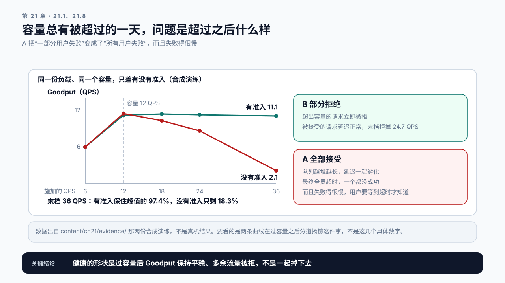
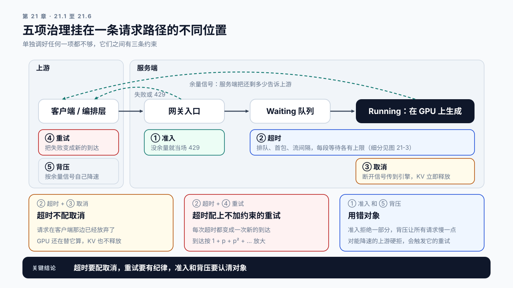
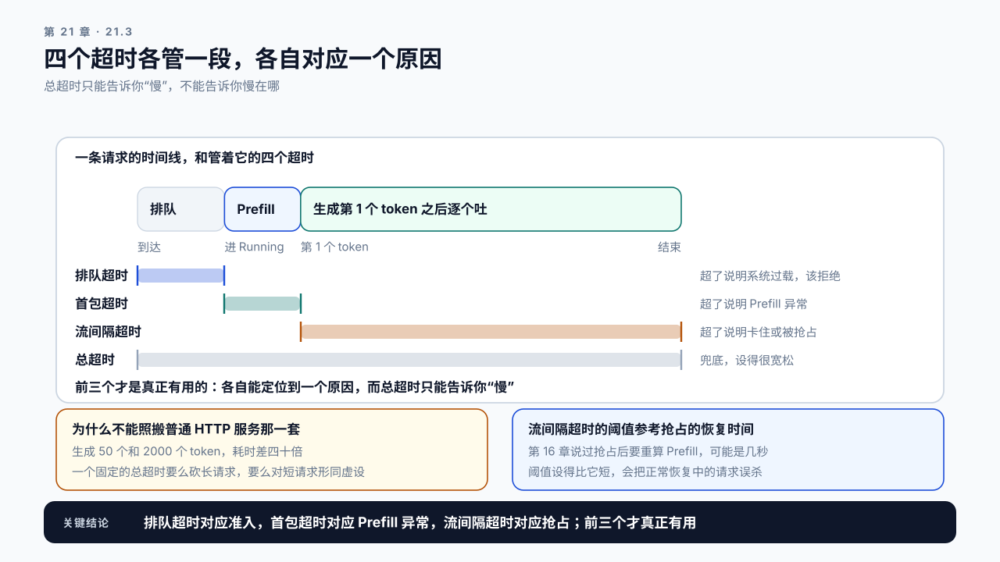
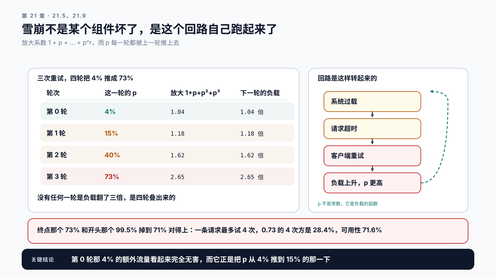

# 第 21 章 流量治理与可靠性：顶不住的时候该怎么垮

## 学习目标

读完这一章，你应该能回答三个问题：

1. 流量超过容量时，系统应该怎么表现？
2. 超时和重试为什么常常让情况更糟？
3. 客户端的哪些写法会凭空放大服务端的压力？

跟着做完，你会得到一套流量治理配置：准入、超时、取消、重试、背压五项的取值和相互约束，以及一份过载演练记录。

## 21.1 容量总有被超过的一天

前面五章都在提升容量：Prefill 更快、Decode 更省、批量更满、参数更优。

但容量再高也是有限的。促销活动、上游故障后的流量回灌、某个客户的批量任务，都会让实际流量超过设计容量。

**问题不是能不能避免，而是超过的时候系统怎么表现。**

两种截然不同的表现：

```text
A. 全部接受   队列越堆越长，所有请求的延迟一起劣化
              最终全员超时，没有一个请求成功
B. 部分拒绝   超出容量的请求立即被拒
              被接受的请求延迟正常，成功返回
```

A 是默认行为，也是最坏的行为。**它把“一部分用户失败”变成了“所有用户失败”，而且失败得很慢，用户要等到超时才知道。**



图21-1：过载时的两种垮法。同一份负载、同一个容量，只差有没有准入；过了容量那条线之后，两条 Goodput 曲线分道扬镳。

让系统按 B 的方式表现，靠的是五项治理，它们挂在一条请求路径的不同位置。准入守在入口，决定这条请求进不进来；超时卡住路径上的每一段等待，判断它该不该放弃；取消把已经放弃的请求从 GPU 上撤下来；重试发生在客户端或编排层，把一次失败变成又一次到达；背压把服务端的余量告诉上游，让上游自己降速。**五项不能分开调，它们之间有三条约束。** 超时不配取消，GPU 还在替已经放弃的请求算；超时配上不加约束的重试（不分错误类型、没有退避和熔断），失败率 p 会让到达按 1 + p + p² + … 放大，21.5 那三条纪律就是这条约束的具体做法；准入是拒绝一部分请求，背压是让所有请求来得慢一点，用错对象，两者都会适得其反。



图21-2：五项治理在请求路径上的位置。准入在入口，超时覆盖排队和生成的每一段，取消在 GPU 上释放 KV，重试和背压都落在上游；下方三块是它们之间的三条约束。

## 21.2 准入：在门口就说不

准入控制的逻辑很简单：请求到达时，判断系统还有没有余量，没有就立即拒绝。

判据用第 20 章那三个指标里的前两个（第三个抢占计数是显存信号，出现得太晚，不适合做准入判据）：

```text
槽位占用率 > 阈值   且   Waiting 队列长度 > 阈值
  → 拒绝新请求，返回 429
```

**为什么要两个条件同时满足？** 只看 Running 会在正常满载时误拒（满载但队列为空说明处理得过来），只看队列会拒得太晚（队列一旦堆起来，已经有请求在受害了）。

**前提是槽位上限先于 KV 约束。** 第 20.8 节那个 `lead_time` 小于等于零时，Running 根本到不了上限，第一个条件永远不成立，准入就一条也拒不掉。那种服务上把第一个条件换成 KV 使用率超过阈值。

几个实现上的要点：

**拒绝要快。** 准入判断应该在请求进入任何昂贵操作之前完成，不要先做 tokenize 再拒绝。

**返回的信息要可用。** 429 要带上 `Retry-After`，告诉客户端多久之后再试。不给这个信息，客户端只能立刻重试，而立刻重试会加剧过载。

**要能按来源区分。** 同样是过载，内部批量任务被拒的代价远低于线上交互请求。准入策略应该支持按优先级区分，把容量留给更重要的流量。

**阈值要留出余量。** 拒绝的目的是保护被接受的请求，所以阈值要设在系统还有余力的位置，而不是已经崩了的位置。Waiting 的阈值有一个硬上限：满载吞吐乘排队超时（21.3）。满载时每秒放走 12 条，排队超时 5 秒，排在第 60 名之后的请求注定等不到进 Running，接受它们只是让它们慢慢超时，所以阈值不能超过 60，还要再往前留一点。第 20 章那个 `lead_time` 说的是另一件事：Running 打满比开始排队早多少秒。它决定告警能提前多久，不决定阈值设在哪。

## 21.3 超时：LLM 场景下不能照搬

普通 HTTP 服务设超时很直接：一个请求该在多少毫秒内返回，超了就断。LLM 服务有两处不一样。

第一，正常请求的耗时分布极宽。生成 50 个 token 和 2000 个 token，耗时差四十倍。设一个固定的总超时，要么把长请求全砍了，要么对短请求形同虚设。

第二，流式响应下“没返回”和“卡住了”不是一回事。一条流式请求可能已经吐了 300 个 token，还在正常生成。按总时长判断会误杀。

所以 LLM 服务需要分层的超时：

```text
排队超时     从到达到进入 Running。超了说明系统过载，该拒绝
首包超时     从进入 Running 到第一个 token。超了说明 Prefill 异常
流间隔超时   两个 token 之间的最大间隔。超了说明卡住或被抢占
总超时       兜底，设得很宽松
```

**前三个才是真正有用的。** 排队超时对应准入，首包超时对应 Prefill 异常，流间隔超时对应第 16 章的抢占，各自能定位到一个原因。而总超时只能告诉你“慢”，不能告诉你慢在哪。



图21-3：四个超时各管一段，各自对应一个原因。横杠覆盖的区间就是它管的那一段，右边一列是它超了意味着什么。

**流间隔超时的阈值要参考抢占的恢复时间。** 第 16 章说过抢占后要重算 Prefill，可能是几秒。阈值设得比它短，会把正常恢复中的请求误杀。

## 21.4 取消：省下的是真金白银

客户端断开连接后，服务端还在继续生成，这是 LLM 服务里一笔很大的隐性浪费。和普通服务不同的是，**这里浪费的是最稀缺的资源**：那条请求占着 KV Cache 的显存，占着 Running 集合的一个位置，每一步都在消耗算力，而结果没有任何人会看到。

浪费量取决于两件事：用户中途放弃的比例，和放弃时平均已生成了多少。交互式产品里用户看到前几句话就关掉的情况很常见，这个比例可能超过一成。

**要让取消真的生效，链路上每一段都要支持传播：**

```text
浏览器/客户端断开
  → 网关感知并关闭上游连接
  → 服务端框架感知
  → 推理引擎收到取消信号
  → 请求移出 Running，KV 立即释放
```

**任何一段断了，取消就不生效。** 常见的断点是网关：很多网关在收到完整响应之前不会主动关闭上游连接，客户端断开它并不知道。

验证方法很直接：发一条长生成请求，几秒后客户端断开，观察服务端的 Running 集合大小和 KV 使用率有没有立即下降。没有下降，说明链路上有一段没传播。

## 21.5 重试：过载时最危险的那个开关

重试是可靠性的常规手段，但在过载场景下它是放大器。

```text
系统过载 → 请求超时 → 客户端重试 → 负载变成两倍 → 更过载 → 更多超时
```

这个正反馈可以在几十秒内把一个只是略微过载的系统彻底压垮。它是本篇开头那条排队与放大的后一半，而且放大了多少可以算出来。设首次失败率为 `p`、最多重试 `r` 次，各次尝试相互独立地以 `p` 失败。第 i 次重试只在前 i 次都失败时才发出，概率是 `p` 的 i 次方，所以到达量的放大系数是：

```text
有限次重试   放大系数 = 1 + p + p² + … + p^r   ≤ 1 + p × r
无限次重试   放大系数 = 1 / (1 − p)
```

右边那个 `1 + p × r` 是好记的上界，对应每次重试都失败的情形。代入三个失败率，取 `r = 2`：

```text
p = 2%    1 + 0.02 + 0.0004 ≈ 1.02    上界 1.04，多出 2% 的流量，看不出来
p = 50%   1 + 0.5 + 0.25 = 1.75       上界 2.00，流量接近翻倍
p = 90%   1 + 0.9 + 0.81 = 2.71       上界 2.80；无限重试下是 1 / 0.1 = 10 倍
```



图21-4：重试把 4% 的失败推成 73%。左边四行是 21.9 案例一那个回路走出来的，右边是回路本身；`p` 每一轮都被上一轮推上去。

**关键在于 `p` 不是常数，它是负载的函数。** 平时 `p` 只有百分之几，放大系数接近 1，重试的代价可以忽略，这就是它平时看起来安全的原因。一旦过载把 `p` 推高，放大系数跟着涨，涨上去的流量又把 `p` 推得更高。无限重试那个式子写出了终点：`p` 趋近 1 时放大系数发散。雪崩不是某一个组件坏了，是这个回路自己跑起来了。

这两个式子都是形状，不是预测值。它们把 `p` 当成定值，只算一轮。真实的放大比它们狠，原因不在式子本身，而在它漏掉的回路：重试让负载变高，负载把 `p` 推高，下一轮再用更高的 `p` 去放大。案例一那张表走的就是这个回路。这两条和全书其余式子的前提、失效点，附录 F.2 汇总在一起。

三条纪律：

一、只重试明确可重试的错误。连接失败、503、429 带 `Retry-After` 的，可以重试。超时不能无条件重试，因为你不知道服务端是不是还在处理。LLM 请求尤其如此，一次超时的请求可能已经消耗了几秒的 GPU 时间，重试等于让它算两遍。

二、退避必须带抖动。固定间隔重试会让所有失败的客户端在同一时刻再次涌入，形成脉冲。指数退避加随机抖动能把这个脉冲摊开。这里的抖动指给每次重试的等待时长加一个随机偏移，是客户端主动加的；和第 20 章那个 ITL 抖动不是一回事，那个是批次成员变化带来的、服务端不想要的副作用。

三、要有熔断。连续失败达到阈值后，客户端应该停止重试一段时间。没有熔断的重试策略，在服务端完全不可用时会持续打满带宽，让恢复更困难。

**还有一条针对 LLM 的特殊考虑：流式请求已经吐出部分内容后失败，重试意味着从头再来。** 用户会看到已经出现的文字消失又重新生成，体验很差，而且成本翻倍。这类情况通常应该直接报错，而不是静默重试。

## 21.6 背压：让上游知道你顶不住

> **背压**（backpressure）：服务端把自己当前的处理余量反馈给上游，让上游主动降低发送速率，从而把过载挡在队列形成之前。

21.1 说过，准入是拒绝，背压是减速。这里要补的是对象：背压面向的是能够调整发送速率的上游。

典型的场景是内部服务之间的调用，或者批量任务的消费端：

```text
无背压   上游按固定速率发，服务端来不及处理，队列堆积
有背压   服务端把当前余量反馈给上游，上游相应降速
```

实现方式有几种：

```text
显式信号   响应头里带当前负载水位，上游据此调整
隐式信号   限制连接数或并发数，上游自然被阻塞
配额       给每个上游分配速率配额，超了排队
```

**背压只对“能降速的上游”有意义。** 面向终端用户的服务没法让用户少点几次，那里只能用准入。所以这一节主要适用于 Agent 编排层调用模型服务、离线批处理任务这类内部链路。

**一个常见的错误是把背压和准入混用。** 对能降速的上游做硬拒绝，会触发它的重试逻辑，反而更糟；对不能降速的用户做背压，只是把等待从服务端挪到了客户端，用户感受不到区别。

## 21.7 客户端的三个写法会放大压力

第 2 章讲过客户端观测和服务端事实的区别。这里讲客户端写法对服务端的实际影响。

一、不复用连接。每次请求新建 TCP 加 TLS 握手，在高频调用下这部分开销可观，而且会消耗服务端的连接资源。用连接池，且池大小要和并发匹配。

二、不设客户端超时或设得过长。客户端一直等着，服务端的请求就一直占着资源。客户端超时应该比服务端的总超时略长一点，让服务端有机会先做清理，但不能长太多。

三、读取 SSE 流太慢。以 vLLM 为例，引擎不会等客户端：每条请求各有一个输出收集器，消费者跟不上时增量被合并起来，生成照常完成、完成就释放 KV。被拖住的是 API 进程里的那条连接和它攒着的输出，连接和内存迟迟不回收。有的框架会把反压一路传到生成侧，以手里那一版的实现为准。客户端侧做耗时处理时，应该先把流读完再处理，不要边读边阻塞。

还有一个写法不放大服务端压力，但值得一并记住：同步阻塞调用。一个 Agent 要串行调五次模型，每次都同步等待，总耗时是五次之和，其中某些步骤本可以并行。它只拉长端到端，第 24 章会展开。

## 21.8 Demo：过载演练

本章 Demo 位于 `code/ch21/overload_drill.py`。加压和取消验证需要真实服务，判形状和走重试回路可以离线跑。

```bash
python3 code/ch21/overload_drill.py run \
  --url http://localhost:8000 \
  --workload workload.json \
  --ramp 0.5,1,1.5,2,3 \
  --capacity-qps 12 \
  --slo-ttft 1500 --slo-itl 80 \
  --output drill-report.json
```

`--capacity-qps` 是必填的：`--ramp` 给的是容量的倍数，没有基准就换算不出实际速率，而 21.5 那个回路走的也是倍数。

它按容量的倍数阶梯加压，每档记录：

```text
offered_qps      施加的请求速率
accepted_qps     被接受的速率
rejected_qps     被拒绝的速率
goodput          满足 SLO 的成功请求速率
p95_ttft         被接受请求的 TTFT
error_breakdown  错误类型分布：429 / 超时 / 连接失败
```

另外三个子命令：

```bash
python3 code/ch21/overload_drill.py analyze --report drill-report.json
python3 code/ch21/overload_drill.py cancel-check --before before.json --after after.json
python3 code/ch21/overload_drill.py retry-storm --report drill-report.json --retries 3
```

`run` 判 goodput 时只用 TTFT：它采的是每条请求的首包时刻，手里没有逐 token 的间隔。`--slo-itl` 只写进报告，说明这组数是在哪条 ITL 线下采的；要把 ITL 也算进达标，用第 19 章那份记分卡。

`cancel-check` 比较断开前后两份调度器快照，直接验证 21.4 那条链路。两份快照可以用第 20 章那个 `collect` 取。判据是两个数都要动：Running 让出了位置而 KV 没还，仍然不算生效。

`retry-storm` 走 21.5 那个回路。给 `--failure-rates 0.04,0.15,0.40,0.73` 就复现 21.9 案例一那张表，给 `--report` 就从这份演练自己的曲线上读失败率，也就是那道讨论题问的“15% 是从哪来的”。用仓库里那份没有准入的合成演练走这个回路，失败率一轮轮涨到约 94%，也就是这份演练最后一档的失败率。回路不是自己收敛的，是被钳在了曲线的尽头，可用性只剩约 21%；换成有准入那份，同样的重试策略收在约 43%，可用性约 97%。重试策略没变，准入把回路的终点挪开了。

**这份演练最该看的是 `goodput` 曲线的形状，而 `analyze` 判五种：**

```text
健康        末档 goodput 保持在峰值的九成以上，多余流量被拒
退化        掉到峰值的五成到九成：准入生效了但不够早
危险        掉到五成以下：准入没有生效，系统正在用全员失败的方式回应过载
可疑        goodput 平稳而一条都没拒：瓶颈可能在压测客户端，不在服务端
未到容量    goodput 一路涨到最后一档且全程没有拒绝：这次加压根本没超过容量
```

**后两种是关于演练本身的，而且判在最前面。** 一条根本没压到容量的曲线被判成健康，是唯一一种会让人挨伤的错答案。

仓库里有一对合成演练，同一份负载、同一个容量、同一组 `offered_qps`，只差有没有准入：没准入那份末档 goodput 掉到峰值的 18.3%，有准入那份保持在 97.4% 且末档拒掉了 24.7 QPS。这一对就是 21.1 那个 A 和 B。在自己的服务上做一次真机演练：跑完四个子命令，确认 goodput 曲线是平稳形态，用 `retry-storm --report` 从自己的曲线上读出那条回路，并量出取消的生效时间。

## 21.9 案例与常见误区

### 案例一：加了重试，可用性反而下降

合成设定：团队为提高可靠性，在客户端加了三次重试，固定间隔 1 秒。上线后一次小的流量高峰导致部分请求超时，系统彻底过载，用户侧可用性从 99.5% 掉到 71%。**而如果不重试，那次高峰只会影响约 4% 的请求。**

4% 怎么变成压垮系统的？用 21.5 那个式子把回路走一遍就清楚了。`r = 3`，放大系数 `1 + p + p² + p³`，而 `p` 每一轮都被上一轮推上去：

```text
轮次   这一轮的单次失败率 p    放大系数    下一轮的负载
 0     4%（高峰本身）          1.04        1.04 倍
 1     15%                     1.18        1.18 倍
 2     40%                     1.62        1.62 倍
 3     73%                     2.65        2.65 倍
```

**没有任何一轮是“负载翻了三倍”，是四轮叠出来的。** 第 0 轮那 4% 的额外流量看起来完全无害，而它正是把 `p` 从 4% 推到 15% 的那一下：高峰时系统本来就贴着满载，第 20 章算过，那个位置上多 5% 的到达就能让排队接近翻倍，排队一长，超时就多了。

终点这个 73% 和开头那个 71% 对得上：三次重试意味着一条请求最多尝试四次，用户看到失败的概率是 `p⁴`，`0.73⁴ ≈ 28.4%`，也就是可用性 71.6%，和开头那个 71% 是同一个数。**这两个数不是各自量出来的，是同一个 `p` 的两种表现。**改成指数退避加抖动、加上熔断、且只对 429 和连接失败重试之后，同样的高峰下可用性保持在 98% 以上。

讨论：重试策略该怎么测？在什么条件下测才能暴露这个问题？表里第 1 轮那个 15% 是从哪来的，怎样才能提前量出来？

### 案例二：用户早就走了，GPU 还在算

合成设定：某对话产品统计发现，约 14% 的请求在生成过程中被用户放弃，但服务端仍然把它们生成完了。

排查发现网关在收到完整响应前不会关闭上游连接。修复后，同样的流量下并发请求数下降约一成，相当于白捡了一成容量。

讨论：除了网关，链路上还有哪些位置可能吞掉取消信号？

### 案例三：超时设成 30 秒，长请求全被砍

合成设定：服务设了统一的 30 秒超时。上线后发现长文档摘要任务大量失败，因为它们本来就需要 40 到 60 秒。把超时调到 120 秒之后，长任务正常了，但真正卡住的请求也要占 120 秒才释放，过载时要拖很久才恢复。

最终改成分层超时：排队 5 秒、首包 10 秒、流间隔 15 秒、总超时 180 秒。长任务不再被误杀，卡住的请求 15 秒内就能被识别。

讨论：这四个阈值分别该依据什么数据来定？

### 两个不写在配置里的误区

误区一：拒绝请求是失败，要尽量避免。在过载场景下，拒绝是正确行为。它把损失限制在一部分请求上，保护了其余请求。真正的失败是全员超时：所有用户都等了很久，然后都没拿到结果，而且系统资源全部浪费在这些注定失败的请求上。

误区二：这些是运维配置，和性能优化无关。第 20 章那个排队论的结果说明，接近饱和时多 5% 的流量就能让排队接近翻倍。准入和背压的作用是让系统不进入那个区域，这比任何单点优化对 P99 的影响都大。一个没有准入的系统，前面几章优化出来的余量会在第一次流量高峰时全部还回去。

## 本章总结

回到开头的三个问题。

**流量超过容量时该怎么表现？** 部分拒绝，而不是全部接受。全部接受会让队列越堆越长，最终所有请求一起超时，把“一部分用户失败”变成“所有用户失败”，而且失败得很慢。准入判据用第 20 章那两个指标同时满足：槽位占用率高且队列有积压；Waiting 的阈值设在系统还有余力的位置，硬上限是满载吞吐乘排队超时，超过它的请求注定等不到。拒绝要快、要带 `Retry-After`、要能按优先级区分。

**超时和重试为什么会更糟？** 超时的问题在于 LLM 请求的耗时分布极宽，统一阈值要么砍长请求要么形同虚设，所以需要分层：排队、首包、流间隔、总超时，前三项各自能定位到一个原因，总超时只能告诉你慢，而流间隔的阈值要留出抢占恢复的时间。重试的问题在于它是过载的放大器：一轮的放大是 `1 + p + … + p^r`，而 `p` 随负载上升，回路一旦转起来，几轮就能把百分之几的失败推成七成。超时后无条件重试尤其危险，因为服务端可能还在处理那条请求。三条纪律：只重试明确可重试的错误、退避带抖动、必须有熔断。流式已吐出部分内容后的失败通常该直接报错而非重试。

**客户端哪些写法放大压力？** 不复用连接消耗服务端连接资源；不设或设得过长的客户端超时让服务端资源迟迟不能回收；读取 SSE 流太慢让服务端替这条连接攒着发不出去的输出，连接和内存迟迟不回收（以 vLLM 为例，生成本身不会被拖慢）。此外还有一件不在客户端而在链路上的事：取消信号必须端到端传播，任何一段断了，用户走了 GPU 还在算，而那条请求占着最稀缺的 KV 显存。

下一章从单个服务扩展到多个：什么时候该自己部署、什么时候该用共享 API，以及请求该被路由到哪个实例。

### 本章 Checklist

- [ ] 服务有准入控制，判据基于槽位占用率和 Waiting 队列长度两个条件；KV 先满的服务上，第一个条件换成 KV 使用率。
- [ ] 拒绝响应带 `Retry-After`，且拒绝发生在昂贵操作之前。
- [ ] 超时是分层的，至少有排队、首包、流间隔三层。
- [ ] 流间隔超时的阈值大于抢占恢复所需的时间。
- [ ] 验证过取消信号能端到端传播，资源在秒级内释放。
- [ ] 重试只针对明确可重试的错误，带指数退避、抖动和熔断。
- [ ] 客户端复用连接，超时设置和服务端协调过。
- [ ] 做过过载演练，goodput 曲线在超容量后保持平稳。

## 课后练习

1. 用满载吞吐乘排队超时算出 Waiting 阈值的上限，定一个留有余量的阈值；再用第 20 章的 `lead_time` 说明告警比开始排队早多少秒。
2. 统计线上请求的耗时分布，据此定出四层超时的阈值。
3. 测出一次抢占从发生到恢复的时间，用它校准流间隔超时。
4. 发一条长生成请求后断开客户端，量出服务端释放资源花了多久。
5. 在链路上逐段检查取消信号的传播，找出可能的断点。
6. 分别用固定间隔和指数退避加抖动的重试策略做过载演练，对比 goodput 曲线。
7. 关掉准入控制重跑一次过载演练，记录 goodput 曲线的形态差异。
8. 为你的服务写一份流量治理配置说明，五项参数各自的取值、依据和相互约束。
