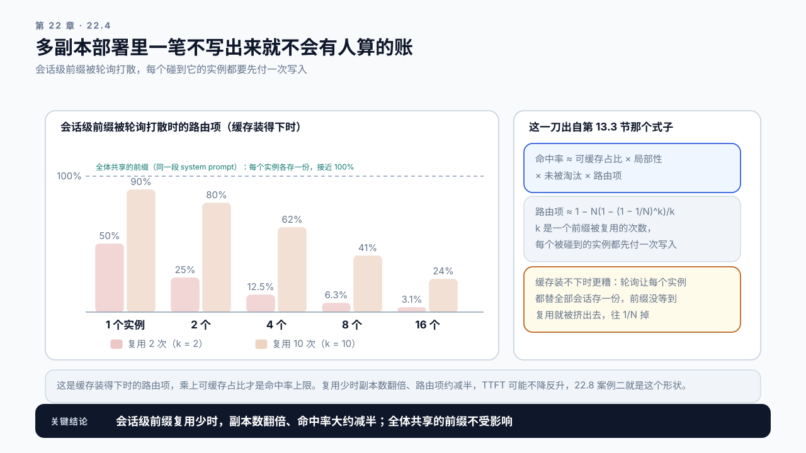
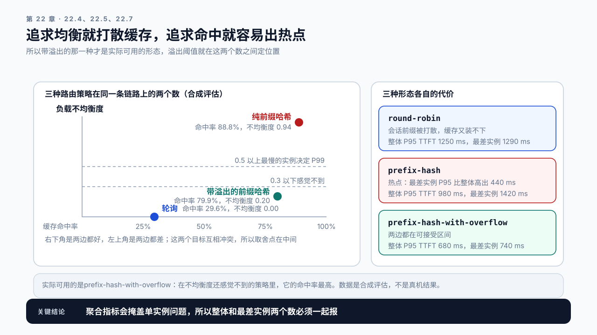

# 第 22 章 Serving 架构选择与模型路由：这套东西到底该不该自己部署

## 学习目标

读完这一章，你应该能回答三个问题：

1. 共享 API、专用部署、自托管，该按什么判据选？
2. 一个产品同时要用几个模型时，请求该怎么分配？
3. 路由策略会不会把前面几章的优化成果抵消掉？

跟着做完，你会得到一份架构决策记录：当前场景选哪种部署形态、依据是什么、什么条件变化时要重新评估。

前面六章讲的都是同一个实例内部的事。这一章往上一层：有多少个实例、它们是谁的、请求该去哪个。

## 22.1 自建的成本不是卡钱

“自己部署更便宜”是一个常见的判断，算的通常是这笔账：

```text
共享 API   每百万 token 若干元 × 月调用量
自建       卡的月摊销 + 电费
```

按这个算法，量大到一定程度自建总是划算的。但这笔账漏了几项，而漏掉的那几项往往比卡钱还多。

**漏掉的第一项是闲置。** API 按实际用量计费，自建按卡的存在计费。如果流量有明显的日内波峰波谷，白天峰值需要 8 张卡，夜里只需要 1 张，那 8 张卡要 24 小时付费。前面几章算出来的容量是峰值容量，而账单按峰值配置出。

这里那个“8 比 1”本书称为峰谷比，也就是峰值 QPS 除以波谷 QPS。它是下一节四条判据里的第二条，也是 22.7 那个 Demo 会直接报出来的一个数：峰谷比越大，流量的波谷越深，下一节第二条判据越偏向 API。**被闲置吃掉多少，看的是另一个比值：峰均比**，即峰值除以全天均值。按峰值配卡时平均负载率约等于峰均比的倒数，闲置就是剩下那部分。两者别混：22.7 那份负载峰谷比 11.25，峰均比约 3.2，平均负载率 29.2%，闲置约七成，而七成这个数是峰均比给的，不是峰谷比。第 26 章算单位成本时用的也是峰均比。

**第二项是工程投入。** 前面 21 章的内容就是这项成本的清单：建 Baseline、做可观测、调参、做容量规划、设计流量治理、处理升级回退。这些工作在用 API 时大部分不存在。

**第三项是可用性责任。** API 挂了是供应商的事，自建挂了是你的事。要达到同样的可用性，需要多副本、跨区、灰度、回滚，每一样都要额外的卡和人。

**第四项是模型迭代。** 新模型出来时，API 那边改一个参数，自建要重新评测、重新调参、重新做容量规划。

**所以自建真正的优势通常不在成本，在其他几件事上：** 数据不出域、能改模型、延迟可控、不受供应商配额和限速约束。如果这几条都不需要，自建的理由就不充分。

## 22.2 三种形态的判据

| | 共享 API | 专用部署 | 自托管 |
|---|---|---|---|
| 计费 | 按 token | 按实例时长 | 按硬件 |
| 容量控制 | 供应商配额 | 独占，可预留 | 完全自主 |
| 延迟稳定性 | 受邻居影响 | 稳定 | 稳定且可调 |
| 数据边界 | 出域 | 通常仍出域 | 可完全内网 |
| 模型可改 | 否 | 有限 | 是 |
| 工程投入 | 很低 | 中等 | 高 |
| 适合的阶段 | 探索期、低量、波动大 | 量稳定、要延迟保障 | 有数据或定制硬约束 |

判据按优先级排：

一、有没有硬约束。数据不能出域、必须用微调后的模型、必须跑在特定硬件上，这三条任何一条成立，直接走自托管，不用再算成本。

二、流量的形状。波动大、有明显波谷的走 API；平稳且量大的走专用或自托管。判断依据是第 6 章那份 workload 描述里的到达模式，以及峰谷比。

三、延迟要求。共享 API 的延迟受其他租户影响，P99 不可控。SLO 卡得紧的场景需要独占资源。22.7 那个 Demo 把“卡得紧”写成 TTFT SLO 不超过 1500 ms，这是经验界不是算出来的，它会把形状上偏 API 的结论推回专用部署。

四、团队能不能养。这一条最常被低估。自托管需要有人持续做前面 21 章的事。没有这个投入，自建的服务通常比 API 更慢也更不稳定。

**这个决策不是一次性的。** 流量涨了十倍、模型换了、合规要求变了，都要重新过一遍。决策记录里要写清楚“什么条件变化时重新评估”。

## 22.3 一个产品用几个模型

真实产品很少只用一个模型。典型的组合：

```text
主力模型     处理大部分请求，能力和成本平衡
小模型       处理简单任务：分类、改写、提取
大模型       处理少量复杂任务
专用模型     Embedding、Rerank、多模态
```

**把所有请求都送给最强的模型，是最常见也最贵的做法。** 一个意图分类任务用 70B 模型做，成本可能是 1B 模型的几十倍，而准确率的差距可能只有两个百分点。

按任务分流的关键是**判据要能在请求进来时就拿到**。几种可行的判据：

```text
调用方声明   由上游业务显式指定用哪一档，最准确也最需要协作
任务类型     按 API 路径或参数区分，实现简单
输入长度     长文档走长上下文模型，短问答走普通模型
先分类再路由 用小模型判断难度，再决定去哪。多一跳，要算成本
```

最后一种要谨慎：**分类本身也是一次模型调用**，它的延迟加在关键路径上。只有当被路由走的请求能省下足够多时才划算，而且分类错误的代价要能接受。

## 22.4 缓存感知路由：别把 Prefix Cache 打散

> **缓存感知路由**（cache-aware routing）：选实例时把“哪个实例已经缓存了这个 prompt 的前缀”当作判据之一，而不是只看谁空闲。
> 它是本节的核心概念，也是后面几节讨论取舍时的默认前提。本书把它的具体做法统一称为**前缀亲和**，第 25 章那几条断言里用的也是这个说法。

这是路由层最容易破坏前面优化成果的地方。

第 13 章讲过 Prefix Cache：相同前缀的请求可以复用已经算好的 KV，命中时 TTFT 大幅下降。第 16 章讲过它的底层是 PagedAttention 的块共享。

**但缓存是每个实例各自持有的。** 一个 system prompt 在实例 A 上被缓存了，请求被路由到实例 B，照样从头算。

轮询路由下会发生什么，要看前缀是哪一类（第 13.3 节）：

```text
4 个实例，轮询路由
全体共享的前缀     每个请求都带的同一段 system prompt
                   每个实例各缓存一份，之后照样命中，代价是显存多存几份
会话级前缀         一段对话的历史、按某份文档拼出来的前缀
                   同一会话的几次请求被打散到 4 个实例，
                   每个被碰到的实例都要先付一次首次写入，复用次数少时大半落空
```

**缓存感知路由的做法是让相同前缀的请求尽量落到同一个实例：**

```text
按前缀哈希路由   取 prompt 前 N 个 token 的哈希，或者会话 ID，映射到实例
                 简单，但负载可能不均
一致性哈希       实例增减时只有被增减那部分实例的键要迁移
                 幸存实例的缓存保得住
带负载反馈       在前缀亲和的基础上，实例过载时允许溢出到其他实例
                 兼顾命中率和均衡
```

> **一致性哈希**（consistent hashing）：把实例和前缀都映射到同一个环上，每个前缀归给环上顺时针方向的第一个实例。
> 它和取模哈希的区别只在实例数变化时才显出来：取模哈希下 `hash % N` 的 N 一变，大部分前缀的归属都要变；一致性哈希下只有被增减的那些实例持有的键需要迁移。

每个实例只在环上放一个点时，各实例分到的那段弧长短不一，N = 4 时按键数算的不均衡度（定义见本节后面）约 0.84，比哈希本身造成的热点还严重。实践中每个实例在环上放上百个虚拟节点，不均衡度降到约 0.09。

**这里有一个要算清的量，不能只说“只影响一小部分”。** 实例数从 `N` 变到 `M` 时，必须迁移的键大约占：

```text
|N − M| ÷ max(N, M)
```

```text
            必须迁移        一致性哈希保住    取模哈希保住
12 → 11    1/12  ≈ 8%      92%               8%
12 → 10    2/12  ≈ 17%     83%               17%
12 → 8     4/12  ≈ 33%     67%               33%
12 → 4     8/12  ≈ 67%     33%               33%
```

**所以它买到的不是“冲击很小”，而是“幸存的那部分不用陪着一起冷启”。** 实例数变化越大，它能保住的越少；缩到只剩三分之一时，三分之二的缓存无论用什么哈希都得重建，因为那些实例本身没了。这时取模哈希碰巧也保住三分之一：12 是 4 的倍数，`hash % 12` 落在 0 到 3 的键，`hash % 4` 不变。差别出现在其他变化上：少一个实例时，取模哈希只保住 8%，一致性哈希保住 92%。这个量在第 27.6 节定缩容策略时要直接用。

**第三种是实际可用的形态。** 纯按前缀亲和会导致热点：某个高频前缀对应的实例被打爆，其他实例空闲。必须有一个溢出机制。

**这里有一个真实的取舍：** 缓存命中率和负载均衡是互相冲突的目标。追求均衡就打散缓存，追求命中就容易出热点。取舍点取决于**会话级前缀**在 prompt 里的占比，也就是只有亲和才保得住的那部分可缓存 token：它占七成以上时，前缀亲和的收益大于均衡的损失；只占两成时不值得为它牺牲均衡。全体共享的前缀怎么路由都命中，不计入这个占比。七成和两成都是经验界。第 13 章那条“可缓存比例高于三成才值得走 Prefix Cache”管的是另一件事：要不要开缓存，而不是要不要做亲和。

冲突的量级可以直接算。全体共享的前缀不受路由影响；会话级前缀受多少影响，看第 13.3 节那个命中率式子里的路由项。一个前缀被复用 k 次、随机落到 N 个实例、每个实例的缓存都装得下时：

```text
路由项 ≈ 1 − N × (1 − (1 − 1/N)^k) ÷ k

                  k = 2     k = 10    k = 100
1 个实例          50%       90%       99%
4 个实例，轮询    12.5%     62%       96%
8 个实例，轮询    6.3%      41%       92%
```

单实例那一行不是 100%，因为每个前缀第一次出现时总要写一次。缓存装不下时更糟：轮询让每个实例都要替全部会话存一份，缓存按前缀亲和下的分量定容量时，每个实例只装得下自己那一份，前缀没等到复用就被挤出去，路由项往 `1/N` 掉。

**对会话级前缀，扩容本身就在削缓存，削的比例按副本数的倒数走。** 复用次数少或缓存吃紧时，副本数翻倍，命中率大约减半。这是多副本部署里一笔不写出来就不会有人算的账：从 4 副本扩到 8 副本，单实例负载减半，命中率也可能减半，TTFT 可能不降反升。第 22.8 节案例二就是这个形状。



图22-1：扩容本身就在削会话级前缀的缓存。两组柱子是复用 2 次和 10 次的会话前缀在轮询下的路由项，顶部虚线是全体共享的前缀，接近 100%。

反过来，纯前缀亲和把路由那一项拉回到接近 1，代价是负载方差。所以第三种形态的溢出阈值实际上是在这两个数之间定位置：阈值松则偏命中率，紧则偏均衡。定它的依据仍然是会话级前缀的可缓存比例，因为那是亲和能保住的命中率的天花板，天花板低的时候这一刀根本不值得躲。

代价那一侧也要有个能报的数，否则“偏均衡”只是一句形容。本书用负载不均衡度：

> **负载不均衡度**（load skew）：各实例请求数的标准差除以均值，也就是第 7 章那个变异系数换一个统计对象，标准差同样按样本口径算。
> 完全均衡是 0；四个实例里有一个接了全部流量是 2.0。经验上 0.3 以下感觉不到，0.5 以上最慢的那个实例会开始决定整体 P99。它和命中率是一对反向指标，两个一起报才看得出这一刀切在哪。

这两条经验界只在负载不高时成立。最热那个实例的负载率最坏是：

```text
ρ_最热 ≤ ρ̄ × (1 + 不均衡度 × (N − 1) ÷ √N)
```

`ρ̄` 是各实例的平均负载率（第 20.6 节）。N = 4、平均负载率 0.7、不均衡度 0.3 时，最热的实例最坏到约 1.0，已经贴着满载，按第 20 章那条曲线排队会先在它身上爆。平均负载率越高，能容忍的不均衡度越小。



图22-2：缓存命中率和负载均衡是互相冲突的两个目标。三种策略落在三个不同的象限，带溢出的那一种是唯一两边都在可接受区间的。

## 22.5 多副本带来的新问题

从单实例到多实例，有几件事会变得不一样。

一、容量不是线性叠加的。两个实例的容量不等于单实例的两倍，因为路由不可能完全均衡，最慢的那个实例决定整体的 P99。实际按 0.8 到 0.9 的系数折算比较稳妥，这是两三个实例、不均衡度在 0.3 以内时的经验值。实例更多或更不均衡时，用 22.4 那条最热实例的式子反推：要让最热的那个不过满载，平均负载率最多是 `1 ÷ (1 + 不均衡度 × (N − 1)/√N)`，4 个实例、不均衡度 0.3 时只剩 0.69，12 个实例时 0.51。

二、Baseline 要重新做。第 7 章那份单实例的 Baseline 在多副本下不能直接用，因为路由本身引入了新的变量。多副本的 Baseline 要包含路由策略作为环境的一部分。

三、指标要能按实例拆开。聚合的 P99 会掩盖单个实例的问题。一个实例卡住，聚合指标可能只是略微变差，而打到那个实例上的用户完全不可用。第 8 章那套请求级追踪要带上实例标识。

四、扩缩容有冷启动代价。新实例起来要加载权重、预热、重新捕获 CUDA Graph，可能是分钟级。这意味着扩容不能作为应对突发流量的手段，它只能应对可预期的趋势性增长。突发要靠第 21 章的准入，不能靠扩容。

五、滚动升级期间容量是下降的。逐个替换实例时，被替换的那个不可用，剩下的 N − 1 个要承担全部流量，负载率变成 `ρ × N/(N − 1)`。平时跑在 85%：4 个实例时升级期间是 113%，过载；12 个实例时是约 93%，不过载，但按第 20.6 节平均排队从约 5.7 个 S 涨到约 13 个。这笔账按单服务台算，前提是请求被前缀亲和钉在副本上、每个副本各排各的队，`S` 指单个实例满载吞吐的倒数；由网关按负载派发时排队要平缓得多。实例越少，升级窗口越要选在低峰期。

## 22.6 什么时候该换框架，什么时候不该

本书的主 Demo 用 vLLM，但生产上会遇到其他选择。

**这一节只给判据，不点名任何框架，也不排名。** 想看具体有哪些系统、各自覆盖哪一层，`code/ch04/README.md` 第 7 节按服务平台、推理服务器、LLM 引擎三层列了七份官方架构文档，是本书唯一的框架清单落点。那份清单的用途也只是确认覆盖范围，不是功能或性能对比。

**判断要不要换框架，先问换的是什么。** 几类常见的动机及其真实性：

**“另一个框架吞吐更高”。** 公开的对比数据通常基于特定负载和配置。第 14 章那条边界纪律在这里适用：模型、负载、硬件、配置任一不同，结论就要重验。换框架之前，用自己的 workload 跑一遍对比。

**“需要某个特性”。** 这是充分的理由。特定的量化格式、特定的并行方式、特定的硬件支持，框架之间确实有差异。

**“现在这个太难调”。** 通常不是框架的问题。第 20 章那个调参顺序没走对，换个框架还是一样。

**换框架的隐性成本很高：** 前面几章积累的 Baseline、参数经验、监控口径、运维流程全部要重做。所以这个决定应该基于特性需求，而不是基于性能数字的微小差异。

**一个折中做法是按场景分开：** 主力场景用当前框架，新出现的特殊需求用另一个框架起一组独立实例，通过路由分流。这样不必一次性迁移。

## 22.7 Demo：架构决策与路由评估

本章 Demo 位于 `code/ch22/serving_choice.py`。

决策部分不需要服务：

```bash
python3 code/ch22/serving_choice.py decide \
  --workload workload.json \
  --peak-qps 45 --trough-qps 4 \
  --data-residency required \
  --slo-ttft 1500 \
  --api-price 0.002 --gpu-monthly 12000 \
  --capacity-per-gpu 12 \
  --team-capacity yes
```

**`--team-capacity` 是一道闸，不是一个可选项。** 结论落在自托管或专用部署而这一项没填时，脚本拒绝出结论，因为 22.2 把它列为第四条判据并说它最常被低估。填 `no` 时分两种情形：没有硬约束就退回共享 API，有硬约束则仍然是自托管，但输出里写明这是一个必须先解决的前置条件。

输出：

```text
hard_constraints  触发的硬约束及其结论
peak_trough_ratio 峰谷比
api_monthly       按 token 计价的月成本估算
selfhost_monthly  按峰值容量配置的月成本估算，含闲置折算
breakeven_qps     两者成本相等的平均 QPS
recommendation    建议形态 + 理由
revisit_when      什么条件变化时重新评估
```

`recommendation` 那一行有一个值得看的情形：把 `--data-residency` 和 `--slo-ttft` 都去掉，同一组数会推荐共享 API，**尽管自建的月成本只有 API 的一半**（只去掉 `--data-residency`、留着 `--slo-ttft 1500` 时，第三条判据会把它从 API 推回专用部署）。先看卡钱这一侧：输出里的 `breakeven_qps` 换算成平均负载率（平均到达速率除以按峰值配好的总容量）是约 13.8%，也就是 4 张卡平均用到 13.8% 自建就和 API 打平；这份负载是 29.2%，在线之上，所以按卡钱算自建确实便宜，七成的闲置已经算在里面了。推荐 API 靠的是 22.2 的第二条判据：峰谷比 11.25 意味着要为一个只在白天出现的峰值养 4 张卡和一支团队，22.1 那三项不进月成本的投入在这种形状下最不划算。脚本把这条判据写成“峰谷比到 5 就推荐 API”，这个 5 是经验界，不是算出来的；已经在养别的自建服务的团队，那三项的边际成本低，可以用 `--api-peak-trough` 把它调高。第三条判据在脚本里也是一条经验界：TTFT SLO 不超过 1500 ms 就算卡得紧，把结论推回专用部署。

路由评估部分需要多实例服务：

```bash
python3 code/ch22/serving_choice.py route-eval \
  --report route-report.json \
  --output route-eval.json
```

报告里对每种策略记录：

```text
cache_hit_rate    各实例的缓存命中率
load_skew         实例间负载的不均衡度
p95_ttft          整体 P95 TTFT
worst_instance    最慢实例的 P95，用来看聚合指标掩盖了什么
```

**`worst_instance` 是刻意单列的。** 22.5 说过聚合指标会掩盖单实例问题，报告里必须同时给出整体和最差实例两个数。缺这一项脚本直接拒绝，不给一个只有聚合值的结果。

仓库里那份合成样例复现的就是案例二那组数：

```text
  round-robin                 命中率 29.6%  不均衡度 0.0018  P95 1250
  prefix-hash                 命中率 88.8%  不均衡度 0.9416  P95 980   最差实例 1420
  prefix-hash-with-overflow   命中率 79.9%  不均衡度 0.2041  P95 680   最差实例 740
```

**中间那一行就是本节说的热点。** 它命中率最高，P95 却输给带溢出的那一版，而且最差实例 1420 ms，聚合值掩盖了 440 ms。所以脚本除了报命中率最高和最均衡的策略，还报一个“实际可用形态”：在不均衡度仍然感觉不到（0.3 以内）的策略里取命中率最高的那个。这一栏选出来的正是本节说的第三种形态。

另外两处拒绝都和天花板有关。单实例的命中率超过可缓存占比，说明量错了；带溢出那一版的加权命中率超过 `可缓存占比 × (1 − 溢出比例 × (1 − 1/N))`，说明配置里那个溢出比例和实际跑出来的不是一回事。后者更容易踩到，因为溢出比例是你设的阈值，实际溢出多少是跑出来的。轮询那一版不设这条线：全体共享的前缀轮询下照样命中，`1/N` 不是天花板。在自己的服务上做一次多实例评估：起三个实例，跑三种路由策略，量出缓存命中率和负载不均衡度的取舍曲线，并核对溢出比例声明的值和实际跑出来的是否一致。

## 22.8 案例与常见误区

### 案例一：自建省了钱，然后花了更多钱

合成设定：团队算出自建比 API 每月省 6 万，投入两名工程师做迁移。

半年后复盘：卡钱确实省了，但两名工程师的投入远超这个数，而且期间发生过两次事故，一次是升级时没留容量余量导致过载，一次是新模型上线前没重做 Baseline。真正的问题是这个业务并没有数据出域或定制模型的硬约束，自建的理由从一开始就只有成本，而那笔成本算漏了三项。

讨论：什么样的量级和什么样的团队配置下，这个决定才成立？

### 案例二：加了负载均衡，TTFT 涨了一倍

合成设定：一个多轮对话服务，每段对话平均十来轮，每轮都带着前面的全部历史，历史占输入 token 的九成多。对话量涨了四倍，服务从单实例扩到四实例，配了轮询负载均衡。总吞吐涨了，但 P95 TTFT 从 600 ms 涨到 1250 ms。

单实例时 Prefix Cache 命中率是 90%：同一段对话的下一轮总落在存着它历史的那个实例上。轮询之后，下一轮只有四分之一的机会落回原实例；更糟的是每个实例都要替全部对话存历史，而缓存只装得下四分之一，历史没等到下一轮就被挤出去。命中率降到三成左右，接近 `1/N` 那一档。改成按对话 ID 做带溢出的前缀亲和路由后，命中率回到约 80%，TTFT 降到 680 ms。

讨论：如果这个服务的长前缀是一段所有请求共用的 system prompt，而不是对话历史，轮询还会让命中率掉这么多吗？

### 案例三：所有请求都用最强的模型

合成设定：一个内容审核产品的全部调用都走旗舰模型，月账单很高。

分析请求发现，78% 是简单的分类判断，输出只有几个 token。用一个小模型测试，这部分任务的准确率只差 1.2 个百分点，而单位成本是原来的三十分之一。

分流之后月成本降了六成多。剩下的 22% 复杂案例仍然走旗舰模型。

讨论：那 1.2 个百分点的准确率差距，该由谁来判断是否可接受？

### 两个不写在决策记录里的误区

误区一：路由是基础设施，和模型性能无关。路由直接决定 Prefix Cache 的命中率，而命中率直接决定 TTFT。案例二里一个路由配置抵消掉了相当于几章优化的成果。路由策略应该和缓存策略一起设计，不能分开决定。

误区二：扩容能应对突发流量。新实例从启动到可用是分钟级，而突发流量是秒级的。扩容只能应对可预期的趋势性增长。秒级的突发必须靠第 21 章的准入控制扛住，指望自动扩缩容来救是来不及的。

## 本章总结

回到开头的三个问题。

**三种形态怎么选？** 按四条判据依次过：有没有硬约束（数据不出域、必须用定制模型、必须跑特定硬件，任一成立直接自托管）、流量的峰谷比（波动大走 API，平稳量大走专用或自托管）、延迟要求（共享 API 的 P99 受邻居影响）、团队能不能养。成本对比要算全：API 按用量计费，自建按峰值容量配置出账单，还要加上工程投入、可用性责任和模型迭代三项。自建真正的优势通常不在成本，而在数据边界、模型可改和延迟可控。

**多模型怎么分配？** 按任务分流，判据要能在请求进来时拿到：调用方声明最准、任务类型最简单、输入长度适合长短文档分流，先分类再路由要多付一次调用的延迟和成本。把所有请求都送给最强模型是最常见也最贵的做法，而简单任务上小模型和大模型的准确率差距可能只有一两个百分点。

**路由会不会抵消优化？** 会，而且是最容易发生的一处。Prefix Cache 是每个实例各自持有的。全体共享的前缀在每个实例上各存一份照样命中；会话级的前缀被轮询打散后，每个碰到它的实例都要先付一次写入，复用次数少或缓存吃紧时命中率按副本数的倒数掉，一个路由配置就能抵消掉几章的优化成果。可用的形态是带溢出的前缀亲和路由：按前缀哈希保证命中率，实例过载时允许溢出保证均衡。取舍点取决于可缓存比例。负载不均衡度的经验界只在负载不高时成立，最热实例的负载率最坏是平均值乘上 `1 + 不均衡度 × (N − 1)/√N`。此外多副本还带来几个新问题：容量不能线性叠加、Baseline 要重做、指标要按实例拆开、扩容是分钟级的所以扛不住秒级突发、滚动升级时负载率涨到 `N/(N − 1)` 倍。

下一章把视角从模型服务扩展到完整链路：一次 RAG 调用里，模型之外的那些时间花在哪。

### 本章 Checklist

- [ ] 能列出自建成本里除卡钱之外的三项，并给出各自的量级估计。
- [ ] 算过峰谷比，知道自建时有多少容量在波谷期闲置。
- [ ] 决策记录里写明了“什么条件变化时重新评估”。
- [ ] 统计过请求中简单任务的占比，评估过分流的收益。
- [ ] 分清长前缀是全体共享还是会话级的，并量过当前路由策略下 Prefix Cache 的实际命中率。
- [ ] 监控能按实例拆开，能看到最差实例而不只是聚合值。
- [ ] 按 `ρ × N/(N − 1)` 算过滚动升级期间的负载率，确认平时的负载率留了余量。
- [ ] 知道扩容一个实例从启动到可用需要多久。

## 课后练习

1. 算出你的业务峰谷比和峰均比，用峰均比估计自建时的平均负载率，并说明峰谷比在这里能用来判断什么。
2. 把自建成本的四项分别估出来，和 API 成本对比，找出盈亏平衡的 QPS。
3. 列出你的场景有没有硬约束，说明每一条的判断依据。
4. 统计请求中简单任务的占比，用小模型测一批，量出准确率差距。
5. 测出当前路由策略下各实例的 Prefix Cache 命中率，和单实例时对比。
6. 分别用轮询和前缀哈希跑一遍，对比命中率和负载不均衡度。
7. 把监控按实例拆开，找出最差实例的 P95，和聚合 P95 对比差多少。
8. 量出一个实例从启动到能接请求的时间，据此说明扩容能应对什么、不能应对什么。
