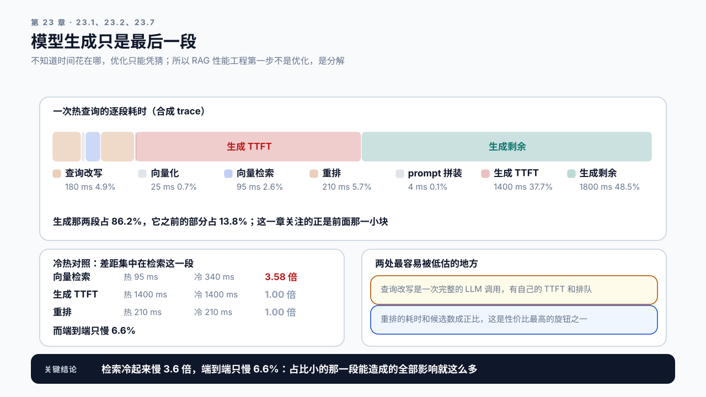
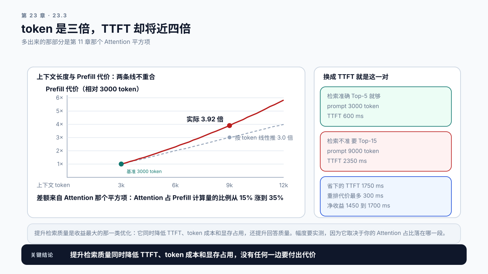

# 第 23 章 RAG 性能工程：模型之外的那一半时间

## 学习目标

读完这一章，你应该能回答三个问题：

1. 一次 RAG 调用的时间分布在哪几段，哪一段最容易被忽略？
2. 检索的质量和整条链路的性能之间是什么关系？
3. 除了让每一段变快，还有哪两条路能缩短链路：哪些段能并行，哪些段能缓存掉？

跟着做完，你会得到一张 RAG 链路的时间分解表：每一段的耗时占比、优化手段和它们之间的相互影响。

## 23.1 优化了模型，端到端没怎么变

前面几篇把模型服务本身的 TTFT 和 TPOT 都压了下去。但线上的用户体感可能没什么变化。因为用户等的不是一次模型调用，是一整条链路。

```text
用户提问
  → 改写查询        一次小模型调用
  → 向量化          把 query 编码成向量
  → 向量检索        向量库
  → 重排            Rerank 模型
  → 拼装 prompt     字符串处理
  → 生成            主模型
  → 返回
```

模型生成只是最后一段。如果前面五段加起来占了总时间的四成，那么把生成优化 50%，端到端只改善 30%。

**这个比例没有定数，必须自己测。** 本章三处数据给出的是一个范围：按 23.2 表各段取中值，生成之前约占三成；23.8 案例一那种配置（改写用主力模型、重排 200 候选）占到 56%，章名那个“一半”说的就是它；而 23.7 那份样例输出很长，生成前只占 13.8%。改写用哪个模型、重排候选多少、输出有多长，这三件事决定它落在哪。

**所以 RAG 的性能工程第一步不是优化，是分解。** 不知道时间花在哪，优化只能凭猜。

这也是第 8 章那套请求级追踪真正派上用场的地方：一次 RAG 调用里有多次下游调用，其中每条推理请求各有各的 Request ID，向量检索这类非推理调用作为同一 Trace 下的 Span，全部挂在同一个 Trace ID 上，否则每一段的耗时都是孤立的数字。

## 23.2 一张时间分解表

一个典型的 RAG 链路，各段的耗时量级：

| 阶段 | 典型耗时 | 主要变量 | 容易被忽略的地方 |
|---|---|---|---|
| 查询改写 | 100–400 ms | 是否调用模型 | 它是一次完整的 LLM 调用，含 TTFT |
| 向量化 | 10–50 ms | 模型大小、批量 | 单条调用时批量优势用不上 |
| 向量检索 | 20–200 ms | 索引类型、库规模 | 冷查询和热查询差几倍 |
| 重排 | 50–300 ms | 候选数、模型大小 | 候选数翻倍，耗时翻倍 |
| prompt 拼装 | 1–10 ms | 片段数 | 通常可忽略 |
| 生成 TTFT | 300–2000 ms | 上下文长度、模型服务的负载 | 它含排队，要按第 2、8 章的生命周期事件把排队那一段单独拆出来（第 25 章的分层预算就是这么拆的） |
| 生成剩余 | 输出长度 × TPOT | 输出长度 | |

几个观察：

查询改写的成本常被低估。它是一次完整的 LLM 调用，有自己的 TTFT 和排队。用一个小模型做，也要一两百毫秒；用主力模型做，可能比检索还慢。

重排的耗时和候选数成正比。检索召回 100 条再重排到 10 条，重排要跑 100 次打分。把召回降到 50 条，重排时间减半。这是链路上性价比最高的旋钮之一。

检索的冷热差异很大。索引在内存里和需要从磁盘读，差几倍。压测时如果一直用同一批查询，测的是热路径，线上真实的冷查询会慢得多。

生成那两段已经在第 12 章和第 15 章讲过。这一章关注的是它之前的部分。



图23-1：一次 RAG 调用的时间去了哪。上方条带按比例画出七段，下方是冷热对照；检索冷起来慢 3.6 倍，而端到端只慢 6.6%。

## 23.3 检索质量直接决定生成成本

这是 RAG 链路最容易被忽略的一层耦合。

第 12 章讲过：上下文越长，TTFT 越高、token 账单越多、并发上限越低。而上下文长度由检索决定。检索准了，少给几段就够；检索不准，只能多给几段来碰运气。

这里的“准”要有口径，否则下面整节的论证没法验证。本书用 Recall@K：在一份标好相关片段的评测集上，前 K 段里至少含一段相关片段的查询占比。回答质量另用端到端评测集打分。两者要和第 12 章那条曲线用同一份评测集，这也是第 12.7 节那条“要判断该不该加长，必须有可量化的质量指标”的具体落法。

```text
检索准确    Top-5 就能覆盖答案 → prompt 3000 token → TTFT  600 ms
检索不准    要 Top-15 才能覆盖 → prompt 9000 token → TTFT 2350 ms
```

注意后一行不是三倍。token 是三倍，TTFT 却将近四倍，多出来的那部分是第 11 章那个 Attention 平方项：按参考模型一（交叉点 16640）代进去，3000 token 时 Attention 只占 Prefill 计算量的 15%，9000 token 时占到 35%，这一段的倍数是 3.9 而不是 3.0。

这组数有两个前提。一是模型：交叉点越大 Attention 占比越小，换参考模型二（65024）同一段是 3.26 倍，换参考模型三（53248）是 3.32 倍，第 14.6 节算过同一件事。二是这里假设 TTFT 的增量全部来自 Prefill 计算：600 ms 是设定值，里面还有排队和固定开销，它们不随长度涨。**方向对任何模型都成立，比线性更贵；倍数要用自己的模型和实测的 TTFT 重算。**



图23-2：检索不准的代价比按 token 数线性推算出来的更贵。虚线是按 token 数线性推算，实线是第 11 章那个模型算出来的真实代价，两条线在 9000 token 处分开。

所以提升检索质量是一种性能优化，而且是这条链路上收益最大的那一类：**它同时降低 TTFT、token 成本和显存占用，还提升回答质量；代价是检索侧多出的几十到几百毫秒，通常远小于省下的 Prefill。**

具体的手段属于检索领域，这里只列出对性能影响最大的几条：

```text
更好的向量模型     召回质量上去，需要的片段数下来
合适的分块策略     片段太碎要多取几段，太大则每段都含大量无关内容
混合检索           向量加关键词，覆盖向量模型不擅长的精确匹配
重排               用少量额外耗时换显著更少的最终片段数
```

重排这一条要特别算账。它增加 50 到 300 ms，但可能把最终片段数从 15 降到 5，省下 6000 token 的 Prefill。按上面那组数，省下的 TTFT 是 `2350 − 600 = 1750 ms`，而代价最多 300 ms，净收益在 1450 到 1700 ms 之间。方向上净收益通常是正的，但幅度要实测，因为它取决于你的 Attention 占比落在哪一段。

第 12 章那条曲线在这里同样适用：画出 Top-K 与质量的关系，找收益停滞的拐点。有了重排，这个拐点会显著左移。

## 23.4 哪些能并行，哪些不能

链路上的串行等待是另一大块可回收的时间。改造之前先按第 9.4 节那条关键路径判断一次：并到别人的等待时间里去的那一段，优化它端到端不会变快。

真正能并行的：

```text
多路检索      向量检索和关键词检索同时发，结果合并
多数据源      同时查文档库、知识图谱、结构化数据
```

看起来能并行其实不能的：

```text
改写 → 检索       检索需要改写后的 query，严格串行
检索 → 重排       重排需要候选集，严格串行
重排 → 生成       生成需要最终片段，严格串行
```

**这条主链是串行的，这是 RAG 的结构决定的。** 所以并行能省的是支线时间，主链只能靠每一段自己变快。能省多少，按第 10.5 节的 Amdahl 式子算：被并行掉的那段时间占端到端的比例，是这一刀的上限。

并行还有一个代价藏在尾部。几路支线并行时，要等最慢的那一路回来。设每一路的 P95 都是 t、相互独立，全部在 t 内返回的概率是：

```text
P(全部 ≤ t) = 0.95^N      两路 90%，三路 86%，十路 60%
```

所以扇出之后，整体的 P95 落在单路更高的分位上。反过来说，扇出 k 路想让整体做到 P99，每一路大约要做到 `P(1 − 0.01/k)`：三路并行时，每路要做到约 P99.7。多路检索、多数据源同时查，路数加上去之前先看最慢那一路的尾巴。

有两个手段可以打破部分串行：

一是跳过改写。不是所有查询都需要改写。简单的、语义清晰的查询直接检索即可。用一个廉价的判据（长度、是否包含指代词、是否是多轮对话中的追问）决定要不要走改写这一步，能省掉相当一部分请求的这段时间。

二是投机检索。在改写模型还在生成时，先用原始 query 发一次检索。改写完成后如果结果差异不大就直接用，差异大再重查。这用额外的检索成本换延迟，只在检索便宜而改写慢时划算。

还有一个常被误用的手段：流式返回中间状态。把“正在检索”这类状态先推给前端，用户感知的等待会短一些。这改善的是体感，不是实际耗时，不能写进性能报告的延迟数字里。

## 23.5 缓存：三个层次

RAG 链路上有三处可以缓存，按跳过的链路从短到长排：Prefix Cache 只省掉固定前缀那段 Prefill，检索结果缓存省掉向量化和检索，完整回答缓存把整条链路都省了。**越靠后跳过的链路越长，存的东西也越接近最终内容，风险越大。** Prefix Cache 不改变任何输出；后两层存的是内容，知识库一更新就可能过期。

**收益不按这个顺序排。** 单次命中省下的时间，检索结果缓存是向量化加检索那 30 到 250 ms，比 Prefix Cache 那几百毫秒还少；而且收益还要乘命中率，全体共享的 system prompt 几乎条条命中，后两层只在重复查询上命中（23.7 那份样例的重复率是 0.18）。所以三层的收益顺序是检索结果缓存、Prefix Cache、完整回答缓存，风险顺序才是 Prefix Cache、检索结果缓存、完整回答缓存。两个序不一样，这正是从 Prefix Cache 开始做的理由：它在风险最低的一头，收益却不是最小的那个。第一层住在模型服务的 KV 池里，后两层在应用层，13.3 那张表里它们分属两头。

一、Prefix Cache。第 13 章那一项，在 RAG 场景下尤其重要，因为 system prompt 和 few-shot 通常很长且完全固定。

前提是拼接顺序正确：固定内容必须在最前面。RAG 的 prompt 拼装代码里，很容易把检索片段放到 system prompt 之前，那样命中率直接归零。这是一行代码的事，收益是几百毫秒。

二、检索结果缓存。相同或相似的 query 直接返回上次的检索结果。key 取在改写之前还是之后，决定它能省掉多少：取改写后的 query，省掉向量化和检索；取用户原始 query，连改写和重排也一起跳过，那就从几十毫秒变成几百毫秒，代价是改写逻辑一变缓存全部失效。

命中率取决于查询的重复度。客服、FAQ 类场景重复度高，收益大；开放式问答重复度低。风险是知识库更新后缓存里是旧内容，需要在更新时失效对应的缓存。

三、完整回答缓存。相同问题直接返回上次的回答。

收益最大，风险也最大：知识更新后回答过时、个性化内容被串用、多轮对话的上下文不同但当前问题相同。这一层需要很谨慎的失效策略，通常只用于明确的 FAQ 场景。

所以从 Prefix Cache 开始做最安全，它不改变任何输出。

## 23.6 RAG 的 Baseline 怎么做

第 7 章那套 Baseline 方法需要为 RAG 扩展几项。

负载描述要加检索侧的字段：

```text
retrieval  index_size: 文档数与向量维度
           top_k: 召回数
           rerank_candidates: 重排候选数
           final_k: 最终使用的片段数
           query_repeat_rate: 查询重复率，决定缓存命中
```

测量要分段，不能只测端到端。每段都要有独立的时间戳，否则优化了一段看不出效果。

**分解要在目标负载下采。** 空闲时采出来的分解表里，生成那一段不含排队，而线上它往往是最大的一块（第 25.2 节那条链路上，模型服务那一层三分之二的时间是排队）。报告里要写明这份分解是在什么负载下采的。

冷热要分开测。检索的冷热差异很大，混在一起测的平均值没有参考价值。至少要给出冷查询和热查询两组数据。

缓存状态要明确。和第 14 章那条纪律一样：要么全程关掉，要么全程开着并记录命中率。RAG 有三层缓存，这件事更容易搞错。

知识库版本是环境的一部分。知识库变了，检索结果变了，片段数变了，prompt 长度变了，TTFT 就变了。Baseline 报告里必须记录知识库的版本和规模。

## 23.7 Demo：RAG 链路时间分解

本章 Demo 位于 `code/ch23/rag_trace.py`。采集需要一条完整的 RAG 服务，分解和估算可以离线跑。

```bash
python3 code/ch23/rag_trace.py collect \
  --endpoint http://localhost:9000/rag \
  --queries queries.jsonl \
  --repeat 3 \
  --cold-start \
  --meta meta.json \
  --output rag-trace.json
```

`meta.json` 里要给三样东西：知识库版本与规模、三层缓存各自的开关与命中率、23.6 那五个检索字段。缺前两样，后面的 `analyze` 会直接拒绝，理由就是 23.6 那几条纪律：知识库是环境的一部分，缓存状态不能靠回忆，冷热必须分开。缺检索字段时它照样分解，但会在输出里列出缺了哪几个；`whatif` 要用到其中某一个时（比如按候选数折算重排），那一个缺了就拒绝。

输出逐段的时间分解：

```text
stages            每段的耗时：rewrite / embed / retrieve / rerank / assemble / ttft / generate
stage_share       每段占总时长的比例
context_tokens    最终 prompt 的 token 数及其来源分解
cache_status      三层缓存各自的命中率
cold_vs_warm      冷查询与热查询的对照
critical_path     关键路径上耗时最长的三段
```

配合一个假设分析模式：

```bash
python3 code/ch23/rag_trace.py whatif \
  --trace rag-trace.json \
  --final-k 5 \
  --skip-rewrite \
  --rerank-candidates 50
```

它按给定的参数变化重新估算端到端时间，输出预估的改善幅度。

这个模式只给估算，不替代实测。它的用途是在动手之前排出优先级：如果估算显示把 `final_k` 从 15 降到 5 能省 900 ms，而跳过改写只能省 180 ms，那先做前者。仓库里那份合成 trace 跑出来正是这两个数：899 ms 和 180 ms。

**TTFT 那一段的重估不是线性折算。** 脚本直接调用第 11 章那个代价模型，所以它给出的是“上下文 9000 → 4000 token，token 是 0.444 倍而 Prefill 计算量是 0.358 倍”这样一对数，而不是把 token 比例当成时间比例。23.3 那个 600 与 2350 的配对，在测试里是用同一个模型双向互推出来的。

它还会拒绝一件事：把主链上的某一段标成可并行。23.4 说过改写、向量化、检索、重排、生成这条链是 RAG 的结构决定的串行，把它并行掉等于卖一份不存在的时间。脚本认的七段全在这条主链上，所以 `--parallelize` 给任何一段都会被拒；多路检索那种支线不在这张表里，它们的收益直接体现在 `retrieve` 那一段的耗时上。在自己的服务上做一次链路实测：接一条完整 RAG 链路，跑出冷热两组分解数据，按 `whatif` 排出的顺序逐项改，用实测值验证估算的准确度。

## 23.8 案例与常见误区

### 案例一：优化了生成，端到端纹丝不动

合成设定：团队花两周把生成的 TTFT 从 1400 ms 优化到 700 ms，端到端却只从 3.2 秒降到 2.5 秒。

做完时间分解才发现：查询改写用的是主力模型，单这一段就占 800 ms；重排候选数设的是 200，占 620 ms。这里的端到端按用户看到第一个字计，所以生成那一段指的是 TTFT，它只占四成多。这个结果第 10.5 节的 Amdahl 式子事先就能算出来：生成 TTFT 占 1400 ÷ 3200 ≈ 44%，加速 2 倍，端到端最多省 `44% × (1 − 1/2) ≈ 22%`，3.2 秒到 2.5 秒一分不差。后来把改写换成小模型、重排候选降到 60，端到端降到 1.4 秒，这两项改动加起来花了两天。

讨论：为什么团队没有先做分解？什么流程能强制这一步发生？

### 案例二：Prefix Cache 命中率为零

合成设定：服务启用了 Prefix Cache，但命中率一直是 0，排查了框架配置、版本、参数，都正常。

最后发现是 prompt 拼装的顺序：代码把检索到的片段放在最前面，system prompt 拼在后面。每条请求的第一个 token 就不同，前缀匹配从一开始就失败。

调整拼接顺序后，命中率到了 89%，TTFT 降了将近一半。改动是一行代码。

讨论：这类问题怎么在代码评审或自动检查里拦住？

### 案例三：检索准了，成本反而降了

合成设定：一个知识库问答产品为了保证召回，一直用 Top-20。团队换了更好的向量模型并加了重排。

结果是 Top-5 的召回覆盖率超过了原来 Top-20 的水平。prompt 从 12000 token 降到 3200，少了 73%；按 23.3 那个模型，TTFT 从约 3.5 秒降到约 650 ms，少了 81%，比 token 降得多，多出来的就是 Attention 平方项。token 账单降了七成，按每条约 400 token 的输出算，单卡并发从 18 涨到 62（并发上限与平均总长度成反比，只按输入算会得到 67）。重排增加的 140 ms 完全被抵消。

**这是一次同时改善质量、延迟和成本的优化**，而它的手段属于检索领域，不属于推理优化。

讨论：这个案例说明性能工程师和算法工程师之间该怎么协作？

### 两个不写在分解表里的误区

误区一：RAG 慢就是模型慢。生成之前那几段能占多少，23.1 给过范围：三成是常见值，改写用主力模型、重排候选又多时能过一半。不做分解就优化模型，很可能在优化一个不是瓶颈的环节。第 10 章那套根因分析方法在这里同样适用，只是对象换成了链路的各段。

误区二：显示“正在检索”就等于变快了。流式中间状态改善的是体感，不是实际耗时。它值得做，但要写在体验改进里，不能混进性能报告的延迟数字。第 5 章那条纪律在这里适用：报告里的每个数字要说清它测的是什么。

## 本章总结

回到开头的三个问题。

**时间分布在哪几段？** 改写、向量化、检索、重排、拼装、生成六段，生成之前那几段常占三成，配置不同能从一成多到五成以上，所以这个比例要自己测。最容易被忽略的是查询改写，它本身就是一次完整的 LLM 调用，用主力模型做可能比检索还慢；其次是重排的候选数，耗时和候选数成正比，是链路上性价比最高的旋钮之一。分解的前提是第 8 章那套请求级追踪：一次 RAG 调用有多次下游调用，各有各的 Request ID，要用同一个 Trace ID 串起来。

**检索质量和性能是什么关系？** 直接耦合。检索准了 Top-5 就够，检索不准只能靠多给片段碰运气，而片段数决定上下文长度，上下文长度决定 TTFT、token 账单和并发上限。所以提升检索质量是这条链路上收益最大的一类性能优化：同时降低三项成本还提升质量，代价是检索侧多出的几十到几百毫秒。重排是其中要单独算账的一项，它增加 50 到 300 ms，但可能省下几千 token 的 Prefill，净收益通常为正。

**还有哪两条路？** 一是并行：多路检索、多数据源可以并行，但改写到检索到重排到生成这条主链严格串行，这是 RAG 的结构决定的。打破串行只有两个手段：按廉价判据跳过不必要的改写，以及用额外检索成本换延迟的投机检索。流式返回中间状态改善的是体感不是耗时，不能写进延迟数字。

二是缓存：三层里越靠后跳过的链路越长、风险也越大，但收益不按这个顺序排。单次命中时检索结果缓存省得最少，再乘上命中率，几乎条条命中的 Prefix Cache 反而最划算。从它开始最安全，但它有一个致命的前提，固定内容必须拼在 prompt 最前面。

下一章处理比 RAG 更长的链路：Agent 的多步调用、工具等待和不断累积的上下文。

### 本章 Checklist

- [ ] 能画出这条 RAG 链路的时间分解表，每段有独立的时间戳。
- [ ] 一次调用的所有下游请求挂在同一个 Trace ID 下。
- [ ] 知道在目标负载下生成占端到端时间的比例，以及其中有多少是排队。
- [ ] 查过查询改写用的是哪个模型，以及它占多少时间。
- [ ] 知道重排候选数和耗时的关系，试过降低候选数。
- [ ] 验证过 prompt 拼装顺序把固定内容放在最前面。
- [ ] 知道三层缓存各自的命中率。
- [ ] Baseline 报告里记录了知识库版本、规模和冷热两组数据。

## 课后练习

1. 为你的 RAG 链路加上分段时间戳，跑一批查询，画出时间分解表。
2. 算出生成占端到端的比例，据此估计优化生成 50% 能带来多少端到端改善。
3. 查出查询改写用的模型和耗时，评估换成更小的模型的影响。
4. 把重排候选数减半，记录耗时变化和最终片段质量的变化。
5. 检查 prompt 拼装顺序，测出当前的 Prefix Cache 命中率。
6. 分别用冷查询和热查询各跑一轮，对比检索段的耗时差异。
7. 画出 final_k 与回答质量的曲线，找出拐点，和第 12 章那条曲线对比。
8. 为你的 RAG 服务写一份 Baseline 报告，包含检索侧字段、三层缓存状态和知识库版本。
