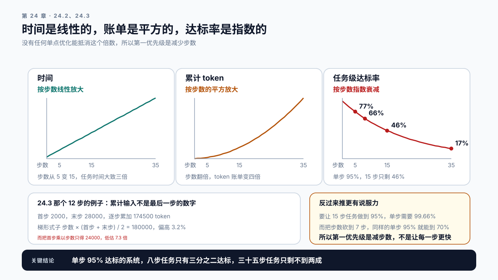
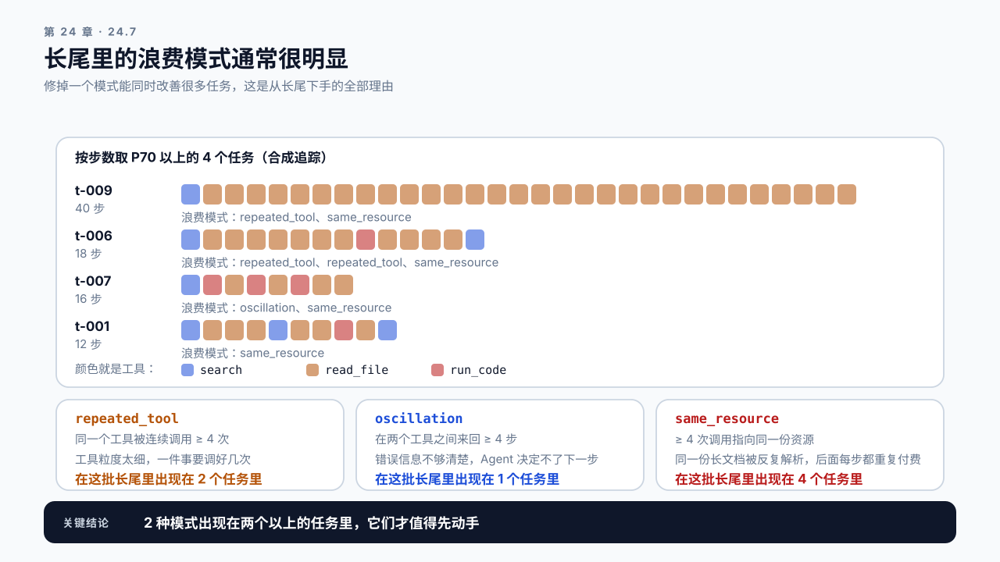

# 第 24 章 Agent 性能工程：一次任务，几十次调用

## 学习目标

读完这一章，你应该能回答三个问题：

1. Agent 任务的延迟和失败率，为什么是单次调用的几十倍，而不是几倍？
2. 上下文一路累积下去，成本是怎么增长的？
3. 一个多步任务里，该从哪一步开始优化？

跟着做完，你会得到一份 Agent 链路的成本与延迟档案：按任务而不是按调用统计，含步数分布、上下文增长曲线和工具等待占比。

## 24.1 单次调用的指标在这里不够用

> **编排层**（orchestration layer）：决定 Agent 下一步做什么的那一层，负责维护任务状态、拼装每一步的 prompt、发起模型调用和工具调用、判断任务该不该结束。
> 它自己不做推理也不做检索，但在第 25 章那张全链路预算表里它是独立的一层，因为串行等待和每一步的调度开销都记在它头上。

前面二十三章的指标体系是围绕一次调用建立的：TTFT、TPOT、E2E、吞吐。Agent 场景下这套指标会给出误导性的结论。

一个任务可能是这样的：

```text
第 1 步  理解任务，决定调用搜索工具        LLM 调用 + 工具
第 2 步  看搜索结果，决定读取某个文件      LLM 调用 + 工具
第 3 步  看文件内容，决定写代码            LLM 调用
第 4 步  运行测试，失败                    工具
第 5 步  看错误，修改代码                  LLM 调用
...
第 12 步 完成，输出结果                     LLM 调用
```

这张单子里有四个单位，一层套一层。任务是用户提交的那一件事；编排层每推进一次算一步，所以一步含一次模型调用、一次工具调用，或者两者都有；同一次模型输出里连着发出三个工具调用，那是三步，哪怕它们并发执行；一次模型调用就是第 2 章那条推理请求，中途重试时会对应好几条，图 2-2 画的正是任务、调用、请求这三层。所以步数不等于模型调用次数：上面十二步里，只有带“LLM 调用”的那几步占 GPU，第 4 步那样的纯工具步只占墙钟时间。**按步数估 GPU 占用，会把工具步也算成推理。**

**用户等的是这十二步全部完成。** 而每一步的 TTFT 都很正常，每一次调用的 E2E 都在 SLO 之内，监控面板上一片绿色。

所以 Agent 的指标要按任务重新定义：

| 单次调用指标 | 任务级对应 | 
|---|---|
| E2E 延迟 | 任务完成时间 |
| 输入 token | 任务累计输入 token |
| 输出 token | 任务累计输出 token |
| 成功率 | 任务成功率（含中途放弃） |
| （无对应） | 步数分布 |
| （无对应） | 工具等待占比 |

**后两项是 Agent 特有的，而且往往是最重要的两项。**

## 24.2 步数是最强的放大器

> **步数放大**（step amplification）：一个 Agent 任务的耗时、token 账单和失败概率都不是单次调用的数字，而是被步数放大之后的数字，且三者的放大倍数各不相同。
> 每步耗时相近时，时间按步数线性放大；累计 token 按步数的平方放大；每一步都必须成功的概率按步数指数衰减。这是本章的第一主张，后面每一节都在处理它的某个侧面。

任务时间大致是这样构成的：

```text
任务时间 ≈ Σ(每步的 LLM 时间 + 每步的工具时间)
```

步数从 5 变成 15，任务时间大致变成三倍。这是每步耗时相近时的数；上下文在逐步累积（24.3），后几步更慢，实际比三倍还多一些。**没有任何单点优化能抵消这个倍数。**所以 Agent 性能工程的第一优先级是减少步数，而不是让每一步更快。

**步数由什么决定？**

```text
任务本身的复杂度   不可压缩的部分
Agent 的规划能力   规划得好，少走弯路
工具的粒度         工具太细碎，一件事要调好几次
错误与重试         一次失败通常多花两三步
模型能力           弱模型更容易绕路
```

**中间三项是可以工程化改善的。**

工具粒度这一条常被忽略：如果一个“读文件”工具每次只能读 50 行，读一个 500 行的文件就要 10 步。把工具设计成一次返回完整内容，步数直接降一个数量级。

错误与重试这一条的影响也很大。一次工具调用失败，Agent 通常要多花两三步来理解错误、调整参数、重试。设每一步有 `q` 的概率失败，每次失败多花 `k` 步，期望步数约为 `N × (1 + q × k)`：12 步的任务、每步 10% 失败、每次多花 3 步，期望约 15.6 步，任务时间跟着多三成。**提升工具本身的可靠性和错误信息的清晰度，是一种性能优化。**

**步数的分布比平均值重要。** 平均 8 步、P95 是 35 步的系统，用户体验由那 35 步决定。要单独看长尾任务在做什么，通常能找到明显的浪费模式。

### 步数也放大失败概率

步数放大的不只是时间。设每一步成功的概率为 `p`，任务要 `N` 步全部成功，各步之间独立时，任务成功的概率是 `p` 的 `N` 次方。工具调用成功率、每一步都必须守住的格式校验，都是这种情形。

代入 `p = 0.95`：

```text
N = 5    0.95^5  ≈ 77%
N = 8    0.95^8  ≈ 66%    上面那个平均步数
N = 15   0.95^15 ≈ 46%
N = 35   0.95^35 ≈ 17%    上面那个 P95 步数
```

**单步 95% 成功的系统，八步任务只有三分之二成功，三十五步任务只剩不到两成。** 用户投诉的是任务，而看板上绿着的是单步，这是 Agent 系统里最容易出现的一次口径错位。

延迟要另算。拿“每一步都不超过各自的 P95”代进同一张表，算出来的是每一步都快的比例，不是任务总时长不超预算的比例，而用户关心的是后者。延迟那一侧要直接测任务总时长的分布（24.6）。



图24-1：步数放大三样东西，而三者的倍数各不相同。时间是线性的，累计 token 是平方的，任务级达标率是指数衰减的。

反过来推更有说服力。要让 15 步任务的成功率做到 95%，单步需要 `0.95^(1/15) ≈ 99.66%`。把单步从 95% 抬到 99.66% 通常比砍掉一半步数难得多，这是“先减步数”那条结论的另一个理由。

这条估算有两处会偏。一是各步并不真的独立。同一次拥塞会把相邻几步一起拖慢，也会让它们一起顺利，这种正相关让“每一步都达标”的比例比 `p^N` 更高：8 步、单步 95%，相关系数 0.3 时约 73%，0.6 时约 81%，都高于独立时的 66%。变重的是任务总时长的尾巴：几步一起慢，总时长的 P95 就被拉长。二是带重试的 Agent 可以用多花两三步换一次成功，任务整体仍然达标，这时达标应该按“任务在时限内完成”来定义，而不是按步累乘，见 24.6 节。

## 24.3 上下文的累积：成本按平方涨

第 12 章提过一句：Agent 的上下文是逐步累积的，成本必须按任务算而不是按调用算。这一节把它展开。

每一步的输入包含前面所有步骤的历史：

```text
第 1 步输入   系统提示 + 任务描述                    2000 token
第 2 步输入   上述 + 第1步的思考和工具结果           3500 token
第 3 步输入   上述 + 第2步的思考和工具结果           5800 token
...
第 12 步输入  上述 + 前 11 步全部                    28000 token
```

**总输入 token 是这些的累加，而不是最后一步的数字。**

```text
任务累计输入 = 2000 + 3500 + 5800 + ... + 28000 ≈ 175000 token
```

估这个数不必把每一步都列出来。只要有首步和末步，用 `步数 × (首步 + 末步) / 2` 就够了：`12 × (2000 + 28000) / 2 = 180000`，和逐步累加的 175000 差 3%。这是梯形估算，增长量完全均匀时它是精确值，增长量越到后面越大时它会略微偏高。下面案例二还要再用一次。这个式子也直接给出了增长的形状：末步本身随步数线性增长，再乘一遍步数，所以**累计输入大致按步数的平方增长，步数翻倍，token 账单变四倍。**

这解释了第 6 章那个案例：按单次调用估算 Agent 的成本，实际账单是估算的六倍多。

**延迟上的影响同样严重。** 第 11 章讲过 Prefill 的 Attention 部分随长度平方增长，而这里上下文本身又在增长，没有 Prefix Cache 时两个效应叠加：后面几步的 TTFT 会明显高于前面几步。

**几个可控的手段：**

```text
截断历史       只保留最近 N 步，丢弃更早的。风险是丢掉关键信息
摘要压缩       把早期步骤压成摘要。多一次模型调用，但能长期控制增长
工具结果裁剪   工具返回的大段内容只保留相关部分，这通常是最大的一块
结构化状态     用显式的状态对象代替自然语言历史，体积小得多
```

**第三项收益最大。** 一次搜索返回 20 条结果、一次文件读取返回整个文件，这些内容会永久留在上下文里，被后面每一步重复付费。只保留真正用到的部分，能大幅压平增长曲线。

**Prefix Cache 在这里有天然优势。** Agent 的上下文是追加式的：第 n 步的输入是第 n-1 步输入的延长。前缀完全匹配，命中率可以很高。命中时每一步只需 Prefill 新增的那一段，整个任务的 Prefill 总量就从累计输入降到约等于末步的输入：上面那个例子从 175000 token 降到约 28000，只剩六分之一，后几步的 TTFT 也不再随历史变长。这是 Agent 场景最大的一根杠杆。

前提有两条。一是历史部分不被改写：如果每一步都重新组织历史的措辞，前缀就对不上了，缓存全部失效。二是两步之间缓存没被挤掉：一次工具调用等了 30 秒，这段时间里别的请求可能已经把它的历史挤了出去，多副本时还要靠第 22 章的前缀亲和让下一步落回同一个实例。注意 token 账单不一定跟着降：API 按输入 token 计费时，命中的部分通常只是打折，不是免费。

## 24.4 工具等待：不在 GPU 上的那段时间

一个 Agent 任务里，模型调用可能只占总时间的一半甚至更少。

```text
LLM 调用     每步 1–3 秒
搜索工具     200 ms – 2 秒
文件读写     10 – 100 ms
代码执行     1 – 30 秒
外部 API     不可控
```

**代码执行和外部 API 是最大的不确定源。** 一次测试运行可能要 30 秒，这段时间 GPU 完全空闲，而任务时间照算。

三件可以做的事：

一、并行化独立的工具调用。如果 Agent 一步内决定了三个互不依赖的调用，应该并发执行而不是串行。这需要 Agent 框架支持，也需要模型能一次输出多个调用。

二、给工具设超时。一个卡住的工具调用会让整个任务挂起。超时要按工具分别设，代码执行和文件读取的合理阈值差两个数量级。

三、把慢工具变成异步。明确会很慢的操作（大规模数据处理、长时间构建），改成提交后轮询的模式，让 Agent 可以先做别的。这会增加步数，要权衡。

**观测上的要求：** 第 8 章那套追踪要覆盖工具调用，每个工具有自己的 Span。没有这个，工具等待这块时间在监控里是不存在的，你只会看到“任务很慢”。

## 24.5 并行与串行：Agent 特有的难点

RAG 的链路结构是固定的，哪些能并行一眼就能看出来。Agent 不是。

**Agent 的步骤序列是运行时决定的**，下一步做什么取决于上一步的结果。这意味着大部分步骤天然串行，无法提前并行化。

能并行的只有两类：

**一是同一次模型输出里发出的多个工具调用。** 模型在一次输出里给出多个互不依赖的调用，框架并发执行。按 24.1 的数法它们仍然各算一步，只是共用一段墙钟时间，所以这类并行压的是任务时长，不是步数。这是最主要的并行机会。

**二是可以拆成独立子任务的场景。** 比如“分析这 10 个文件”，可以拆成 10 个独立的子 Agent 并行跑，最后汇总。这需要任务本身有这个结构，且需要编排层支持。

**第二类要注意两个反效果。** 一是汇总要等最慢的那个子 Agent。按第 23.4 节那个扇出式子，10 个子任务各自有 95% 的机会在自己的 P95 之内完成，全部做到的机会只有 60%。

二是 10 个子 Agent 同时跑，就是 10 倍的并发压力打到模型服务上。第 20 章那个排队论的结论在这里生效：如果模型服务本来就跑在负载率 0.8 上，这一下可能把它推到饱和，结果是 10 个子任务各自都变慢，总时间未必比串行好。

**所以 Agent 的并行度要和模型服务的容量一起规划。** 编排层的并发上限应该从模型服务的余量反算，不能拍脑袋定一个数。按第 6 章的 Little's Law，一个子 Agent 每秒发出的请求数是“模型调用次数 ÷ 子任务时长”。**这里是调用次数，不是步数**：打到模型服务上的只有模型调用，24.1 刚说过按步数估会把纯工具步也算成推理。模型服务能让出来的请求速率是“(目标负载率 − 当前负载率) × 满载吞吐”。两者相除就是能同时跑几个子 Agent。满载 12 QPS、当前负载率 0.5、打算最多推到 0.7，能让出 2.4 QPS；一个子 Agent 60 秒发出 20 次模型调用，每秒 0.33 次请求，所以上限约 7 个。同样 60 秒、同样 20 步但只有 7 次模型调用的子 Agent（第 25.2 节那条链路的比例），上限是 20 个，差着近五倍。

## 24.6 任务级的 SLO 怎么定

单次调用的 SLO 在 Agent 场景下没有意义，因为用户感知的是任务。但任务级 SLO 有它自己的麻烦：**任务的复杂度差异极大**，简单任务 3 步、复杂任务 40 步，用一个阈值卡不住。

可行的做法是分层：

```text
按任务类型分类   不同类型定不同的目标
按步数归一化     每步平均时间作为指标，任务时间作为参考
定完成率而非时长 在 N 秒内完成的任务比例
```

**第三种最实用。** 它自然处理了复杂度差异：简单任务本来就该很快完成，复杂任务慢一点可以接受，指标关注的是整体分布。

还有两个 Agent 特有的指标要一起看：

**任务放弃率。** 用户在任务完成前主动终止的比例。这是体验的直接信号，比任何延迟指标都准。第 21 章讲过取消的资源回收，Agent 场景下一次放弃浪费的是整条链路的资源。

**步数超限率。** 达到最大步数限制仍未完成的比例。这个数字高，说明 Agent 在绕路，属于能力问题而非性能问题，但它消耗的是真金白银的算力。

## 24.7 Demo：Agent 任务档案

本章 Demo 位于 `code/ch24/agent_profile.py`，需要一个带追踪的 Agent 服务提供数据，分析本身离线。**它报的每一个数都是任务级的，一个都不是调用级的**，这是 24.1 那句话的直接后果。

```bash
python3 code/ch24/agent_profile.py profile \
  --traces agent-traces.jsonl \
  --output agent-profile.json
```

从追踪数据生成任务级档案：

```text
task_count          任务数
steps               步数分布：P50 / P90 / P99 / max
duration            任务时长分布
llm_time_share      LLM 调用占任务总时长的比例
tool_time_share     工具等待占比，按工具类型分解
context_growth      每步输入 token 的增长曲线
cumulative_tokens   任务累计输入与输出 token
prefix_hit_rate     各步的 Prefix Cache 命中率
abandon_rate        任务放弃率及放弃时的平均步数
step_limit_rate     步数超限率
model_calls         每任务的模型调用次数分布（均值 / P50 / P95）
unaccounted_time_share  未归属时间占比
```

**输出里有两项是刻意这样设计的。**

一是工具占比之外单列一项未归属时间。编排层开销、串行等待、追踪没覆盖到的部分都落在这里，不摊进 LLM 和工具那两项。让三项占比凑成 1 会正好盖掉这个缺口，而下一章 25.2 那张表里编排层那一栏，量的就是这个缺口（两条链路不同，样例那 18% 是照 25.2 设的，不是从它算出来的）。二是任务数少于二十个时输出会加一句提醒：十个任务的 P95 就是最大值，它反映的是那一个任务，不是一个分位数。

另外，步数和模型调用次数分两项报。第 26 章做容量规划时代进去的是**每个任务平均的模型调用次数**，不是步数：纯工具步不打到模型服务上。这两个数在这份合成样例里碰巧相等（每一步都有模型调用），真实链路上往往差好几倍。

配合一个长尾分析模式：

```bash
python3 code/ch24/agent_profile.py tail \
  --traces agent-traces.jsonl \
  --percentile 0.95
```

它挑出步数或时长在 P95 以上的任务，按判据降序输出它们的步骤序列，用来找重复的浪费模式：同一个工具被连续调用多次、在两个状态之间来回、大量步骤花在解析同一份长文档。三种模式的门槛都设在四次，因为连续两三次调同一个工具是正常的。

**这个模式是这一章最有用的工具。** 长尾任务里的浪费模式通常很明显，而且修掉一个模式能同时改善很多任务。



图24-2：长尾任务里的浪费模式。每一行是一个长尾任务的工具调用序列，连续的同色长串和两色交替的段落一眼就能看出来。

所以它最后报的不是模式清单，而是哪几种模式出现在两个以上的**任务**里：那几种才值得先动手。注意是按任务去重，同一个任务里同一种模式检出两次不算共享。样本小的时候要把 `--percentile` 调低，十个任务用 0.95 只会挑出一个，这时脚本会直接说“长尾里只有 1 个任务，看不出模式是否共享”，而不是说没有共享模式。

还有第三个子命令，对应 24.2 那张表：

```bash
python3 code/ch24/agent_profile.py step-slo \
  --step-pass-rate 0.95 --steps 15 --task-target 0.95
```

它打印 `0.95^N` 在 5 / 8 / 15 / 35 上的四个值，反推 15 步要做到 95% 需要的单步达标率 99.66%，并多给一行：步数砍一半到 7 步时任务级达标率是 69.8%。这一行是“先减步数”那条结论的量。**给了 `--retries-enabled` 它会直接拒绝**，因为 24.2 自己说过带重试的 Agent 不适用乘法模型，这时要按 24.6 的做法用完成率定义达标。在自己的服务上做一次真实数据采集：接一条真实 Agent 链路，采集至少二十个任务的追踪，跑出档案和长尾分析，并核对未归属那一项占了多少。

## 24.8 案例与常见误区

### 案例一：每次调用都很快，用户等了四分钟

合成设定：监控显示模型服务一切正常：P95 TTFT 480 ms，P95 E2E 3.2 秒，全部达标。

但用户投诉任务要等几分钟。做任务级统计才发现：P50 是 9 步，P95 是 41 步，而 P95 那批任务的总时长是 4 分多钟。

进一步看长尾任务的步骤序列，发现一个模式：文件读取工具每次只返回 100 行，读一个大文件要十几步。把工具改成一次返回完整内容后，P95 步数降到 16 步。

讨论：这个问题为什么在单次调用的监控里完全看不见？

### 案例二：token 账单是估算的六倍

第 6 章提过这个案例（那里标的是合成设定），这里给出完整的账。

估算方式是：平均每个任务 5 次调用，每次输入约 3000 token，所以每任务 15000 token。

实际是：平均 8 步（不是 5），且每步输入是累积的，第 8 步的输入已经到 20000 token。用 24.3 那个梯形式子：`8 × (3000 + 20000) / 2 = 92000 token`，是估算的 6.1 倍。

**两个错误叠加**：步数估少了，以及把累积增长当成了固定值。

后来加了工具结果裁剪，把搜索和文件读取的返回内容按相关性截断，累计输入降到 34000 token。

讨论：怎么在设计阶段就把这笔账估对？

### 案例三：并行子任务，整体更慢了

合成设定：一个批量分析任务被改成 12 个子 Agent 并行执行，期望时间降到十二分之一。

实测只快了 2.3 倍。原因是模型服务的容量撑不住 12 倍的瞬时并发，请求开始排队，每个子任务的每一步都变慢了。而且部分请求触发了抢占，ITL 出现大尖峰。

把并发度降到 4，反而比 12 快。因为 4 个并发没有让模型服务饱和。

讨论：用 24.5 那个反算，这个最优并发度需要哪几个数？哪个数最难拿到？

### 两个不写在档案里的误区

误区一：Agent 慢就去优化模型推理。模型调用可能只占任务时间的一半。步数、工具等待、上下文累积这三项的影响通常更大，而且它们的优化手段完全在推理服务之外。先做 24.7 那份档案，再决定往哪里投入。

误区二：上下文累积是必然的，没办法。大部分累积来自工具返回的原始内容，而其中真正被后续步骤用到的往往只是一小部分。裁剪工具结果通常能把累计 token 降掉一半上下（案例二是 63%），但要用评测集确认任务成功率没掉：24.3 说过截断有丢掉关键信息的风险，练习 6 做的就是这件事。性价比高，不等于免费。

## 本章总结

回到开头的三个问题。

**为什么是几十倍？** 因为用户等的是整个任务，而任务由多步构成：有的步是一次模型调用，有的步只是一次工具调用，还有的两者都有。单次调用的指标全部达标，任务仍然可能要几分钟，监控面板上却一片绿色。失败概率也按步数放大：单步 95% 时八步任务只剩三分之二能成，所以任务级 SLO 要按“N 秒内完成的比例”定，不能把单步达标率乘起来。所以 Agent 需要任务级指标：任务完成时间、累计 token、步数分布、工具等待占比，后两项是 Agent 特有的，也往往是最重要的。步数是最强的放大器，从 5 变 15 任务时间就是三倍，没有任何单点优化能抵消这个倍数。

**上下文成本怎么增长？** 每一步的输入包含前面所有历史，累计输入大致按步数的平方增长，步数翻倍账单变四倍。没有 Prefix Cache 时，延迟上还要叠加第 11 章那个 Attention 的平方项，后面几步的 TTFT 明显高于前面几步。可控手段里收益最大的是裁剪工具返回的内容，因为它会永久留在上下文里被后面每一步重复付费。Prefix Cache 在这里有天然优势：Agent 的上下文是追加式的，命中时整个任务的 Prefill 只剩约末步那么多，前提是历史部分不被改写、两步之间没被挤出缓存。

**从哪一步开始优化？** 先做任务级档案，看三个占比：LLM 时间、工具等待、上下文增长。然后看长尾任务的步骤序列，找重复的浪费模式，比如同一个工具被连续调用十几次。优先级通常是：减步数（改工具粒度、提升工具可靠性）、裁上下文（裁剪工具结果）、并行独立调用，最后才是优化单次推理。并行子任务时要注意，编排层的并发上限应该用 Little's Law 从模型服务的余量反算，否则会把服务推到饱和，结果比串行还慢；汇总还要等最慢的那一个。

下一章把 Part 5 的内容合到一条真实链路上：从调度参数到路由策略到 Agent 编排，在同一个 SLO 下做一次完整的优化。

### 本章 Checklist

- [ ] 监控里有任务级指标，不只是单次调用指标。
- [ ] 知道步数的 P50、P95 和最大值，以及每任务模型调用次数的均值（第 26 章代进容量链的是后者）。
- [ ] 追踪覆盖工具调用，每个工具有独立的 Span。
- [ ] 知道 LLM 时间和工具等待各占任务时长的多少。
- [ ] 画出过每步输入 token 的增长曲线。
- [ ] 算过任务累计输入 token，而不是按单次调用估。
- [ ] 检查过历史部分是否被逐步改写，导致 Prefix Cache 失效。
- [ ] 看过长尾任务的步骤序列，找出至少一个浪费模式。
- [ ] 编排层的并发上限是按模型服务容量定的，反算时用的是模型调用次数而不是步数。
- [ ] 用 `step-slo` 算过当前步数下的任务级达标率，任务级 SLO 按完成率定。

## 课后练习

1. 采集一批 Agent 任务的追踪，统计步数的 P50、P95 和最大值。
2. 算出 LLM 调用和工具等待各占任务总时长的比例。
3. 画出一个典型任务每步输入 token 的增长曲线，算出累计输入。
4. 把累计输入和“按单次调用乘以步数”的估算对比，看差多少。
5. 挑出 P95 以上的长尾任务，读它们的步骤序列，找出重复的浪费模式。
6. 裁剪一个工具的返回内容，重新统计累计 token 和任务成功率。
7. 检查各步的 Prefix Cache 命中率，如果偏低，查历史部分有没有被改写。
8. 按 24.5 的反算，从模型服务的满载吞吐、当前负载率和子任务的模型调用次数、时长算出编排层的并发上限，和当前配置对比；再用步数代一次，看差几倍。
