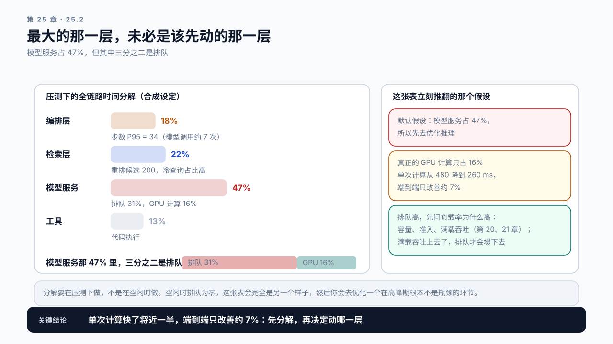
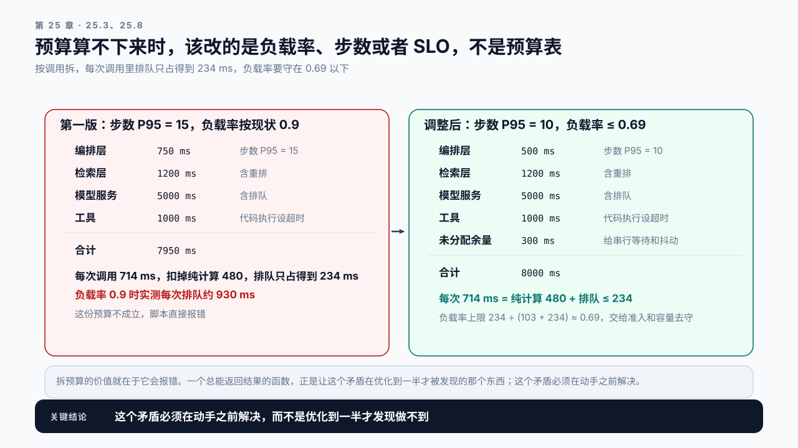

# 第 25 章 Serving 与 Agent 综合实验：在一条真实链路上守住 SLO

## 学习目标

读完这一章，你应该能回答三个问题：

1. 一条完整链路上有这么多可改的地方，该按什么顺序动手？
2. 不同层的优化互相影响时，怎么知道净效果是正还是负？
3. 优化做完了，怎么保证它下个月还有效？

跟着做完，你会产出本篇的交付物：一份端到端优化报告，覆盖从调度参数到路由到编排层的完整改动链，并附一份防回退的检查清单。

调度、流量治理、路由和应用编排共同影响一条链路。交互式助手需要控制用户等待时间；[夜间报告生成](#nightly-report-case)则要求在固定窗口内完成整批任务。两者都要先定义交付目标，再沿链路寻找限制。

## 25.1 从一个不达标的服务开始

实验的起点是一条真实的 RAG + Agent 链路，SLO 不达标。

```text
场景      企业知识库助手，支持多轮追问和文档分析
链路      编排层 → 改写 → 检索 → 重排 → 主模型（多步）
规模      3 个 vLLM 实例，轮询路由
现状      P95 任务完成时间 21 秒，目标 8 秒
          高峰期任务放弃率 12%
```

面对这个局面，常见的做法是从最熟悉的地方开始动手。而这一章要建立的是另一套顺序。

**动手之前先做三件事，一件都不能跳过。**

## 25.2 第一步：分层定位，不是分层优化

第 10 章那套根因分析在这里的对象是整条链路。

先按第 23 章和第 24 章的方法做分解，得到一张全链路时间表。模型服务那一栏里排队和计算的拆分不在这两章的交付物里，它来自第 8 章那套生命周期事件和第 20 章的 Queue 时间：

```text
层         占 P95 任务时长        主要构成
编排层     18%                    步数 P95 = 34，其中模型调用约 7 次
检索层     22%                    含改写、向量化、检索、重排；重排候选 200，冷查询占比高
                                  改写用的是小模型、走另一个端点，不计入那 7 次
模型服务   47%                    排队 31%，GPU 计算 16%
工具       13%                    代码执行
```

34 步里只有约 7 次是模型调用，其余是一次模型输出里连着发出、由编排层串行执行的细粒度工具调用，串行等待就从这里来。

**这张表立刻推翻了一个默认假设。** 模型服务占了 47%，但其中三分之二是排队，真正的 GPU 计算只占总时长的 16%，也就是 7 次调用、每次 480 ms。只把单次调用的计算缩短将近一半，端到端只改善约 7%（案例一）。

**排队占比高，先问负载率为什么高。** 第 9 章那三个问题在这里一样适用：到达变多了、服务变慢了，还是容量变小了。答案多半落在容量和准入上，这是第 20、21 章的内容。推理效率也能降排队，但前提是它提高的是满载吞吐，而不只是单次调用的延迟，案例一会算这笔账。



图25-1：分层定位，不是分层优化。最大的那一层是模型服务，但它三分之二是排队，真正的 GPU 计算只占总时长的 16%。

**分解要在压测下做，不是在空闲时做。** 空闲时排队为零，这张表会完全是另一个样子，然后你会去优化一个在高峰期根本不是瓶颈的环节。

## 25.3 第二步：把 SLO 拆到每一层

端到端目标 8 秒，要拆成各层的预算，否则每层都不知道自己该做到什么程度。编排层按步数拆，模型服务按模型调用次数拆。

```text
总预算        8000 ms
编排层         750 ms   步数降到 P95 = 15，每步编排开销 50 ms
检索层        1200 ms   含重排，按每任务平均 2 次检索
模型服务      5000 ms   含排队，P95 任务约 7 次模型调用
工具          1000 ms   代码执行设超时
```

**拆预算会立刻暴露不可能的目标。** 模型服务 5000 ms 分给 7 次调用，每次约 714 ms；扣掉 480 ms 的纯计算，留给排队的只有约 234 ms。而 25.2 量到的排队是 6.5 秒，分到每次调用约 930 ms，差了四倍。

排队这一项可以按第 20.6 节反推出它要求的负载率。现状负载率约 0.9，平均排队约 9 个 S，所以这条链路模型服务的 S 约 103 ms。这里把 P95 那类任务的每次排队当平均值代进了一条平均值的式子，所以 103 ms 是个等效值，只用来反推负载率上限这一个数；按 P95 口径一致地反推，上限是 0.668 而不是 0.69，结论不变。要把每次排队压到 234 ms 以内，`ρ/(1−ρ)` 不能超过 234 ÷ 103 ≈ 2.3，负载率要守在约 0.69 以下。

**其余三层也要这样对一遍，不能只核模型服务。** 编排层现状 34 步、3600 ms，每步约 106 ms，而预算按每步 50 ms 给：步数降到 10 步也要 1060 ms，比 500 ms 的预算多出一倍，所以这一层要么把每步开销压到 50 ms（编排改异步、去掉每步的同步落盘），要么预算得重写。检索层现状 4490 ms 对 1200 ms，六项改动里只有重排候选 200 → 60 动它，省约 400 ms，剩下的要靠缓存和冷查询比例，这一项在 25.4 的表里没有对应的改动，是这份预算最薄弱的一环。工具层 2100 ms 对 1000 ms，靠设超时压下去的部分会变成任务失败，要和任务成功率一起看。**一份只核了一层的预算，等于把另外三层的不可能推迟到实施阶段才发现。**

这说明两件事之一：**要么把负载率从 0.9 压到 0.69 以下，要么这个 SLO 定错了。** 这个矛盾必须在动手之前解决，而不是优化到一半才发现做不到。纯计算这一侧还有一条硬线：哪怕排队为零，`5000 ÷ 480 ≈ 10.4`，模型调用超过 10 次这份预算就放不下。

调整后的方案有两处。一是负载率守在 0.69 以下，这是交给准入和容量的目标，25.4 把准入排在第一位正是为了它，第 26 章按它配卡。二是步数降到 P95 = 10，编排层从 750 降到 500 ms。调整后的预算是这一份，**后面所有小节都用它，上面那份只是推导过程**：

```text
总预算        8000 ms
编排层         500 ms   步数 P95 = 10，每步编排开销 50 ms
检索层        1200 ms   含重排，按每任务平均 2 次检索
模型服务      5000 ms   含排队，7 次调用，每次 480 计算 + 不超过 234 排队
工具          1000 ms   代码执行设超时
未分配余量     300 ms   给串行等待和抖动
```

编排层从 750 降到 500，是因为步数少了：`10 × 50 = 500`。省下的 250 ms 加上第一版剩下的 50 ms，一共 300 ms 没有再分给别人，留作余量，理由和第 5.9 节那份预算表一样：余量是整条链路共用的一份，不该在纸面上分光。



图25-2：拆预算会立刻暴露不可能的目标。左边那一版按现状负载率 0.9，每次调用的排队约 930 ms，预算只给得出 234 ms，脚本直接报错；右边那一版把负载率守在 0.69 以下，排队放得进。

这张表是加法，而第 5.9 节说过，加法只对单个任务或平均值成立。这里每一层的数说的是一条 P95 那类任务的时间怎么分，验收只看整条链路的 P95 任务完成时间。不能拿各层自己的 P95 去对表，更不能相加：各层的 P95 来自不同的任务，加起来比整条链路的 P95 大。反过来，按各层均值拆完也不能直接当 P95 用：四层相互独立、各层的变异系数在 0.3 到 0.5 之间时，整条链路的 P95 约是均值之和的 1.4 到 1.6 倍，尾巴越重倍数越大（按这份预算的权重取对数正态做抽样：CV 0.3 是 1.37，0.5 是 1.64，0.8 到 2.0）。

**预算分配是一个业务决策，不是技术决策。** 它决定了哪一层要承担最多的改造工作，应该由能对整条链路负责的人来定。

## 25.4 第三步：排出顺序，按代价和影响面

有了定位和预算，才轮到排顺序。判据是两条：**改动代价和影响面**。

| 顺序 | 改动 | 代价 | 影响面 | 预期 |
|---|---|---|---|---|
| 1 | 启用准入控制 | 低，配置 | 保护全局 | 排队时间可控，放弃率下降 |
| 2 | 路由改为前缀亲和 | 低，配置 | 模型服务 | Prefix Cache 命中率回升 |
| 3 | 重排候选 200 → 60 | 低，参数 | 检索层 | 检索段减少约 400 ms |
| 4 | 裁剪工具返回内容 | 中，改代码 | 编排层 + 模型服务 | 上下文增长变缓 |
| 5 | 合并细粒度工具 | 中，改工具 | 编排层 | 步数 P95 从 34 降到 10 |
| 6 | 调度参数重调 | 低，但依赖前五项 | 模型服务 | 在新的负载形状下找 Goodput 峰值 |

准入排第一，因为它不依赖任何其他改动，且立刻止血。第 21 章讲过，没有准入的系统在高峰期会全员劣化，前面所有优化的余量都会被吃掉。

路由排第二，因为代价极低而收益可能很大。第 22 章那个案例里，一个轮询配置抵消掉了相当于几章的优化成果。

**调度参数排最后，因为它依赖前面所有改动。** 第 20 章说过参数之间有依赖，这里进一步：负载形状变了，Goodput 曲线也变了。前面五项改完之后，请求的长度分布、并发模式、缓存命中率全都不一样了，之前调好的参数不再是最优。

**一次只做一项，每项做完重测全链路。** 第 14 章那条纪律，在跨层场景下更重要，因为一层的改动会影响另一层的指标。

## 25.5 跨层的相互作用

这是综合实验和单层实验最大的区别：改一层会牵动另一层。

**裁剪工具结果 → 模型服务变轻。** 上下文短了，Prefill 计算量降、KV 占用降、并发上限升。所以第 4 项做完之后，模型服务的容量是变大的，第 6 项要在新容量下重调。

**步数下降 → 串行等待变少，模型调用不一定变少。** 这个场景里步数从 34 降到 10，被合并的是细粒度的工具调用，模型调用次数基本没变。所以编排层和工具那两段的串行等待大幅缩短，模型服务的请求速率却没怎么降，负载率不会自己降下来，0.69 那条线仍要靠准入和容量守住。别用步数之比去估模型服务的负载，请求速率按每个任务平均的模型调用次数算，用平均值而不是 P95。反过来，如果步数下降来自模型少走弯路（第 24.2 节），模型调用跟着少，负载率才会降：平均调用次数降到三分之一，负载率从 0.9 降到 0.3，按第 20.6 节排队从 9 个 S 降到约 0.43 个，只剩约二十分之一。这正是本篇两个式子在同一条链路上闭合的地方：步数是放大，负载率是排队。

**前缀亲和路由 → 负载分布变化。** 缓存命中率上去了，但实例之间的负载可能变得不均。这会影响准入阈值该设在哪里：按第 22.4 节，三个实例、不均衡度 0.3 时，最热那个实例的负载率最坏是平均值的约 1.35 倍，平均守在 0.69，最热的那个最坏到 0.93，排队约 13 个 S、1.35 秒，是 234 ms 排队预算的近六倍。所以 0.3 这条经验界在这条链路上不够用：22.4 说过它只在负载不高时成立。要让最热实例也守在 0.69，不均衡度得压到 `(0.69/ρ̄ − 1) × √3 / 2`，平均 0.6 时是 0.13。**准入要按实例做**，让最热那个自己把超出的部分拒掉，比把希望寄托在不均衡度上可靠。

**准入控制 → 放弃率与重试的连锁。** 拒绝一部分请求会让编排层看到更多错误。如果编排层有重试逻辑，第 21 章那个放大器就会启动。所以第 1 项和编排层的重试策略必须一起看，不能只改服务端。

**判断净效果是正是负的方法**，还是那一条：每改一项重测全链路的同一组指标。跨层时这组指标要包含每一层的关键数字，而不只是端到端的一个总时长。

## 25.6 综合记分卡

第 19 章那份五维记分卡在这里要扩展成全链路的版本：

| 维度 | 指标 | 来自 |
|---|---|---|
| 端到端 | P95 任务完成时间、任务成功率 | Ch24 |
| 质量 | 端到端评测集得分、结构化输出合格率 | Ch19/Ch23 |
| 用户放弃 | 任务放弃率及放弃时的步数 | Ch24 |
| 编排 | 步数 P50/P95、累计输入 token | Ch24 |
| 检索 | 各段耗时、冷热对照、三层缓存命中率 | Ch23 |
| 模型服务 | 排队时间、P95 ITL、Goodput | Ch19/Ch20 |
| 容量 | 槽位占用率、抢占计数、显存 | Ch16/Ch20 |
| 治理 | 拒绝率、超时分布、取消生效率 | Ch21 |
| 路由 | 各实例命中率、负载不均衡度、最差实例 | Ch22 |
| 成本 | 每任务 token 成本、单卡任务吞吐 | Ch12/Ch22 |

**十个维度看起来很多，但每一项都在前面某一章里被证明过是必要的。** 少任何一项，都对应着前面某个案例里犯过的错。质量必须自己占一行，不能挂在检索或端到端的子字段里：它是下面三项否决项之一，藏起来的否决项等于没有。

**其中三项是否决项：** 任务成功率下降、质量评测越线、抢占计数持续上升。这三项任何一项恶化，即使端到端时间改善了，也不能算成功。

## 25.7 防回退：优化怎么保住

优化做完之后，最容易发生的事是几个月后悄悄退回去。

常见的退化路径：

```text
知识库扩容      检索变慢，片段变长，TTFT 回升
框架升级        参数默认值变了，某条快速路径失效（第 18 章案例三）
新增实例        路由配置没同步，前缀亲和被打破
业务变更        新场景的 prompt 拼装顺序不对，Prefix Cache 归零
流量增长        负载率爬到饱和区，排队重新出现
```

**这些都不是有人故意改坏的，而是环境在变而检查没跟上。**

防回退需要三样东西：

一、把关键判据做成自动检查。不是监控告警，是能在部署流程里跑的断言。每条断言后面都要写清阈值是从哪里来的，否则半年后没人敢改它，也没人敢相信它：

```text
Prefix Cache 命中率 > 55%
  依据：这条链路的可缓存占比约 71%，前缀亲和后的路由命中约 0.9，
        天花板 0.71 × 0.9 ≈ 64%，门槛留约 9 个点的余量
prompt 拼装顺序：固定内容在最前
  依据：布尔判据。顺序一错，上面那个 71% 直接归零（第 13 章）
各实例负载不均衡度 ≤ 0.3
  依据：22.4 的经验界，但它只在负载不高时成立。这条链路平均要跑到 0.69，
        0.3 的不均衡会把最热实例推到 0.93（25.5），所以这条断言不是
        用来保证排队达标的，它只防路由配置失效；排队由每个实例自己的准入守
步数 P95 ≤ 10
  依据：25.3 那份预算按 10 步给编排层 500 ms，步数一涨编排层先超支，
        那 300 ms 余量就被吃掉。取闭区间：10 是预算的设计点，不是越线
框架实际走的 Attention kernel 名称在白名单内
  依据：布尔判据。第 18 章案例三的静默回退只有这一条能拦住
```

那个 71% 不是量出来的，是从链路结构推出来的，所以值得把推导留在这里。第 24 章说过 Agent 的上下文是追加式的：第 k 次模型调用的 prompt，就是第 k−1 次的 prompt 加上它的输出和中间那几次工具结果。所以每次调用里全新的只是上一次之后新增的那一段，把各次的全新部分加起来，正好等于最后一次调用的输入；而累计输入按 24.3 那个梯形式子约是 `调用次数 × 末次输入 ÷ 2`。两者相除，全新部分约占累计输入的 `2 ÷ 调用次数`，7 次就是约 29%，剩下约 71% 可缓存。**这也说明调用越多可缓存占比越高，Agent 场景天然适合 Prefix Cache。** 至于四刀式子里的另外两刀，局部性和未被淘汰的比例，在一个任务内部都接近 1，因为同一任务的相邻两次调用通常只隔几秒，前缀还在显存里。

这里的 71% 已经把首次写入扣掉了（每次调用全新的那一段就是它），所以后面那一刀要用**相对单实例**的折扣，不能直接拿 22.4 那个绝对的路由项来乘，否则首次写入被扣两遍。

路由命中那 0.9 来自第 22.8 节案例二，那里的长前缀也是会话级的：单实例 90%，按对话做带溢出的前缀亲和后回到约 80%，路由这一刀打了约 0.89 的折。这里取 0.9。不做亲和、三个实例轮询时也要这么折算。Agent 的上下文是追加式的，每次都比上次长一截，落到某台实例上只能命中上回在那台存下的那一截，直接按三实例随机落点模拟这条链路，命中率是单实例的约 0.6 倍，所以天花板约 `0.71 × 0.6 ≈ 43%`。不要直接套 22.4 那个路由项：它给的是绝对值（N = 3、k = 7 时 0.60），而且假设同一段前缀被反复复用，对追加式上下文偏乐观（按同一口径折成相对单实例是 0.70）。缓存吃紧时还要往下掉，到三分之一上下。

**最后一条断言尤其重要。** 第 18 章那个案例里，升级后静默回退到朴素实现，性能掉一半而没有任何报错。这类问题只有主动断言才能发现。

二、定期重跑 Baseline。第 7 章那份 Baseline 不是一次性的。知识库规模、模型版本、实例数量任一变化，都应该重跑并对比。

三、把边界写进文档并定期复核。第 14 章那四项边界（模型、负载、硬件、配置），加上这一章的链路结构，构成这次优化成立的全部前提。定期检查这些前提是否还成立，比事后排查为什么变慢便宜得多。

## 25.8 Demo：全链路实验

本章 Demo 位于 `code/ch25/e2e_experiment.py`，需要完整链路。

```bash
python3 code/ch25/e2e_experiment.py run \
  --orchestrator http://localhost:9100 \
  --tasks tasks.jsonl \
  --slo-budget budget.json \
  --variant admission-control \
  --expectation expect-admission.json \
  --output e2e-admission.json
```

报告结构：

```text
expectation     实验前写下的预期（Ch14 格式）
layer_breakdown 全链路时间分解，压测状态下采集
budget_check    各层实际耗时与预算的对照，标出超支的层
scorecard       十维记分卡
cross_layer     本次改动对其他层指标的影响
verdict         与预期对照的结论
boundary        模型、负载、硬件、配置、链路结构五项边界
```

另外三个子命令：

```bash
python3 code/ch25/e2e_experiment.py budget --slo 8000 --steps-p95 15 \
  --model-calls-p95 7 --service-time-ms 103 --rho 0.9
python3 code/ch25/e2e_experiment.py guard --config guard-rules.json
python3 code/ch25/e2e_experiment.py ceiling --calls 7 --route-hit 0.9 --threshold 0.55
```

`budget` 做 25.3 那件事：编排层按步数、模型服务按调用次数拆预算，在预算不可能达成时直接报错，而不是给出一份看起来合理的分配。上面那条命令**故意传的是现状负载率 0.9**，用来看它报错，报错信息里带着这份预算允许的负载率上限 0.69；传 `--rho 0.69` 和 `--steps-p95 10` 才会拿到那份可行的预算。不给调用次数时按每步一次调用算；纯计算一侧的上限 `5000 ÷ 480` 向下取整是 10 次，也会写进输出。

`guard` 跑 25.7 那五条断言，用于部署流程。它的退出码可以直接接进 CI。**每条断言必须写出 `basis`，没写就拒**，理由和 25.7 那段一样：没有依据的门禁半年后没人敢改，也没人敢相信。

`ceiling` 把那条命中率断言的依据算出来，而不是让你写上去：可缓存占比取 `1 − 2/调用次数`，乘上前缀亲和后的路由命中，得到天花板。门槛贴着或超过天花板时它以非零退出码返回并说明这条断言必然长期红着。三实例轮询时这一刀相对单实例约 0.6（25.7 那段模拟），缓存吃紧时往三分之一掉，天花板在 43% 到 24% 之间，55% 的门槛在那种配置下够不着，这个检查会当场说出来。

**三条硬性检查：**

`layer_breakdown` 必须标注采集时的负载水平，空闲状态下采集的分解会被标为不可用于决策。`cross_layer` 不可为空，跨层实验必须记录对其他层的影响。`boundary` 比第 14 章多一项链路结构，因为链路变了结论就不成立。

还有一条不是检查能表达的：**否决项是否决，不是投票。** 报告写着通过而三项否决项里有一项恶化，检查器直接拒（测试里那份写着通过的报告就是这么被拒掉的）。仓库里那对合成样例演示的是它的两种结局：一份对应 25.9 案例二本身，十维里只有两维改善，任务成功率和抢占计数双双恶化，结论写的是失败；另一份对应它修正之后那一轮，六维改善、否决项未越线。两份都还没走完 25.4 那六项改动，所以四层都还在超支：它们是过程中的两轮，不是终态。两份的采集条件（`collected_under_load`、`load_note`）和 `boundary` 逐字相同，否则对比不成立；`layer_breakdown` 里的占比不同，因为分解正是被改动的对象。

各层占比之和还要等于 1，各层实测之和还要和端到端 P95 对得上（差超过一成就报错），占比和实测也要互相印证。对不上时报错说的是“要么有一层漏了，要么某一段的时间被算了两遍”，后者在全链路追踪里比前者常见。在自己的链路上做一次综合实验，这是本篇的交付：按 25.4 的顺序做完六项改动，产出十维记分卡齐全的报告，并把 `guard` 接入部署流程。

## 25.9 案例与常见误区

### 案例一：优化了 GPU，端到端改善 7%

合成设定：团队接手这条链路后，直接开始优化推理：量化、调小批量、开投机解码，两周把单次调用的纯计算从 480 ms 降到 260 ms。端到端 P95 从 21 秒降到 19.5 秒，改善约 7%。

做完分层分解才发现，GPU 计算只占总时长的 16%，而排队占 31%。他们优化的是那 16% 里的将近一半：7 次调用各省 220 ms，约 1.5 秒。排队一点没动，因为他们缩短的是单次调用的延迟，满载吞吐没有跟着涨：投机解码要多算草稿，批量调小以后每秒完成的调用反而更少，负载率还在 0.9。

如果同样的 220 ms 来自满载吞吐的提升，结果会完全不同。第 10.5 节说过，排队段是 Amdahl 式子的例外：同样的卡每秒多完成 480/260 倍的调用，负载率从 0.9 降到约 0.49，S 也缩到约 56 ms，每次排队从约 930 ms 塌到约 50 ms。7 次调用省下约 6.1 秒，加上计算省的 1.5 秒，端到端能省约 36%。按 25.4 的顺序重做，前三项配置改动（准入、路由、重排候选）花了两天，端到端降到 13 秒。

讨论：什么样的流程能强制“先分解再优化”这一步发生？

### 案例二：改了三处，端到端反而变差

合成设定：团队同时做了三项改动：开准入、改路由、调批量。端到端 P95 从 21 秒涨到 24 秒。

拆开重做才找到原因：准入开始拒绝请求后，编排层的重试逻辑触发，实际负载上升；同时路由改成前缀亲和，热点实例的拒绝率更高，重试更集中。两者叠加形成了第 21 章那个放大器。单独开准入并同步关掉编排层的盲目重试之后，端到端降到 16 秒。

讨论：跨层改动时，怎么提前识别出这类连锁反应？

### 案例三：三个月后退回原样

合成设定：优化完成后端到端稳定在 7.8 秒，达标。三个月后回升到 15 秒。

排查发现三件事同时发生了：知识库扩了四倍导致检索变慢、新增了两个实例但路由配置没同步导致前缀亲和失效、一次框架升级让 Prefix Cache 的某个配置项默认值变了。

三件事单独看都不严重，叠加起来抵消了全部优化成果。而这三个月里没有任何告警触发，因为每一项都在告警阈值之内。

讨论：25.7 那五条断言里，哪几条能提前发现这三个问题？还缺哪条？

### 两个不写在报告里的误区

误区一：从自己最熟悉的层开始优化。案例一就是这么发生的。熟悉哪一层和哪一层是瓶颈之间没有关系。分层分解是为了对抗这个本能，而不是走个形式。

误区二：优化完成就是终点。环境在持续变化：知识库、模型版本、实例数量、流量规模、业务场景。每一项变化都可能让某条前提失效。没有自动断言和定期重跑 Baseline，优化成果的半衰期通常只有几个月。

<a id="nightly-report-case"></a>

## 25.10 业务案例：六小时生成 6000 份技术报告

用户订阅几个技术方向，系统收集这些方向的最新文章，生成日报或周报。报告在夜间处理，没有人在屏幕前等待首个 token，但第二天必须能读到结果。

这时，工程师面对的问题变成了：同样一组计算资源，能否在六小时内完成约定的报告清单？

### 25.10.1 交付单位是一份报告，不是一次模型调用

这项业务的已知条件如下。

| 项目 | 业务条件 |
|---|---|
| 用户规模 | 日活约 6000～10000，夜间目标为 6000 份报告 |
| 报告规模 | 每份包含 20、50、100、200 或 400 篇文章，五类占比待统计 |
| 聚合材料 | 每篇文章的摘要与关键词合计约 200 字 |
| 处理过程 | 逐篇提炼、分类与技术主题抽取、反思校验、按主题并行总结、报告组装 |
| 完成窗口 | 六小时，无交互式 TTFT、ITL 要求 |
| 模型与硬件 | 业务方使用 Qwen3.5-122B，16 张 Ascend 910B1 |
| 尚需记录 | 完整模型标识与版本、精度、节点拓扑、单卡内存、推理框架及插件版本、当前部署配置 |

这里记录的是真实业务需求，尚未获得该环境的端到端压测结果。6000 份是交付目标，不是已经验证的处理能力；后面的算式用于拆解需求，不代表硬件实测。

平均交付速度的要求是：

```text
6000 份 ÷ 6 小时 = 1000 份/小时
6 小时 = 21600 秒
```

这不要求每份报告在 3.6 秒内完成。多份报告可以重叠执行，单份耗时和全系统交付速度是两件事。验收要看截止时间前有多少份完整、合格的报告已经落库，而不是截取吞吐最高的几分钟乘以六小时。

“合格”需要在压测前约定：报告结构完整、摘要能追溯到文章、技术主题和总结通过约定的质量检查。漏掉文章、截断主题、反思失败后直接放行的报告，不能算作有效产出。相同报告的重试也不能重复计数。

### 25.10.2 先看清两次并行之间的依赖

报告生成之前，采集和解析服务持续同步文章，并处理图片、附件、视频字幕等材料。生成时先检查材料是否完整；缺失的材料要补齐，不能把它们当成已经准备好的输入。

六小时内需要承担哪些准备工作，必须写入实验边界。白天已经完成的解析可以作为夜间任务的前置条件；实际推迟到夜间的补解析、补摘要，则必须计入完成时间和资源消耗。业务流程中的“在线生成”是服务调用方式，并不表示用户必须交互式等待。

| 阶段 | 做什么 | 什么时候可以开始 | 模型调用口径 |
|---|---|---|---|
| 材料检查 | 检查文章与解析结果是否齐全，提交报告的文章列表 | 报告任务进入系统后 | 按实际实现记录，不默认计一次 LLM 调用 |
| 逐篇提炼 | 并行处理各篇文章，得到聚合所需摘要与关键词 | 对应文章材料就绪后 | 按实际需要生成或进一步提炼的文章数统计 |
| 全局聚合 | 读取本报告的全部摘要，分类并抽取技术主题与文章归属 | 本报告所需摘要全部就绪后 | 记录实际调用次数及完整输入长度 |
| 反思校验 | 检查主题划分与内容，必要时返回全局聚合 | 本轮聚合完成后 | 区分规则校验和 LLM 校验，记录回路次数 |
| 主题总结 | 对每个主题下的文章摘要并行生成总结 | 本报告主题划分通过校验后 | 按主题数统计，不等于文章数 |
| 报告组装 | 汇集主题结果，生成并保存最终报告 | 所需主题总结全部完成后 | 代码组装不计 LLM 调用；额外生成则另计 |

两次并行都只发生在依赖允许的范围内。主题划分还没完成，主题总结就没有确定的输入；同一报告中一篇文章提炼迟迟未完成，也可能挡住全局聚合。不能把所有阶段的耗时直接相加，也不能把所有调用都当成从一开始就可运行。

“每篇约 200 字”只说明聚合材料的规模，不说明逐篇提炼是否已经完成。业务中可能存在两种情况：夜间直接复用已有摘要；或者夜间仍然要读取全文、解析结果或已有摘要，调用模型进一步提炼。两种情况的计算量不同，必须从实际请求记录确认。

反思回路也需要核实。它是只记录问题，还是触发重新聚合？由规则完成，还是每轮调用模型？允许多少轮？这些差别都会改变任务数，流程图上的一条回箭头不能直接换算成固定的重试成本。

### 25.10.3 6000 份报告会产生多少工作

先做一个调用数核算。假设一次全局聚合调用一次模型、一次反思校验也调用一次模型，每个主题总结调用一次模型，并且暂不计网络失败导致的重试：

```text
单份报告的模型调用数 C = M + 2 × R + N + F

M：本报告需要执行的逐篇提炼调用数
R：聚合与反思的总轮数，首次通过时 R = 1
N：技术主题数
F：最终报告组装额外需要的模型调用数，纯代码组装时为 0
```

用一份 100 篇文章、10 个主题的报告检查这个口径：逐篇提炼全部需要执行，反思首次通过，最后用代码组装，调用数就是 `100 + 2 + 10 = 112`。如果 6000 份报告都符合这个假设，且没有跨报告复用，则共需 672000 次调用，折合六小时平均约 31.1 次/秒。

如果摘要在窗口开始前已全部准备好，不再提炼，同样的报告只剩 `2 + 10 = 12` 次调用，即 72000 次，平均约 3.33 次/秒。这里的 100 篇和 10 个主题只是核算条件，不是五类报告的实际平均值。若摘要生成仍占用同一个夜间窗口，就不能用第二个数字代表全系统工作量。

调用数还不足以估算性能。一次单篇提炼和一次 400 篇报告的全局聚合，输入规模可能相差很大。仅把摘要与关键词汇总，就有下面这些文字量：

| 报告文章数 | 按每篇 200 字估算的聚合材料 |
|---|---|
| 20 | 4000 字 |
| 50 | 10000 字 |
| 100 | 20000 字 |
| 200 | 40000 字 |
| 400 | 80000 字 |

这还不含系统提示词、标题、文章标识和格式要求。字数不等于 token 数，要用实际模型的 tokenizer 和聊天模板测量完整请求，并为输出留出空间。不能因为单篇摘要很短，就直接给全局聚合设置一个未经验证的上下文上限。

如果多个用户订阅到相同文章，文章引用次数也不等于独立提炼任务数。只有输入内容、模型、提示词、参数及权限范围一致，且摘要不依赖用户或报告上下文时，才可以复用同一份结果。并发遇到同一任务时也应合并计算，避免同时生成多份相同摘要。反过来，每份报告的主题划分依赖自己的文章集合，不能因为有几篇文章相同就直接复用另一份报告的分类。

### 25.10.4 五类报告混合提交，但不拼成一个 Prompt

如果先跑完所有 20 篇报告，再处理 50 篇，直到最后才处理 400 篇，大报告会集中在窗口尾部。此时系统即使已经交付了很多小报告，也可能来不及完成剩余清单。

可以让五类报告共用模型服务，向一个统一管理的就绪队列提交独立子任务。某份报告处于什么阶段，只决定它当前可以提交什么请求，不要求其他报告与它同步推进。

| 同时就绪的请求 | 所属报告 | 实际输入 |
|---|---|---|
| A 的全局聚合 | 20 篇 | A 的全部文章摘要 |
| B 的单篇提炼 | 400 篇 | B 中某一篇文章的材料 |
| C 的主题总结 | 100 篇 | C 中某个主题的文章摘要 |

这三条请求可以并发发送，但不能拼进同一个 Prompt。每条请求保留 `report_id`、`task_id`、阶段、输入版本与尝试次数；模型返回后，编排层按标识归还结果并释放后续任务。日志或 Trace 保存这些标识，聚合监控按阶段和报告规模统计。

“400 篇报告”是业务分类，不是这份报告中每个请求的长度分类。控制长输入时，应看每条完整请求的实际 token 数，而不是仅看它属于哪类报告。

这里还有两种不同的混合：五类报告共享服务，是业务任务混合；Prefill 和 Decode 在同一模型实例中执行，是 PD 混部。前者不要求把不同报告的文本放到一起，后者也不要求每个批次都包含五种报告。

批次由引擎组织。vLLM 的 Chunked Prefill 可以把长输入的 Prefill 分块，并与 Decode 请求一起调度；实际 Ascend 部署是否支持并启用这条路径，要核对所用版本与运行配置。`max_num_batched_tokens` 是调度步的 token 预算，不是所有运行请求的 KV Cache 总量上限，分块也不等于缩短完整上下文。[vLLM 调优文档](https://docs.vllm.ai/en/latest/configuration/optimization/#chunked-prefill)

非流式响应同样可以并发提交。后台工作进程异步等待多个独立请求的完整结果即可，不必为了增加并发引入面向用户的逐 token 展示。

### 25.10.5 队列里有任务，不等于全部送进模型

五类任务放在一起后，首先要防止两个极端：一份大报告释放大量子任务，独占整个提交窗口；或者为了提高每小时完成数，一直优先短任务，让大报告始终得不到处理。

业务层至少要分别管理三个限制。

| 限制 | 解决什么问题 | 怎么判断是否需要调整 |
|---|---|---|
| 全局在途请求数 | 防止编排层无限向模型服务堆积请求 | 看就绪积压、服务端排队、有效报告吞吐和错误 |
| 单份报告的在途子任务数 | 防止一次并行展开占满提交额度 | 看其他报告的等待时间和各类完成进度 |
| 长输入请求的准入额度 | 防止多个全局聚合同时推高内存压力 | 联合观察输入长度、KV Cache、抢占与重算 |

阈值需要通过实际负载扫描确定，不能直接从 16 张卡推导出一个固定并发数。队列中尚未获准提交的任务保留在持久化存储中，不应因为模型服务暂时繁忙就把它们标记为业务失败。

调度可以从跨报告轮转开始，再根据各类剩余工作、已等待时间和截止时间调整优先级。大报告不能等到小报告全部完成才开始；等待过久的任务也需要获得执行机会。是否为某类预留额度，要通过混合压测验证，而不是预设所有类别必须平均分配资源。

每个子任务单独保存结果。一个主题总结失败，只重试这个主题，不重跑已经完成的文章提炼和其他主题。网络失败重试、反思重新聚合是两种不同的额外工作，需要分别计数，并设置有限的尝试次数与截止时间。达到上限后保留失败状态，不能靠无限重试掩盖质量或容量问题。

### 25.10.6 从 PD 混部基线开始，什么证据才值得改架构

基线可以沿用现有能够稳定处理目标模型和最长请求的 PD 混部部署，先不改变模型、精度和并行方式。把任务清单、阶段记录、结果持久化和有限并发补齐，才能判断服务是在等待任务，还是已经被计算、内存或通信限制。

16 张卡并不自动意味着“两台机器、每台八卡”，也不能仅凭卡数认定两个 TP8 副本一定更快。节点拓扑、内存余量和软件支持确认后，再把多副本或其他并行配置作为对照实验；它们不是本案例的既定最优配置。

优化顺序由观察到的问题决定。

| 观察到的问题 | 优先验证的改动 | 同时检查的代价 |
|---|---|---|
| 同一篇文章被多个报告反复提炼 | 复用符合条件的文章级结果，合并重复的在途任务 | 版本失效、个性化语义与权限隔离 |
| 就绪队列有任务，模型却经常空闲 | 检查编排与连接开销，逐步增加全局提交并发 | 排队、内存压力和失败率是否上升 |
| 大量全局聚合同时进入后抢占增加 | 限制长输入在途量，对照测试调度 token 预算 | 聚合等待是否拖慢报告整体完成 |
| 主题总结已完成很多，报告却交付很少 | 查找被最慢子任务、反思回路或结果组装卡住的报告 | 不得通过跳过必需阶段提高完成数 |
| 长输入超过服务实际支持的上下文 | 先去除重复材料；必要时比较分层聚合方案 | 主题遗漏、跨组信息丢失和额外调用 |

文章级结果缓存直接避免一次生成，与只复用相同前缀计算的 Prefix Cache 不是同一层缓存。若把文章提炼提前到白天执行，应确认白天有可用资源，并分别报告夜间交付能力和包含白天预处理的总成本。

本业务没有严格的交互式 TTFT、ITL 目标，因此不需要为了首 token 体验直接引入 PD 分离。但这不等于离线业务永远不适合 PD 分离。如果测量证明 P/D 资源配比失衡或相互干扰限制了有效吞吐，且分离后的收益足以覆盖 KV 传输、额外资源和调度复杂度，它仍然可以进入候选方案。判断依据是同等资源与质量约束下的报告交付量，而不是“大模型加长输入”这一组标签。

### 25.10.7 看 KV Cache，但不要把占满当成目标

报告完成数是业务结果，模型请求与资源指标用于解释结果。监控表需要同时保留这两层。

| 指标 | 统计口径 | 回答的问题 |
|---|---|---|
| Reports/hour | 单位时间新增完成且合格的报告数，按报告标识去重 | 实际交付速度是多少 |
| 截止时间完成率 | 六小时内合格报告数 ÷ 计划报告数，同时按五类分别计算 | 是否完成整份任务清单，而非只完成小报告 |
| 阶段吞吐 | 各阶段完成的模型请求数/秒，重试尝试与逻辑任务分别计数 | 工作消耗在哪一段 |
| Input / Output tokens/s | 固定窗口内实际请求的输入、生成 token 数，按阶段记录 | 请求数量相同，工作量是否变化 |
| 积压与等待 | 各阶段、各报告规模的就绪任务数、未满足依赖数和等待时间 | 是供给不足、依赖卡住，还是服务处理不过来 |
| KV Cache 与内存 | 各模型实例的 KV 池占用、可用容量及整体设备内存 | 并发是否接近缓存或其他状态的容量约束 |
| 抢占、重算、重试 | 观察窗口内的增量、发生率与额外耗费 | 算力是否花在重复工作上 |
| 质量与成本 | 主题覆盖、来源对应、合格率及每份合格报告成本 | 提速是否以丢信息或增加总成本为代价 |

“Batch throughput”没有独立且统一的计量单位。如果用它指整个服务的吞吐，必须进一步注明是请求/秒、输入 token/秒还是输出 token/秒；如果用报告/小时，它就与 Reports/hour 是同一口径。请求吞吐变高，不一定表示报告交付变快。

以 vLLM 为例，`vllm:kv_cache_usage_perc` 表示已使用 KV Cache 块的比例，取值为 0～1。它不是整张卡的内存使用率，也不是 Prefix Cache 命中率。实际部署须核对指标名称和含义，不能把其他版本缺失的字段填成 0。[vLLM 指标说明](https://docs.vllm.ai/en/latest/design/metrics/#v1-metrics)

KV Cache 占用高但吞吐稳定、没有明显抢占，不一定需要降低并发。占用持续接近容量边界，同时抢占重算增多、每小时报告数下降，才形成了更有力的缓存压力证据。反过来，占用低也不代表还可以无限加请求：计算、通信、编排供给或其他运行状态都可能先成为限制。设备利用率要一起看，但单个利用率百分比不能直接判定根因。

如果所用模型确认是官方 `Qwen/Qwen3.5-122B-A10B`，还要注意它采用 Gated DeltaNet 与 Attention 的混合结构，不能把全注意力模型逐层 KV 增长公式直接套到全部层上。应核对实际实现中的 KV 池和其他状态内存，再分析并发容量。[Qwen 官方模型说明](https://huggingface.co/Qwen/Qwen3.5-122B-A10B#model-overview)

输入 token 统计也要区分“请求携带多少 token”和“引擎实际重新计算多少 token”。Prefix Cache 和抢占重算会改变两者的关系，不能仅凭客户端的输入量推导 Prefill 算力利用率。

### 25.10.8 先分别测五类，再验证真实混合负载

第一轮从五类中分别抽取真实报告，覆盖不同内容和主题数，跑通完整流程。保留每阶段的输入/输出 token、等待与执行时间、反思轮数和质量结果。目的是找出哪类报告在哪个阶段变重，不是先给 16 张卡定一个吞吐结论。

第二轮逐步增加并发。在相同报告集、模型、提示词、生成参数和缓存条件下，每轮只改变一个并发或调度设置。除了总体完成数，还要看是否增加了某类积压、某个阶段的长尾或失败重试。若改变了结果缓存策略，应单独列为实验变量，记录命中与未命中任务，不能把预先填满缓存的结果当成冷启动能力。

第三轮按五类真实占比回放整批业务，并保留原有依赖。不要把每类都设成 20%，也不要把所有模型子任务预先展开成互不依赖的压测请求。那样测到的是引擎接收现成请求的能力，不是报告系统生成下一批任务并完成交付的能力。

混合后的长短任务有可能提高利用率，也可能互相干扰；必须测量，不能预先认定混合一定更快。若比较混合调度和分批调度，两者应使用同一份报告清单、资源预算及质量标准。

最终的六小时验收从约定的窗口起点开始，覆盖当晚实际发生的准备工作、流水线填充、重试、最后一批长尾和结果落库。另行记录稳定运行段的吞吐，便于诊断，但不能用它替代完整窗口的验收。

| 验收项 | 当前状态 |
|---|---|
| 五类报告的数量、占比、真实内容与主题数分布 | 待统计 |
| 模型、精度、框架及插件版本、16 卡拓扑与部署配置 | 待记录 |
| 逐篇提炼的真实输入、复用比例、反思回路规则 | 待核实 |
| PD 混部基线及五类分阶段结果 | 待实测 |
| 混合负载的六小时有效完成数与分类型完成率 | 待实测 |
| 优化前后质量、成本、抢占重算和重试对照 | 待实测 |

仅凭模型名称和卡数，还不能判断六小时是否能完成 6000 份报告。第一份有用的交付物，是五类真实报告的阶段记录和任务清单；在这份基线上，才能解释某个改动为什么增加了有效产出，以及收益在哪些条件下成立。

讨论：如果总体 Reports/hour 上升，而 400 篇报告的完成率下降，这次调度改动是否达标？如果模型输出 token/秒上升，却主要来自反思重试，应该怎样判断？如果逐篇提炼已在白天完成，夜间报告和全日成本分别该如何记账？

## 本章总结

回到开头的三个问题。

**按什么顺序动手？** 先做三件事：压测状态下的分层时间分解、把 SLO 拆成各层预算、按代价和影响面排序。分解会推翻默认假设，比如 GPU 计算可能只占总时长的 16% 而排队占 31%；拆预算会暴露不可能的目标，比如每次调用留给排队的只有 234 ms，负载率必须从 0.9 守到 0.69 以下，这个矛盾必须在动手前解决而不是优化到一半才发现。排序的判据是改动代价和影响面：准入排第一因为它不依赖别的且立刻止血，路由排第二因为代价极低收益可能很大，调度参数排最后因为前面所有改动都会改变它的最优值。

**怎么知道净效果是正是负？** 每改一项重测全链路的十维记分卡，而不只是端到端总时长。跨层的相互作用是可预期的：裁剪上下文会让模型服务容量变大；步数下降会减少串行等待，但只有模型调用跟着变少时负载率才会降；前缀亲和会改变负载分布，最热实例的负载率比平均高；准入会和编排层的重试逻辑连锁。其中最后一条最危险，案例二里它让端到端不降反升。十维里有三项是否决项：任务成功率、质量评测、抢占计数，各自占一行，不藏在别的维度里。

**怎么保证下个月还有效？** 把关键判据做成能在部署流程里跑的自动断言，而不是只配监控告警，尤其是 Attention kernel 名称白名单这类只有主动断言才能发现的静默回退。定期重跑 Baseline，知识库规模、模型版本、实例数量任一变化都要重跑。把五项边界写进文档并定期复核。案例三里三个月的退化，每一项都在告警阈值之内，靠告警发现不了。

夜间报告案例把 SLO 换成了交付截止时间：五类报告共享模型服务，但各阶段保持独立请求和正确依赖；以合格报告的完成量验收，用阶段吞吐、KV Cache、抢占和重试解释变化。单请求更快、缓存占得更多或某段 token 吞吐更高，都不能单独证明六小时的交付目标已经达成。

资源预算和单位交付成本还需要与容量规划结合，具体见第 26 章的容量、显存与成本模型。

### 本章 Checklist

- [ ] 有一张压测状态下采集的全链路时间分解表。
- [ ] 知道排队时间占模型服务耗时的比例。
- [ ] SLO 已拆成各层预算，且每层预算都被确认过可达成。
- [ ] 模型服务的预算按调用次数拆过，并按第 20.6 节反推出它要求的负载率上限。
- [ ] 改动顺序按代价和影响面排过，准入和路由排在前面。
- [ ] 每项改动都单独做、单独测，记录了对其他层的影响。
- [ ] 十维记分卡齐全，三项否决项都有数据。
- [ ] 准入策略和编排层的重试逻辑一起检查过。
- [ ] 关键判据做成了能在部署流程里跑的自动断言。
- [ ] 报告里写明了五项边界，包含链路结构。
- [ ] 对夜间任务，能区分报告数、文章引用数、独立提炼任务数和模型调用数。
- [ ] 混合压测保留了五类真实占比、阶段依赖、缓存条件及失败重试。
- [ ] 六小时验收统计合格报告，并同时检查各类完成率、KV Cache 和重复工作消耗。

## 课后练习

1. 在压测状态下做全链路时间分解，标出每层占比和采集时的负载水平。
2. 算出模型服务耗时里排队和计算各占多少，据此判断该优化哪一层；再按 20.6 反推出排队预算要求的负载率上限。
3. 把你的端到端 SLO 拆成各层预算，检查有没有不可能达成的层。
4. 按代价和影响面排出改动顺序，说明每一项排在这个位置的理由。
5. 只改准入一项，重测全链路十维指标，记录对其他层的影响。
6. 检查编排层的重试策略，判断它在准入开启后会不会形成放大器。
7. 写出至少五条能在部署流程里自动跑的断言，并实现其中两条。
8. 列出这次优化成立的五项边界，为每一项写出“什么变化时需要重新验证”。
9. 从五类夜间报告各抽取真实样本，记录完整请求的 token 数和阶段调用次数，指出仅凭文章数无法估算的工作。
10. 为 6000 份报告制定混合压测清单，写明准备工作的计时边界、长输入准入方式、各类完成率与质量验收条件。
