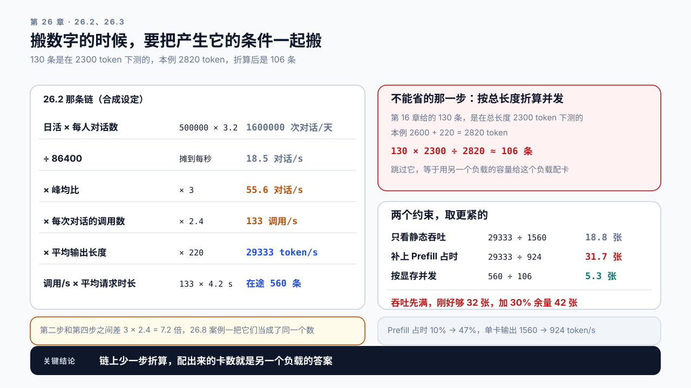
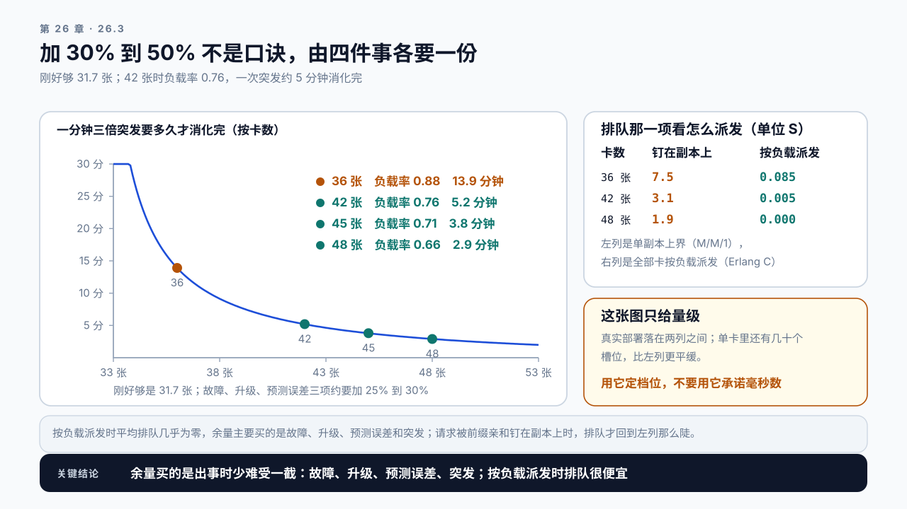

# 第 26 章 容量、显存与成本模型：这套系统该配多少，花多少钱

## 学习目标

读完这一章，你应该能回答三个问题：

1. 给定业务量，需要多少张卡？
2. 一次调用到底花了多少钱，一个用户一个月花多少钱？
3. 成本降不下来时，该动哪个数字？

跟着做完，你会得到一份容量与成本模型：从业务指标推到卡数和月度账单，并能回答“流量涨三倍要加多少钱”。

## 26.1 一个答不上来的问题

前五篇都在让系统更快。现在换一个人来问：

```text
"明年用户量翻五倍，预算要报多少？"
```

这个问题答不上来，前面所有的优化都很难被认可。因为它不是技术问题的延伸，而是另一条推理链：从业务指标推到资源，再推到钱。

**而这条链的每一环，前面几章其实都已经建好了：**

```text
业务指标  →  请求速率        第 6 章的 workload 描述
请求速率  →  token 速率      第 12 章和第 24 章的上下文账
token 速率 → 卡数            第 16 章的容量表 + 第 19 章的 Goodput
卡数      →  月度成本        第 22 章的成本对比
```

这一章要做的是把这四段接起来，并且让它能回答假设性问题。

## 26.2 从业务指标推到 token 速率

第一段是把产品口径翻译成技术口径。

产品方通常给的是这类数字：日活、月活、人均使用次数。要转成请求速率，中间有几处容易出错。

```text
日活 50 万
人均每天对话 3.2 轮
  → 日对话量 160 万
  → 平均对话速率 = 160万 / 86400 ≈ 18.5 次/秒
```

**但平均 QPS 不能用来做容量规划。** 三个原因：

一、流量不均匀。日内波峰通常是平均值的 2 到 4 倍。容量按峰值配，账单也按峰值配置出。这个倍数是这一步最重要的输入，它直接决定了自建方案里有多少卡在波谷期闲着。

> **峰均比**（peak-to-mean ratio）：峰值 QPS 除以全天平均 QPS。它和第 22 章的峰谷比（峰值除以波谷）是两个数，换算是 `峰均比 = 峰谷比 × 波谷 ÷ 日均`。第 22 章那份负载峰谷比 11.25、峰均比约 3.2；把 11.25 当峰均比代进下面的链，卡数会变成正确值的三倍多。

二、一次“对话”不等于一次请求。RAG 链路一次对话可能包含改写和生成两次 LLM 调用（检索和重排走别的模型或服务，不占这池卡）；Agent 任务一次可能是几十次。第 24 章那条纪律在这里生效：按任务算账，不按调用算账，而代进来的是**模型调用次数**，不是步数：纯工具步不打到这池卡上。

三、真正决定资源的是 token 速率，不是请求速率。一个 8000 token 的请求和一个 300 token 的请求对系统的压力差几十倍。

所以要推到 token 速率：

```text
峰值调用速率 = 18.5 × 3（峰均比）× 2.4（每轮对话的模型调用数，合成设定，
               实际取第 24 章任务档案里的 model_calls 均值） ≈ 133 次/秒
               有重试时还要乘第 21.5 节那个重试放大，卡数按推理请求算
峰值输入 token/s = 133 × 平均输入长度 2600 ≈ 346000
峰值输出 token/s = 133 × 平均输出长度 220 ≈ 29000
```

输入和输出要分开算，因为它们消耗的是不同资源：输入吃 Prefill 的算力，输出吃 Decode 的带宽和时间。计价上也通常不同价。

## 26.3 从 token 速率推到卡数

第二段用第 16 章和第 19 章的结果。

单卡能承载多少，取决于两个约束，取更紧的那个：

```text
显存约束   单卡并发上限 = KV 预算 ÷ 每条请求的平均 KV 占用    （第 16 章）
吞吐约束   单卡 token 吞吐 = 批量 × 每 token 时间的倒数        （第 19 章的 Goodput 峰值）
```

两个约束哪个更紧，取决于负载形状。

```text
总长度大到 KV 允许的并发低于实际批量   显存先满
（参考卡上约 1 万 token 以上）
其余情况                              吞吐先满
```

判的是总长度，不是输入输出比。决定显存那一侧的是 KV 允许同时放下几条，决定吞吐那一侧的是批量；两者在同一把尺子上比，谁先到顶谁是约束。输入长本身不让显存先满，它推高的是 Prefill 占时，那在吞吐那一侧（下面那一节算的就是它）。

两个数都要从前面章节搬过来，而**搬数字的时候必须把产生它的条件一起搬**。

```text
单卡输出吞吐   第 19.3 节批量扫描表：批量 32 处吞吐 1592 token/s、达标率 98%，
               Goodput 1592 × 0.98 ≈ 1560 token/s
               那是第 19 章那份负载上量的：prompt P50 600、输出 P50 400，
               而且是在那一组 SLO 下筛出来的（TTFT ≤ 1500 ms、单条 P95 ITL
               ≤ 80 ms、达标率 ≥ 95%）。SLO 一收紧，峰值批量和这个数都要重取
单卡并发上限   第 16 章那张容量表第 9 步：130 条
               但那是按平均总长度 2300 token 算的（prompt 2000 + 输出 300）
               本例是 2600 + 220 = 2820 token，按同一张表折算：130 × 2300 ÷ 2820 ≈ 106 条
```

第二行那个折算不能省。第 16 章那张表的第 7 步就是按平均总长度切分的，换了负载画像还用原来的条数，等于用另一个负载的容量给这个负载配卡。29.8 案例一整个就是在讲这件事。

```text
按输出吞吐   29000 ÷ 1560 ≈ 19 张
按并发       峰值在途请求数 = QPS × 平均请求时长 = 133 × 4.2 ≈ 559
             559 ÷ 106 ≈ 6 张
```

4.2 秒是合成设定，真机上要用高峰期的实测值，而且它要和单卡吞吐成对取：吞吐是在某个批量下量的，平均时长按 Little's Law 反推出的每卡在途数要和那个批量对得上，对不上就说明这两个数来自两种状态，得换成同一次压测里的一对。

取更紧的：19 张，吞吐先满。两个约束也可以放到同一把尺子上比：一张卡每秒完成 1560 ÷ 220 ≈ 7.1 次调用，按 Little's Law 乘上 4.2 秒，吞吐允许每卡同时在途约 30 条，和第 19 章量 1560 时那个批量 32 对得上；而显存允许 106 条，吞吐那一侧先到顶。但这个 19 张还不能用，因为 1560 是从另一份负载上搬过来的，搬的时候漏了一个条件。

### 漏掉的那个条件：单卡的一秒钟怎么分

上面两个约束都是静态的：显存那一侧问一张卡能装下多少，吞吐那一侧问它能产出多少。两者都没有问单卡的一秒钟是怎么分的。

一张卡的时间要分给两件事：给新到的请求做 Prefill，给在途的请求做 Decode。两者抢的是同一块算力。

```text
单卡输出吞吐 = 纯 Decode 吞吐 × (1 − Prefill 占时)
```

第 19 章那个 1560 已经含了它自己那份 Prefill 开销，因为那是一次完整的服务压测，不是只跑 Decode。可那份负载的输入输出比约 1.5，本例是 2600 ÷ 220 ≈ 11.8，同一张卡要花多得多的时间做 Prefill。占时怎么换算，要回到一条请求占卡的时间：

```text
占卡时间 = 输入 ÷ Prefill 速率 + 输出 ÷ Decode 速率
Prefill 占时 ÷ (1 − Prefill 占时) = (输入 ÷ 输出) × (Decode 速率 ÷ Prefill 速率)
```

随输入输出比成正比变化的是 `占时 ÷ (1 − 占时)`，不是占时本身。

**式子里的输入要按未命中的那部分算。** 开了 Prefix Cache 之后，命中的前缀不再重算，真正进 Prefill 的只有未命中的那一截；拿完整输入长度代进去会把 Prefill 占时算高，卡数跟着多配。Part 5 那份清单里要的“当前路由策略下的实测命中率”，用在的就是这一步，本例按全不命中算。

第 19 章那份负载的描述里给了这个占时：批量 32 时 Prefill 约占单卡忙碌时间的 10%。这是卡时口径：一个采样窗口里，含 Prefill token 的那些引擎步耗时之和，除以同一窗口的总忙碌时间（合成设定，按第 9 章那套步级观测量）。它和第 23.7 节那种单条请求的墙钟分段不是一回事：那里的 TTFT 占比里含排队，而 generate 那一段里这张卡同时在给几十条请求做 Decode，两种口径能差近十倍。

```text
第 19 章那份负载   占时 10%   10% ÷ 90% ≈ 0.111
本例               0.111 × 11.8 ÷ 1.5 ≈ 0.875   占时 ≈ 0.875 ÷ 1.875 ≈ 47%
纯 Decode 吞吐     1560 ÷ 0.9 ≈ 1733 token/s
本例单卡输出       1733 × (1 − 0.47) ≈ 924 token/s
按输出吞吐         29000 ÷ 924 ≈ 32 张
```

直接按比例放大占时会算出 10% × 11.8 ÷ 1.5 ≈ 79%，输入再长一点就超过 100%，这就是为什么要用比值的形式。

**补上这一项，刚好够的卡数从 19 张变成约 32 张，多了七成。** 这个负载输入长、输出短，一张卡近一半的时间在做 Prefill，从短输入负载上搬来的吞吐数字在这里高估了七成。占时高到这个程度，就是第 13.5 节那个 PD 分离要考虑的时候：Prefill 和 Decode 各用一组卡，两边不再抢同一张卡的时间，代价是 KV Cache 的传输和两组卡各自的容量规划（附录 E）。两个约束换到同一把尺子上也跟着变：每卡每秒完成 924 ÷ 220 ≈ 4.2 次调用，吞吐允许每卡在途约 18 条，仍然远低于显存允许的 106 条，仍是吞吐先满。

（上面每一步都取了整。26.7 那个 Demo 不取整，一路算下来是 31.74 张，向上取整 32 张；下面的余量按它作基数。）

这一项还决定了输入长度算不算杠杆。不补它，输入长度在这套算法里对卡数没有任何影响：卡数由输出 token 速率定，而输出速率只跟 QPS 和输出长度有关。补上之后这条链才接得上：

```text
输入变短 → Prefill 占时下降 → 同一张卡腾出更多时间做 Decode
        → 单卡输出吞吐上升 → 卡数下降
同时      KV 占用下降 → 并发上限上升（本例里显存本来就不紧，这一路没收益）
```

所以输入长度是不是大杠杆，取决于 Prefill 占时和显存这两条里有没有一条卡着你。长输入短输出的负载上它通常是；短输入长输出的负载上它几乎不是。这个判断不能靠直觉，要量那个占比。



图26-1：从日活到卡数，中间那一步不能省。左栏是 26.2 那条链的六级阶梯，右上那一步把第 16 章的 130 条按总长度折算成 106 条，右中把约束并排：只看静态吞吐是 18.6 张，补上 Prefill 占时是 31.7 张。

这里用到了 Little's Law，第 6.4 节讲过。它是本篇那条稳态与余量的前一半，这一章从速率推到并发靠的都是它，所以在这里重述一次：

> **Little's Law**：稳态下，系统里的平均在途请求数 `L` 等于到达速率 `λ` 乘平均停留时间 `W`，写作 `L = λW`。这里的 `W` 是含服务的停留时间，不是第 20.6 节那个只算排队的 `W_q`。
> 它对到达分布和服务分布都不作要求，这是它好用的原因。但它要求**稳态**：到达速率小于服务能力，且观察窗口足够长。到达率超过服务能力时队列无上界增长，`W` 不收敛，这条式子就不成立了。

这个前提正好解释了为什么这一节要用高峰期的数据。日内波动大的业务，到达速率整天都在变，全天并不平稳，所以不能拿日均值代进去；能代的是高峰那一段内部近似平稳的一小时，而那一段的 `W` 比日均值大。

所以平均请求时长要用实测值，而且要用高峰期的实测值。高峰期排队更久，时长更长，在途数更多，这是一个会自我放大的量。

下面这些余量都假设准入是开着的：突发那一项按“全部接受、排进队列再消化”算，没有准入时队列会一直堆，消化时间那一列不成立（第 21 章）。

最后要加余量。31.74 张是刚好够的数字，等于让每张卡都跑在负载率 1 上，等待时间发散，这个配置根本不能上线。常见的做法是在计算值上加 30% 到 50%。这个区间不是口诀，它由四件事各要一份：

```text
单卡故障（N+1）   挂一张，剩下的扛全部；三十几张的规模多 1 张，约 3%
滚动升级          逐个替换时同样少一张（第 22.5 节），和故障可能撞在一起，再多 1 张
流量预测误差       业务估算通常偏乐观，按历史误差留，常见 10% 到 20%
突发              平时负载率越高，一次突发消化得越慢（第 20.6 节）
```

前三项连乘：预测误差取 10% 到 20% 两端，`(1 + 2/32) × 1.10 ≈ 1.17` 到 `(1 + 2/32) × 1.20 ≈ 1.28`，也就是加 17% 到 28%。第四项决定还要不要往上加，用 26.7 那个 `margin` 子命令按卡数逐档看：

```text
36 张   负载率 0.88   一分钟三倍突发约 13.9 分钟消化完   加 13% 余量
42 张   负载率 0.76   约 5.2 分钟                       加 32% 余量
45 张   负载率 0.70   约 3.8 分钟                       加 42% 余量
48 张   负载率 0.66   约 2.9 分钟                       加 51% 余量
```

从 36 张加到 42 张，卡数多 17%，一次突发的余波从 14 分钟缩到 5 分钟。**余量买到的不是“能多算几条请求”，而是“出事的时候少难受一截”。** 这也回答了为什么目标负载率通常定在 70% 上下而不是 90%：0.9 附近一次分钟级的突发要一刻钟以上才消化得掉，而流量估算再偏乐观一点，负载率就会越过那条线。加 30% 覆盖前三项的上端，加 50% 把突发也覆盖进来，这就是那个区间的两端。

**还有一路输入来自 SLO 预算。** 第 25.3 节那种拆法会直接给出一条负载率上限（那条链路是 0.69），它和余量是两套算法，取更紧的那个：卡数取“按余量算出的卡数”和“刚好够 ÷ 负载率上限”里的大者。本例按 0.69 需要 31.74 ÷ 0.69 ≈ 46 张，比 42 张那一档还紧，说明这条 SLO 预算要的余量比这四项加起来更多。

### 余量买的是什么

第 20.6 节那条排队式子也能代进来，但要先说清服务台是什么。把每张卡当成一个服务台，`S` 取单卡满载吞吐的倒数，本例每张卡每秒 4.2 次调用，`S` 约 238 ms。下面两列都以 `S` 为单位：

```text
          负载率   钉在副本上（单副本上界）   按负载派发（Erlang C）
36 张     0.88     7.5 个 S                   0.085 个 S
42 张     0.76     3.1 个 S                   0.005 个 S
48 张     0.66     1.9 个 S                   0.0003 个 S
```

请求可以按负载派发到任何一张卡时，三四十张卡组成的是一个多服务台系统，42 张时的平均排队几乎为零，余量买的不是平均排队；请求被前缀亲和钉在某个副本上时（第 22.4 节），每个副本各排各的队，才接近左列那个单副本上界。真实部署落在两列之间，而且一张卡里还有几十个槽位，比左列更平缓。



图26-2：余量买的是什么。左边是一分钟三倍突发的消化时间随卡数怎么变，31、36、39、41 四档落在曲线上；右上是排队那一项在两种派发方式下差多少。

所以这两张表都只给量级。用它们定余量的档位，不要用它们承诺具体的等待毫秒数；排队那一项在按负载派发时很便宜，余量主要花在故障、升级、预测误差和突发上。

## 26.4 单位成本：三种口径

第三段是钱。而“一次调用多少钱”这个问题有三种算法，用错了会差很多。

口径一：按 token 计价（用 API 时）

```text
单次成本 = 输入 token × 输入单价 + 输出 token × 输出单价
```

直接、准确，且和用量严格成正比。这是用 API 时唯一需要的口径。

口径二：按卡时摊销（自建时）

```text
单卡月成本 = 硬件摊销 + 电费 + 机房 + 运维分摊
单位 token 成本 = 单卡月成本 × 卡数 ÷ 月度总 token 数
```

**这个口径有一个陷阱：分母用的是实际用量，而分子按峰值配置。** 峰均比越大，实际的单位成本越高于“满载时的单位成本”。分母还要再收紧一步：第 0 章那条成本式子的分母是有用的产出，失败的、超出 SLO 的、用户等不及放弃的那些 token，卡照样算了，却不该算进分母。

```text
实际单位成本 = 满载单位成本 ÷ 平均负载率 ÷ 有用比例
平均负载率   ≈ 1 ÷ (峰均比 × (1 + 余量))
```

代入本例：峰均比 3、余量 30%，平均负载率约 1 ÷ 3.9 ≈ 26%，实际单位成本约是满载的 3.9 倍。Demo 按取整后的 42 张算出平均负载率 25.2%，3.97 倍：满载口径每百万 token 约 0.39 元，实际口径约 1.55 元。同一份负载走 API 的混合价约 0.89 元，用满载口径比，自建便宜五成多；用实际口径比，自建贵七成。有用比例如果只有九成，实际单位成本还要再除以 0.9，到约 1.72 元。这正是第 0.4 节那个例子：承接量从四成加到九成，账单降了，投诉涨了，因为分母里有用的产出变少了。成本这一组式子的前提，附录 F.5 列在一起。

折成一次调用：2820 token × 1.55 元 ÷ 100 万 ≈ 0.0044 元，满载口径会报成约 0.0011 元。学习目标第 2 问要的就是这个数，以及它跟着口径变四倍这件事。

报告里要给出的是实际口径。用满载成本去和 API 报价比，是自建成本被低估的最常见原因。

口径三：按业务单位计价

```text
每日活用户每月成本 = 月度总成本 ÷ 日活用户数
每任务成本     = 月度总成本 ÷ 月度任务数
```

这是唯一能和业务对话的口径。“每百万 token 1.55 元”对产品方没有意义，“每个日活用户每月 1.01 元”才有。

而且它能直接回答一个关键问题：这个成本和产品的单用户收入相比是多少。比例失衡时，该做的可能不是继续优化性能，而是改产品形态。

## 26.5 成本模型要能做假设分析

一份只能算出当前成本的模型，用处有限。真正有用的是能回答假设。

把前面三段串起来，就得到一个可以调参数的模型：

```text
输入：日活、人均次数、峰均比、每次的调用数、输入输出长度、Prefill 占时
中间：峰值 QPS、token 速率、单卡容量、卡数
输出：月度成本、单位成本、每用户成本
```

几个最值得试的假设：

“流量涨三倍”。维持同样的负载率，卡数就和流量成正比：31.74 张变 95 张，加余量后 124 张，Demo 算出的 +195% 就是三倍减去取整误差。比三倍还多只有一个来源：多副本的扩展效率不到 1（第 27.2 节），按 0.85 算是三倍除以 0.85，约 3.5 倍。比三倍少也只有一个来源：现在的负载率低于目标，先把闲着的那部分用掉。

“上下文砍一半”。这个改动会同时影响三处：Prefill 算力降、KV 占用降、并发上限升。第 12 章和第 16 章那两笔账在这里合并。但它能不能变成卡数，要看 26.3 那一项：Prefill 占时和显存里得有一条正卡着你，否则这三处改善都到不了账单上。本例 Prefill 占时近一半，这一条正卡着。

“换成量化版本”。第 17 章那两笔账：权重量化改善延迟从而改善吞吐，KV 量化改善并发。但要把质量评测的结论一起带进来。

“峰均比从 3 降到 1.5”。通过把批量任务调度到波谷期，能显著提高卡的平均负载率。这不是技术优化，是排班，但对自建成本的影响可能比任何技术优化都大。

最后这一条常被忽略。峰均比是成本模型里杠杆最大的一个参数，而它通常不在性能工程师的视野里。

## 26.6 哪个数字最值得动

成本降不下来时，按杠杆大小排序：

| 可动的数字 | 杠杆 | 代价 | 归属 |
|---|---|---|---|
| 峰均比 | 很大 | 需要业务配合调度 | 产品 + 运维 |
| 平均输入长度 | 大，但有前提 | 可能损失质量 | 算法 + 性能 |
| 每次任务的调用数 | 很大 | 需要改编排逻辑 | 应用开发 |
| 模型档位（大换小） | 很大 | 质量下降 | 算法 |
| 量化 | 中 | 质量下降 | 性能 |
| 批量与调度参数 | 中 | 延迟抖动 | 性能 |
| 推理引擎优化 | 小到中 | 工程投入 | 性能 |

表里第二行那个“有前提”，指的就是 26.3 那一关：Prefill 占时或显存得有一条正卡着你。

**杠杆最大的四项里，三项完全不在性能工程手里，第四项（输入长度）要和算法一起动。** 这不是在推卸责任，而是说明一件事：成本模型的价值在于让这些讨论能基于同一组数字发生。

没有这份模型，讨论会停留在“能不能再优化一点”；有了它，可以说这样的话：

```text
把峰均比从 3 压到 2（批量任务挪到波谷跑）
  峰值 QPS   18.5 × 2 × 2.4 ≈ 89
  峰值输出   89 × 220 ≈ 19500 token/s
  卡数       19500 ÷ 924 ≈ 22 张
  月成本     比 32 张降约 33%，需要业务侧确认批量任务能不能挪
```

注意这个例子挑的是峰均比，不是上下文长度。峰均比在这套模型里有一条直通卡数的路径；上下文长度要先过 26.3 那一关，而且要先量出 Prefill 占时。能报出百分比的前提是模型里真的有那条路径、那条路径上的数是量过的，不然那个百分比就是凭感觉写的。这一章的真正产出不是一个数字，是一份能让不同角色对话的模型。

## 26.7 Demo：容量与成本模型

本章 Demo 位于 `code/ch26/capacity_cost.py`，不需要 GPU。

```bash
python3 code/ch26/capacity_cost.py size \
  --dau 500000 --sessions-per-user 3.2 \
  --peak-to-mean 3.0 --calls-per-session 2.4 \
  --input-tokens 2600 --output-tokens 220 \
  --request-duration 4.2 \
  --gpu-concurrency 130 --concurrency-at-tokens 2300 \
  --gpu-output-tps 1560 --prefill-share 0.10 --measured-io-ratio 1.5 \
  --gpu-monthly 12000 --headroom 0.3 \
  --api-input-price 0.0008 --api-output-price 0.002
```

`--concurrency-at-tokens` 不能省。它是 130 这个数按多长的平均总长度算出来的。脚本按本次负载的总长度折算，不给就直接拿 130 用，也就是 29.8 案例一那种错法。`--prefill-share` 和 `--measured-io-ratio` 是同一个道理：1560 是在输入输出比 1.5 的负载上量的，脚本按 26.3 那个比值形式折到本次负载。

输出：

```text
peak_qps            峰值请求速率
token_rate          峰值输入与输出 token 速率
inflight            按 Little's Law 算出的峰值在途请求数
gpus_by_memory      按显存约束需要的卡数
gpus_by_throughput  按吞吐约束需要的卡数
gpus_required       取更紧者，含余量
gpus_floor          下限卡数：波谷要的卡数，加同样的余量，至少 2 张
per_card_inflight   两个约束换成每卡在途：吞吐允许几条，显存允许几条
selfhost_monthly    自建月成本
api_monthly         API 月成本
cost_per_token      实际单位 token 成本，分母是有用产出（--useful-share）
cost_per_user       每活跃用户月成本
utilization         平均负载率，以及实际单位成本是满载口径的几倍
```

`gpus_floor` 是给第 27 章和第 29 章用的。容量模型只报峰值那个 42 张，扩缩容配置就只能拿它去填最小实例数，那样波谷永远缩不下来，26.4 算的峰谷账也就白算了。`--trough-to-mean` 是谷均比（波谷 QPS ÷ 日均 QPS），默认 0.3：波谷要 3.2 张，加 30% 余量是 5 张。扩缩容的区间要盖住这两个数，最大实例数不低于 42，最小实例数不低于 5。

假设分析模式：

```bash
python3 code/ch26/capacity_cost.py whatif \
  --scenario "traffic=3x" \
  --scenario "input_tokens=1800" \
  --scenario "peak_to_mean=2.0"
```

每个场景输出卡数、月成本和单位成本的变化，以及相对基线的百分比。跑出来是这样：

```text
traffic=3x         124 张（+82）  月成本 +195.2%
input_tokens=1800   36 张（-6）   月成本  -14.3%
peak_to_mean=2.0    28 张（-14）  月成本  -33.3%
```

第二行是这个 Demo 最该被看到的输出。输入从 2600 降到 1800，输入输出比从 11.8 降到 8.2，Prefill 占时从 47% 降到约 38%，单卡输出吞吐涨了约 17%，卡数降 6 张。加上 `--ignore-prefill` 重跑，同一个场景变成 +0.0%，并被单列进 `no_effect`：不算 Prefill 占时，输入长度在这套模型里就没有通往卡数的路径，脚本老老实实报 0。

**宁可报 0 也不报一个凭感觉的收益**，这是这个脚本和一份手写表格的区别。

第三个子命令出 26.3 那两张余量表：

```bash
python3 code/ch26/capacity_cost.py margin --minimum-cards 31.738 --options 36,42,45,48
```

每一档给出负载率、挂一张之后的负载率、一分钟三倍突发的消化时间，以及排队的两种算法：单副本上界和 Erlang C。两种同时报，是因为哪一种更接近你的部署取决于请求能不能按负载派发，这件事脚本看不到。

两条口径上的硬性约束：

`cost_per_token` 用有用的实际产出做分母，不提供满载口径的数字。想看满载成本要显式加 `--show-saturated`，且输出会带一行警告说明它不能用于和 API 报价对比。`utilization` 必须一同输出，因为它是解释单位成本高低的依据。

在自己的服务上校准这份模型：用实测的单卡并发、Goodput 和 Prefill 占时替换 `--gpu-concurrency`、`--gpu-output-tps`、`--prefill-share` 和 `--measured-io-ratio`，重跑一遍并对比估算偏差。

## 26.8 案例与常见误区

### 案例一：按平均 QPS 报预算，上线当天挂了

合成设定：团队按日均 18.5 次对话每秒算出需要 3 张卡，配了 4 张留余量。

**这里的 18.5 是对话数，不是模型调用数**，而 26.2 那条链里它后面还要乘一个 2.4。团队以为 3 张卡能扛约 25 次对话每秒，其实那是 25 次模型调用每秒，折成对话只有约 10 次。

上线首日晚高峰，实际到了 61 次对话每秒，服务直接过载。复盘时数了两处：峰均比 3.3 完全没进预算，每次对话 2.4 次调用也没算。两项相乘是 8 倍，而配置只多留了三分之一。他们用的单卡吞吐还是直接从短输入负载上搬来的，没有折 Prefill 占时，那又是一笔高估。更麻烦的是采购周期要三周，这期间只能靠降级维持。

讨论：26.2 列了三个不能用平均 QPS 的理由，这个案例踩了其中两个。第三个是什么，什么样的业务会踩到它？

### 案例二：自建比 API 便宜，算错在哪

合成设定：一份对比报告写着，自建单位成本每百万 token 3.2 元，API 是 9 元，自建省 64%。

复核发现自建那个数字是按卡 24 小时满载算的。实际平均负载率只有 27%，按 26.4 那个分解式，真实单位成本是 3.2 ÷ 0.27 ≈ 11.9 元，比 API 还贵。

**分子按峰值配置出，分母按实际用量进。** 这两个口径混用，是自建成本被低估的标准做法。

讨论：什么情况下满载成本这个口径才是有意义的？

### 案例三：优化了一年，成本没降

合成设定：性能团队一年里做了量化、调参、换框架，单次调用的 GPU 时间降了 45%。但月度账单几乎没变。分析发现同期业务侧发生了两件事：为提升效果把 RAG 的 Top-K 从 5 加到 12，以及新增了一个 Agent 工作流，每个任务平均 11 次调用。

**性能优化的收益被业务侧的用量增长吃掉了**，而这两边从来没有在同一组数字上讨论过。

后来建了成本模型并在季度评审上过，业务侧的每一次改动都要报一次成本影响。

讨论：这个机制怎么落地才不会变成流程负担？

### 两个不写在模型里的误区

误区一：成本优化就是性能优化。26.6 那张表里杠杆最大的四项，三项不是性能手段，第四项要和算法一起动。性能优化能降低单位成本，但用量、上下文长度、调用次数、模型档位这几项的影响通常更大，而它们属于产品和算法。

误区二：算出一个精确的数字就够了。精确的当前成本用处有限，因为决策总是关于未来的：流量涨了怎么办、改了模型怎么办、砍了上下文能省多少。模型的价值在于能做假设分析，能算准当前值只是它的副产品。

## 本章总结

回到开头的三个问题。

**需要多少张卡？** 分三段推：业务指标推到 token 速率（要乘峰均比、要按任务算调用数、要把输入输出分开）；token 速率推到单卡容量（显存和吞吐两个约束取更紧的，用 Little's Law 从 QPS 推在途数，并把单卡吞吐按 Prefill 占时折到本次负载）；最后加 30% 到 50% 的余量。Prefill 占时那一步在长输入短输出的负载上最要紧：本例只看静态吞吐是 19 张，补上它是 32 张。余量由四件事各要一份：单卡故障、滚动升级、预测误差和突发；请求能按负载派发时，平均排队很便宜，余量主要买的是出事时少难受一截。

**一次调用花多少钱？** 三种口径。按 token 计价适用于 API；按卡时摊销适用于自建，但分母必须是有用的实际产出，实际单位成本 = 满载单位成本 ÷ 平均负载率 ÷ 有用比例，峰均比 3、余量 30% 时约是满载的 3.9 倍，用满载口径去和 API 比是自建成本被低估的最常见原因；按业务单位计价是唯一能和产品对话的口径，而且它能直接回答成本与单用户收入的比例是否失衡。

**该动哪个数字？** 按杠杆排序：峰均比、平均输入长度、每任务调用数、模型档位，然后才是量化、调参、引擎优化。前四项都不在性能工程的职责内，所以这一章真正的产出不是一个数字，而是一份能让产品、算法、性能三方基于同一组数字讨论的模型。没有它，讨论会停在“能不能再优化一点”。

下一章处理卡数确定之后的事：这些实例怎么组织、怎么扩缩容，以及弹性为什么救不了突发流量。

### 本章 Checklist

- [ ] 知道业务的峰均比，且这个数字有实测依据，没有和峰谷比混用。
- [ ] 能从日活推到峰值 token 速率，中间每一步的乘数都能解释。
- [ ] 知道当前负载是显存先满还是吞吐先满，单卡吞吐按 Prefill 占时折过。
- [ ] 用 Little's Law 算过峰值在途请求数，用的是高峰期的实测时长。
- [ ] 卡数里的余量能逐项说出来：单卡故障、滚动升级、预测误差、突发。
- [ ] 单位 token 成本用有用的实际产出做分母，不是满载口径，并报了平均负载率。
- [ ] 知道每活跃用户每月的成本，以及它和单用户收入的比例。
- [ ] 成本模型能做假设分析，至少跑过流量、上下文、峰均比三个场景。

## 课后练习

1. 从产品方拿到日活和人均使用次数，推到峰值 QPS，写清每一步的乘数和依据。
2. 统计一次业务操作平均触发多少次模型调用，和产品方的直觉估计对比。
3. 分别算出按显存和按吞吐需要的卡数，说明当前哪个约束更紧。
4. 用 Little's Law 算峰值在途数，用高峰期和低峰期两组时长各算一次，对比差异。
5. 算出实际单位 token 成本和满载单位成本，用 26.4 那个分解式说明两者为什么差这么多倍。
6. 算出每活跃用户每月成本，和产品的单用户收入对比。
7. 跑三个假设场景：流量三倍、上下文减半、峰均比降到 1.5，对比各自的成本变化；再加 `--ignore-prefill` 重跑上下文那一个，解释两次结果为什么不同。
8. 按 26.6 那张表给你的业务排一次杠杆顺序，标出每一项的责任方。
