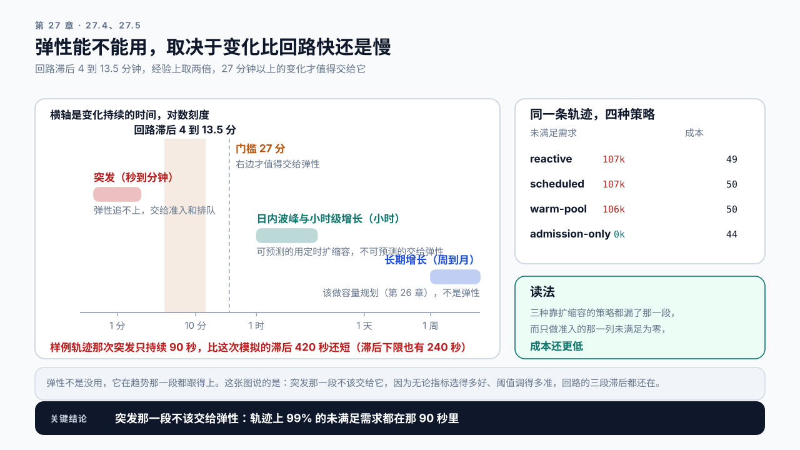

# 第 27 章 多副本、路由与 Autoscaling：弹性为什么救不了突发

## 学习目标

读完这一章，你应该能回答三个问题：

1. 加一倍的卡，能不能扛一倍的流量？
2. 自动扩缩容该按什么指标触发，为什么常用的那个指标是错的？
3. 冷启动几分钟的服务，弹性还有什么用？

跟着做完，你会得到一份扩缩容配置：触发指标、阈值、步长、冷却时间，以及一份说明弹性覆盖不了哪些场景的边界文档。

## 27.1 卡数定了，然后呢

第 26 章算出需要 36 张卡。但“36 张卡”不是一个部署方案。

```text
36 张卡怎么组织？        几个多卡实例，还是 36 个单卡实例？
流量低的时候呢？          36 张全开着还是关一部分？
突然涨到 3 倍呢？         自动扩，还是拒绝？
某一张卡挂了呢？          剩下 35 张扛得住吗？
```

这四个问题的答案互相牵制，而且都和前面几章的结论有关。这一章逐个处理。

**先说结论里最反直觉的一条：自动扩缩容解决的不是突发流量。** 这一点在第 22 章提过一句，这一章展开。

## 27.2 加一倍的卡，扛不住一倍的流量

第 22 章说过多副本容量不是线性叠加，实际按 0.8 到 0.9 折算。这一节说清楚那部分损失去了哪里。

损失一：路由不均。请求长度差异大，即使请求数均分，负载也不均。某个实例分到几条超长请求就会明显慢于其他。而 P99 由最慢的实例决定。

损失二：缓存分散。第 22 章那个案例：轮询把同一段对话的历史打散，命中率从 90% 掉到三成左右。实例越多，会话级前缀被分到的份数越多，单实例的缓存效率越低；全体共享的前缀不受这一项影响。

损失三：余量不能共享。单实例时所有余量在一个池子里；拆成多个实例后，A 的空闲帮不了 B 的拥挤，除非路由能实时感知并倾斜。

损失四：故障域变大。实例越多，任一时刻有实例处于异常状态的概率越高。

**这四项里前三项都能通过路由缓解**，所以路由设计在多副本场景下不是可选项。

一个实用的结论：副本数从 1 到 4 的边际收益很好，从 4 到 16 开始明显衰减，超过 16 之后路由和一致性的复杂度会吃掉相当一部分收益。需要更大规模时，通常要引入分层（按场景或按模型分组），而不是继续扩同一个池子。

## 27.3 单实例几张卡

另一个维度的问题：36 张卡是拆成 36 个单卡实例，还是 9 个 4 卡实例？

判据是模型能不能装进一张卡：

```text
装得下   优先单卡实例。没有通信开销，故障域小，扩缩容粒度细
装不下   必须多卡，用张量并行把权重切开
```

**装得下却用多卡并行，通常是亏的。** 第 15 章那个案例说明了原因：张量并行在每层之后要通信同步，而 Decode 是高频循环，这个同步每步都要做一次。单条请求的延迟可能改善，但吞吐和成本效率会下降。

装不下时，一个实例要几张卡也是算出来的，按第 16 章那本显存账，只是权重要按卡数摊开。以一个 70B 的 GQA 模型为例：80 层、8 个 KV 头、每头 128 维，每 token 的 K/V 是 320 KiB，FP16 权重约 140 GB。放在 80 GiB 的卡上。注意引擎按 `gpu_memory_utilization`（默认 0.9）留池，一张卡能用的是 72 GiB，不是 80：

```text
2 卡   144 GiB − 140 GiB 权重 − 每卡约 6 GiB 固定开销 < 0   装不下
4 卡   288 GiB − 140 GiB − 24 GiB ≈ 124 GiB 给 KV           约 38 万 token
```

2 卡按整卡 160 GiB 算还剩 8 GiB，按默认的 0.9 直接是负数，连权重带开销都放不下；4 卡才是一个能干活的实例。卡数还要能整除注意力头数，通常取 2、4、8，不会是 7。

必须多卡时，要知道扩展效率不是 1。两卡的吞吐通常是单卡的 1.6 到 1.8 倍，不是 2 倍。卡数越多，效率越低，且对卡间带宽很敏感。

> **张量并行**（Tensor Parallelism）：把模型每一层的权重矩阵切开，分到多张卡上各算一部分，再通过通信合并结果。它让单张卡装不下的模型能跑起来，代价是每层都要一次跨卡通信。

多卡的实现细节和扩展效率的实测方法属于附录 C 的范围（附录 C 目前只列出了要回答的问题），正文不展开。

扩缩容粒度是一个容易忽略的因素：单卡实例时，扩容的最小单位是 1 张卡；8 卡实例时，最小单位是 8 张卡。后者意味着你要么浪费，要么不够。

## 27.4 Autoscaling 该看哪个指标

自动扩缩容的触发指标，选错的代价很大。

最常用也最错的是 GPU 利用率。第 15 章讲过，那个百分比统计的是有没有 kernel 在执行，不是算力用了多少。Decode 阶段计算单元大量时间在等数据，利用率照样接近 100%。按它触发扩容，会在系统还很空闲时就扩，也会在真正拥挤时无动于衷。

次常用也不太对的是 QPS。26.2 那条理由在这里同样成立：请求数不能反映负载，真正决定资源的是 token 速率。按 QPS 扩容，长请求变多时会扩不够。

应该用的是第 20.7 节那组调度信号：

```text
主指标   槽位占用率（Running / 上限）
辅助     Waiting 队列长度
辅助     KV Cache 使用率（20.7 那张对照表里的另一个“还能不能再收一条”）
```

第 20.7 节那三个信号里的第三个是抢占计数，这里换成了 KV 使用率：抢占是显存已经不够之后的结果，对扩容来说太晚，而 KV 使用率在同一条路上动得早。抢占计数仍然要看，它是容量告警，不是扩容触发器。

槽位占用率（第 20.7 节）是最好的单一指标，因为它直接反映“还能不能接更多请求”，而且它比排队和抢占都动得早，能留出扩容需要的时间。

**前提是 `max_num_seqs` 已经按第 20.5 节用 Goodput 曲线定好。** 它的分母就是这个参数：留在引擎默认值（通常几百条）时，卡已经到了吞吐上限，占用率可能还只有一成，0.7 的扩容阈值永远不触发。第 26 章那份负载每卡吞吐只允许约 30 条在途，而按 Goodput 峰值定的 `max_num_seqs` 是 32，0.7 × 32 ≈ 22 条，正好落在它该报警的位置上。显存先满的服务是另一种失效：Running 先被 KV 卡住，到不了 `max_num_seqs`，请求堆在 Waiting 里而占用率一直不高，那种服务要改用 KV 使用率做主触发。

还有一个更好但更难实现的选择：

```text
SLO 达成率   一个窗口里达标请求（第 5 章的 good request）占全部请求的比例
```

它的好处是直接对齐业务目标：达成率没掉就不需要扩，开始掉了才扩，无论原因是什么。坏处是它是滞后指标，等它动的时候用户已经在受影响了。

**实践上的折中是用槽位占用率做主触发，用 SLO 达成率做兜底。**

### 指标选对了，回路还有滞后

选对指标只解决了“看什么”。还有一个量决定这套机制到底能追上多快的变化，也就是本篇开头那条稳态与余量里的滞后：从流量变化发生，到新容量真正开始接请求，中间隔了多久。它是三段之和：

```text
观测窗口   指标聚合窗口 + 上报延迟            30 到 90 秒
决策周期   评估间隔 + 连续满足的稳定窗口       30 到 120 秒
冷启动     下一节那五步                      180 到 600 秒
合计       回路滞后                          4 到 13.5 分钟
```

由此得到一条能直接用的判据：**一次流量变化只有在持续时间明显长于回路滞后时，扩容才来得及。** 经验上取两倍，也就是持续半小时以上的变化才值得交给 Autoscaling（按上界 13.5 分钟算是 27 分钟）；更短的突发，无论指标选得多好、阈值调得多准，都追不上。

滞后还有一个副作用：它越大，控制越容易振荡。等扩容生效时，触发它的那阵流量可能已经过去了，于是紧接着触发缩容，缩完又来一阵。稳定窗口和缩容的保守策略（27.6 节）都是在压这个振荡，代价是把滞后进一步拉长。

三项不是同等可压的。预热实例池能把冷启动那一项压到秒级，整个滞后就由前两项决定，这是唯一能把量级改掉的手段；而如果扩容还要等配额审批或节点供给，冷启动那一项可以远超 600 秒，这时调阈值和窗口都没有意义，要改的是供给。

## 27.5 冷启动决定了弹性能做什么

这是这一章最重要的一节。

一个新实例从创建到能接请求，要经过：

```text
调度到节点      秒级到分钟级，取决于有没有空闲资源
拉取镜像        如果没有本地缓存，可能几分钟
加载模型权重    几十秒到几分钟，取决于模型大小和存储介质
预热            捕获 CUDA Graph、跑几次 warmup，十几秒到一分钟
就绪检查通过    可以接流量
```

总计通常是 3 到 10 分钟。

而突发流量是秒级的。一次营销推送、一次热点事件，几十秒内流量翻三倍。等新实例起来，高峰已经过去了，或者服务已经垮了。

**所以要把流量变化分成三类，用不同手段应对：**

| 变化类型 | 时间尺度 | 能否预测 | 应对手段 |
|---|---|---|---|
| 可预测的周期 | 日内波峰 | 能 | 定时扩缩容，提前拉起 |
| 不可预测的增长 | 小时到天 | 不能 | Autoscaling |
| 突发 | 秒到分钟 | 不能 | 准入控制 + 预留余量 |

前两行的时间尺度是重叠的，区分它们的不是持续多久，而是可不可预测：日内波峰每天同一时刻来，用定时扩缩容在它来之前就把卡加上；只有事先不知道的小时级增长才交给 Autoscaling。再往上，周到月的长期增长不归弹性管，那是第 26 章的容量规划。

第三行是关键。第 21 章那套准入控制不是弹性不足时的补丁，而是唯一能在秒级尺度上生效的手段。指望 Autoscaling 来救突发，是一个时间尺度上的错配。



图27-1：变化比回路快时，弹性就调不了。回路滞后是一条带，两倍滞后是门槛线，三类变化按持续时间落在门槛两边；右栏是同一条轨迹上四种策略的未满足需求与成本。

缩短冷启动的几个手段：

```text
镜像预拉取      节点上常驻镜像缓存
权重本地缓存    避免每次从远端对象存储拉
减少预热档位    第 18 章那个 CUDA Graph 的档位，捕获越多启动越慢
预热实例池      保持若干已加载但不接流量的实例待命，最快但最贵
```

最后一项本质上是用钱换时间。它能把扩容时间压到秒级，但那些实例一直在付费。值不值取决于突发的频率和代价。

## 27.6 缩容比扩容更容易出事

扩容慢但安全，缩容快但危险。

缩容的三个陷阱：

一、正在处理的请求被中断。一条生成到一半的长请求，实例被回收就没了。缩容必须先摘流量、等在途请求处理完、再回收。这个优雅退出的等待时间要设得比最长请求还长。

二、缩完之后立刻又要扩。流量有波动，刚缩完一个实例流量就回来了，于是又扩，形成抖动。防抖的手段是冷却时间和不对称阈值：

```text
扩容阈值   槽位占用率 > 70%
缩容阈值   槽位占用率 < 40%      （不是 70%，留出滞回区间）
缩容冷却   30 分钟                  （远长于扩容冷却）
```

这三个数各有来由。扩容阈值要让新容量赶在饱和之前到：槽位占用率从阈值涨到 1 的时间，要长于 27.4 那个回路滞后。高峰爬坡时占比每分钟涨 2 个点的话，从 0.7 涨到 1 要 15 分钟，刚好盖住 4 到 13.5 分钟的滞后；爬坡更快，阈值就要更低。缩容阈值要保证缩掉一个实例后不会立刻越过扩容阈值：N 个实例缩到 N − 1 个，占比放大 `N ÷ (N − 1)` 倍，所以缩容阈值不能高于 `扩容阈值 × (N − 1) ÷ N`，N = 3 时是 0.47，取 0.4 再留一点余地。缩容冷却要长于流量自己的一个波动周期，否则缩完它就回来了。

> **滞回区间**（hysteresis band）：让“开”和“关”用两个不同的阈值，中间那段谁也不触发的区间。
> 上面这组里 40% 到 70% 就是滞回区间。只用一个阈值时，指标在阈值附近抖动会让系统反复扩缩；拉开一段之后，要走完整段才会翻向，抖动就被吃掉了。空调的温控、施密特触发器用的是同一个办法。区间越宽越稳，代价是响应越迟钝。

三、缩容把缓存也缩掉了。第 22 章那个一致性哈希的意义在这里：用取模哈希时，实例数一变大部分前缀的归属都会变，少一个实例就只保住十二分之一。

但一致性哈希能救回多少，取决于缩容的幅度。按 22.4 那张表，实例数从 `N` 缩到 `M` 时，一致性哈希必须迁移的键约占 `|N − M| ÷ max(N, M)`，取模哈希保住的只有 `gcd(N, M) ÷ max(N, M)`：

```text
            一致性哈希要重建    取模哈希要重建
12 → 10    17%                 83%
12 → 8     33%                 67%
12 → 4     67%                 67%     两种哈希一样，都救不回来
```

所以缩容下限也是一个缓存参数。缩得越狠，下次扩回来时冷启的比例越高，而这笔账不出现在实例费用里。第 26 章 Demo 报的下限卡数（本例 4 张）只按波谷流量算，是下限的下限；缓存这一项只会把它往上抬，不会往下压。

**缩容应该比扩容保守得多。** 扩错了只是多花钱，缩错了会直接影响可用性。

## 27.7 灰度与滚动：容量在这期间是降的

第 22 章提过一句：滚动升级期间容量下降。这里给出具体的算法。

```text
实例总数 N，每次替换 k 个
升级期间可用容量 = (N - k) / N
```

N=6、k=1 时，升级期间容量是 83%。如果平时负载率就在 85%，升级期间的负载率是 `0.85 × 6 ÷ 5 ≈ 1.02`，必然过载（第 22.5 节那个式子）。

两条纪律：

一、平时的负载率上限要为升级留出空间。如果按每次替换 1 个规划，平时负载率不该超过 `(N-1)/N` 再打个折。N 越小，这个约束越紧。

二、升级窗口要选在波谷。这不是习惯，是容量算出来的要求。

**灰度发布还有一个 LLM 特有的问题：** 灰度期间新旧两个版本同时在线，新版本的流量份额一步步放大，两个版本的行为可能不同，而 Prefix Cache 是按版本隔离的。两个版本各自维护缓存，命中率都会下降。所以灰度期间的性能数据不能直接和全量后的对比，第 28.5 节会展开这一点，并把灰度和滚动升级、Canary、Shadow 放在一起比较。

## 27.8 Demo：扩缩容策略模拟

本章 Demo 位于 `code/ch27/autoscale_sim.py`，不需要 GPU。

```bash
python3 code/ch27/autoscale_sim.py simulate \
  --traffic content/ch27/evidence/traffic-trace-sample.csv \
  --capacity-per-instance 150 \
  --scale-up-threshold 0.7 --scale-down-threshold 0.4 \
  --cold-start 300 --scale-up-cooldown 180 --scale-down-cooldown 1800 \
  --min-instances 3 --max-instances 30 \
  --output autoscale-report.json
```

两个阈值必须不相等，而且缩容那个要更低。传相等的两个值脚本直接拒，理由就是 27.6 那条：两个方向的风险不对称，用同一个阈值的系统会持续抖动。

它用一段真实或合成的流量轨迹模拟扩缩容行为，输出：

```text
instance_timeline   实例数随时间的变化
unmet_demand        超出当时容量的请求量及其时长
scale_events        每次扩缩容的触发时刻、原因和生效时刻
lag                 从触发到生效的延迟分布
thrash_count        抖动次数：缩容后短时间内又扩容
cost                按实例小时数算的成本
verdict             这套参数在这段流量下是否可用
```

关键在 `unmet_demand` 和 `lag` 的配合，而 `unmet_demand` 还要再拆一层：

```text
unmet_in_trend    趋势那一段没跟上的     跟不上说明参数不对
unmet_in_surge    突发那一段没跟上的     跟不上说明时间尺度不对
```

**这一拆是这个脚本最值得看的地方。** 拿仓库里那份合成轨迹跑反应式弹性，结果是：

```text
未满足需求        107175（0.9%）
结论              趋势跟得上，突发跟不上
                  未满足的 107175 里有 99% 落在那段只持续 90 秒的突发上，
                  而回路滞后是 420 秒
```

不拆开看，0.9% 这个总数会让人以为参数需要调；拆开才知道参数是够用的，问题出在那 90 秒不该交给扩缩容。

对比模式：

```bash
python3 code/ch27/autoscale_sim.py compare \
  --traffic content/ch27/evidence/traffic-trace-sample.csv
```

四种策略在同一段流量上对比：

```text
策略                    未满足        被拒    成本   结论
reactive              107175.0       0.0    49.1   趋势跟得上，突发跟不上
scheduled             106695.0       0.0    49.7   趋势跟得上，突发跟不上
warm-pool             106467.0       0.0    50.3   趋势跟得上，突发跟不上
admission-only             0.0  133440.0    44.0   可用
```

`admission-only` 不是按最小实例数跑的，那样比不出东西。它按 27.5 那张表里的“预留余量”配置：静态配到能扛住需求 P95 的高位，而且按目标负载率 0.7 配，也就是 11 个实例，再用准入挡住突发。按负载率 1 配只要 8 个，看上去更省，但模拟器不建模延迟，负载率贴着 1 在这里没有代价，在真实服务上却是第 20 章那条曲线最陡的地方。所以它的成本 44 不是靠少配卡省出来的，是靠不为那 90 秒的突发常备容量省出来的，仍比反应式的 49.1 便宜。

未满足和被拒这两列不能直接比大小，它们不是同一种损失。被拒的请求立刻拿到 429，可以退避重试或者降级处理；未满足的请求堆在队列里慢慢超时，还把同批其他请求一起拖慢。比较策略时按 Goodput 比：admission-only 拒掉的那些在突发里本来也做不完，而它保住了其余请求的延迟。

还有一个子命令对应 27.4 和 27.6：

```bash
python3 code/ch27/autoscale_sim.py lag                        # 回路滞后三段相加
python3 code/ch27/autoscale_sim.py cache --before 12 --after 8  # 这次缩容丢掉多少缓存，加 --modulo 看取模哈希
```

`admission-only` 这一项是刻意加进来的对照。它不做任何扩缩容，只靠准入控制。在突发为主的流量上，它的表现常常好于纯反应式弹性，而成本更低。这个对照能防止“弹性一定更好”的直觉。

在自己的服务上做一次验证：用一段真实的日内流量重跑四种策略，看结论是否成立。

## 27.9 案例与常见误区

### 案例一：配了自动扩容，突发时照样挂

合成设定：服务配了基于 GPU 利用率的自动扩容，阈值 80%，最大 30 个实例。

一次热点事件让流量在 90 秒内涨到 4 倍。扩容确实触发了，但第一个新实例 6 分钟后才就绪。这 6 分钟里服务完全不可用，而且因为没有准入控制，所有请求都堆在队列里一起超时。事后加了准入控制，同样量级的突发只影响了约 35% 的请求，其余正常返回。

讨论：这个场景下，把最小实例数调高能解决问题吗？代价是什么？

### 案例二：缩容之后延迟全面上升

合成设定：夜间流量下降，自动缩容从 12 个实例缩到 8 个。第二天早高峰扩回 12 个后，P95 TTFT 比前一天高了 60%，持续了一个多小时。

原因是缩容和扩容都用取模哈希做路由。12 → 8 时 `hash % 12` 和 `hash % 8` 相同的键只占三分之一，另外三分之二的前缀换了实例，缓存要重建；扩回 12 时同样的事再来一遍。换成一致性哈希后，同样这套 12 到 8 再到 12 的动作，缩容时只有被摘掉的那 4 个实例持有的三分之一要迁移，恢复时间从约八十分钟降到约四十分钟。

后来有人提议夜里干脆缩到 4 个省钱。这一档换什么哈希都救不回来：摘掉的实例持有三分之二的键，这部分前缀无论用什么哈希都得重建；取模哈希在 12 和 4 之间碰巧也保住三分之一，两种哈希一样。

```text
取模哈希     12 → 8 → 12   缩容时只保住 33%      约八十分钟
一致性哈希   12 → 8 → 12   必须迁移 4/12 ≈ 33%   约四十分钟
任一种哈希   12 → 4 → 12   必须迁移 8/12 ≈ 67%   约八十分钟
```

这三行用 27.8 那个 Demo 的 `cache` 子命令能直接跑出来。

**缩容的幅度本身就是一个参数**，而它的代价不写在实例账单上，写在第二天早高峰的 TTFT 上。

讨论：夜里缩到 4 个多省的钱，和早高峰多出来的四十分钟，怎么比？

### 案例三：加了一倍的卡，吞吐只涨了六成

合成设定：从 8 个实例扩到 16 个，期望吞吐翻倍，实测只涨 62%，也就是**扩展效率 81%**（1.62 ÷ 2）。

拆开看有三处损失：轮询路由下长请求分布不均，最慢实例拖累 P99；缓存分散让命中率从 71% 降到 44%，平均 prompt 的 Prefill 变重；以及新增实例分布在另一个可用区，跨区调用增加了几十毫秒。改成带溢出的前缀亲和路由并把实例集中到同区后，吞吐涨到 78%，扩展效率 89%，落回 27.2 那个 0.8 到 0.9 的带里。

```text
改之前   涨 62%   效率 81%
改之后   涨 78%   效率 89%
```

讨论：89% 是不是就到顶了？剩下那 11% 分别属于 27.2 里的哪几项损失？

### 两个不写在配置里的误区

误区一：自动扩缩容是弹性的全部。它只覆盖小时到天尺度里事先不知道的那部分变化。日内周期用定时扩缩容更好，因为可预测；秒级突发只能靠准入控制和预留余量；周到月的长期增长要回到容量规划。把三类变化混在一起用一套机制应对，结果是每一类都应对不好。

误区二：缩容和扩容用同一套参数就行。扩错了多花钱，缩错了影响可用性，两者的风险不对称，参数也该不对称：缩容阈值要更低、冷却时间要更长、优雅退出的等待要比最长请求还长。用对称参数的系统会持续抖动。

## 本章总结

回到开头的三个问题。

**加一倍的卡能扛一倍流量吗？** 不能，实际按 0.8 到 0.9 折算。损失来自四处：路由不均导致最慢实例决定 P99、缓存分散让命中率下降、余量不能在实例间共享、故障域变大。前三项都能通过路由缓解，所以多副本场景下路由设计不是可选项。副本数从 1 到 4 边际收益好，超过 16 之后复杂度会吃掉相当一部分收益，那时该分层而不是继续扩同一个池子。另外模型装得下一张卡时优先单卡实例，多卡并行的通信同步在 Decode 的高频循环里会被放大。

**Autoscaling 该看什么指标？** 不是 GPU 利用率，它统计的是有没有 kernel 在跑而不是算力用了多少；也不是 QPS，因为请求长度差几十倍。应该用槽位占用率（Running 占上限的比例）做主触发，它直接反映还能不能接更多请求，且比排队和抢占动得早，前提是 `max_num_seqs` 已按 Goodput 峰值定好；显存先满的服务改用 KV 使用率。再用 SLO 达成率做兜底，它对齐业务目标但滞后。

**冷启动几分钟时弹性还有什么用？** 它只对事先不知道的小时级增长有用。冷启动 3 到 10 分钟，而突发是秒级的，这是时间尺度上的错配。三类流量变化要用三种手段：日内周期用定时扩缩容（可预测，提前拉起），不可预测的小时级增长用 Autoscaling，突发只能靠准入控制加预留余量；再往上，周到月的长期增长归第 26 章的容量规划。缩容还要比扩容保守得多，因为风险不对称：阈值要有滞回区间，缩容阈值不能高于 `扩容阈值 × (N − 1) ÷ N`；冷却时间要长得多；优雅退出要等到最长请求结束；实例数变化会冲击缓存，路由要用一致性哈希，而缩容幅度大到一定程度时换什么哈希都救不回来。

下一章处理另一类风险：版本变了、配置变了、模型变了，怎么在上线之前就发现性能回归。

### 本章 Checklist

- [ ] 知道当前副本数下的实际扩展效率，而不是假设线性。
- [ ] 模型装得下单卡时用的是单卡实例，多卡有明确理由。
- [ ] 扩缩容的触发指标是槽位占用率，不是 GPU 利用率或 QPS；且 `max_num_seqs` 已按 Goodput 峰值定好（显存先满的服务改用 KV 使用率做主触发）。
- [ ] 知道一个新实例从触发到就绪需要多久。
- [ ] 三类流量变化各有对应手段，突发靠的是准入而非弹性。
- [ ] 缩容阈值和扩容阈值之间有滞回区间，缩容冷却时间明显更长。
- [ ] 优雅退出的等待时间大于最长请求的耗时。
- [ ] 路由用一致性哈希，实例数变化时缓存不会整体失效。
- [ ] 平时的负载率上限为滚动升级期间的容量下降留了空间。

## 课后练习

1. 把副本数从 1 加到 8，每档测吞吐，画出实际扩展效率曲线。
2. 分别用轮询和前缀亲和路由重做上一题，对比两条曲线。
3. 量出一个新实例从创建到就绪的各段耗时，找出最长的那一段。
4. 对比 GPU 利用率、QPS 和槽位占用率三个指标在一段压测中的走势，说明前两个为什么会误导。
5. 用一段真实流量轨迹跑扩缩容模拟，记录 `unmet_demand` 和抖动次数。
6. 在同一段流量上对比反应式弹性和纯准入控制两种策略的结果。
7. 做一次缩容，测量 Prefix Cache 命中率的恢复曲线。
8. 按你的实例数算出滚动升级期间的可用容量，据此定出平时的负载率上限。
