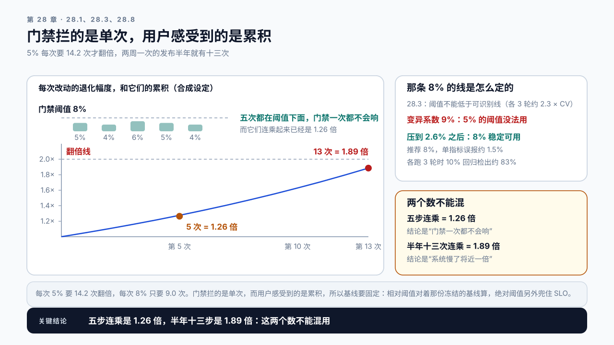

# 第 28 章 性能回归与发布门禁：让变慢在上线前就被拦住

## 学习目标

读完这一章，你应该能回答三个问题：

1. 性能回归为什么大多是悄悄发生的？
2. 一次自动化 Benchmark 要满足什么条件，结论才能用来卡上线？
3. 门禁阈值该怎么定，才不会天天误报又漏掉真问题？

跟着做完，你会得到一套可接进 CI 的发布门禁：自动 Benchmark 脚本、阈值定义、Shadow 与 Canary 的判据，以及阻断规则。

## 28.1 变慢从来不是一次发生的

第 25 章那个案例：优化完成后端到端 7.8 秒，三个月后回到 15 秒，而这期间没有任何告警触发。那三件事每一件都不小（平均每件慢约 24%），但告警按当时的水平设，它们各自都没越过自己那条线，其中两件还是配置悄悄变了，只有断言抓得住（28.4）。

还有一种形态更难发现，也更常见：持续的小幅累积，每一次都在门禁阈值以内。

```text
一次框架升级     某个默认值变了，某条快速路径失效，慢 5%
一次业务变更     prompt 里多加了一段说明，慢 4%
一次知识库扩容   检索变慢，片段变长，慢 6%
一次模型升级     层数多了两层，慢 5%
一次配置调整     有人为了排查问题关了某个开关，忘了打开，慢 4%
```

每一项单独看都在门禁阈值以内：28.3 会讲到，一份管理得好的 Benchmark 变异系数在 3% 上下，而门禁阈值通常设在 8%，这五项一个都碰不到线（它们并不都在噪声里，5% 和 6% 已经高过单轮的波动，但门禁判的是阈值）。

但它们是乘起来的，不是加起来的：

```text
1.05 × 1.04 × 1.06 × 1.05 × 1.04 = 1.26      五次就慢了两成六
两周一次发布，半年 13 次，每次 5%           1.05^13 ≈ 1.89
```

半年慢将近一倍不需要任何一次大退化，只需要十三次都在阈值以内。28.8 案例二就是这个数。



图28-1：每一次都在阈值下面，累积起来不在。上排五根柱子都低于 8% 的门禁阈值，下方的累积曲线在第 5 次是 1.26 倍、第 13 次是 1.89 倍；右上一块是那条 8% 的线本身怎么定出来的。

告警发现不了这类问题，因为告警的阈值是按“当前正常水平”设的，而当前正常水平自己在漂移。

**能发现它的只有一件事：每次变更都和一个固定的基准对比。** 固定基准是一份冻结的参考版本：模型、配置、负载都钉死，它的结果只在人工确认后才更新。这就是发布门禁。

## 28.2 门禁 Benchmark 的三个硬条件

第 7 章那套 Baseline 方法在这里要加严，因为结论要用来阻断上线。

条件一：可复现，且波动已知。第 7 章讲过：不可复现的 Baseline 比没有更糟。用于门禁时更严重：波动大意味着要么天天误报，要么阈值被迫放宽到漏掉真问题。

所以门禁 Benchmark 要先解决波动：固定随机种子、独占测试机、固定 GPU 频率、足够的重复轮次。**变异系数压到 3% 以内，门禁才有意义。**

条件二：环境分成两类，一类钉死，一类作为被测的变更记录下来。

```text
钉死的      GPU 型号与驱动、测试机标识、workload 描述文件及其哈希
被测的      模型 revision、框架版本、启动参数
```

分这两类是因为 28.1 列的那五项退化里，框架升级、模型升级、配置调整恰恰是门禁要拦的候选变更：把它们也“固定”下来，门禁就没东西可比了。钉死的那几项一旦不同，两次测量就没有可比性，Demo 直接拒绝对比。换模型是个例外：它改变的是被测对象本身，要先在旧模型和新模型上各跑一次，把这次差值作为“明确被接受的退化”人工确认，再换基线。

其中最容易漏的是 workload 的哈希。有人改了测试数据集，性能数字变了，但没人知道是数据变了还是代码变了。

条件三：跑得够快，但不能太短。门禁要接进 CI，跑两小时没人会用。但跑太短会让波动变大。

实践上的折中是分层：

```text
每次提交     快速检查，3 到 5 分钟，只跑核心场景，宽阈值
每日         完整 Benchmark，30 到 60 分钟，全场景，严阈值
每次发布     完整 + Shadow 对比
```

快速检查的作用是拦住明显的问题，不是拦住所有问题。把它和完整 Benchmark 混为一谈，结果通常是两边都做不好。

## 28.3 阈值怎么定

阈值太紧天天误报，太松形同虚设。

> **两类错误（type I / type II error）**：第一类错误是把没有回归的变更判成回归，也就是误报；第二类错误是把真实回归放过去，也就是漏报。
> 阈值只有一个，两类错误此消彼长：调紧压低漏报、抬高误报，调松反过来。所以定阈值不是找一个“对”的数，而是选一个你愿意承担的比例。

两类错误的代价并不对称，而且哪一类更贵取决于门禁装在哪。装在合并前，误报的代价是所有人每天都被挡一次，很快就没人看了（本章案例一）；装在发布前，漏报的代价是回归进了生产。所以合并前的门禁可以松一档、以观察为主，发布前的门禁要紧一档、以阻断为主，同一个指标在两处用不同阈值是合理的，不是自相矛盾。定阈值有三条可操作的原则。

一、阈值必须大于实测波动，而下限取决于各跑几轮。**先把轮数定下来**：本章按“快速检查各 1 轮、完整 Benchmark 各 3 轮”算。各 3 轮时下限是第 7.3 节那条可识别线，变异系数 2.6% 对应约 5.9%；各 1 轮时差值的波动是 `√2 × 2.6% ≈ 3.7%`，下限约 `1.96 × 3.7% ≈ 7.2%`。经验做法是在可识别线和三倍变异系数之间取，比如 8%，因为合并前的门禁误报代价更高。

放到 8% 买到了什么、付出了什么，可以算出来。候选和基线各跑一轮时，两边的差值本身的波动约是 `√2 × 2.6% ≈ 3.7%`：

```text
没有回归时，单个指标越过 8% 的概率      约 1.5%    这是误报率
五个指标一起判，至少一个误报            约 7%
真实回归恰好 8% 时被拦住的概率          50%        这是检出率
两边各跑 3 轮，真实回归 10% 被拦住      约 83%
```

误报率只有 1.5%，代价是一个正好 8% 的回归有一半会被放过去。**想同时压低两类错误，唯一的办法是多跑几轮**，把差值的波动压下去；多跑几轮的代价是时间，这正是 28.2 要分层的原因。这组数和可识别线的关系，附录 F.4 有对照。

二、不同指标用不同阈值。

```text
              该指标的 CV（实测）   阈值
P50 延迟      约 1.5%               5%
P95 延迟      约 2.6%               10%
P99 延迟      约 5%                 只观察，不阻断
吞吐          约 1.5%               5%
显存峰值      约 0.3%               2%，而且双向判
```

这一列 CV 是合成设定，真机上要从自己的 Baseline 里量。它不是可有可无的一列：上面那条“阈值不低于下限”是按某个具体的 CV 算的，5% 的阈值配 2.6% 的 CV 误报率有 8.7%，配 1.5% 才回到 1.5% 上下。**没有逐指标的 CV，这张表就只是几个看起来合理的数。**

显存那一项值得单独说。它波动极小，所以任何超过 2% 的变化都是真实的变化，很适合用来发现“某个配置悄悄改了”这类问题。**正因如此它要双向判**：涨超过 2% 是容量风险，降超过 2% 同样可疑：28.7 那份静默样例里显存降了 20.4%，正是精度被悄悄改了。只判变差那一边，这个信号就只剩一半。P99 只观察不阻断，原因在第 5.5 节那条样本量规则：一轮 200 条请求时 P99 以上只有两条，它的抽样波动本身就比阈值大。

三、绝对值和相对值都要有。

```text
相对   P95 比基线慢超过 10%   → 阻断
绝对   P95 TTFT 超过 SLO      → 阻断
```

这里的百分比要和上面那张表对上。上表给 P95 的是 10%，所以这两条说的都是 P95。两种阈值各自漏什么，要看基线怎么定：

```text
滚动基线 + 相对阈值   每次和上一次比，每次慢 9% 永远不触发，累积多少都看不见
固定基线 + 相对阈值   每次和那份冻结的参考版本比，累积到 10% 就触发
绝对阈值              一越过 SLO 就触发，但 SLO 以下的漂移它一概不管
```

所以两种阈值要一起上：固定基线上的相对阈值抓累积漂移，绝对阈值兜住 SLO。

基线怎么更新是一个容易出错的地方。如果每次通过就把基线更新成当前值，固定基线就退化成了滚动基线，表里第一行那个漏洞又回来了。

推荐的做法是基线只在两种情况下更新：一次明确的性能改进被验收，或者一次明确的、被接受的退化（比如为了新功能付出的代价）。两种情况都需要人工确认，不能自动。

## 28.4 静默回归：只看延迟发现不了的那些

有一类回归不体现在延迟上，但后果同样严重。第 17 章和第 18 章各出现过一例。

一、输出质量悄然下降。第 17 章那个案例：量化后通用评测只掉 0.3 个百分点，但结构化输出的 JSON 格式错误率从 0.2% 涨到 4.1%。延迟、吞吐、显存全部正常。门禁必须包含质量检查项，且要覆盖格式遵循、长回答、专业领域这几个容易先坏的维度。

二、配置在不知不觉中改变。某次升级后框架对某个参数的默认值做了调整，Attention 退回朴素实现。第 18 章那个案例里性能掉一半，但如果那次只掉 6%，就会被当成噪声。

**能发现这类问题的是断言，不是阈值：**

```text
实际走的 Attention kernel 名称在白名单内
Prefix Cache 处于启用状态
量化配置与声明一致
CUDA Graph 捕获的档位数在预期范围
显存占用在预期区间
```

这些断言检查的是“系统是不是按我以为的方式在跑”，和性能数字是两回事。第 25 章那份 `guard` 规则就是这个。

三、高峰期才显现的退化。一个改动让排队行为变差，但在门禁的中等压力下完全看不出来，只在接近饱和时爆发。第 20 章那条排队敏感度曲线解释了原因：饱和档位是一个放大器。同样是满载吞吐降 5%，负载率 0.5 时 ρ 只变成 0.53，平均排队从 1 个 S 变成 1.1 个，看不出来；负载率 0.9 时 ρ 变成 0.95，排队从 9 个 S 涨到约 18 个，翻了一倍。所以门禁 Benchmark 至少要包含一档接近饱和的压力，而不只是测舒适区。

## 28.5 Shadow 与 Canary：用真实流量验证

门禁 Benchmark 用的是合成负载，而合成负载不可能覆盖真实流量的全部形态。要用真实流量验证新版本，又不能一下子把所有用户都押上去。

发布时常听到的几个词管的是不同的东西。**滚动升级换的是实例，灰度分的是流量。** 滚动升级逐个替换机器，影响的是升级期间的容量（27.7）；灰度让新版本先只接一部分流量、再逐步放大，影响的是多少用户替新版本承担风险。Canary 是灰度的一种做法，先切一小份隔离的流量，专门验证风险最高的那几项。Shadow 不分流量，它复制一份流量给新版本、响应丢弃，用户不承担风险，所以通常排在灰度之前。哪一步出了问题，退路都是回滚（29.3）。

| 做法 | 动的是什么 | 谁承担风险 | 回答的问题 |
|---|---|---|---|
| 滚动升级 | 实例，逐个替换 | 全体用户，经由升级期间少掉的容量 | 换版本时容量够不够（27.7） |
| 灰度发布 | 流量，按比例逐步放大 | 已经切到新版本的那部分用户 | 每放大一步，指标还正常吗 |
| Canary | 流量，一小份隔离样本 | 那一小份用户 | 风险最高的几项先过不过得去 |
| Shadow | 流量的副本，响应丢弃 | 无 | 真实流量下的性能和资源 |

```text
优点   零用户风险，能用真实流量分布
限制   新版本要有独立资源，成本翻倍
注意   有副作用的操作必须屏蔽，否则会重复写入
```

Shadow 特别适合验证第 28.4 那三类静默回归，因为真实流量里才有那些边缘形态。

```text
优点   能观察真实用户行为和端到端影响
风险   受影响的是真实用户
判据   小流量下的指标能不能代表全量
```

**Canary 有一个 LLM 特有的陷阱：缓存效率。** 第 27 章提过：新旧版本各自维护 Prefix Cache，5% 流量的 Canary 实例缓存命中率会远低于全量时的水平。

```text
Canary 命中率低  →  TTFT 看起来更差
实际全量后       →  命中率恢复，TTFT 可能比旧版还好
```

所以 Canary 期间的性能数字不能直接和旧版对比，要么等缓存预热稳定后再看，要么把缓存命中率作为协变量一起分析。这里很容易得出错误结论。

两者的分工：Shadow 先跑，测性能和资源，用来发现性能和质量问题，但它测不出写操作和有状态的链路，因为响应被丢弃了；Shadow 通过之后再 Canary，测正确性和真实用户路径。

## 28.6 门禁怎么接进流程

门禁要产生作用，必须能真的阻断，而不是发一封没人看的邮件。

```text
提交       快速检查，失败则 CI 红
合并前     完整 Benchmark，失败则不能合并
发布前     Shadow 对比 + 断言检查，失败则不能发布
发布中     Canary 指标监控，异常则自动回滚
```

三条让门禁不被绕过的设计：

一、失败信息要能定位。只说“性能回归 12%”没人会去查。要给出是哪个指标、和哪个基线比、变化了多少、以及可能相关的变更。门禁的可用性直接决定它会不会被绕过。

二、要有明确的豁免流程，而不是默认可跳过。有时确实需要接受一次退化，这时该走的是记录在案的豁免，包含原因和基线更新的决定，而不是“加个 skip 标签”。

**三、误报要被当成 bug 修。** 连续几次误报之后，团队就会开始习惯性忽略门禁结果，这时门禁就已经死了。误报率高说明波动没压住或阈值定得不对，要修的是门禁本身。

## 28.7 Demo：性能门禁

本章 Demo 位于 `code/ch28/perf_gate.py`。采集那一步需要真实服务，`run` 判读吃的是现成的 JSON，可以离线跑。

```bash
python3 code/ch28/perf_gate.py run \
  --mode full \
  --result content/ch28/evidence/gate-result-pass.json \
  --baseline content/ch28/evidence/gate-baseline.json \
  --thresholds content/ch28/evidence/gate-thresholds.json
```

`--mode` 取 `quick`、`full`、`release` 三档，对应 28.2 那三层。

输出：

```text
environment     完整环境指纹，含 workload 哈希
metrics         各指标的本次值、基线值、变化率
threshold_check 逐项通过或失败，失败项标出超出多少
assertions      逐条断言的结果
quality         评测集得分与基线对比
saturation      接近饱和档位的结果
verdict         pass / fail / warn
blocking_reason 失败时的可定位说明
exit_code       0 通过，1 阻断，2 警告
```

基线管理：

```bash
python3 code/ch28/perf_gate.py promote \
  --result gate-result.json \
  --baseline gate-baseline.json \
  --kind improvement \
  --reason "Ch17 KV INT8 验收：理论并发 213 → 427，质量评测通过" \
  --approver <名字>
```

`promote` 强制要求 `--reason`、`--approver` 和 `--kind`，且拒绝在 `verdict` 为 `fail` 时执行。`--kind` 只接受 `improvement` 和 `accepted_regression` 两个值，也就是 28.3 说的那两种情况。这就是“基线不能自动更新”的实现，28.8 案例二那条路从这里堵死。

仓库里那份 `gate-result-silent.json` 是这个 Demo 最该跑一遍的样例。它的每一个延迟指标都比基线更好，吞吐涨了 5%，“变差”那一侧一条阈值都没碰到：

```text
p50_latency_ms   392  基线 420   -6.7%
p95_latency_ms   918  基线 980   -6.3%
throughput_tps  1639  基线 1560  +5.1%
peak_memory_gib  48.7 基线 61.2  -20.4%   双向判，阻断
结论             fail（退出码 1）
阻断原因         peak_memory_gib 超阈值；断言未通过：['attention_kernel_allowlisted']；
                 这次改动动了精度却没有质量数据（28.4 第一类）
```

**如果显存只判变差那一侧，这份报告在数字这一关会全绿。** 它之所以没有全绿，靠的是两件 28.3、28.4 才给的东西：显存双向判，以及那条 kernel 白名单断言。只比“有没有变慢”的门禁，会给这次改动开绿灯。

还有两个子命令，把 28.1 和 28.3 的算术做成可跑的：

```bash
python3 code/ch28/perf_gate.py drift --steps 0.05,0.04,0.06,0.05,0.04 --threshold 0.08
python3 code/ch28/perf_gate.py threshold --cv 0.026
```

`drift` 会告诉你这五次累计 1.26 倍、而且一次都没碰到阈值；`threshold` 会按变异系数给出可用的阈值下限和建议值，2.6% 的波动对应 8%，正是 28.8 案例一修完之后那个数，同时打印 28.3 那张表：单指标误报约 1.5%、五个指标约 7%、8% 的回归检出 50%、各跑 3 轮时 10% 的回归检出约 83%。

Shadow 那一半需要两套真实服务，所以它不在这个脚本里，而是 28.5 那一节的做法：复制流量到候选版本，对比两边的延迟分布、质量得分和断言结果，并单列缓存命中率作为协变量，防止 28.5 那个陷阱。采到数据之后，两边各出一份 `--result`，用同一个 `--baseline` 各跑一次 `run` 就能对比。在自己的服务上接一次真实 CI：压低 Benchmark 的波动到 3% 以内，定出各指标阈值，把 `quick` 模式接进提交流程。

## 28.8 案例与常见误区

### 案例一：门禁天天红，一个月后没人看

合成设定：团队上了性能门禁，阈值统一设成 5%。

Benchmark 的变异系数是 9%，于是正常波动经常触发失败。两周后大家开始习惯性点重试，一个月后有人在 CI 配置里加了跳过条件。

真正的问题不是阈值，是波动。测试机上跑着其他任务、GPU 频率没锁、重复轮次只有 2。修掉这三项后变异系数降到 2.6%，阈值设 8% 就很稳。

讨论：波动实在压不下去时，门禁还能怎么设计？

### 案例二：每次通过就更新基线，半年慢了将近一倍

合成设定：门禁配置成通过即更新基线，两周一次发布。每次变更慢 4% 到 6%，都在 8% 的阈值内，于是每次都通过，每次都成为新基线。半年 13 次发布之后，端到端时间是最初的 1.9 倍，而门禁从未失败过。后来改成基线只在人工确认时更新，并加了绝对阈值兜底。

讨论：绝对阈值该设在哪里？SLO 那条线合适吗？

### 案例三：Canary 显示变慢了，全量后反而变快

合成设定：新版本 Canary 到 5% 流量，P95 TTFT 比旧版高 34%，团队准备回滚。

有人查了缓存命中率：Canary 实例只有 21%，而生产实例是 83%。因为 5% 的流量分散在同样的前缀上，每个前缀在 Canary 上出现的频率太低，缓存建不起来。

把 Canary 比例提到 25% 并等待 40 分钟后，命中率升到 76%，TTFT 比旧版低 11%。全量后是 14%。

讨论：小流量 Canary 还能怎么排除缓存因素的干扰？

### 两个不写在门禁配置里的误区

误区一：门禁就是跑一次 Benchmark 比一下数字。只比数字会漏掉三类静默回归：质量下降、配置悄悄改变、只在饱和区显现的退化。这三类都不体现在常规延迟指标上，需要质量评测、断言检查和饱和档位压力三样额外的手段。

误区二：门禁是 CI 的事，和性能工程无关。阈值定在哪、基线什么时候更新、Canary 的数字怎么解读，这些都需要对系统的理解。案例三那个缓存命中率的问题，没有前面几章的铺垫根本想不到去查。门禁的配置质量决定了它是保护网还是绊脚石。

## 本章总结

回到开头的三个问题。

**为什么大多是悄悄发生的？** 因为退化的典型形态是持续的小幅累积：一次框架升级慢 5%、一次业务变更慢 4%、一次知识库扩容慢 6%，再加上模型升级和配置调整的 5% 和 4%，每一项单独看都在 8% 的门禁阈值以内，连乘起来已经是 1.26 倍；两周一次发布，半年 13 次就是 1.89 倍。告警的阈值本身又是按当前正常水平设的，会跟着一起漂移。能发现它的只有一件事：每次变更都和一个固定的基准对比。

**门禁 Benchmark 要满足什么条件？** 三条。可复现且波动已知，变异系数压到 3% 以内，否则要么天天误报要么阈值被迫放宽；环境完全固定并记录，最容易漏的是 workload 的哈希；跑得快但不能太短，所以要分层，快速检查拦明显问题、完整 Benchmark 每日跑、发布前加 Shadow。另外还要包含三样常规延迟指标之外的东西：质量评测、配置断言，以及一档接近饱和的压力。

**阈值怎么定？** 下限是第 7.3 节的可识别线，通常设在两到三倍波动处，并且要知道它的代价：变异系数 2.6%、阈值 8% 时，单指标误报约 1.5%，而正好 8% 的回归只有一半被拦住，想两头都压低只能多跑几轮。不同指标用不同阈值，显存因为波动极小可以设得很严，很适合发现配置被悄悄改动；固定基线上的相对阈值和绝对阈值都要有，前者抓累积漂移，后者兜住 SLO，只靠滚动基线会以每次 9% 的速度慢慢退化而永不触发。基线不能自动更新，只在明确的改进被验收或明确的退化被接受时人工更新。最后，误报要当成 bug 来修，因为连续误报之后门禁就会被绕过，那时它已经死了。

下一章把这一章的门禁、前面几章的容量与成本，合并成一次上线前的完整评审。

### 本章 Checklist

- [ ] Benchmark 的变异系数压到 3% 以内，且知道这个数字。
- [ ] 环境指纹包含 workload 文件的哈希。
- [ ] 门禁分层，快速检查和完整 Benchmark 的目标不同。
- [ ] 阈值大于实测波动，算过它的误报率和检出率，且不同指标有不同阈值。
- [ ] 同时有相对阈值和绝对阈值。
- [ ] 基线只在人工确认时更新，更新要记录原因和审批人。
- [ ] 门禁包含质量评测项，覆盖格式遵循和长回答。
- [ ] 门禁包含配置断言，能发现静默回退。
- [ ] Benchmark 包含一档接近饱和的压力。
- [ ] Canary 的性能数字排除了缓存命中率的干扰。

## 课后练习

1. 测出当前 Benchmark 的变异系数，如果超过 3%，找出三个波动来源并逐个消除。
2. 为五个关键指标各定一个阈值，说明每个阈值的依据：先量出每个指标自己的变异系数，用 `threshold` 子命令逐个算出它们各自的误报率，再按 `1 − ∏(1 − pᵢ)` 合起来。
3. 检查你的基线更新策略，如果是自动的，按发布频率估算半年后可能累积多少退化。
4. 写出至少五条配置断言，覆盖 kernel 路径、缓存状态和显存区间。
5. 构造一份门禁用的质量评测集，说明它覆盖哪些容易先坏的维度。
6. 在门禁里加一档接近饱和的压力，对比它和舒适区档位的判别能力。
7. 做一次 Shadow 对比，记录两边的延迟、质量和断言结果。
8. 在一次 Canary 中同时记录缓存命中率，分析它对性能数字的影响有多大。
