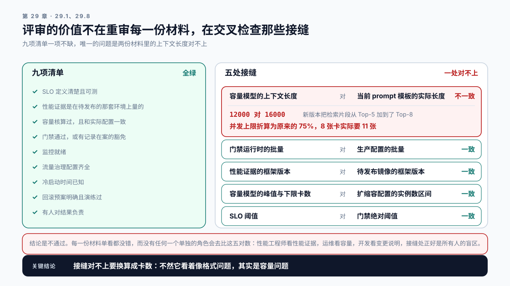

# 第 29 章 Performance Review 与上线检查：上不上，谁来拍板

## 学习目标

读完这一章，你应该能回答三个问题：

1. 一次上线评审要看哪些材料，缺哪一份就不该放行？
2. 出问题时怎么回滚，以及哪些东西回滚不掉？
3. 性能工作怎么从一次次救火变成持续运转的机制？

跟着做完，你会得到一份上线检查清单和一套评审模板，以及一份回滚预案。

## 29.1 最后一道关口

前面二十八章的产出到这里汇总：

```text
第 7 章    可复现的 Baseline
第 10 章   根因报告
第 19 章   Decode 优化报告
第 25 章   端到端优化报告与防回退断言
第 26 章   容量与成本模型
第 27 章   扩缩容配置
第 28 章   门禁结果
```

**评审要做的不是重新审一遍这些内容，而是检查它们是否齐全、是否互相一致、以及有没有人对结果负责。**

一个反复出现的失败模式是：每一份材料单看都没问题，合起来却对不上。容量模型按平均上下文 12000 算，而新版本的 prompt 模板加长到了 16000；门禁在批量 32 下通过，而生产配置是 64。评审的价值就在这些接缝处。

## 29.2 上线检查清单

一次上线要过九项。每一项都指向前面某一章。

**一、SLO 定义清楚且可测。**

```text
指标、分位、阈值、统计窗口、适用范围
```

第 5.8 节讲过口径的重要性。**“TTFT 要快”不是 SLO，“P95 TTFT < 1500 ms，按 5 分钟窗口统计，不含被拒绝的请求”才是。**

**二、性能证据是在待发布的那套环境上量的。** 这里要的是候选版本在新驱动、新框架、新硬件上的那次测量，三个月前那份数量的是三个月前的环境。

它和第 28 章那份冻结基线是两样东西，不要混成一个词。第 28 章冻结的是参考版本（模型、配置、负载）连同它的那组数，只在人工确认后由 `promote` 更新。参考版本在新环境上重跑出来的结果，是拿去**和冻结值比**的：差值就是环境带来的漂移，要不要把它收进基线，走第 28 章那条 `promote` 的路，由人确认。直接用重跑的结果替换基线，固定基线就退化成了滚动基线，框架升级带来的那 5% 从此再也比不出来（28.3）。评审时还要核对环境指纹是否与生产一致。

**三、容量核算过，且和实际配置一致。** 第 26 章那个模型，输入参数要用最新的实际值。特别要核对上下文长度，它是最容易和模型里的假设脱节的一项。容量模型还要写明两件事：哪个约束先满，显存还是吞吐；峰值和波谷各要几张卡。前者决定上下文变了之后怎么折算成卡数（29.7），后者决定扩缩容的区间怎么配。

**四、门禁通过，或有记录在案的豁免。** 第 28 章那套。豁免要有原因和审批人。

**五、监控就绪。** 上线后要看的每一个指标，现在就要能看到。先列结果，再列原因：

```text
结果     P95 TTFT、P95 ITL 与 ITL 分布、错误率、拒绝率、SLO 达成率
原因     槽位占用率、排队长度、抢占计数、KV 使用率、Prefix Cache 命中率
容易漏   各实例的负载分布、取消生效率、显存占用
```

前两行共十一项是必需的，`check` 逐项点名（ITL 与 ITL 分布算两项）。Prefix Cache 命中率在“原因”那一行而不是“容易漏”，因为 29.4 的 2 小时窗口要看它的恢复曲线，29.3 的回滚预案要用它算缓存恢复期，第 28 章案例三那次回退也是靠它发现的：一个看不到命中率的服务，这三件事都做不了。

结果那一行是第 0 章规律三在监控上的样子：只有有用的产出才算数。SLO 达成率是一个窗口里达标请求（第 5 章的 good request）占全部请求的比例，它要在面板上实时可见，而不是事后从日志里算。拒绝率单独列，是因为 SLO 的统计口径常常不含被拒绝的请求，上面那个例子就是：这时只看达成率，多拒绝一些请求反而能把它做得更好看。原因那一行是第 20 章那几个调度器信号，结果变坏时靠它们定位。上线后才发现某个指标没采集，是最常见的准备不足。

**六、流量治理配置齐全。** 第 21 章那五项：准入、超时、取消、重试、背压。尤其要确认准入是开启的，它是突发流量唯一的防线。

**七、冷启动时间已知。** 第 27 章那个数字。它决定了出问题时恢复要多久，也决定了扩容能不能指望上。

**八、回滚预案明确且演练过。** 下一节展开。

**九、有人对结果负责。** 不是“团队负责”，是具体的人，且这个人有权在指标异常时执行回滚。

**九项里最容易被跳过的是第五和第八项**，因为它们在上线前看起来不产生价值。而它们恰恰是出问题时唯一有用的两项。

## 29.3 回滚：哪些回得去，哪些回不去

回滚预案不能只写“切回旧版本”。要先分清哪些东西能回滚。

能回滚的：

```text
服务版本        重新部署旧镜像
配置参数        改回旧值
路由权重        切回旧实例组
模型版本        加载旧权重
```

回不去或很难回去的：

```text
数据写入        新版本已经写进数据库或向量库的内容
缓存状态        回滚后旧版本的 Prefix Cache 是冷的，性能会暂时更差
索引重建        知识库如果被重新切分和向量化，切回要很久
下游依赖        如果新版本触发了外部系统的状态变化
用户可见的输出  已经发给用户的回答收不回来
```

**第二项是 LLM 场景特有的，也最容易被忽略。** 回滚之后旧版本的实例缓存是空的，TTFT 会比回滚前更差一段时间。如果回滚的原因就是性能问题，回滚瞬间可能看起来更糟，这会让人怀疑回滚决定本身。

预案里要写清这一点，并给出预期的恢复时间。

回滚要演练。没演练过的预案在真正需要时会发现：权限不对、旧镜像已被清理、配置文件找不到、执行的人不在。演练的目标是量出从决定到生效需要多久，这个数字要写进预案。

回滚的触发条件要事先定好，不能临场判断：

```text
自动回滚   错误率 > X%，持续 Y 分钟
           P95 延迟 > SLO 的 1.5 倍，持续 Y 分钟
人工决策   质量指标异常
           成本异常上升
```

把自动回滚的条件定死，是为了避免在压力下犹豫。条件里那个“持续 Y 分钟”也要按样本量定（第 5.5 节）：每秒 10 个请求时，1 分钟窗口里只有 600 个样本，P99 背后只有 6 个尾部样本，几条慢请求就能让它越线，回滚会被抽样噪声触发。所以自动触发用 P95，同样的窗口里它有 30 个尾部样本；要看 P99，窗口放到 10 分钟以上。

## 29.4 上线后的观察窗口

> **观察窗口**（observation window）：上线后一段有明确起止、有明确看什么的时间。
> 它和“上线后多留意一下”的区别在于三件事写死了：看多久、看哪几个指标、什么条件下回滚。没有这三项，观察期就是一句安慰。

上线不是终点。要明确一段观察期，以及这期间看什么。

```text
前 10 分钟   错误率、P95 延迟、槽位占用率
             看的是有没有立刻崩

前 2 小时    缓存命中率的恢复曲线、抢占计数、显存占用
             看的是稳态下的资源状况

前 24 小时   跨越一个完整的日内波峰，看峰值表现
             这是唯一能验证容量核算的窗口

前 7 天      成本、质量指标、长尾任务
             这些需要足够样本才看得出来
```

**24 小时那一档最重要**，因为容量核算的所有假设只有在真实波峰下才能被验证，很多问题在低峰期完全不显现。验证的办法是拿波峰时的四个实测数去对容量模型：

```text
峰值在途条数        对  峰值 QPS × 平均请求时长（Little's Law）
实测峰均比          对  容量模型里填的峰均比
实测谷均比          对  容量模型的谷均比（它定下限卡数）
峰值负载率          对  容量模型的目标负载率
每条达标请求的成本  对  第 26 章实际口径的单位成本
```

前三个对不上，是需求那一侧的假设偏了，回到第 26 章改输入重算。前三个对得上而第四个对不上，说明有用的比例比模型里假设的低，失败、超时和被放弃的请求占得比预想多，这是规律三那笔账。

**观察期内不要叠加其他变更。** 这是第 14 章那条“一次只改一项”在生产场景下的版本。上线当天又改了别的配置，出问题时无从判断是谁的原因。

## 29.5 让性能工作持续运转

最后一个问题：怎么让这些不退化成一次性的项目。需要固定下来的有四件事。

一、定期重跑 Baseline。不是等出问题才跑。月度或跟随重要变更。第 28 章那套门禁已经覆盖了变更触发的部分，定期重跑覆盖的是环境自然漂移。**重跑的结果拿去和冻结值比，不直接替换它**：替换掉就看不见漂移了，要换也走 `promote`。

二、成本与容量的定期复核。第 26 章那份模型的输入参数会变：上下文长度、调用次数、峰均比、Prefill 占时。季度复核一次，并把差异归因。

三、变更要报性能影响。第 26 章案例三那个机制：业务侧改 Top-K、加一个 Agent 步骤，都要报一次成本和延迟影响。关键是这个评估要基于同一份模型，否则会变成各说各话。

四、事故要产出可自动化的检查。每次性能事故的复盘，产出不应该只是一份文档，而应该包含至少一条能加进第 28 章那套断言的检查。没有转化成断言的教训，下次还会重犯。

四件事的共同点是它们都需要一个固定的节奏，而不是靠个人记得。评审机制的作用就是提供这个节奏。

## 29.6 评审模板

一份可用的评审材料包含六块：

```text
1. 变更说明     改了什么，为什么改，影响范围
2. 性能证据     Baseline 对比、门禁结果、关键指标变化
3. 容量核算     卡数、余量、和成本模型的一致性检查
4. 风险清单     已知风险、缓解措施、未覆盖的场景
5. 回滚预案     触发条件、执行步骤、预期耗时、不可回滚项
6. 责任与观察   负责人、观察窗口、各阶段看什么
```

**第四块里的“未覆盖的场景”是最有价值的一项**，也是最容易被省略的。第 14 章那条边界纪律在这里的形式是：这次验证了什么，以及没验证什么。

```text
已验证   批量 32、上下文 P95 3800、单区三实例
未验证   批量 64 的表现、跨区部署、上下文超过 8000 的请求
```

写出未验证项不是暴露不足，是让风险变得可管理：上线后如果真在这些场景出问题，至少知道从哪里查。

## 29.7 Demo：上线检查与评审

本章 Demo 位于 `code/ch29/release_check.py`。输入是一份把所有材料汇在一起的 JSON。

```bash
python3 code/ch29/release_check.py check \
  --docs content/ch29/evidence/release-docs-seam.json
```

它做两件事。

第一，逐项检查九项清单。这一步里有三项不接受一个“是”：

```text
monitoring      对着十一项必需指标点名，缺哪一项说哪一项
traffic_policy  五项治理配置，且准入配了没开启也算缺
rollback        要触发条件、执行步骤、演练量出来的耗时、不可回滚项、缓存恢复期
```

`monitoring` 那一项来自 29.8 案例三：那次评审里这一项填的是“是”，而真正需要的 ITL 分布指标根本不存在。`rollback` 第二样来自 29.3：演练的产出就是一个数，没有这个数等于没演练。

第二，做一致性交叉检查，这是它最有价值的部分：

```text
容量模型的上下文长度      对  当前 prompt 模板的实际长度
门禁运行时的批量          对  生产配置的批量
性能证据的框架版本        对  待发布镜像的框架版本
容量模型的峰值与下限卡数  对  扩缩容配置的实例数区间
SLO 阈值                  对  门禁绝对阈值
```

这五项就是 29.1 说的那些接缝。每一项不一致都对应着一个真实发生过的事故形态，而接缝不一致是阻断项，和清单缺项同级。

第四处不是相等关系。容量模型给的是峰值那一刻要几张卡，扩缩容配的是一个区间，要核对的是两个不等式：最大实例数不低于峰值卡数，最小实例数不低于下限卡数（第 26 章 Demo 的 `gpus_floor`）。要求最小实例数等于峰值卡数，等于说波谷永远缩不下来，第 26 章那笔平均负载率的账和第 27 章的缩容设计都白做了。

仓库里那份 `release-docs-seam.json` 复现的就是案例一：九项清单全绿，唯一的问题是第一处接缝。

```text
[不一致] 容量模型的上下文长度 对 当前 prompt 模板的实际长度　12000 对 16000
         并发上限折算为原来的 75%，容量模型算出的 8 张实际要 11 张
结论     不通过　接缝对不上：context_length
```

那个 75% 不是估的。第 16 章那张表里单卡并发上限反比于平均总长度，所以两边的总长度之比就是并发上限的折算比例：

```text
(12000 + 220) ÷ (16000 + 220) = 0.753
8 ÷ 0.753 = 10.6，向上取整 11 张
```

**这一步只在显存先满时成立**，所以 `capacity` 里要写明哪个约束先满。这个服务的总长度一万六千上下，KV 池按参考卡只放得下二十几条，低于批量，显存确实先满。换成第 26 章那种 2820 token 的负载就不能这么换算：那里 KV 允许一百多条、批量只有三十几，吞吐先满，上下文变长改变的是 Prefill 占时，要回到 26.3 重算。脚本按 `binding_constraint` 分这两条路。

这个换算有一个前提：显存先满。这个服务的 system prompt 长，并发受 KV 预算限制，容量模型里写明了显存先满，所以并发上限降多少，卡就要按比例加。第 26 章的主例是吞吐先满，同样把输入从 2600 加到 3400，显存一侧从 5.3 张变成 6.8 张，仍然不是约束；变的是 Prefill 占时，从 47% 升到 53%，吞吐一侧从 31.7 张变成 36.3 张，42 张变 48 张。所以脚本按容量模型里写的约束分两种读法：显存先满时直接换算卡数；吞吐先满时只报显存一侧的比例，并要求用第 26 章的模型按新的输入长度重算。容量模型没写哪个先满时，照显存先满换算，同时提示先把这一项补上。

**换算出“要 11 张”这一步不能省。** 只报“上下文长度对不上”，评审现场很容易把它当成一个格式问题；报出多要三张卡，它才是一个容量问题。这也是 26.3 那一节反复说的：搬数字的时候必须把产生它的条件一起搬。

还有一条规则容易被漏掉：**一处接缝的两边只要有一个没提供，状态是“无法核对”而不是“一致”**，整份评审降级为有条件通过。把缺数据读成没问题，是这类检查最常见的坏掉方式。

`packet` 子命令把同一份结果渲染成 29.6 那份评审材料的六块，缺失项写成显式的“未演练”“未记录”（变更说明和风险清单不在九项清单里，但 29.6 说后者那栏“未验证”最有价值，所以它缺了也要显式写出来），不留空、也不渲染成一个 `None`。

这个脚本读的是一份手工汇总的 JSON。用在自己的发布流程里时要补两步：把五处接缝的两边改成直接从真实的配置文件和容量模型的输出里读，免得汇总时抄错；再演练一次回滚，把量出来的耗时填进去。

## 29.8 案例与常见误区

### 案例一：所有材料都通过，上线当晚过载

合成设定：评审很顺利，Baseline 达标、门禁通过、容量核算说 8 张卡够用。

上线当晚波峰时过载。复盘发现容量模型用的平均上下文是 12000，而这次上线的新版本把检索片段从 Top-5 加到了 Top-8，平均上下文实际是 16000。这是个长文档问答服务，总长度一万多，KV 池放得下的条数低于批量，显存先满，所以按第 16 章那张表并发上限降了两成多，8 张卡实际要 11 张。

**每一份材料单看都没错，接缝处对不上。** 后来加了交叉检查，这类问题在评审时就能发现。



图29-1：九项全绿，评审仍然不通过。左栏九项清单一项不缺，右栏五处接缝里只有第一处对不上，而那一处换算出来是容量模型算的 8 张卡实际要 11 张。

讨论：还有哪些接缝值得加进自动检查？

### 案例二：回滚之后更慢了

合成设定：新版本上线后 P95 TTFT 上升，值班决定回滚。回滚完成后 TTFT 不降反升，比新版本还高 40%。

原因是回滚后旧版本实例全部重启，Prefix Cache 清空。团队以为回滚失败，又切回新版本，结果缓存又清一次，来回折腾了四十分钟。

如果预案里写清了“回滚后有约 20 分钟的缓存恢复期，期间 TTFT 会更高”，就不会有这次反复。

讨论：有什么办法能让回滚不清空缓存？

### 案例三：监控上线后才补

合成设定：评审时“监控就绪”那一项填的是“是”。上线后发现 P95 ITL 抖动很大，但没有 ITL 的分布指标，只有 TPOT 平均值。加指标、发版、等数据，花了两天才定位到是批量配置的问题。

而这两天里用户一直在受影响。

上线前十分钟能做完的事，出问题后要花两天。

讨论：监控就绪该怎么验证，才不会流于形式？

### 两个不写在清单里的误区

误区一：评审是走流程。

评审真正的价值在交叉检查，而这件事没有任何一个单独的角色会做：性能工程师看性能证据、运维看容量、开发看变更说明，接缝处正好是所有人的盲区。案例一那个事故就发生在这里。

误区二：回滚是万能的兜底。

有相当一部分东西回滚不掉：已写入的数据、已发给用户的输出、被重建的索引。而且回滚本身有代价，缓存清空会让性能短期更差。把回滚当成“反正能退回去”的安全感，会让人在上线前少做检查。

## 本章总结

回到开头的三个问题。

**评审要看什么？** 九项：SLO 定义、当前配置下重跑的 Baseline、和实际配置一致的容量核算、门禁结果或豁免、监控就绪、五项流量治理配置、已知的冷启动时间、演练过的回滚预案、明确的责任人。监控先看结果再看原因，结果里要有 SLO 达成率和拒绝率，这是规律三落到面板上的样子。但评审的价值不在重审每一份材料，而在交叉检查那些接缝：容量模型的上下文长度对不对得上新的 prompt 模板、门禁跑的批量是不是生产批量、Baseline 的框架版本是不是待发布的版本、扩缩容的区间盖不盖得住峰值和下限卡数。每一项不一致都对应一种真实的事故形态，而且要换算成卡数才不会被当成格式问题；怎么换算，取决于容量模型里哪个约束先满。

**回滚能回什么？** 服务版本、配置、路由、模型权重能回；已写入的数据、已发给用户的输出、被重建的索引回不去。还有一项 LLM 特有的：回滚后缓存是冷的，如果回滚的原因本身是性能问题，回滚瞬间会看起来更糟，预案里必须写明这一点和预期恢复时间。回滚要演练，目标是量出从决定到生效需要多久；触发条件要事先定死，避免在压力下犹豫。

**怎么持续运转？** 四件事要有固定节奏：定期重跑 Baseline 覆盖环境的自然漂移、季度复核容量与成本模型的输入参数、业务变更要基于同一份模型报性能影响、每次事故复盘要产出至少一条能加进自动断言的检查。最后这条最关键，没有转化成断言的教训下次还会重犯。

Part 6 到此结束。下一篇只有一章，把前二十九章的全部内容用在一个完整的项目上。

### 本章 Checklist

- [ ] SLO 写明了指标、分位、阈值、统计窗口和适用范围。
- [ ] Baseline 是在当前配置下重跑的，环境指纹和生产一致。
- [ ] 容量模型的输入参数核对过，特别是上下文长度；模型写明了哪个约束先满，峰值和下限各几张卡。
- [ ] 门禁通过，或豁免有原因和审批人记录。
- [ ] 十一项必需指标现在都能查到（含 Prefix Cache 命中率），SLO 达成率和拒绝率在同一块面板上。
- [ ] 准入控制确认为开启状态。
- [ ] 知道冷启动需要多久。
- [ ] 回滚预案含触发条件、执行步骤、预期耗时和不可回滚项，且演练过。
- [ ] 有具体的负责人，且此人有权执行回滚。
- [ ] 做过五项交叉检查，接缝处没有不一致。

## 课后练习

1. 把你的 SLO 补全成含指标、分位、阈值、窗口和适用范围的完整定义。
2. 核对容量模型的上下文长度假设和当前 prompt 模板的实际长度，记录差异。
3. 对照 29.2 那十一项必需指标，逐个验证现在就能查到，并写出你的 SLO 达成率按什么口径算、含不含被拒绝的请求。
4. 写一份回滚预案，包含触发条件、步骤、预期耗时和不可回滚项。
5. 演练一次回滚，量出从决定到生效的实际耗时。
6. 测量一次实例重启后 Prefix Cache 命中率的恢复曲线，写进预案。
7. 做一遍 29.7 那五项交叉检查，记录发现的不一致。
8. 找一次过去的性能事故，把它的教训写成一条可自动执行的断言。
